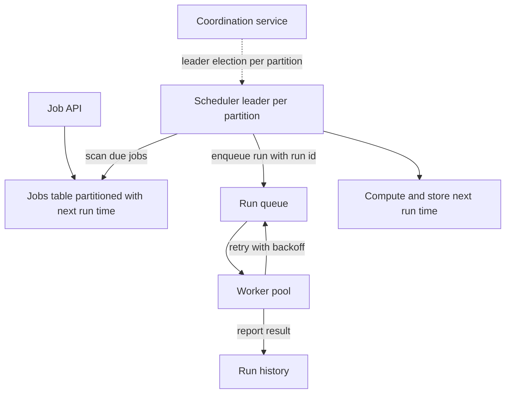

## The hook

Millions of things must happen at a time in the future: send this reminder at 9:00, generate this invoice on the 1st, retry this payment in 30 minutes, clean up these files every night.

On one server, cron does it. Then the server dies at 1:59 and the 2:00 billing job never runs. So you run cron on two servers. Now the billing job runs twice and every customer is charged twice.

The scheduler you need must never miss a run and never run one twice in a way that matters. Predict which of those two promises is possible to keep across crashes. (Only one of them, honestly, and the design is built around making the other one harmless.)

## Requirements

**Functional**
- Create, update and delete jobs: one-off at a time, or recurring by cron expression.
- Run each due job by sending it to a worker (or calling a target endpoint).
- Retries with backoff on failure; a history of runs and results.

**Non-functional**
- About 10 million job runs per day (**estimate**), with bursts on round times.
- Runs start within a few seconds of their scheduled time.
- No missed runs when nodes fail; duplicate dispatch must not cause duplicate effects.

:::analogy
Think of **an alarm clock that wakes the right worker**. The clock room holds millions of alarms. Each wing of the building has one night watchman who walks his wing, finds alarms that are due, and wakes a worker with a ticket naming the exact alarm. If a watchman faints, another takes over his wing, and workers ignore tickets for alarms that have already been handled.
:::

## Back-of-envelope numbers

All **estimates**.

- 10,000,000 runs per day ÷ 86,400 s ≈ **116 runs per second** on average.
- If 20% of daily runs are "hourly, on the hour", each hour's top contains about 10,000,000 × 0.2 ÷ 24 ≈ **83,000 runs** due at the same minute; spread over 60 seconds that is about **1,400 per second**, more if they all expect the same second.
- Job definitions: millions of rows, small each; run history grows daily and needs retention.

## High-level design

1. Jobs are stored with their **[[schedule]]** and a precomputed `next_run_at`, partitioned (for example by job id hash).
2. Each partition has one active scheduler (elected through a coordination service with leases).
3. Every second, the scheduler queries its partition for **[[due job]]s** (`next_run_at <= now`, not yet dispatched), enqueues a run for each, and advances `next_run_at` for recurring jobs.
4. Workers take runs from the queue, execute them, and record results; failures are retried with backoff.

## Deep dives

### 1. Finding due jobs efficiently

An index on (partition, next_run_at) turns "what is due now?" into a short range scan. Alternatives for very high scale: time-bucketed tables (one bucket per minute), or a sorted structure in memory per partition for the next few minutes, refilled from the database.

### 2. One owner per partition

Two schedulers scanning the same partition would dispatch every job twice. Each partition's scheduler holds a lease from a coordination service, as in [One Key to the Shared Room, With a Numbered Tag](article:system-design-distributed-locks-sd). If it dies, the lease expires and another node takes over the partition.

### 3. The duplicate run you cannot fully prevent

Now the hook. Trace a failover:

| Time | Old leader | New leader | Effect |
|---|---|---|---|
| 02:00:00.0 | finds billing job due | | |
| 02:00:00.1 | enqueues run "billing@02:00" | | run dispatched |
| 02:00:00.2 | crashes before marking it dispatched | | database still says due |
| 02:00:15 | | gets the lease, scans, sees the job due | |
| 02:00:15.1 | | enqueues "billing@02:00" again | **duplicate dispatch** |

Never missing a run requires re-dispatching anything not confirmed. So dispatch is **at-least-once**, and duplicates are possible. The promise you *can* keep is that duplicates have no extra effect: every run carries a **[[run id]]** (job id plus scheduled time), and the worker or the target system records completed run ids and ignores repeats. At-least-once delivery plus idempotent execution gives an exactly-once *effect*, as in [A Cheque the Bank Cashes Only Once](article:system-design-exactly-once).

### 4. Retries and timeouts

Workers claim runs with a **[[visibility timeout]]**: if a worker dies mid-run, the run reappears for another worker after the timeout. Failed runs retry with exponential backoff and jitter, up to a limit, then go to a dead-letter queue with an alert.

### 5. Downtime and misfires

If the whole scheduler was down from 01:50 to 02:10, what happens to the 02:00 run? That is the **[[misfire policy]]**: run once immediately (usual for billing), run every missed occurrence (for jobs that must process each interval), or skip (for "refresh the dashboard cache").

:::insight
A scheduler cannot guarantee exactly-once dispatch across crashes, so it guarantees never missing a run by dispatching at least once, and makes duplicates harmless by giving every run an id that execution treats as an idempotency key. Partitioning with one leased leader per partition spreads the load without two schedulers firing the same job.
:::

## Trade-offs

| Decision | Choice | Trade-off |
|---|---|---|
| Dispatch guarantee | At least once | No missed runs; needs idempotent execution |
| Scan interval | About 1 second | Timely starts; more database queries |
| Partitioning | By job id hash | Even load; round-time bursts still hit every partition |
| Execution | Through a queue to a worker pool | Absorbs bursts; adds queueing delay |
| Burst handling | Jitter where allowed | Flatter load; job runs a few seconds off the round time |

:::warning
Common misconception: "a distributed lock guarantees the job runs exactly once." The lock holder can pause, lose its lease and later act anyway; or crash after dispatching but before recording. Locks reduce duplicates; idempotent runs keyed by run id are what make them harmless.
:::

:::try-this
A job "send the daily summary email at 08:00" must not email users twice even if dispatched twice, and must not be skipped if the scheduler restarts at 07:59:59. Design its run id and misfire policy. (Run id = job id + "2026-11-04T08:00"; the email service stores sent run ids per user and skips repeats. Misfire policy: run once immediately on recovery if within, say, an hour of the scheduled time, otherwise skip, because a 3 pm "morning summary" is not useful.)
:::

## What can go wrong

- **Duplicate side effects** without run-id idempotency.
- **Missed runs** when dispatch is marked done before the run is safely enqueued.
- **Thundering herds** at round times.
- **Clock skew** between scheduler nodes; use the database's or coordinator's time for due checks.
- **Poison jobs** retried forever; cap retries and dead-letter them.
- **Time zones and daylight-saving changes** in cron schedules, creating skipped or doubled local times.

### Interview follow-ups

**"How would you support 'run this one-off job in 30 seconds' at very high volume?"** Use time-bucketed queues or delay queues (messages with a visible-after time), so the queue itself releases jobs when due, rather than scanning a database.

**"How do you let users see job status?"** Store each run's state (queued, running, succeeded, failed, retrying) in the run history with timestamps and errors, and expose it through the API.

**"How would you scale to 1 billion jobs?"** More partitions with their own leaders, time-bucketed storage, and a separate path for very short delays; queues and worker pools scale out independently, as in [The Ticket Rail Between Waiters and Cooks](article:system-design-message-queues).

## Further reading

- The documentation of open-source workflow and scheduling systems, such as Apache Airflow or Quartz, on misfires and retries.
- The idempotency discussion in [The Dry Cleaner's Ticket](article:system-design-async-processing).

## Key takeaways

- A distributed scheduler stores jobs with their next run time, has one leased scheduler per partition find due jobs, and dispatches runs to a queue of workers.
- Never missing a run requires dispatching at least once, so duplicates are possible after failovers.
- Every run carries a run id (job id plus scheduled time) that execution treats as an idempotency key, making duplicates harmless.
- Visibility timeouts, retries with backoff and dead-letter queues handle failing workers and failing jobs.
- Plan for round-time bursts, misfire policies after downtime, and time-zone edge cases in recurring schedules.
