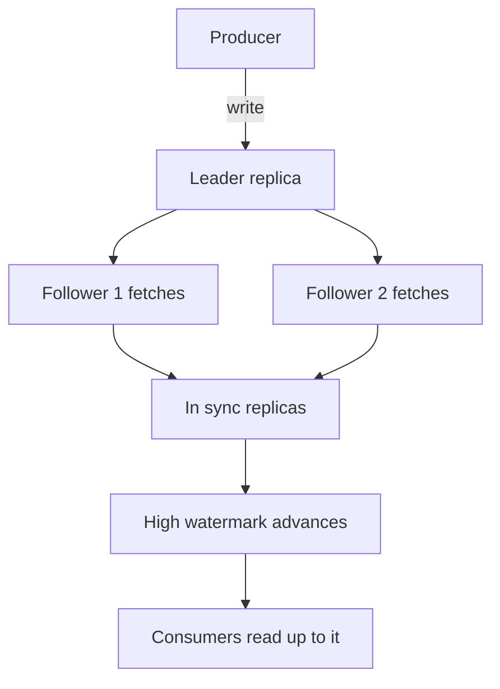

## The hook

A payments team sends every transaction event to Kafka with the producer setting `acks=1`, because it is faster, and the documentation said Kafka is replicated. One night a broker's disk controller dies mid-write. Kafka elects a new leader within seconds, exactly as designed.

The next morning, a few hundred transactions are missing from downstream systems. Each one had been acknowledged to the producer as successfully written.

Kafka was replicated. The data was not. Predict the one-word setting change that would have saved those events, and its cost. We'll come back to it with the exact timeline.

## The intuition

:::analogy
Picture **numbered notebooks copied by trusted clerks**. The head clerk writes each new line, and two assistant clerks copy it into their notebooks. A line counts as official only once every clerk who is keeping up has copied it, and readers are only shown official lines. If the head clerk faints, an assistant who copied everything takes over. But if the head clerk tells a writer "done" before anyone has copied the line, and then faints, that line was never official.
:::

- The head clerk is a partition **leader**; assistants are followers.
- Clerks keeping up form the **[[ISR]]** (in-sync replicas).
- "Official" lines are those below the **[[high watermark]]**.
- Telling the writer "done" early is **[[acks]]** = 1.

## How it works

### Logs on disk: segments

Each partition is a directory of **[[segment]]** files. New messages append to the active segment. Each segment has an offset index (offset → byte position) and a time index (timestamp → offset), so a consumer can seek to "offset 1,048,576" or "messages from 09:00" with a small lookup instead of a scan. When a segment reaches its size or age limit, a new one starts; retention deletes whole old segments.

Reads are fast because recent data usually sits in the operating system's page cache, and data can be sent from the file to the network socket without copying through the application (zero-copy).

### Replication: leader, followers, ISR

Followers continuously fetch from the leader. A follower that falls too far behind is removed from the ISR; it rejoins after catching up. The high watermark advances to the highest offset that every ISR member has.

### acks, timed

| Setting | Producer told "done" when | Risk |
|---|---|---|
| acks=0 | Message sent, no confirmation | Lost on any network or broker problem |
| acks=1 | Leader wrote it | Lost if the leader dies before followers copy it |
| acks=all | Every in-sync replica has it | Safe while at least one in-sync replica survives |

The hook, traced with acks=1:

| Time | Leader (broker 1) | Follower (broker 2) | Producer |
|---|---|---|---|
| t1 | appends offset 501 | has up to 500 | |
| t2 | | | receives ack for 501 |
| t3 | disk controller fails | has up to 500 | |
| t4 | | elected leader, log ends at 500 | |
| Result | | message 501 never existed here | believes 501 is stored |

The one-word fix from the hook: `acks=all`. Its cost is waiting for the followers, a few extra milliseconds per write.

But acks=all alone is not enough. If the ISR has shrunk to just the leader, "all in-sync replicas" means one machine. **[[min.insync.replicas]]** = 2 (with replication factor 3) makes such writes fail instead, so acknowledged data always lives on at least two brokers.

Wait, should a rejected write be considered worse than a lost one? For payments, no: a rejected write is visible and can be retried; a silently lost one is not.

### Consumer offsets

Consumer groups commit their offsets to an internal Kafka topic (`__consumer_offsets`), which is itself replicated and compacted. Committing after processing gives at-least-once; Kafka's transactions can write output messages and offsets atomically for effectively-once pipelines.

### Compaction

With **[[log compaction]]**, Kafka keeps at least the latest message per key and discards older ones, so a topic can serve as a changelog that rebuilds a table's latest state, for example in stream processing or change data capture.

:::insight
Kafka's durability is a combination of settings, not a default: data is safe once every in-sync replica has it, consumers only see data below the high watermark, and acks=all with min.insync.replicas of 2 or more guarantees an acknowledged write lives on more than one broker.
:::

## Trade-offs

| Setting | Gain | Cost |
|---|---|---|
| acks=all, min.insync.replicas=2 | No loss of acknowledged data on a single failure | Slightly higher latency; writes fail when too few replicas are in sync |
| acks=1 | Lower latency | Loss on leader failure |
| Unclean leader election allowed | Partition stays available when no in-sync replica survives | Data loss: an out-of-date replica becomes leader |
| More partitions | More parallelism | More files, leaders and recovery work |

:::warning
Common misconception: "Kafka is replicated, so acknowledged messages are always durable." With acks=1, an acknowledgement means only the leader had the message. Durability needs acks=all, enough in-sync replicas (min.insync.replicas ≥ 2) and unclean leader election disabled for critical topics.
:::

:::try-this
Replication factor 3, min.insync.replicas = 2, acks=all. One broker restarts for maintenance, and a second one falls behind and drops out of the ISR. Can producers still write to partitions whose leader is the remaining healthy broker? (No. The ISR is now just one replica, below the minimum of 2, so acks=all writes are rejected until a replica catches up. That is the intended trade: availability is sacrificed rather than accept writes stored on one machine.)
:::

## What can go wrong

- **acks=1 or acks=0 on critical data**, losing messages on leader failover.
- **min.insync.replicas = 1**, making acks=all no stronger than acks=1 when the ISR shrinks.
- **Unclean leader election**, choosing an out-of-sync replica and losing committed data.
- **Slow followers** repeatedly leaving the ISR, shrinking safety margins.
- **Too many partitions per broker**, slowing failover and recovery.
- **Committing offsets before processing**, losing messages on consumer crashes.

### Interview follow-ups

**"How does Kafka avoid duplicate messages from producer retries?"** Idempotent producers attach a producer id and sequence numbers; the broker drops duplicates of the same sequence within a partition.

**"What is the high watermark for?"** It marks data replicated to all in-sync replicas, so consumers never read data that a leader failover could remove.

**"How would you size replication for a critical topic?"** Replication factor 3 across racks or zones, min.insync.replicas = 2, acks=all, unclean leader election off; then measure the added latency.

## In the real world

- Apache Kafka is widely used for event streaming; several managed services and compatible implementations exist.
- Newer Kafka versions replace the external ZooKeeper dependency with a built-in consensus-based controller (KRaft), as described in the Kafka project documentation.

The general design these internals implement is in [Design a Distributed Message Queue](article:system-design-distributed-message-queue), and the replication ideas come from [A Teacher Dictating Notes to the Class](article:system-design-replication).

## Further reading

- The Apache Kafka documentation on replication, producer configuration and log compaction.
- Kreps, Narkhede and Rao, "Kafka: a Distributed Messaging System for Log Processing" (NetDB 2011).

## Key takeaways

- Each Kafka partition is a set of append-only segment files with offset and time indexes, deleted or compacted a whole segment at a time.
- Followers copy the leader; the in-sync replicas are those caught up, and the high watermark marks data every in-sync replica has.
- acks=1 acknowledges after the leader alone has a message, so a leader failure can lose acknowledged data; acks=all waits for every in-sync replica.
- Pair acks=all with min.insync.replicas of at least 2 and disable unclean leader election for data you cannot lose.
- Consumer offsets live in a replicated, compacted internal topic, and committing after processing gives at-least-once delivery.
