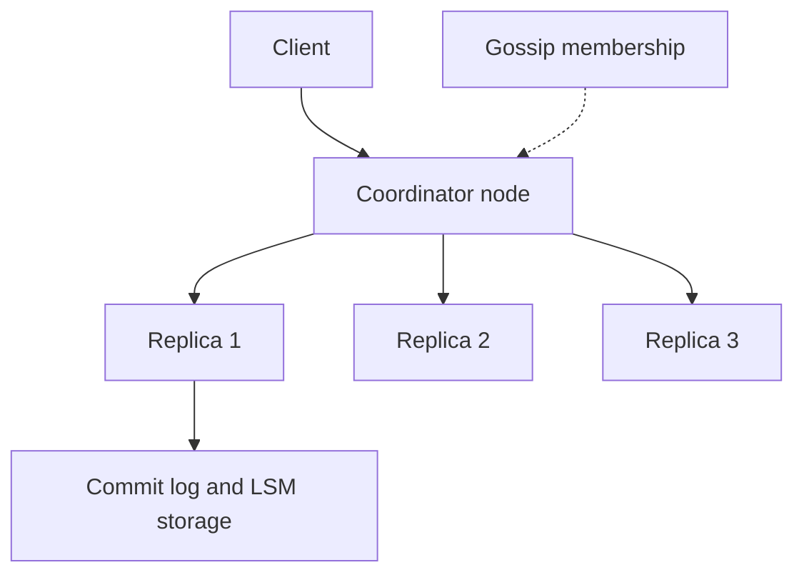

## The hook

"Design a key-value store: put(key, value) and get(key). It must survive machines dying, keep working during network problems, and handle hundreds of thousands of requests a second."

It sounds like a hash map. In an interview it is one of the hardest questions, because every answer opens three more. Where does a key live? What if that machine dies? Two clients write the same key on different machines at the same instant: which value wins? A machine was down for an hour: how does it catch up without re-copying everything?

Each of those questions has a standard answer, and you have already met most of them separately. This case study snaps them together the way Amazon's Dynamo paper (2007) did, and the way interviewers expect you to.

## Requirements

**Functional**
- `put(key, value)` and `get(key)` for small values (up to about a few KB).
- `delete(key)`.

**Non-functional**
- Highly available for writes: a shopping cart must accept "add item" even during failures. We choose availability over strict consistency (an AP design), with tunable consistency per request.
- Scales horizontally to many nodes; no single point of failure.
- Low latency: single-digit to low tens of milliseconds at high percentiles (an **estimate** of a reasonable target).
- Durable: acknowledged writes survive node crashes.

Clarify in the interview: Do we need transactions across keys? (No.) Range queries? (No, only point lookups.) Strong consistency? (Optional per request.)

:::analogy
Picture a **coat check spread across many counters** in a huge theatre. Your ticket number decides which counter holds your coat, and each coat is also hung at the next two counters along, in case one counter closes. When you collect it, the attendant checks a couple of counters and gives you the most recent one. If two attendants hung two different coats under your number at the same time, you are shown both and asked which is yours.
:::

## Back-of-envelope numbers

All numbers here are **estimates** to size the design, not measurements of any real system.

- 10 billion keys × 1 KB average value = **10 TB** of raw data.
- Replication factor 3: **30 TB** stored.
- Nodes with 4 TB disks kept 70% full hold 2.8 TB each: 30 / 2.8 ≈ 10.7, so **11 nodes for storage**.
- Traffic: 300,000 reads/s and 100,000 writes/s at peak.
- Each write goes to 3 replicas and each read to 2 (R = 2): 3 × 100,000 + 2 × 300,000 = **900,000 replica operations/s**.
- If one node handles about 50,000 such operations/s, we need 900,000 / 50,000 = **18 nodes for throughput**.
- Throughput dominates storage, so plan around **18 nodes plus headroom**, perhaps 24, so a node failure or a hot spot does not overload the rest.
- Write bandwidth into the cluster: 100,000 × 1 KB × 3 = **300 MB/s**, spread across the nodes.

## High-level design

Every node is equal: there is no master. Any node can act as **[[coordinator]]** for a request.

1. The client (or a load balancer) sends get or put to any node.
2. That node hashes the key onto the ring and finds its preference list: the first 3 distinct physical nodes clockwise.
3. It forwards the request to all 3 and waits for W = 2 write acknowledgements or R = 2 read responses.
4. Nodes learn who is alive and who owns which ranges by gossip.

On each node, writes go to a commit log (for durability) and an in-memory table, which is flushed to sorted files on disk: the LSM design in [Why Modern Databases Write So Fast](article:famous-algos-lsm-trees).

## Deep dives

### 1. Partitioning: where does a key live?

Consistent hashing with virtual nodes, as in [Seats Around a Round Table](article:system-design-consistent-hashing-sd). Adding a node moves only about 1/N of keys, and virtual nodes spread both load and a failed node's work.

### 2. Replication and quorums

N = 3 replicas per key, W = 2, R = 2. Since R + W > N, every read overlaps every completed write. The client can lower R or W per request for speed, or raise them for safety, following [Ask Enough People and Someone Heard the News](article:system-design-quorums).

Wait, why not W = 3 for maximum durability? Because then one slow or dead replica blocks every write, which breaks the "always writable" requirement.

### 3. Versions and conflicts

Two clients update the same cart on different coordinators during a network blip. Both writes succeed. Which wins?

Each value carries a **[[vector clock]]**: one counter per node that has updated it. When a get returns versions whose clocks are ordered, the store keeps the newest. When neither clock dominates, the versions are concurrent, and the store returns both as **[[sibling]]s**. The client merges them (for a cart, the union of items) and writes back a version whose clock dominates both.

| Step | Event | Version clock | Value |
|---|---|---|---|
| 1 | Write via node A | [A:1] | {book} |
| 2 | Write via A again | [A:2] | {book, pen} |
| 3a | Concurrent write via B (client had [A:1]) | [A:1, B:1] | {book, mug} |
| 3b | | [A:2] | {book, pen} |
| 4 | get returns both: neither clock dominates | siblings | |
| 5 | Client merges, writes via A | [A:3, B:1] | {book, pen, mug} |

Predict the alternative: with last-write-wins, step 4 would keep whichever version had the larger timestamp, and either the pen or the mug would silently vanish.

### 4. Handling temporary failures

If one of a key's replicas is down, a write still needs W = 2 acknowledgements. With a **sloppy quorum**, the coordinator writes to the next healthy node on the ring instead, tagged with a hint. When the original replica returns, the stand-in delivers the data: **[[hinted handoff]]**.

### 5. Repairing permanent divergence

Hints can be lost if the stand-in also dies. Two background mechanisms close the gap:

- **Read repair**: when a read sees a stale replica, the coordinator writes the newest version to it.
- **[[Anti-entropy]]**: replicas compare Merkle trees of their key ranges and copy only the ranges whose hashes differ, as in [One Fingerprint for a Billion Files](article:famous-algos-merkle-trees).

### 6. Deletes

A delete writes a **[[tombstone]]**, not an absence. Otherwise, a replica that missed the delete still holds the value, and anti-entropy would copy it back everywhere. Tombstones are purged only after every replica has had time to see them.

### 7. Membership and failure detection

Nodes gossip their view of the cluster, as in [How Rumours Keep a Thousand Servers in Sync](article:famous-algos-gossip-protocols). A node suspected dead is routed around; permanent removal is an explicit operator action, so a brief network glitch does not trigger massive data movement.

:::insight
A Dynamo-style store is a stack of simple ideas, each fixing one failure: consistent hashing decides placement, replication survives crashes, quorums tune consistency, vector clocks expose concurrent writes, hinted handoff covers short outages, and Merkle-tree anti-entropy repairs everything else.
:::

## Trade-offs

| Decision | Chosen | Gain | Give up |
|---|---|---|---|
| CAP stance | AP with tunable quorums | Writes always accepted | Possible stale reads, siblings |
| Conflict resolution | Vector clocks and siblings | No silent loss | Clients must merge |
| Leaderless | Any node coordinates | No failover step, no single point of failure | No global order of writes |
| Sloppy quorum | Yes | Writes survive replica outages | Overlap guarantee lost during failures |
| Storage engine | LSM tree | Fast writes | Read amplification, compaction cost |

If the product needs strong consistency per key, say so and change the design: a leader per partition with consensus-based replication gives linearizable keys at the cost of write availability during partitions.

:::warning
Common misconception: "use last-write-wins and the problem of conflicts goes away." It does not go away; it becomes invisible. Concurrent writes are still happening, and LWW drops all but one of them without any error. For data like carts, merge siblings; reserve LWW for data where losing a concurrent update is acceptable.
:::

:::try-this
With N = 3, W = 2, R = 2, two of a key's three home replicas lose network access. With strict quorums, can a client write? With sloppy quorums? (Strict: no, only one home replica is reachable, and W needs two. Sloppy: yes, the coordinator writes to the one reachable home replica plus the next healthy node on the ring with a hint, and hands the data back when the home replicas return.)
:::

## What can go wrong

- **Hot keys**: one very popular key overloads its three replicas. Add a cache in front or split the key.
- **Sibling explosion**: clients that never merge siblings let versions pile up. Cap siblings and alert.
- **Tombstone build-up**: deletions that are never purged slow reads; tune purge windows to repair frequency.
- **Clock-dependent features**: anything using wall-clock timestamps (TTL, LWW) breaks under clock skew; keep clocks synchronised and avoid relying on them for ordering.
- **Rebalancing storms** when nodes join: throttle data transfer.
- **Correlated failures**: all three replicas in one rack. Make the preference list skip racks or zones already used.

### Interview follow-ups

**"How would you support strong consistency for some keys?"** Offer a per-request consistency level (R = W = majority, plus read repair before returning), or route those keys to partitions that use a leader and consensus.

**"How do you add a node with no downtime?"** It joins the ring with its virtual nodes, streams the data for its new ranges from current owners, then takes over ownership; clients learn the new ring through gossip.

**"Why a commit log if data is replicated?"** Replication protects against one machine dying; the local log protects against a power loss on all of them, and lets a restarted node recover its in-memory writes, the idea in [Write It in the Ledger Before You Hand Over the Cash](article:famous-algos-write-ahead-log).

**"How do reads find a key quickly on disk?"** Per-file Bloom filters skip files that cannot contain the key, as in [The Data Structure That Is Allowed to Lie](article:famous-algos-bloom-filter).

## Further reading

- DeCandia et al., "Dynamo: Amazon's Highly Available Key-value Store" (SOSP 2007).
- The Apache Cassandra architecture documentation (ring, consistency levels, hinted handoff, repair).
- The leaderless replication section of Martin Kleppmann's *Designing Data-Intensive Applications*.

## Key takeaways

- A Dynamo-style key-value store has no master: consistent hashing with virtual nodes places each key, and any node can coordinate a request to the key's replicas.
- Replicating to N nodes with read and write quorums (R + W > N) lets each request trade latency against consistency.
- Vector clocks detect concurrent writes, and keeping siblings for the client to merge avoids the silent loss of last-write-wins.
- Hinted handoff covers short outages, while read repair and Merkle-tree anti-entropy repair any remaining divergence; deletes are tombstones so repair cannot resurrect old values.
- The design deliberately chooses availability over strict consistency; say so, and explain how you would offer stronger guarantees where the product needs them.
