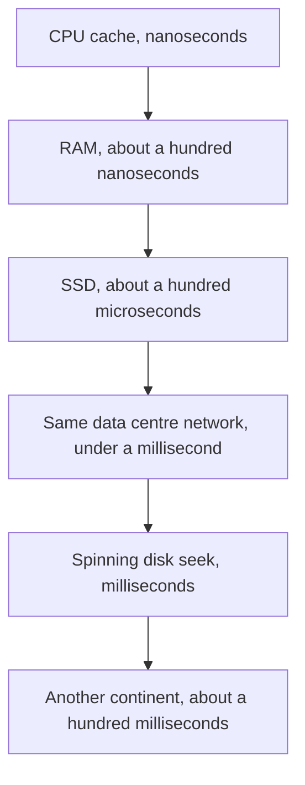

## The hook

Nanoseconds, microseconds, milliseconds: the words blur together, and so do the numbers. That blur hides the most important fact in system design. A trip to another continent is not "a bit slower" than reading memory. It is roughly a million times slower.

Scale the numbers to human time and the blur disappears. If reading from the CPU's fastest cache took one second, a single network request across the world would take about five years.

## The intuition

:::analogy
Think of fetching a tool while working at a bench. The tool on your belt takes a second. The one on the shelf behind you takes a minute or two. The one in the shed takes a day. The one you must order from another country takes years. A fast system keeps the tools it needs on its belt, and plans carefully around anything that has to come from far away.
:::

Each level of storage and network is a different distance. Good designs keep hot data close, a principle called [[locality]], and avoid making users wait on the far levels more than once.

## Let's build it up

### The ladder, scaled to human time

The numbers below are **approximate orders of magnitude**. They vary with hardware and setup and drift over the years; the gaps between levels are what to remember. The right column multiplies each one by a billion, so one nanosecond becomes one second.

| Operation | Rough [[latency]] | If 1 ns were 1 second |
|---|---|---|
| CPU cache (L1) read | about 1 ns | 1 second |
| Main memory (RAM) read | about 100 ns | under 2 minutes |
| Read from a fast SSD (random) | about 100 µs | about a day |
| [[Round trip]] inside one data centre | about 0.5 ms | about 6 days |
| Disk seek on a spinning hard drive | about 10 ms | about 4 months |
| Round trip between continents | about 150 ms | about 5 years |

The pattern: memory is about 100 times slower than cache, the network inside a data centre is thousands of times slower than memory, and crossing an ocean is hundreds of times slower again.

:::insight
Every big design trick is about avoiding the slow levels. Caches avoid the database. CDNs avoid crossing oceans. Batching avoids many round trips. Replicas in each region avoid sending reads abroad. When you add a component, ask which slow level it saves you from.
:::

### Latency adds up; throughput multiplies

[[Throughput]] is how many operations finish per second; latency is how long each one takes. They are different. A cross-continent link can carry enormous throughput while each request still takes 150 ms.

Sequential steps add their latencies. If rendering a page makes 10 database queries one after another, each taking about 1 ms, that is about 10 ms. If those queries go to another region at about 100 ms each, it is about a second. Making calls in parallel, or combining them into one request, cuts the waiting back down.

### Sequential versus random

The same device can be fast or slow depending on the access pattern. Reading a large file straight through is far quicker than jumping to random spots, because hardware prefetches what comes next. This is why databases append to logs, why LSM trees write in big sorted batches, and why analytics systems store columns contiguously: they turn random access into sequential access.

### The slow few: tail latency

Averages hide pain. If 1 in 100 requests takes 2 seconds, the average looks fine but one user in a hundred waits, and a page that makes 100 backend calls is now likely to hit at least one slow one. That is why engineers track [[tail latency]], like the 99th percentile, not just the mean.

:::warning
Common misconception: "these are exact numbers to quote." They are not. Hardware differs, and the classic tables from the 2000s and 2010s have shifted, especially for SSDs and networks. Quote orders of magnitude, and say "roughly". What interviewers check is that you know which level is ten times or a thousand times slower than another.
:::

## A tiny example

A product page in India calls a pricing service hosted in the United States. Each call is a round trip of roughly 200 ms (an estimate). The page makes 5 such calls one after another.

- Sequential waiting: 5 × 200 ms ≈ **1 second** before the page can render.
- Make the 5 calls in parallel: about **200 ms**.
- Cache the prices in an Indian region, refreshed every minute: a local cache read is a fraction of a millisecond plus a short in-region hop, so the page waits **a few milliseconds**.

Three versions of the same feature, with waits that differ by a factor of hundreds. Nothing about the code's logic changed, only where the data lives and how calls are arranged.

:::try-this
Estimate how many sequential in-region database queries (about 1 ms each) fit inside a 100 ms page budget, leaving 40 ms for rendering. Then estimate how many cross-continent calls fit. (About 60 local queries, but under one cross-continent call. That is why designs keep user-facing reads in the user's region.)
:::

## Where you'll see this again

These numbers justify almost every component in the building blocks track: caching, CDNs, replicas and queues. They pair with [back-of-envelope estimates](article:system-design-back-of-envelope): estimates tell you how much traffic you have, and latencies tell you how long each request will take. The next article follows a single request from your browser to a server and back, adding up exactly these costs.

## Key takeaways

- Storage and network levels differ by orders of magnitude: cache, memory, SSD, data centre network, disk seek and intercontinental links.
- Scaling nanoseconds to seconds makes the gaps intuitive: a cross-continent round trip is years compared with a cache read's second.
- Latencies of sequential calls add up, so parallel calls, batching and caching close to users cut waiting dramatically.
- Throughput and latency are different, and tail latency matters because slow outliers hit many users at scale.
- Quote these numbers as approximate orders of magnitude; the ratios between levels are what guide design.
