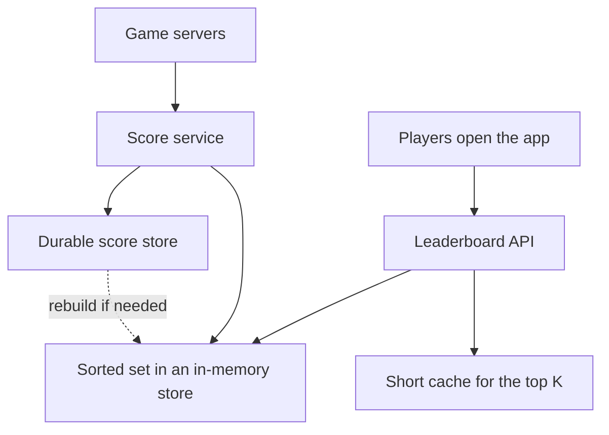

## The hook

A mobile game runs a weekly tournament for 50 million players. Every finished match updates a score. Every player opens the app to see the top 10 and "you are #3,503". In the last minute of the tournament, everyone plays one more match and checks their rank again.

The first version keeps scores in a relational table and runs `SELECT COUNT(*) FROM scores WHERE score > ?` for every rank request. It is correct. In the final minute, the database is on its knees.

Predict how many steps a well-chosen data structure needs to find one player's rank among 50 million. (About 26, and the reason is the same as binary search.)

## Requirements

**Functional**
- Update a player's score after each match.
- Show the top K players (say top 10 or 100).
- Show a player's own rank and the players just above and below them.
- Weekly or seasonal leaderboards, plus friends-only boards.

**Non-functional**
- Ranks update within seconds.
- Low latency reads under huge spikes at the end of a tournament.
- Scores are never lost; the board can be rebuilt from the score history.

:::analogy
A stadium **scoreboard reorders itself as points come in**. Nobody recounts every team's points to show the standings; the board keeps teams in order, and when one team scores, it just slides up a few places.
:::

## Back-of-envelope numbers

All **estimates**.

- 50 million players × 5 matches a day ÷ 86,400 s ≈ **2,900 score updates per second** on average; many times more in the final minutes.
- Rank and top-K reads: several per match, plus app opens, so reads exceed writes.
- Memory: 50 million members at roughly 100 bytes each in an in-memory sorted set ≈ **5 GB**: fits on one large cache node, with replicas.
- Rank lookup in a balanced structure: log₂(50,000,000) ≈ **26 steps**.

## High-level design

1. Game servers report match results to the score service (never trust scores sent directly by the client).
2. The service writes the score durably and updates the **[[sorted set]]**.
3. The leaderboard API answers top-K, rank and neighbourhood queries from the sorted set, with the top K cached for a second or two.

## Deep dives

### 1. Sorted sets do the heavy lifting

An in-memory sorted set (Redis sorted sets are the classic example, built on skip lists) keeps members ordered by score:

| Operation | Typical command | Cost |
|---|---|---|
| Add or update score | ZADD / ZINCRBY | O(log n) |
| Player's **[[rank]]** | ZREVRANK | O(log n) |
| **[[Top-K query]]** | ZREVRANGE 0 K−1 | O(log n + K) |
| Neighbours around a player | ZREVRANGE rank−5 rank+5 | O(log n + 10) |
| Count of players above a score | ZCOUNT | O(log n) |

That is the answer to the hook: about 26 steps for 50 million players, instead of counting rows.

### 2. Ties

Equal scores need a **[[tie-breaking]]** rule, and it must live in the sort key. A common trick encodes score and time together, for example score × 10¹⁰ + (MAX_TIME − time_reached), so equal scores order by who got there first. Predict the bug without this: two players with the same score swap places every time either one is updated.

### 3. Sharding without losing global rank

One sorted set of 50 million fits in memory, but suppose the game grows to 500 million, or the single node cannot take the write rate. Options:

- **Shard by user id** (hash): writes spread evenly. A global rank becomes a fan-out: rank = 1 + Σ over shards of count(score > s). With 3 shards answering 1,204, 987 and 1,311 players above score s, the global rank is 1 + 3,502 = **3,503**. Top K merges each shard's top K.
- **Shard by score range**: each shard holds a band of scores, so a rank is the counts of all higher bands plus the rank within the player's band. But the top band is a hot spot, and players move between shards as scores change.
- **Approximate ranks with [[score bucket]]s**: keep counts per score bucket; for players far from the top, "about #2.3 million" is good enough and costs one bucket lookup.

Wait, why is exact rank so valuable near the top but not lower down? Because players near the top compete for prizes and check obsessively, while nobody notices whether they are #2,301,442 or #2,301,450. Exact where it matters, approximate where it does not, is a common product decision.

### 4. Many leaderboards

Weekly boards use a key per week (`lb:2026-w45`) with an expiry after the season. Friends-only boards are small: fetch friends' scores and sort on the fly, or keep a small sorted set per user for very active social games.

:::insight
A leaderboard is a sorted set problem: keep players ordered by score so updates, ranks and top-K are all logarithmic. Encode tie-breaking in the score, persist scores durably so the set can be rebuilt, and when one node is not enough, shard by user and compute global ranks by summing counts across shards.
:::

## Trade-offs

| Decision | Choice | Trade-off |
|---|---|---|
| Store | In-memory sorted set plus durable store | Fast reads and writes; must rebuild after loss |
| Sharding | By user id | Even writes; rank needs a fan-out across shards |
| Exactness | Exact for top tiers, bucketed beyond | Cheap at scale; lower ranks are approximate |
| Freshness | Cache top K for 1 to 2 seconds | Absorbs spikes; ranks lag slightly |
| Score source | Server-side validation only | Prevents cheating; game servers must report results |

:::warning
Common misconception: "a database with an index on score handles ranks fine." It handles top-K well, but "how many players are above me" for millions of players at thousands of requests per second means walking large parts of the index. Sorted sets keep counts in their structure so rank is logarithmic.
:::

:::try-this
At the final second of the tournament, 2 million players request their rank within 10 seconds. With 3 replicas of the sorted set, each answering about 100,000 rank queries per second (an estimate), is that enough, and what else helps? (2,000,000 ÷ 10 s = 200,000 per second against 300,000 capacity: enough, with little margin. Also cache each player's rank briefly after their last match, serve the top K from a cache, and show the final official ranks a few seconds after the tournament closes rather than live.)
:::

## What can go wrong

- **Cheating** if clients report their own scores.
- **Losing the in-memory set** without a durable source to rebuild from.
- **Hot keys**: everyone reading the same top-K; cache it.
- **Ties flickering** without a stable tie-break rule.
- **Score-range shards** creating hot spots at the top.
- **End-of-season spikes** without pre-scaled replicas.

### Interview follow-ups

**"How would you show a player's rank among their friends?"** Fetch their friends' scores (usually a few hundred) from the sorted set or score store and sort them in the API; no global structure is needed.

**"How would you reset weekly?"** Write to a new key per week and let old keys expire; the reset is just switching which key the API reads.

**"What if Redis is down?"** Serve the last cached top K, temporarily hide personal ranks, and rebuild the sorted set from the durable score store, as in [A Shared Whiteboard the Whole Fleet Can Read](article:system-design-distributed-cache).

## Further reading

- The Redis documentation on sorted sets and their commands.
- William Pugh, "Skip Lists: A Probabilistic Alternative to Balanced Trees" (Communications of the ACM, 1990).

## Key takeaways

- A leaderboard needs ordered scores with fast updates, ranks and top-K queries, which an in-memory sorted set provides in about O(log n).
- Scores must come from trusted servers and be stored durably so the in-memory board can be rebuilt.
- Tie-breaking rules belong in the sort key, for example combining score with the time it was reached.
- When sharding by user, a global rank is one plus the sum of each shard's count of higher scores, and top K merges each shard's top K.
- Exact ranks matter near the top; lower ranks can be approximated with score buckets to save work at huge scale.
