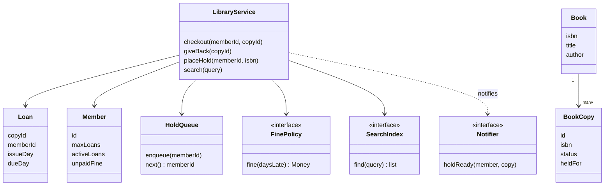

## The hook

Exam week. You search the college library app for *Introduction to Algorithms*. It says "Not available". You place a hold, sigh, and go back to your notes.

The next day your friend walks in, finds a copy sitting on the shelf, and borrows it in two minutes. The library owned two copies all along. The app was not broken in any way you could see. It simply had one checkbox called `available` on the book, and when the first copy went out, it unticked it.

That checkbox is the most common mistake in this machine coding problem. Before we fix it, here is the real question: what does a library system have to remember so that it never lies about its shelves, never loses track of who has what, and treats the people waiting fairly?

## Requirements

Clarify first, as [Build the Model House One Room at a Time](article:system-design-machine-coding-approach) recommends, and write the answers down.

**Functional**

- Add titles to the catalogue and physical copies of each title.
- Members borrow and return copies. Each member has a loan limit.
- A loan lasts a fixed period. Late returns create a fine.
- A member with unpaid fines above a threshold cannot borrow.
- Members can place a hold on a title when no copy is free; a returned copy goes to the first person waiting.
- Search by title words, author or ISBN, showing how many copies are free.

**Example rules for this article** (yours will differ, which is the point of making them swappable): a 14-day loan, at most 2 loans per member, Rs 5 per late day, and borrowing blocked once unpaid fines reach Rs 50.

**Non-functional**

- Two desks can serve members at the same moment without lending one copy twice.
- Fine rules, loan limits and search can change without rewriting the lending code.
- Testable with a fake calendar, so a test can jump to day 30 without waiting a month.

**Out of scope, said out loud:** payments integration, e-books, inter-library loans. You will mention them as extensions.

:::analogy
Picture an old **librarian's card catalogue**: a wooden cabinet of drawers with one card per title. The card says what the book *is*. Stapled behind it, there is a small slip for every physical copy, each with its own number and a pencil mark for "out" or "in". The librarian answers "do we have it?" by flipping through the slips, never by looking at the card alone. A queue of names clipped to the card says who is waiting. Every class in this design is a part of that drawer.
:::

## Core objects

Underline the nouns and give each one a single job:

- **Book**: the [[catalogue record]]. ISBN, title, author. No status of any kind.
- **BookCopy**: one [[book copy]] on a shelf. Copy id, ISBN of its title, status (available, loaned, on hold, lost).
- **Member**: id, membership type, loan limit, active loan count, unpaid fines.
- **Loan**: the [[loan]] record linking a member, a copy, an issue day and a due day.
- **HoldQueue**: the [[hold queue]] of members waiting, one queue per title.
- **FinePolicy**: the [[fine policy]] that turns lateness into money.
- **SearchIndex**: answers search queries.
- **Notifier**: tells a member their held copy is ready.
- **LibraryService**: the front desk that coordinates checkout, return and hold.

Wait, why is the hold queue per title and not per copy? Because a waiting member wants *any* copy of the book. If Ravi queues on copy A1 while copy A2 comes back first, a per-copy queue makes him wait for nothing. The card catalogue clips the waiting list to the card, not to a slip.

## Class design



### Why two classes for one book

Predict the bug before you read on. A library stores `Book.available = true or false`. It owns two copies of a title. Copy 1 goes out, and the flag becomes false. What does a search show now, and what happens when copy 1 returns while copy 2 is still out?

The search says "not available" while copy 2 sits on the shelf. That is the hook. And when copy 1 comes back, the flag flips to true, which happens to be right, but only by luck. Add a lost copy or a hold and the flag is wrong in both directions.

The fix is the drawer in the analogy. The card (Book) never carries a status. Each slip (BookCopy) carries its own, and availability is a count over the slips. You never store what you can compute from the truth.

:::insight
Separate the thing people search for from the thing people carry out of the building. Titles are described once; copies are lent, held, lost and returned one at a time, so every status, loan and hold attaches to a copy or a queue, never to the title.
:::

### The skeletons

```pseudo
enum CopyStatus: AVAILABLE, LOANED, ON_HOLD, LOST

class Book:           isbn, title, author                 // no status here
class BookCopy:       id, isbn, status, heldFor
class Member:         id, maxLoans, activeLoans, unpaidFine
class Loan:           copyId, memberId, issueDay, dueDay

interface FinePolicy:
    fine(daysLate) -> Money

class PerDayFine implements FinePolicy:
    fine(daysLate): RATE * max(0, daysLate)               // example: Rs 5 per day

class LibraryService:
    constructor(catalogue, copies, members, finePolicy, searchIndex, notifier, calendar)

    checkout(memberId, copyId):
        member = members[memberId]; copy = copies[copyId]
        if member.unpaidFine >= FINE_BLOCK: refuse "unpaid fines"
        if member.activeLoans >= member.maxLoans: refuse "loan limit"
        if copy.status == LOANED: refuse "on loan"
        if copy.status == ON_HOLD and copy.heldFor != memberId: refuse "held for someone else"
        if copy.status == ON_HOLD: holds[copy.isbn].removeFront()
        copy.status = LOANED; copy.heldFor = NONE
        member.activeLoans += 1
        loans[copyId] = Loan(copyId, memberId, today, today + LOAN_DAYS)

    giveBack(copyId):
        loan = loans.remove(copyId) or fail "no open loan"     // closes exactly once
        member = members[loan.memberId]
        member.activeLoans -= 1
        member.unpaidFine += finePolicy.fine(today - loan.dueDay)
        queue = holds[copy.isbn]
        if queue not empty:
            copy.status = ON_HOLD; copy.heldFor = queue.front()
            notifier.holdReady(queue.front(), copy)
        else:
            copy.status = AVAILABLE

    placeHold(memberId, isbn):
        holds[isbn].append(memberId)

    search(word):
        for each isbn in searchIndex.find(word):
            free = count copies of isbn with status AVAILABLE
            report (title, free, total)
```

Notice the order of checks in `checkout`. The member rules come first, the copy rules second. Wait, why does order matter? Because the error message is a product decision: a blocked member should hear "pay your fine" even when the copy is also out, since paying is the only thing they can act on.

## Key flows

### Two weeks at the desk, traced

The demo library has *Clean Code* with copies C1 and C2, and *Introduction to Algorithms* with one copy, A1. Members Asha and Ravi each have a limit of 2 loans. Days are numbered from the start of term.

| Day | Event | Rule that decides | Result |
|---|---|---|---|
| 1 | Asha borrows A1 | all checks pass | due day 15 |
| 2 | Ravi asks for A1 | copy is loaned | refused: A1 is on loan |
| 2 | Ravi places a hold on the title | append to queue | queue size 1 |
| 3 | Asha borrows C1 | all checks pass | due day 17 |
| 4 | Asha asks for C2 | 2 active loans, limit 2 | refused: loan limit |
| 20 | Asha returns A1 | 5 days late × Rs 5; queue not empty | fine Rs 25, A1 held for Ravi |
| 21 | Asha asks for A1 | held for someone else | refused |
| 22 | Ravi borrows A1 | he is the holder | due day 36, hold removed |
| 30 | Asha returns C1 | 13 days late × Rs 5 | fine Rs 65, total owed Rs 90 |
| 31 | Asha asks for C2 | Rs 90 is at least Rs 50 | blocked: unpaid fine |
| 31 | Asha pays, asks again | all checks pass | due day 45 |
| 31 | Search "code" | count C1, C2 | *Clean Code*, 1 of 2 free |

Before you look at day 21, guess: Asha has only one loan open and A1 is physically back on the counter. Why is she refused? Because the copy is not *available*, it is *on hold*. A system that only knows "loaned or not" would hand Ravi's book to whoever reached the desk first.

:::try-this
Change one rule: the fine is capped at Rs 40 per loan. Replay days 20 and 30. Is Asha still blocked on day 31? (Day 20 gives Rs 25, day 30 gives min(65, 40) = Rs 40, so she owes Rs 65, which is still at least Rs 50. She is still blocked, and the only class that changed was the fine policy.)
:::

### The race for the last copy

Two desks, one copy left. Desk 1 reads C2's status as available. Desk 2 reads the same. Both mark it loaned and both print a slip. One student leaves with the book; the other leaves with a slip for a book that is not there.

You have seen this bug before in the parking lot: the gap between check and act. The card catalogue never has it, because only the librarian holding the drawer writes on a slip. In code, the drawer is a lock or an atomic claim:

| Option | How | Good for |
|---|---|---|
| One lock around checkout, return and hold | The service's three write methods share a mutex | A single desk process; simplest and obviously correct |
| Per-copy compare-and-set | Flip status from AVAILABLE to LOANED only if it is still AVAILABLE | Many desks, few conflicts |
| Conditional update in a database | Update the copy row where id matches and status is available, then check one row changed | The real multi-branch system |

Return and hold assignment must sit inside the same protected step. If a return releases the copy to AVAILABLE and *then* checks the queue, a walk-in can grab it in between, and the person who waited longest loses.

### The code

The program below implements the skeletons with a per-day fine policy and replays the traced table. A single-threaded demo needs no lock; the comments mark where one would go.

```cpp
#include <bits/stdc++.h>
using namespace std;

enum class CopyStatus { AVAILABLE, LOANED, ON_HOLD };

struct Book { string isbn, title, author; };                  // the catalogue card
struct BookCopy { string id, isbn; CopyStatus status = CopyStatus::AVAILABLE; string heldFor; };
struct Loan { string copyId, memberId; int issueDay, dueDay; };
struct Member { string id; int maxLoans; int activeLoans = 0; int unpaidFine = 0; };

struct FinePolicy {
    virtual int fine(int daysLate) const = 0;
    virtual ~FinePolicy() = default;
};
struct PerDayFine : FinePolicy {                              // example rule: Rs 5 per late day
    int fine(int daysLate) const override { return 5 * max(0, daysLate); }
};

struct Library {
    static const int LOAN_DAYS = 14, FINE_BLOCK = 50;
    map<string, Book> books;                                   // isbn -> card
    map<string, BookCopy> copies;                              // copy id -> physical copy
    map<string, Member> members;
    map<string, Loan> loans;                                   // copy id -> open loan
    map<string, deque<string>> holds;                          // isbn -> waiting member ids
    unique_ptr<FinePolicy> finePolicy = make_unique<PerDayFine>();

    // In a multi-desk version, checkout, giveBack and placeHold hold one mutex.
    string checkout(const string& mid, const string& cid, int day) {
        Member& m = members.at(mid);
        BookCopy& c = copies.at(cid);
        if (m.unpaidFine >= FINE_BLOCK) return mid + " blocked: unpaid fine Rs " + to_string(m.unpaidFine);
        if (m.activeLoans >= m.maxLoans) return mid + " refused: loan limit " + to_string(m.maxLoans);
        if (c.status == CopyStatus::LOANED) return cid + " is on loan";
        if (c.status == CopyStatus::ON_HOLD && c.heldFor != mid) return cid + " is held for " + c.heldFor;
        if (c.status == CopyStatus::ON_HOLD) holds[c.isbn].pop_front();
        c.status = CopyStatus::LOANED; c.heldFor = "";
        m.activeLoans++;
        loans[cid] = {cid, mid, day, day + LOAN_DAYS};
        return mid + " borrows " + cid + ", due day " + to_string(day + LOAN_DAYS);
    }
    string placeHold(const string& mid, const string& isbn) {
        holds[isbn].push_back(mid);
        return mid + " holds " + books.at(isbn).title + ", queue size " + to_string(holds[isbn].size());
    }
    string giveBack(const string& cid, int day) {
        Loan loan = loans.at(cid);
        loans.erase(cid);
        Member& m = members.at(loan.memberId);
        m.activeLoans--;
        int fine = finePolicy->fine(day - loan.dueDay);
        m.unpaidFine += fine;
        BookCopy& c = copies.at(cid);
        string out = loan.memberId + " returns " + cid + ", fine Rs " + to_string(fine);
        auto& q = holds[c.isbn];
        if (!q.empty()) {                                      // next in queue gets this copy
            c.status = CopyStatus::ON_HOLD; c.heldFor = q.front();
            out += ", now held for " + q.front();
        } else c.status = CopyStatus::AVAILABLE;
        return out;
    }
    string search(const string& word) {
        string out = "search '" + word + "':";
        for (auto& [isbn, b] : books) {
            string t = b.title; transform(t.begin(), t.end(), t.begin(), ::tolower);
            if (t.find(word) == string::npos) continue;
            int total = 0, free = 0;
            for (auto& [id, c] : copies) if (c.isbn == isbn) { total++; free += c.status == CopyStatus::AVAILABLE; }
            out += " " + b.title + " (" + to_string(free) + " of " + to_string(total) + " free)";
        }
        return out;
    }
};

int main() {
    Library lib;
    lib.books["111"] = {"111", "Clean Code", "Robert C. Martin"};
    lib.books["222"] = {"222", "Introduction to Algorithms", "Cormen et al."};
    lib.copies["C1"] = {"C1", "111"}; lib.copies["C2"] = {"C2", "111"}; lib.copies["A1"] = {"A1", "222"};
    lib.members["asha"] = {"asha", 2}; lib.members["ravi"] = {"ravi", 2};

    cout << "day 1:  " << lib.checkout("asha", "A1", 1) << "\n";   // due day 15
    cout << "day 2:  " << lib.checkout("ravi", "A1", 2) << "\n";   // on loan
    cout << "day 2:  " << lib.placeHold("ravi", "222") << "\n";    // queue size 1
    cout << "day 3:  " << lib.checkout("asha", "C1", 3) << "\n";   // due day 17
    cout << "day 4:  " << lib.checkout("asha", "C2", 4) << "\n";   // loan limit 2
    cout << "day 20: " << lib.giveBack("A1", 20) << "\n";          // Rs 25, held for ravi
    cout << "day 21: " << lib.checkout("asha", "A1", 21) << "\n";  // held for ravi
    cout << "day 22: " << lib.checkout("ravi", "A1", 22) << "\n";  // due day 36
    cout << "day 30: " << lib.giveBack("C1", 30) << "\n";          // Rs 65
    cout << "day 31: " << lib.checkout("asha", "C2", 31) << "\n";  // blocked, Rs 90
    lib.members["asha"].unpaidFine = 0;                            // Asha pays at the desk
    cout << "day 31: " << lib.checkout("asha", "C2", 31) << "\n";  // due day 45
    cout << "day 31: " << lib.search("code") << "\n";              // 1 of 2 free
    cout << "day 31: " << lib.search("algorithms") << "\n";        // 0 of 1 free
}
```

It prints, among other lines, `asha returns A1, fine Rs 25, now held for ravi` and `search 'code': Clean Code (1 of 2 free)`. To keep it short, the demo passes the day into each call; in the full design an injected calendar supplies "today", and the search scans titles instead of using an index.

## Patterns used

| Pattern | Where | Why it earns its place |
|---|---|---|
| Strategy | FinePolicy | Per day, capped, free for faculty, double during exams: the rule changes every semester |
| Strategy | Loan limit by membership type | Students, faculty and alumni differ; a `MembershipType` object supplies limit and loan days |
| Strategy | SearchIndex | A title scan for the demo, an [[inverted index]] for a real catalogue, a search engine later |
| Observer | Notifier on hold ready | Email, SMS and the app can all listen without the return flow knowing them |
| State, lightly | CopyStatus | Checkout and return behave differently per status; an enum is enough until rules per state grow |
| Repository | Books, copies, members, loans | The service talks to interfaces, so a test uses maps and production uses a database |

:::warning
Common misconception: "A Book class with a `copies` count is enough." A count tells you how many exist, not which one Asha has, which one is damaged, or which one is set aside for Ravi. Loans and holds need an identity to point at, so every physical copy must be its own object with its own id.
:::

## Extensions

### Search that scales

The demo scans every title. A real catalogue keeps an inverted index: lowercase each title and author, split into words, and map each word to a set of ISBNs. A query for "clean code" intersects the sets for "clean" and "code". Adding a title costs one insert per word; a search costs one lookup per query word instead of a scan of the whole catalogue.

Keep the index behind the `SearchIndex` interface. The lending code never knows whether search is a map, a database query or a separate service.

### Holds that expire

Remember the analogy: the name clipped to the card is a promise, not a forever. If Ravi never comes, A1 should not sit behind the counter all term. Give each held copy a pickup deadline (say 3 days). A daily job, or a check on the next checkout, moves expired holds to the next person in the queue or back to the shelf. This is the same "lock with a timeout" idea that seat holds use in [Design a Movie Ticket Booking System](article:system-design-bookmyshow-lld).

### Edge cases worth naming

- **Return of a copy with no open loan:** reject it and log it; never create a negative loan count.
- **Member already has a hold on the title:** refuse a second hold, or the queue serves them twice.
- **Member already holds a copy of the title:** refuse a hold on the same title.
- **Lost copy:** mark it LOST, close the loan with a replacement charge, and remove it from the free count.
- **Renewal:** allowed only if nobody is waiting in the hold queue, otherwise renewing starves the queue.
- **Holiday on the due day:** the calendar, not the loan, decides the next working day.

### Common mistakes

- Storing status on the title (the hook).
- Putting fine arithmetic inside `giveBack`, so every rule change edits the return flow.
- Releasing a returned copy to the shelf before checking the hold queue.
- Reading the system clock directly, which makes "13 days late" untestable.
- A `Library` class that searches, lends, fines, emails and prints reports: a god class with five reasons to change.

### Interview follow-ups

**"How would you support multiple branches?"** Give each BookCopy a `branchId`. Search reports free copies per branch; a hold can be "any branch" or "my branch", and a transfer becomes a new copy status, IN_TRANSIT. The title stays one catalogue record across all branches.

**"How do you make the fine rule different for faculty?"** Pick the policy from the member's membership type: a small factory maps `FACULTY` to a no-fine policy and `STUDENT` to the per-day one. Loans never ask "who is this member?"; they ask the policy for a number.

**"What if two members place holds at the same instant?"** The queue append happens under the same lock as return and checkout, so the order is whatever order the lock grants. Both are served, one after the other; nobody is lost.

**"How do you test the day-30 fine without waiting?"** Inject a calendar. The test sets it to day 3, checks out C1, sets it to day 30, returns C1 and asserts Rs 65.

The next problem in this track keeps the same discipline of small classes but adds turns, dice and a winner: [Design Board Games: Snake and Ladder, Tic-Tac-Toe](article:system-design-snake-ladder-tictactoe).

## Key takeaways

- A library design keeps the catalogue record for a title separate from the physical copies, and every status, loan and hold attaches to a copy or a queue, never to the title.
- Availability is computed by counting copies whose status is available, so the system cannot drift into saying "not available" while a copy sits on the shelf.
- The return flow must check the hold queue and assign the copy in the same protected step, or a walk-in can take the book from the person who waited longest.
- Fine rules, loan limits and search sit behind small interfaces, so a new semester's rules arrive as a new strategy instead of edits to lending code.
- Checkout and return change shared state, so they run under one lock or an atomic claim, exactly like the spot claim in a parking lot.
