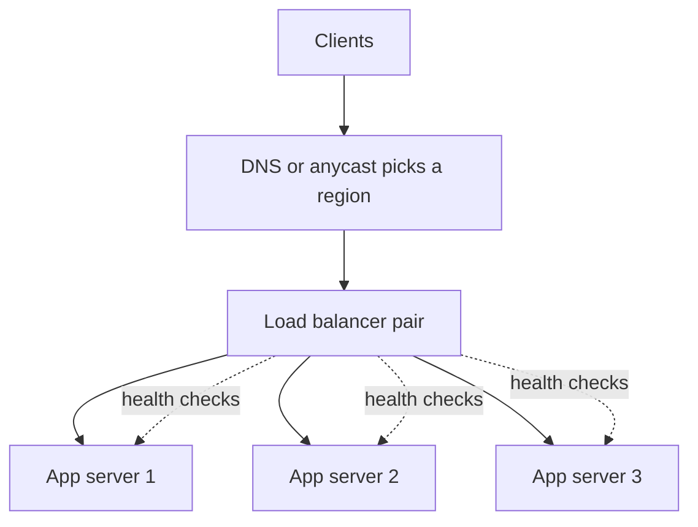

## The hook

One server can handle so many requests per second. Your app needs ten times that. So you run ten servers. But users type one address, not ten. Something has to stand at the front door, take every request, and decide which server gets it, quickly, fairly, and without sending anyone to a server that just crashed.

That something is a load balancer. It is usually the first box drawn in any system design, and the one interviewers poke at first, and getting its details right is what turns "we have ten servers" into "we survive one of them dying at peak".

## The intuition

:::analogy
Think of the host at a busy restaurant. Guests do not pick their own table; the host looks at which waiters are busy, skips the section whose waiter just went home sick, keeps regulars with the waiter who knows their order, and makes sure no single waiter is swamped while another stands idle.
:::

The host is the [[load balancer]]. Waiters are servers. Checking who went home sick is a [[health check]]. Keeping regulars with the same waiter is a [[sticky session]].

## How it works

### Where it sits

Clients connect to the load balancer's address. It forwards each connection or request to one healthy server in its pool, and returns the response. Large systems often have several layers: DNS or anycast spreads users across regions, an edge balancer spreads across clusters, and internal balancers spread traffic between microservices.

### Layer 4 vs Layer 7

- **[[Layer 4 load balancing]]** works on TCP or UDP connections using addresses and ports. It is very fast and protocol-agnostic, but cannot see URLs or headers.
- **[[Layer 7 load balancing]]** terminates HTTP (and often TLS), reads the request, and can route by path, host, header or cookie: `/api` to the API pool, `/static` to a cache. It can also retry, rewrite and add headers, at a higher cost per request.

### The algorithms

| Algorithm | How it picks | Good for |
|---|---|---|
| Round robin | next server in turn | identical servers, similar requests |
| Weighted round robin | in turn, more often for bigger servers | mixed server sizes |
| Least connections | fewest active connections | long or uneven requests |
| Power of two choices | two random servers, pick the less loaded | many balancers, imperfect load data |
| Consistent hashing | hash of a key such as user id | cache locality, sticky routing |

The power-of-two-choices trick is explained in [Pick Two Lines at Random, Join the Shorter](article:famous-algos-power-of-two-choices), and hashing-based routing in [Adding a Server Without Moving Everything](article:famous-algos-consistent-hashing).

:::insight
A load balancer is not just a traffic splitter; it is the place where failure becomes invisible. Health checks remove dead servers, draining handles deploys, and retries hide brief blips, so users see one reliable service instead of many fragile machines.
:::

### Health, deploys and sessions

- **Health checks**: the balancer probes each server, for example `GET /health` every few seconds, and removes servers that fail several times in a row.
- **[[Connection draining]]**: during a deploy, a server stops receiving new requests but finishes the ones in progress before shutting down.
- **Sticky sessions**: route a user to the same server, via a cookie, when that server holds their session. Prefer stateless servers instead, as in [Pressing the Pay Button Twice Should Charge Once](article:system-design-stateless-idempotency), so any server can serve anyone.

### TLS termination and observability

Layer 7 balancers usually terminate TLS: the encrypted connection from the user ends at the balancer, which decrypts the request, routes it, and talks to servers over a fast internal network, sometimes re-encrypting. That centralises certificate management and offloads expensive cryptography from app servers. Because every request passes through it, the balancer is also the natural place to measure request rates, error rates and latency per backend, which makes it one of the most useful dashboards during an incident.

## Trade-offs

- **L4 vs L7:** L4 is faster and simpler; L7 gives smart routing, TLS termination and observability, at more CPU per request.
- **Smart vs simple algorithms:** least connections needs load data and can herd when data is stale; round robin is naive but predictable.
- **Sticky sessions vs even load:** stickiness helps caches and stateful servers but makes load uneven and failover painful.
- **Managed vs self-run:** cloud load balancers remove operational work; self-run ones like NGINX, HAProxy or Envoy give more control.

## What can go wrong

- **The balancer as a single point of failure.** Run at least two, with automatic failover, or many behind DNS or anycast.
- **Bad health checks.** A check that only says "process alive" sends traffic to servers whose database connection is broken; a check that is too strict flaps servers in and out.
- **Retry amplification.** A balancer that retries failed requests can double load on a struggling backend; cap retries and use budgets.
- **Uneven load from long-lived connections**, such as WebSockets, where round robin at connect time does not reflect current load.

:::warning
Common misconception: "adding a load balancer makes the system highly available." It removes single server failures from the user's view, but only if the balancer itself is redundant, health checks reflect real health, and the servers behind it are stateless or share state safely.
:::

:::try-this
You have 6 servers, each comfortably handling 800 requests per second (an estimate), and peak traffic of 4,000 requests per second. Can you survive losing one server at peak? Two? (With 5 servers left: 5 × 800 = 4,000, exactly at the limit, so very risky. With 4 left: 3,200, overloaded. Plan for N + 2 here: at least 7 or 8 servers.)
:::

## In the real world

Cloud providers offer managed L4 and L7 balancers, such as AWS's Network and Application Load Balancers. NGINX and HAProxy are widely used self-hosted balancers, and Envoy powers many service meshes for internal traffic. Large sites combine DNS-based global routing with regional balancers and per-service balancing inside the cluster, so failures at every level are absorbed.

## Further reading

- NGINX documentation, "HTTP Load Balancing": https://docs.nginx.com/nginx/admin-guide/load-balancer/http-load-balancer/
- Envoy documentation, "Load balancing": https://www.envoyproxy.io/docs/envoy/latest/intro/arch_overview/upstream/load_balancing/load_balancing
- AWS, "What is Elastic Load Balancing?": https://docs.aws.amazon.com/elasticloadbalancing/latest/userguide/what-is-load-balancing.html

## Key takeaways

- A load balancer spreads requests across a pool of servers behind one address, enabling horizontal scaling.
- Layer 4 balancing is fast and protocol-agnostic, while Layer 7 reads HTTP and can route by path, host or cookie.
- Algorithms range from round robin to least connections, power of two choices and consistent hashing, each suited to different workloads.
- Health checks, connection draining and redundant balancers are what make server failures and deploys invisible to users.
- Prefer stateless servers over sticky sessions, and size the pool so it survives losing servers at peak.
