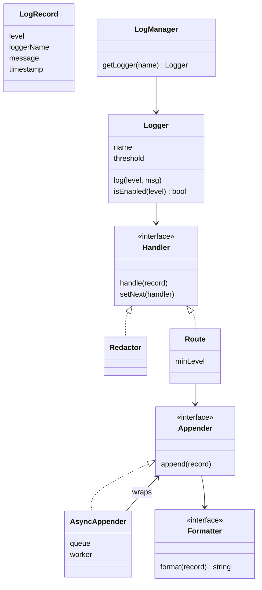

## The hook

Black Friday sale, 9 pm. The payment service slows down, then stops answering. CPU is low. The database is fine. The bank is fine.

Someone takes a thread dump. Every request thread is waiting in the same place: inside `logger.info`, waiting for a turn to write to a log file on a disk that a backup job is hammering.

Your app is not slow at paying. It is slow at *talking about* paying.

Logging feels like the least interesting part of anything you build, which is exactly why it is a favourite machine coding question. It looks like `print` with a timestamp, and it hides levels, routing, formatting, sensitive data and a concurrency trap that can take down a healthy service. So how do you build one that never makes the caller wait?

## Requirements

**Functional**

- Log messages with a [[log level]]: DEBUG, INFO, WARN, ERROR (FATAL is a common fifth).
- Each logger has a name (such as `payments`) and a threshold; messages below it are dropped.
- Send records to one or more destinations: console, file, an alerting channel.
- Each destination can have its own minimum level and its own format.
- Mask sensitive data, such as card numbers, before anything is written.
- Configure loggers and destinations without changing the calling code.

**Non-functional**

- Logging must not slow the caller noticeably, even when the disk is slow.
- Safe to call from many threads at once; lines must not interleave mid-record.
- No unbounded memory growth when writes fall behind.
- On a clean shutdown, records already accepted are written out.

**Out of scope, said out loud:** shipping logs to a central search system, log rotation by size or date, structured JSON logging. All three come back as extensions.

:::analogy
Think of a logging framework as **a mail room routing letters by priority**. Staff across the office drop letters in the out-tray and walk straight back to their desks; they never carry a letter to the post office themselves. In the mail room, a clerk blacks out account numbers, a sorter reads the stamp on each letter, routine letters go in the regular sack, and urgent ones also go by courier. The out-tray has a fixed size. Every piece of this design is a person or a tray in that room.
:::

## Core objects

- **Logger**: the name, the threshold, and the entry point `log(level, message)`. It is the out-tray slot on each desk.
- **LogRecord**: one letter. Level, logger name, message, timestamp, thread id.
- **Appender**: an [[appender]] writes records to one destination. ConsoleAppender, FileAppender, PagerAppender, and a MemoryAppender for tests.
- **Formatter**: turns a record into text, such as `[INFO] payments: payment 42 started`.
- **Handler chain**: the mail room clerks. A [[Chain of Responsibility]] of steps that redact, filter and route.
- **AsyncAppender**: wraps any appender with a [[bounded queue]] and a background thread.
- **LogManager**: creates and hands out loggers by name, and reads configuration.

Wait, why is the level checked in two places, the logger's threshold and each appender's minimum? Because they answer different questions. The logger's threshold says "is this worth recording at all?" and lets the cheapest exit happen at the desk. The appender's minimum says "is this worth a courier?" A WARN belongs in the file but should not page anyone at 3 am.

## Class design



```pseudo
enum Level: DEBUG < INFO < WARN < ERROR

class Logger:
    name, threshold, chain
    isEnabled(level): return level >= threshold
    log(level, message):
        if not isEnabled(level): return              // cheapest exit, nothing allocated
        chain.handle(LogRecord(level, name, message, clock.now(), threadId))

interface Handler:
    handle(record)                                   // may change, stop or pass the record

class Redactor implements Handler:
    handle(record):
        record.message = mask long digit runs, keep last 4
        next.handle(record)

class Route implements Handler:
    minLevel, appender
    handle(record):
        if record.level >= minLevel: appender.append(record)
        next.handle(record)                          // always pass on: one record can go many places

interface Appender:   append(record)

class AsyncAppender implements Appender:             // a Decorator around any appender
    inner, queue (bounded, capacity C), dropped = 0
    append(record):
        lock
        if queue.size == C: dropped += 1; return     // never block the caller
        queue.push(record); signal worker
    workerLoop():
        loop:
            wait until queue not empty or stopping
            if queue empty and stopping: return
            record = queue.pop()
            unlock; inner.append(record); lock      // slow I/O outside the lock
    close():  stopping = true; signal; join worker   // drains what is left
```

### The chain, link by link

Why a chain instead of one big `log` method with every rule inside? Because the mail room's jobs keep growing. Today it is redact, then route. Next month it is "sample DEBUG lines at 1 in 100", "add the request id", "drop health-check noise". Each one is a new link you insert, and no existing link changes.

Order matters, and here is the predict moment. Suppose you put the Route to the console *before* the Redactor. What reaches the console?

The raw card number. Your log file now holds data you were never allowed to store.

Redaction must run before any link that writes. The chain makes that ordering explicit and visible in one place, the setup code, instead of hidden across methods where you would never spot it in review.

### Async without blocking

Back to the hook. The fix is not a faster disk.

It is the out-tray. The caller's only job is to put a record in memory and leave; the mail room's background thread pays for the slow write.

[[Decorator]] is the right shape for this. `AsyncAppender` *is* an appender (same interface) and *has* an appender (the one it wraps). Any appender, file or network or console, becomes asynchronous by wrapping it, and nothing upstream knows the difference.

:::insight
A logger is called from the hottest paths in your code, so the caller must only ever do cheap, in-memory work: check a level, build a record, enqueue it. Every slow thing, formatting, disk, network, happens behind a bounded queue on another thread.
:::

## Key flows

### What happens when the tray is full

Every bounded queue forces a decision when it fills. Guess which choice the hook's service had made, before you read the table.

| Policy when full | Caller experience | Risk |
|---|---|---|
| Block until space | Waits for the disk | A slow disk becomes a slow app: the hook |
| Grow without limit | Never waits | Memory climbs until the process dies |
| Drop the new record, count it | Never waits | Some lines are lost, but you know how many |
| Drop low levels, block only for ERROR | Rarely waits | Slightly more complex; keeps the lines you need most |

The hook's service blocked. That one choice is what you saw in the thread dump.

The demo below drops and counts, which is the common default for application logs. The fourth row is a good answer to "but what if we lose an error?": errors are rare, so blocking for them costs little, and they are the lines you need in an incident. That is [[backpressure]] made explicit: the system decides, in advance, who pays when the consumer is slow.

### One burst of payment logs, traced

The demo logger `payments` has threshold INFO. Its chain is Redactor, then Route to an async console (capacity 4), then Route to a pager for ERROR and above. To make the queue fill predictably, the demo starts the console's worker thread only after the burst, which plays the part of a disk that is stuck.

| # | Call | Chain decision | Queue size after | Output now |
|---|---|---|---|---|
| 1 | DEBUG cache warmed | below threshold, dropped at the logger | 0 | none |
| 2 | INFO payment 42 started | to console queue | 1 | none |
| 3 | INFO card 1234567812345678 charged | redacted, to console queue | 2 | none |
| 4 | WARN bank slow, retrying | to console queue | 3 | none |
| 5 | ERROR bank timeout on payment 42 | to console queue and to pager | 4 | PAGE on-call |
| 6 | INFO payment 43 started | queue full, dropped | 4 | none |
| 7 | INFO payment 44 started | queue full, dropped | 4 | none |
| 8 | worker starts | drains 4 records in order | 0 | four console lines |

Predict the very first line the program prints. It is the page, not `payment 42 started`. The pager is synchronous and the console is not, so the urgent courier leaves before the regular sack, exactly as in the mail room.

:::try-this
Same burst, but the capacity is 3 and the policy is: when full, a WARN or ERROR record evicts the oldest record below WARN; anything else is dropped. Which lines reach the console? (Calls 2 to 4 fill the queue. Call 5, an ERROR, evicts "payment 42 started". Calls 6 and 7 are INFO, so they are dropped. The console prints the redacted card line, the WARN and the ERROR.)
:::

### The code

```cpp
#include <bits/stdc++.h>
using namespace std;

enum Level { DEBUG, INFO, WARN, ERROR };
const char* NAMES[] = {"DEBUG", "INFO", "WARN", "ERROR"};

struct Record { Level level; string logger, msg; };

// ---------- appenders: where records go ----------
struct Appender {
    virtual void append(const Record& r) = 0;
    virtual ~Appender() = default;
};
struct ConsoleAppender : Appender {
    void append(const Record& r) override { cout << "[" << NAMES[r.level] << "] " << r.logger << ": " << r.msg << "\n"; }
};
struct PagerAppender : Appender {            // stands in for an alert channel
    void append(const Record& r) override { cout << "PAGE on-call: " << r.msg << "\n"; }
};

// Decorator: makes any appender asynchronous with a bounded queue that never blocks the caller.
struct AsyncAppender : Appender {
    unique_ptr<Appender> inner; size_t cap;
    deque<Record> q; mutex m; condition_variable cv;
    bool stopping = false; int dropped = 0; thread worker;
    AsyncAppender(unique_ptr<Appender> a, size_t c) : inner(move(a)), cap(c) {}
    void start() { worker = thread([this] { run(); }); }
    void append(const Record& r) override {
        lock_guard<mutex> g(m);
        if (q.size() >= cap) { dropped++; return; }   // full: drop, never make the caller wait
        q.push_back(r);
        cv.notify_one();
    }
    void run() {
        unique_lock<mutex> lk(m);
        while (true) {
            cv.wait(lk, [this] { return stopping || !q.empty(); });
            if (q.empty()) return;                     // stopping and fully drained
            Record r = q.front(); q.pop_front();
            lk.unlock(); inner->append(r); lk.lock();  // slow I/O happens outside the lock
        }
    }
    ~AsyncAppender() override {                        // flush on shutdown
        { lock_guard<mutex> g(m); stopping = true; }
        cv.notify_one();
        if (worker.joinable()) worker.join();
    }
};

// ---------- chain of responsibility: each link may change, stop or pass a record ----------
struct Link {
    Link* next = nullptr;
    virtual void handle(Record r) = 0;
    void pass(const Record& r) { if (next) next->handle(r); }
    virtual ~Link() = default;
};
struct Redactor : Link {                       // a run of 12+ digits becomes 12 stars plus its last 4 digits
    void handle(Record r) override {
        r.msg = regex_replace(r.msg, regex("\\d{8,}(\\d{4})"), "************$1");
        pass(r);
    }
};
struct Route : Link {                          // sends records at or above a level to an appender
    Level min; Appender& out;
    Route(Level l, Appender& a) : min(l), out(a) {}
    void handle(Record r) override { if (r.level >= min) out.append(r); pass(r); }
};

struct Logger {
    string name; Level threshold; Link* chain;
    void log(Level l, const string& msg) {
        if (l < threshold) return;             // cheapest possible exit: nothing is built
        chain->handle({l, name, msg});
    }
};

int main() {
    AsyncAppender console(make_unique<ConsoleAppender>(), 4);
    PagerAppender pager;
    Redactor redact; Route toConsole(INFO, console); Route toPager(ERROR, pager);
    redact.next = &toConsole; toConsole.next = &toPager;
    Logger log{"payments", INFO, &redact};

    log.log(DEBUG, "cache warmed");                      // below threshold
    log.log(INFO, "payment 42 started");
    log.log(INFO, "card 1234567812345678 charged");
    log.log(WARN, "bank slow, retrying");
    log.log(ERROR, "bank timeout on payment 42");        // also pages
    log.log(INFO, "payment 43 started");                 // queue full: dropped
    log.log(INFO, "payment 44 started");                 // queue full: dropped
    cout << "caller finished, dropped " << console.dropped << ", draining queue\n";
    console.start();                                     // the slow disk finally catches up
}
```

The output is the page first, then `caller finished, dropped 2, draining queue`, then the four console lines in order, with the card printed as `************5678`. The worker writes outside the lock, so a slow appender never stops callers from enqueuing. The demo skips timestamps and a formatter class to stay short; a real record carries both.

### Many threads, one file

Two threads log at the same moment. Without care, their bytes interleave and the file shows half of one line glued to half of another. Guess where the fix belongs: in every caller, in the logger, or in the appender?

In the appender, or behind it. Your callers should never lock anything for logging.

With an async appender, only one worker thread ever touches the file, so lines cannot interleave, and the queue's lock is held only for a push or a pop. With a synchronous file appender, the appender itself takes a lock around each whole write.

## Patterns used

| Pattern | Where | Why it earns its place |
|---|---|---|
| Chain of Responsibility | Redactor, filters, routes | New processing steps are new links; order is explicit in one place |
| Decorator | AsyncAppender wrapping any appender | Adds async behaviour without a subclass per destination |
| Strategy | Formatter | Plain text for humans, JSON for machines, chosen per appender |
| Observer, loosely | Several appenders receiving one record | The logger does not know how many destinations exist |
| Singleton, carefully | LogManager registry | One registry per process so `getLogger("payments")` returns the same logger; tests reset it or inject their own |
| Factory | LogManager building loggers and appenders from config | Changing destinations is a config edit, not a code change |

:::warning
Common misconception: "Async logging is free, so log everything." Async moves the cost, it does not remove it. Every record is still built, redacted and queued on the caller's thread, and a flood of DEBUG lines fills the queue and pushes out the lines you need. Keep the threshold sensible, guard expensive messages with `isEnabled`, and watch the drop counter.
:::

## Extensions

### Lazy messages

Remember the first quiz question: arguments are evaluated before the call. `log.debug("cart=" + cart.toJson())` builds the JSON even when DEBUG is off. Two fixes: check `if (log.isEnabled(DEBUG))` first, or accept a function that builds the message, called only after the level check passes. Both keep the cheapest exit truly cheap.

### File rotation

A FileAppender that writes one file forever eventually fills the disk. Wrap the rotation rule as a strategy, by size or by date: before each write, ask the policy whether to roll over, then close the file, rename it with a suffix, and open a fresh one. Only the worker thread rotates, so no lock fight happens over the file handle.

### Hierarchical loggers

Real frameworks let `payments.bank` inherit its threshold and appenders from `payments`, which inherits from the root. LogManager stores loggers in a tree keyed by dotted names; a logger with no setting of its own walks up to its parent. That lets you turn on DEBUG for one noisy module without drowning in the rest.

### Edge cases worth naming

- **Crash before drain:** records still in the queue are lost. The trade-off is speed versus durability; flushing ERROR records synchronously is a common middle ground.
- **Logging inside an appender:** a FileAppender that logs its own failure through the same logger can recurse forever. Appenders report their own errors to stderr.
- **Shutdown order:** close the async appender before anything it writes to, and drain it before the process exits.
- **Clock jumps:** timestamps come from an injected clock, so tests are stable and records sort sensibly.
- **Huge messages:** cap the message length, or one giant payload eats the queue's memory.

### Common mistakes

- A Logger class that formats, filters, redacts and writes files in one method.
- Writing to disk on the caller's thread on a hot path.
- An unbounded queue "because dropping is bad".
- Doing I/O while holding the queue's lock, so callers wait for the disk anyway.
- A singleton reached from everywhere that tests cannot reset.

### Interview follow-ups

**"How do you test a logger?"** Inject a MemoryAppender that stores records in a list. Log through the real chain and assert on levels, redaction and order. For the async path, close the appender (which drains) before asserting.

**"How do you add a request id to every line?"** Add an Enricher link at the head of the chain that reads the id from a per-thread context and stamps it on the record. No caller changes.

**"What changes when logs go to a remote service?"** Wrap a NetworkAppender in the same AsyncAppender, and add batching: the worker sends up to N records or waits up to T milliseconds, whichever comes first. Retries live in the network appender; the caller still only enqueues.

**"Why not make every logger a singleton?"** Loggers are many, one per name, and they need different thresholds. The registry is the single thing; loggers are its entries. Even the registry should be replaceable in tests.

The async appender is a tiny producer and consumer around a bounded buffer. The next design is the same shape of problem with more rules about what to keep and what to throw away: [Design an In-Memory Cache With Eviction Policies](article:system-design-cache-lld).

## Key takeaways

- A logging framework separates loggers (what and how important), a handler chain (redact, filter, route) and appenders (where), so new rules and destinations are added without editing callers.
- The caller only checks the level and enqueues a record; an async appender moves formatting and slow I/O to a background thread, which keeps a slow disk from becoming a slow application.
- Every bounded queue needs an explicit full policy, and dropping low-priority records with a counter is usually safer than blocking the caller or growing without limit.
- Redaction must run before any link that writes, and a chain makes that order visible in one place.
- Expensive messages should be built only after the level check passes, because arguments are evaluated before the logger can decide to ignore them.
