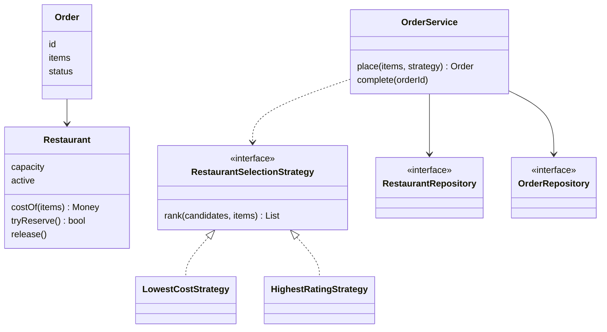

## The hook

The problem statement arrives as a PDF. Ninety minutes on the clock. "Design a food-ordering system where restaurants have menus and capacity, and orders are auto-assigned by a selectable strategy. Your code must run and handle the sample input."

You know SOLID. You know Strategy, Observer and State. You open your editor and type `interface`.

Here is the uncomfortable truth: that first keystroke decides more of your score than any pattern you know. Candidates who start with a perfect class hierarchy often finish with beautiful code that does not run. Candidates who start with a working ugly loop often finish with nothing extensible. So what should the first 10 minutes, the next 40 and the last 15 actually look like?

## Requirements

A [[machine coding round]] is judged differently from a whiteboard design round. Formats vary by company, but interviewers commonly look at these, roughly in this order:

1. **It runs** and produces correct output on the sample commands.
2. **Modularity**: clear classes with one job each, no god class.
3. **Extensibility**: a new variant (strategy, item type, rule) slots in without rewriting.
4. **Edge cases**: invalid input, capacity limits, missing items handled with clear errors.
5. **Readability**: names, small methods, no dead code.
6. **Tests or a demo of edge cases**, if time allows.

Notice where patterns sit: inside points 2 and 3, never above point 1.

:::analogy
Think of **building a model house room by room**. You lay the foundation first: the floor plan of which rooms exist. Then you finish one room completely, walls, door and light, so someone can actually stand in it. Then the next room. The wiring runs through standard sockets, so adding a room later never means rebuilding the kitchen. Paint and decoration come last. A house with ten half-built rooms is worth less than one with three finished ones.
:::

### The 90-minute plan

| Minutes | Phase | What you produce | Model house step |
|---|---|---|---|
| 0-10 | Clarify | Written list of must-haves, nice-to-haves, input/output format | Agree the floor plan |
| 10-20 | Model | Entities, their fields, one interface per known variation point | Lay the foundation |
| 20-55 | Core slices | Feature 1 working end to end, then feature 2, each with a driver command | Finish rooms one by one |
| 55-70 | Extend | The variants asked for (second strategy, new rule) slotting into interfaces | Add rooms through standard sockets |
| 70-82 | Harden | Edge cases, error messages, concurrency guard, a few tests | Check every door locks |
| 82-90 | Polish and present | Rename, delete dead code, rehearse a 2-minute walkthrough | Paint |

If you are at minute 55 with nothing running, cut scope immediately and get one flow working. Hold that thought: we will see exactly what "one flow" means on a real problem in a minute.

## Core objects

### Minutes 0-10: clarify like you mean it

Take the hook's problem. Before writing code, write questions and answers at the top of your file, as a comment. Predict which of these questions changes the design the most.

- Must an order go to a single restaurant, or can it be split? (Single.)
- What happens when no restaurant can take an order? (Reject with a message.)
- What does "capacity" mean? (Maximum orders being prepared at once; completing an order frees a slot.)
- Which strategies? (Lowest total cost, highest rating; more may come.)
- Ties? (Lowest cost ties go to the better rating.)
- Input format? (Method calls from a driver are fine.)
- Persistence? (In memory only.)

The answer: capacity. It turns a pure lookup problem into one with shared mutable state, which brings concurrency into the room. The tie rule matters too, because without it your output is not deterministic and the interviewer cannot check it.

### Minutes 10-20: entities first

Underline the nouns. Each becomes an [[entity]] with its own rules.

- **Restaurant**: name, rating, menu (item to price), capacity, active order count. Owns the rule "never exceed capacity".
- **Order**: id, items with quantities, assigned restaurant, status.
- **RestaurantSelectionStrategy**: ranks restaurants for an order. The variation point the problem told you about.
- **RestaurantRepository** and **OrderRepository**: store entities; [[in-memory repository|in-memory]] maps for now.
- **OrderService**: coordinates placing and completing orders.

Wait, why does Restaurant own the capacity rule instead of OrderService? Because the data and the rule that protects it belong together. If OrderService checks `active < capacity` and then increments, every other caller must remember to do the same, and one will forget.

## Class design

```pseudo
class Restaurant:
    name, rating, capacity, active = 0, menu: map item -> price
    costOf(items) -> Money or NONE      // NONE if any item missing
    tryReserve() -> bool:               // atomic check and increment
        lock; if active >= capacity: return false
        active += 1; return true
    release(): lock; active -= 1

interface RestaurantSelectionStrategy:
    rank(candidates, items) -> ordered list of Restaurant

class LowestCostStrategy implements RestaurantSelectionStrategy:
    rank: sort by costOf(items), ties by higher rating

class HighestRatingStrategy implements RestaurantSelectionStrategy:
    rank: sort by rating, highest first

class OrderService:
    constructor(restaurantRepo, orderRepo)
    place(items, strategy) -> Order or Rejection:
        candidates = restaurants whose costOf(items) is not NONE
        for r in strategy.rank(candidates, items):
            if r.tryReserve():
                return orderRepo.save(new Order(items, r))
        return Rejection("no restaurant can take this order")
    complete(orderId):
        order = orderRepo.get(orderId) or fail "unknown order"
        order.restaurant.release(); order.status = COMPLETED
```



### What the folder looks like

Interviewers open your project before they read a line. A layout that mirrors the design tells them you think in parts:

```pseudo
model/        Restaurant, Order, OrderStatus
strategy/     RestaurantSelectionStrategy, LowestCostStrategy, HighestRatingStrategy
repository/   RestaurantRepository, OrderRepository, InMemory versions
service/      OrderService
exception/    UnknownOrder, InvalidItem
Main          driver with the sample commands
tests/        OrderServiceTest
```

## Key flows

### Minutes 20-55: one room at a time

Slice 1 is "register restaurants, place an order with one strategy, print where it went". Make it run with a [[driver program]] before touching slice 2 ("complete an order frees capacity"). Each [[vertical slice]] is a finished room in the model house.

Here is the sample run. Annapurna has rating 4.5, capacity 2, biryani ₹220, dosa ₹90. Bawarchi has rating 4.1, capacity 3, biryani ₹180, dosa ₹100, idli ₹60. Before you read the table, take a guess: where does the dosa order on row 6 go?

| Row | Command | Cost at Annapurna | Cost at Bawarchi | Load A / B before | Result | Load A / B after |
|---|---|---|---|---|---|---|
| 1 | biryani ×2, lowest cost | 440 | 360 | 0 / 0 | O1 to Bawarchi, ₹360 | 0 / 1 |
| 2 | biryani + dosa, lowest cost | 310 | 280 | 0 / 1 | O2 to Bawarchi, ₹280 | 0 / 2 |
| 3 | dosa ×2, highest rating | 180 | 200 | 0 / 2 | O3 to Annapurna, ₹180 | 1 / 2 |
| 4 | idli ×2, lowest cost | no idli | 120 | 1 / 2 | O4 to Bawarchi, ₹120 | 1 / 3 |
| 5 | biryani ×1, lowest cost | 220 | 180 | 1 / 3 | Bawarchi full, O5 to Annapurna, ₹220 | 2 / 3 |
| 6 | dosa ×1, lowest cost | 90 | 100 | 2 / 3 | both full: rejected | 2 / 3 |
| 7 | complete O1 | | | 2 / 3 | Bawarchi frees a slot | 2 / 2 |
| 8 | dosa ×1, lowest cost | 90 | 100 | 2 / 2 | Annapurna full, O6 to Bawarchi, ₹100 | 2 / 3 |

Row 6 is rejected: both restaurants are at capacity. Row 5 is the interesting one. The strategy ranked Bawarchi first, but its tryReserve failed, so the service fell through to the next candidate. The strategy never needed to know about capacity at all.

Here is the code you could have running by minute 55, compressed:

```cpp
#include <bits/stdc++.h>
using namespace std;

struct Restaurant {
    string name; double rating; int capacity; int active = 0;
    map<string, int> menu;                       // item -> price in rupees
    mutex m;
    Restaurant(string n, double r, int c, map<string, int> mu)
        : name(move(n)), rating(r), capacity(c), menu(move(mu)) {}
    optional<int> cost(const map<string, int>& items) const {
        int total = 0;
        for (auto& [item, qty] : items) {
            auto it = menu.find(item);
            if (it == menu.end()) return nullopt;
            total += it->second * qty;
        }
        return total;
    }
    bool tryReserve() { lock_guard<mutex> g(m); if (active >= capacity) return false; ++active; return true; }
    void release() { lock_guard<mutex> g(m); --active; }
};

struct Strategy {                                // picks candidates in preference order
    virtual vector<Restaurant*> rank(vector<Restaurant*> rs, const map<string, int>& items) = 0;
    virtual ~Strategy() = default;
};
struct LowestCost : Strategy {
    vector<Restaurant*> rank(vector<Restaurant*> rs, const map<string, int>& items) override {
        sort(rs.begin(), rs.end(), [&](Restaurant* a, Restaurant* b) {
            int ca = *a->cost(items), cb = *b->cost(items);
            if (ca != cb) return ca < cb;
            return a->rating > b->rating;            // tie-break: better rating
        });
        return rs;
    }
};
struct HighestRating : Strategy {
    vector<Restaurant*> rank(vector<Restaurant*> rs, const map<string, int>&) override {
        sort(rs.begin(), rs.end(), [](Restaurant* a, Restaurant* b) { return a->rating > b->rating; });
        return rs;
    }
};

struct OrderService {
    vector<unique_ptr<Restaurant>> restaurants;
    map<string, Restaurant*> orders;             // order id -> restaurant
    int nextId = 1;
    string place(const map<string, int>& items, Strategy& s) {
        vector<Restaurant*> can;
        for (auto& r : restaurants) if (r->cost(items)) can.push_back(r.get());
        for (Restaurant* r : s.rank(can, items))
            if (r->tryReserve()) {               // may fail if another order took the slot
                string id = "O" + to_string(nextId++);
                orders[id] = r;
                return id + " -> " + r->name + " Rs " + to_string(*r->cost(items));
            }
        return "rejected: no restaurant can take it";
    }
    void complete(const string& id) { orders.at(id)->release(); orders.erase(id); }
};

int main() {
    OrderService svc;
    svc.restaurants.push_back(make_unique<Restaurant>("Annapurna", 4.5, 2,
        map<string, int>{{"biryani", 220}, {"dosa", 90}}));
    svc.restaurants.push_back(make_unique<Restaurant>("Bawarchi", 4.1, 3,
        map<string, int>{{"biryani", 180}, {"dosa", 100}, {"idli", 60}}));
    LowestCost cheap; HighestRating best;
    cout << svc.place({{"biryani", 2}}, cheap) << "\n";                 // O1 -> Bawarchi Rs 360
    cout << svc.place({{"biryani", 1}, {"dosa", 1}}, cheap) << "\n";    // O2 -> Bawarchi Rs 280
    cout << svc.place({{"dosa", 2}}, best) << "\n";                     // O3 -> Annapurna Rs 180
    cout << svc.place({{"idli", 2}}, cheap) << "\n";                    // O4 -> Bawarchi Rs 120
    cout << svc.place({{"biryani", 1}}, cheap) << "\n";                 // O5 -> Annapurna Rs 220
    cout << svc.place({{"dosa", 1}}, cheap) << "\n";                    // rejected
    svc.complete("O1");
    cout << svc.place({{"dosa", 1}}, cheap) << "\n";                    // O6 -> Bawarchi Rs 100
}
```

It is deliberately plain: structs, one interface, a map for storage. In the real round you would put the repository behind an interface and give the order map its own lock too, because two threads writing to one map at once corrupt it.

:::insight
Get one feature working end to end before you design the second one. Extract an interface at the exact moment a second variant appears, or when the problem statement names one; that is when the abstraction is earning its place instead of guessing.
:::

### The race on the last slot

Back to the capacity question from the clarify phase. Two customers order at the same instant; Annapurna has one free slot. Both threads rank Annapurna first. Can you spot the bug if tryReserve were written as two separate calls, `if r.hasSpace()` followed by `r.increment()`?

Both threads see "has space", both increment, and Annapurna is now at 3 of 2. The fix in the code above is that the check and the increment happen under one lock in one method. The thread that loses simply gets false and moves to the next candidate. In a database you get the same effect with a conditional update, such as "increment active where active is less than capacity", and checking the number of rows changed.

:::warning
Common misconception: "the interviewer wants to see as many design patterns as possible." Patterns are tools for specific problems. An interviewer who sees a Factory with one product, an Observer with no listeners and a Singleton holding everything reads it as over-engineering. Name the problem each pattern solves; if you cannot, delete it.
:::

## Patterns used

- **Strategy** for restaurant selection, because the problem names two ranking rules and hints at more. It is the one place variation was promised.
- **Repository** for storage, so the service never touches maps directly, and a database later changes one class.
- **Dependency injection**: OrderService receives repositories in its constructor, so tests pass fresh in-memory ones.
- **Not used, on purpose**: Observer (nobody needs order events yet), State (status has two values), Singleton (main creates one service and passes it). Saying this out loud shows judgement.

## Extensions

### Minutes 55-70: the follow-up feature

Interviewers often add a requirement mid-round to test extensibility. Three common shapes, and the room each one adds to the model house:

| New requirement | Where it lands | Existing code changed |
|---|---|---|
| "Add a strategy: nearest restaurant" | New class implementing RestaurantSelectionStrategy | None |
| "Restaurants can update menu prices" | A method on Restaurant guarded by its lock | Restaurant only |
| "Notify restaurants on new orders" | Add an Observer now that a listener exists | OrderService publishes one event |

### Minutes 70-82: harden and test

The edge cases worth demonstrating in the driver:

- An order with an item no restaurant serves: rejected, not a crash.
- Completing an unknown or already-completed order: a clear error, and capacity is not released twice.
- Quantity zero or negative: rejected at the boundary.
- All restaurants full: rejected, as in row 6.

Tests follow the same list. A test for row 5 builds two restaurants, fills one, and asserts the order falls through to the other. That single test proves the strategy and the capacity rule cooperate.

:::try-this
A new rule arrives at minute 60: a customer may have at most 2 active orders. Which class owns the rule, and which existing classes change? (A Customer entity owns its active-order count with the same atomic check-and-increment as tryReserve. OrderService reserves a customer slot before ranking restaurants, gives it back if the order is rejected, and releases it in complete(). Restaurant and the strategies do not change.)
:::

### Common mistakes

- **Designing for 50 minutes.** The model house has a perfect floor plan and no rooms. Cap modelling at about 10 minutes.
- **The god class.** One OrderManager with every map and every rule. Split by responsibility as in [Lego Bricks With Standard Studs](article:system-design-oop-solid).
- **Printing inside business logic.** Return results; let the driver print. Otherwise you cannot test without capturing stdout.
- **Floating-point money.** Use integer rupees or paise.
- **Silent failures.** Returning null with no message makes edge cases look like bugs.

### Interview follow-ups

**"How would you make this thread-safe?"** Find every piece of shared mutable state: each restaurant's active count and the order map. Make each one's check-and-update atomic (a per-restaurant lock, a lock or concurrent map for orders). Lock per restaurant rather than globally, so orders to different restaurants do not wait on each other.

**"How would you move this to a real database?"** Implement the repository interfaces with SQL. Replace tryReserve's lock with a conditional update on the restaurant row. OrderService does not change, which is the point of the repository.

**"Why not put the capacity check inside the strategy?"** Then every strategy must remember it, and ranking would mix with reservation. Keeping capacity in Restaurant means strategies stay pure ranking functions that are easy to test.

**"You are out of time and the second feature is half done. What do you do?"** Make sure what exists runs, comment out or remove the half-built part, and explain in one minute how you would finish it. Working code plus a clear plan beats broken code.

Next in this track, [Design a Parking Lot](article:system-design-parking-lot) runs this exact plan on the most-asked machine coding problem, where two cars racing for one spot is the heart of the round.

## Key takeaways

- A machine coding round rewards running code first, then modularity, extensibility, edge cases and readability, so plan the 90 minutes around a working end-to-end slice early.
- Spend the first ten minutes writing down scope, input and output format and tie-breaking rules, because those decide the design and make the output checkable.
- Model entities so that each one owns the rules that protect its own data, such as a restaurant that refuses to exceed its capacity.
- Add an interface exactly where variation is real or promised, and say out loud which patterns you chose not to use and why.
- Make every check-and-update on shared state atomic, and let a failed reservation fall through to the next candidate.
