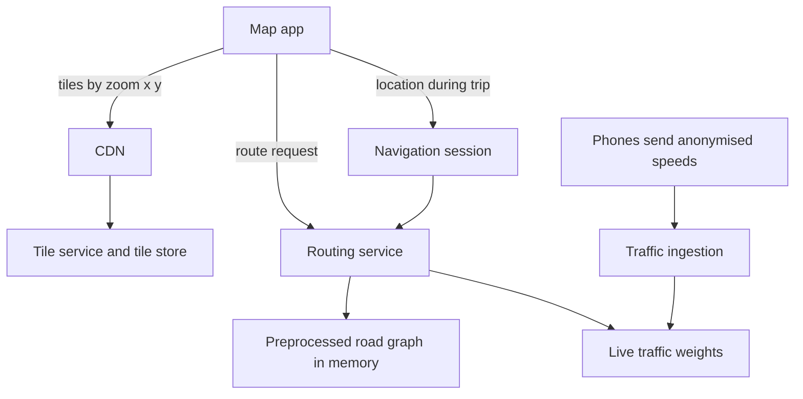

## The hook

You ask for directions from Pune to Bengaluru. In under a second you get a route of more than 800 km, an arrival time, and a warning about traffic near Kolhapur. Halfway through the drive, the app says "a faster route is available, saves 12 minutes".

The road network of a country has hundreds of millions of intersections. Dijkstra's algorithm, which you know from DSA, would explore a huge share of them for a long route. A server answering thousands of such queries per second cannot afford that.

Predict where the speed comes from: a better algorithm at query time, or work done before anyone asks? (Mostly the second, and it is one of the cleverest ideas in this track.)

## Requirements

**Functional**
- Show a pannable, zoomable map.
- Compute routes between points, with ETA, for driving (and other modes).
- Turn-by-turn navigation with live traffic and rerouting.

**Non-functional**
- Fast map loading worldwide; route queries in well under a second.
- ETAs that reflect current traffic.
- Huge scale of map data and many concurrent navigating users.

:::analogy
Navigation is **a road atlas that updates with traffic reports**. The atlas has pages at different scales: a country map with highways, regional maps, city maps with every lane. To plan a long trip you go from your street up to the highway map, across, and back down, instead of studying every lane in between. And radio traffic reports keep correcting your estimate as you drive.
:::

## Back-of-envelope numbers

All **estimates**.

- Tiles: level z has 4^z tiles. Level 10 has about 1 million; level 18 has 4¹⁸ ≈ **6.9 × 10¹⁰**, most of them ocean or empty land, so tiles are generated on demand and cached.
- Road graph for a large region: hundreds of millions of nodes and over a billion edges.
- A plain Dijkstra search for a long route could visit tens of millions of nodes; with hierarchical preprocessing, a query explores thousands.

## High-level design

## Deep dives

### 1. Tiles

The map is cut into **[[map tile]]s** addressed by (**[[zoom level]]**, x, y). Clients fetch the tiles covering the screen and prefetch neighbours. Modern apps often use vector tiles (geometry and labels) that the phone renders, allowing rotation and styling without new downloads. Tiles are immutable between map updates, so they are perfect for a CDN, as in [Local Warehouses for the Whole Internet](article:system-design-cdn).

### 2. Routing at scale

The **[[road graph]]** has intersections as nodes and road segments as edges weighted by travel time. A* with a straight-line-distance heuristic, from [Dijkstra With a Compass](article:famous-algos-a-star), focuses the search but still explores too much on long routes.

The answer to the hook is preprocessing. **[[Contraction hierarchies]]**, for example, rank nodes by importance (small residential streets low, highways high) and add shortcut edges that preserve shortest distances when less important nodes are skipped. A query then runs a bidirectional search that only moves upward in importance from both ends, meeting on major roads. It explores a tiny fraction of the graph, and the expensive work is done once, offline.

Wait, if traffic changes weights constantly, doesn't that ruin the preprocessing? Fully static preprocessing would. Practical systems use variants that separate the graph's structure (preprocessed rarely) from its weights (updated frequently), so live speeds can be applied quickly.

### 3. Live traffic and ETAs

Phones that opt in send anonymised location and speed. **[[Live traffic]]** ingestion matches points to road segments and estimates current speeds per segment, often blended with historical patterns for that time and day. The ETA is the sum of predicted segment travel times along the route, refined with learned corrections (traffic lights, turns, typical delays).

### 4. Navigation sessions and rerouting

During a trip, the app sends its position; the session tracks progress, detects when the driver leaves the route (recompute from the current point) and periodically checks whether a significantly faster route exists given new traffic, offering it only when the saving is worth the change.

:::insight
Maps scale by separating concerns: immutable tiles served from CDNs by zoom level, routing that answers in milliseconds because most of the shortest-path work was done offline on a hierarchical road graph, and live traffic that keeps updating the weights, ETAs and suggested routes.
:::

## Trade-offs

| Decision | Choice | Trade-off |
|---|---|---|
| Tiles | Vector tiles via CDN | Small, styleable; client does rendering |
| Routing | Preprocessed hierarchy | Millisecond queries; preprocessing and weight updates are complex |
| Traffic | Crowdsourced speeds plus history | Current and broad; needs privacy safeguards and enough data |
| Rerouting | Only when savings exceed a threshold | Stable directions; occasionally not the absolute fastest |
| Graph storage | In memory, partitioned by region | Fast; cross-region routes need stitching |

:::warning
Common misconception: "routing is just Dijkstra or A* on the road graph." On a continental graph, those explore far too many nodes per query at real traffic volumes. Production routing relies on preprocessing such as contraction hierarchies or related techniques, with A*-style search only on the reduced problem.
:::

:::try-this
A user pans the map at zoom 15 on a phone screen that shows about a 3 × 5 grid of tiles. How many tiles are fetched at first, and why prefetch more? (About 15 tiles for the visible area. Prefetching a ring of neighbours (and the next zoom level) makes panning and zooming feel instant, because those tiles are already on the device or in a nearby CDN cache.)
:::

## What can go wrong

- **Slow routes on long trips** without hierarchical preprocessing.
- **Stale traffic** making ETAs wrong; blend live and historical data and expire old reports.
- **Map errors** (closed roads, wrong turn restrictions) sending drivers astray; fast correction pipelines.
- **Rerouting flapping** between two similar routes; require a minimum saving.
- **Privacy**: location data must be anonymised and aggregated.

### Interview follow-ups

**"How would you store map data for a region?"** Partition by geographic cells (as in [Turning a Map Into a String](article:famous-algos-geohash)) for tiles and places, and keep a region's road graph in memory on routing servers.

**"How would you handle offline maps?"** Download a region's vector tiles and road graph to the phone, and run routing locally with static weights.

**"How do you compute an ETA for a trip starting in two hours?"** Use historical speeds for that future time and day rather than current traffic.

## Further reading

- Geisberger, Sanders, Schultes and Delling, "Contraction Hierarchies: Faster and Simpler Hierarchical Routing in Road Networks" (WEA 2008).
- Documentation on web map tiles (the zoom/x/y tiling scheme) from open mapping projects.

## Key takeaways

- The map is drawn from tiles addressed by zoom level and position; level z has 4^z tiles, so tiles are generated lazily and served through CDNs.
- Routing models roads as a weighted graph, but plain Dijkstra or A* explores too much on long routes.
- Preprocessing such as contraction hierarchies adds shortcuts so queries mostly travel up to major roads and back, exploring a tiny fraction of the graph.
- Live traffic from anonymised phone reports updates travel-time weights, and ETAs are sums of predicted segment times.
- Navigation sessions track progress, reroute when the driver leaves the route, and suggest faster routes only when the saving is meaningful.
