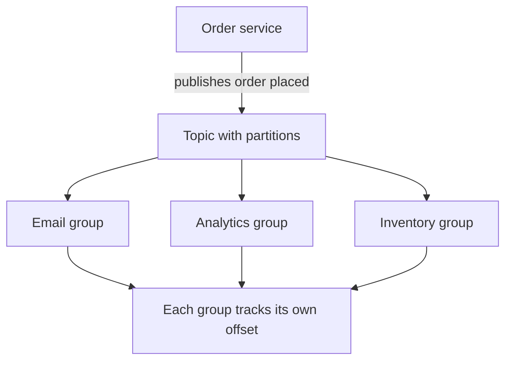

## The hook

When you upload a video, the site answers "Upload complete" in a second. But converting that video into ten resolutions takes minutes. If the upload request waited for all of it, uploads would time out, and a burst of uploads after a viral moment would crash the converters.

Instead, the upload service drops a note on a queue, "new video 81723, please process", and moves on. Converter workers pick notes off the queue at their own pace. That simple handoff is one of the most important building blocks in large systems.

## The intuition

:::analogy
In a busy restaurant, waiters do not walk into the kitchen and wait beside a cook until the dish is ready. They clip an order ticket onto a rail and go back to their tables. Cooks take tickets from the rail as fast as they can. During the dinner rush, tickets pile up on the rail, but no waiter is stuck and no order is lost.
:::

The rail is a [[message queue]]. Waiters are [[producer and consumer|producers]]; cooks are consumers. The rail absorbs rushes and lets each side work at its own speed.

## How it works

### Two flavours

**Work queues** (RabbitMQ, Amazon SQS style): each message is delivered to one consumer, which acknowledges it after processing; then it is removed. Great for jobs: "resize this image", "send this email". Messages that are not acknowledged within a visibility timeout become available again, which is how crashed workers are handled.

**Logs with [[publish-subscribe]]** (Kafka style): messages are appended to a topic and kept for a retention period, even after reading. Each [[consumer group]] tracks its own position, its offset, so several independent systems can read the same stream: search indexing, analytics and notifications can all consume "order placed" events.

### Ordering and parallelism

A Kafka-style topic is split into [[partition]]s. Order is guaranteed only within a partition. Producers choose a partition by a message key, so all events for one user or one order go to the same partition and stay in order. Within a consumer group, each partition is read by exactly one consumer, so more partitions allow more parallel consumers.

### Delivery guarantees

- **At most once:** acknowledge before processing; a crash loses the message.
- **At least once:** acknowledge after processing; a crash causes redelivery, so duplicates happen. This is the usual choice.
- **Exactly once** is not a property of delivery over a network; it is achieved by combining at-least-once delivery with idempotent processing or transactions, as in [Pressing the Pay Button Twice Should Charge Once](article:system-design-stateless-idempotency).

### When messages keep failing

A message that crashes the consumer every time, a "poison message", would block a queue forever. On the restaurant rail, it is a ticket for a dish the kitchen cannot make: someone must move it aside so the other orders keep flowing. After a few retries it goes to a [[dead letter queue]] for inspection, and the rest of the work continues.

:::insight
A queue decouples services in time and speed. The producer only needs the queue to be up, not the consumer. That turns slow, spiky or fragile downstream work into a steady background stream, at the cost of answers arriving later rather than immediately.
:::

## Trade-offs

- **Asynchrony vs immediacy.** Users get a fast acknowledgement but not the final result; you need status endpoints, notifications or polling to tell them when work finishes.
- **Work queue vs log.** Work queues are simple for one-off jobs; logs keep history, allow replay and support many independent consumers, but need retention and offset management.
- **Ordering vs parallelism.** Strict global order means one partition and one consumer; more partitions means more throughput but order only per key.
- **More moving parts.** A broker is another system to run, monitor and scale; for small apps, a database table of jobs can be enough. Managed cloud queues reduce the operational burden, at the price of less control and some vendor lock-in.

### A quick estimate

An e-commerce site produces 5,000 order events per second at peak (an estimate), each about 1 KB. That is about 5 MB/s, or roughly 430 GB per day. With 7 days of retention and 3 replicas, the log stores about 430 × 7 × 3 ≈ 9 TB. These numbers tell you how many brokers and disks the cluster needs.

## What can go wrong

- **Duplicates** from at-least-once delivery cause double emails or double charges when consumers are not idempotent.
- **Consumer lag**: consumers fall behind and the backlog grows for hours. Monitor lag and scale consumers or partitions.
- **Hot partitions**: one key, such as a celebrity's id, sends most traffic to one partition and one consumer.
- **Poison messages** block processing without a dead letter queue.
- **Lost messages** when producers do not wait for the broker's acknowledgement or replication.

:::warning
Common misconception: "adding a queue makes the system faster." A queue makes the producer's response faster and smooths spikes, but the total work is the same, and the end-to-end time can be longer. If consumers are permanently slower than producers, the queue just grows until it runs out of space.
:::

:::try-this
A queue receives 1,200 messages per second. Each consumer processes 150 per second. How many consumers do you need, and how many partitions at least (Kafka style, one consumer per partition)? (At least 8 consumers, so at least 8 partitions; add headroom, such as 12, for spikes and failures.)
:::

## In the real world

Kafka, which started at LinkedIn, is widely used as a durable event log between services and data systems. RabbitMQ and cloud services such as Amazon SQS and Google Cloud Pub/Sub are common for job queues and pub-sub. Typical uses: sending emails and notifications, processing uploads, updating search indexes, feeding analytics, and connecting microservices without tight coupling. A later case study designs a Kafka-like log from scratch.

## Further reading

- Apache Kafka documentation, "Introduction": https://kafka.apache.org/intro
- RabbitMQ tutorials: https://www.rabbitmq.com/tutorials
- Jay Kreps, "The Log: What every software engineer should know about real-time data's unifying abstraction" (2013).

## Key takeaways

- A message queue lets producers hand off work and continue, while consumers process it at their own pace.
- Work queues deliver each message to one consumer; Kafka-style logs keep messages so many consumer groups can read the same stream.
- Order is guaranteed only within a partition, so key messages by the entity whose events must stay ordered.
- At-least-once delivery is the norm, so consumers must be idempotent; poison messages go to a dead letter queue.
- Queues smooth spikes and decouple services, but add latency to final results and another system to operate.
