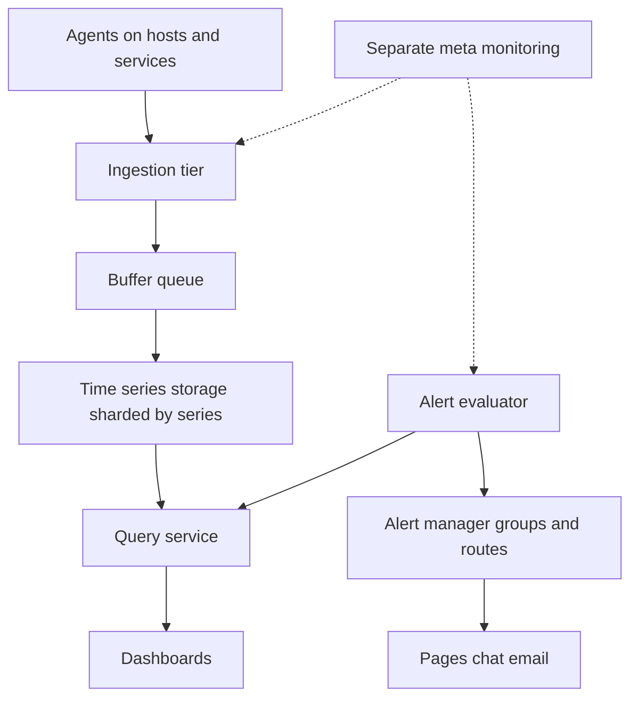

## The hook

In a hospital, every patient in intensive care is attached to a monitor: heart rate, oxygen, blood pressure, sampled every few seconds, with an alarm that sounds when something crosses a threshold. Nurses do not stare at every screen; the alarms find them.

A company with 10,000 servers needs the same thing. Every server and service reports numbers every few seconds; dashboards show trends; alerts wake someone at 3 am only when users are actually affected.

Predict the most dangerous failure of a monitoring system. (It is not losing a few data points. It is the monitor going dark at the exact moment production does, because they shared something.)

## Requirements

**Functional**
- Collect metrics from hosts and services (CPU, memory, request rates, latencies, error counts, business metrics).
- Store them; query them for dashboards over minutes to months.
- Evaluate alert rules; notify on-call through pages, chat and email, with grouping and silencing.

**Non-functional**
- About 10,000 hosts × 500 metrics every 10 seconds (**estimates**).
- Recent data queryable within seconds; alerts evaluated every 15 to 60 seconds.
- Highly available, and independent from the systems it monitors.

:::analogy
Think of **a hospital monitor for every server**: sensors (agents) sample vital signs, a central station stores the readings, screens show trends, and an alarm system pages the right nurse, once, when a reading stays out of range, rather than beeping for every flicker.
:::

## Back-of-envelope numbers

All **estimates**.

- Series: 10,000 hosts × 500 metrics = **5 million series**.
- Ingestion: 5,000,000 ÷ 10 s = **500,000 points per second**.
- Storage per day: at 16 bytes per raw point, about **690 GB per day**; with time-series compression to around 2 bytes per point, about **86 GB per day**.
- Retention: raw data for weeks, downsampled rollups for a year or more, as in [A Diary Where Only New Entries Are Written](article:system-design-time-series-db).

## High-level design

## Deep dives

### 1. Collection: push or pull

| Model | How | Strengths | Weaknesses |
|---|---|---|---|
| Pull (**[[scrape]]**) | The system fetches /metrics from each target on a schedule | Central control of rate; a target that stops answering is itself a signal | Needs service discovery and network reachability |
| Push | **[[Collection agent]]s** send metrics to an ingestion endpoint | Works for short-lived jobs and behind firewalls | Ingestion must handle bursts; dead targets are silent |

Many setups mix both: pull for long-running services, push through a gateway for batch jobs.

### 2. Ingestion and storage

The ingestion tier validates points and enforces limits (rejecting series with unbounded labels to protect cardinality), then writes into a buffer queue so storage hiccups do not drop data. Storage nodes are sharded by series (hash of metric name and labels), compress points into time-ordered chunks, and replicate for durability. Downsampling jobs create 1-minute and 1-hour rollups for long-range queries.

Wait, why a queue between ingestion and storage? Because storage nodes restart, compact and rebalance. The queue absorbs those pauses, so agents never block and points are not lost during short storage outages.

### 3. Queries

The query service fans out to the shards holding the requested series, aggregates (sum by service, 99th percentile), and picks the right resolution for the time range: raw for the last hour, rollups for last month. Popular dashboards are cached for a few seconds.

### 4. Alerting

An **[[alert rule]]** is a query plus a condition plus a duration: "checkout error rate > 2% for 5 minutes". The duration filters out blips. The evaluator runs rules on a schedule and sends firing alerts to an alert manager, which does **[[alert deduplication]]** and grouping (300 hosts with full disks become one notification), routing by team, silencing during maintenance, and escalation if nobody acknowledges.

Alert on symptoms tied to service objectives, as in [A Dashboard, a Trip Log and a GPS Trace](article:system-design-observability).

### 5. Watching the watcher

**[[Meta-monitoring]]**: the monitoring system's own health (ingestion lag, evaluator running, notifications delivered) is checked by a separate, minimal system in different infrastructure. A "dead man's switch" alert that should always fire, and pages when it stops arriving, detects a silent monitoring outage.

:::insight
A monitoring system is a time-series pipeline (collect, ingest, store, query) plus an alerting loop that evaluates rules and routes grouped notifications. Its defining requirement is independence: it must keep working, and keep alerting, precisely when the production systems it watches are failing.
:::

## Trade-offs

| Decision | Choice | Trade-off |
|---|---|---|
| Collection | Pull for services, push for batch jobs | Control and liveness detection; two paths to run |
| Resolution | 10 s raw, rollups after days | Detail where it matters; coarse history |
| Cardinality | Enforced label limits at ingestion | Protects the system; some teams must change metrics |
| Alert evaluation | Every 30 s with 5-minute durations | Few false alarms; detection delayed by minutes |
| Deployment | Separate from production | Survives outages; extra infrastructure |

:::warning
Common misconception: "we can monitor the system with itself." If metrics storage or alerting runs on the same cluster, network or region as production, the outage that most needs an alert silences it. Keep monitoring independent and monitor it from outside.
:::

:::try-this
A team adds a `request_id` label to a latency metric on a service handling 2,000 requests per second. What happens to series count, and what should ingestion do? (Every request creates a new series: 2,000 new series per second, millions per hour, quickly exhausting memory. Ingestion should enforce per-metric series limits and reject or drop the label; request-level detail belongs in traces and logs.)
:::

## What can go wrong

- **Cardinality explosions** from unbounded labels.
- **Monitoring sharing fate** with production.
- **Alert storms** without grouping, leading to ignored pages.
- **Ingestion backlog** silently delaying alerts; alert on ingestion lag itself.
- **Expensive dashboard queries** over long ranges at raw resolution.
- **Missing data treated as healthy**: a dead host stops sending errors, and error-rate alerts go quiet; alert on absent data too.

### Interview follow-ups

**"How do you compute a 99th-percentile latency across 500 hosts?"** Not by averaging percentiles; collect histograms (bucket counts) per host, sum the buckets across hosts, and compute the percentile from the merged histogram.

**"How would you alert on anomalies rather than fixed thresholds?"** Compare current values with the same time last week or a forecast band, using streaming windows as in [Counting Cars Per Minute When Some Report Late](article:system-design-stream-processing), and alert when values leave the band for a sustained period.

**"How would you scale to 100× more series?"** Shard storage and query by series hash, add more ingestion nodes behind the queue, push more queries to rollups, and enforce cardinality budgets per team.

## Further reading

- *Site Reliability Engineering* (Google), "Monitoring Distributed Systems" and "Practical Alerting".
- The Prometheus documentation on the pull model, storage and Alertmanager.

## Key takeaways

- A metrics system collects points from agents or by scraping, buffers them, stores them in sharded, compressed time-series storage, and serves queries for dashboards and alerts.
- 10,000 hosts with 500 metrics every 10 seconds is 500,000 points per second from 5 million series; compression and downsampling keep storage affordable.
- Alert rules combine a query, a threshold and a duration, and an alert manager groups, deduplicates, routes and silences notifications.
- Enforce cardinality limits at ingestion, because unbounded labels can take down the whole system.
- Keep monitoring independent of production and monitor it from outside, so it still works when it matters most.
