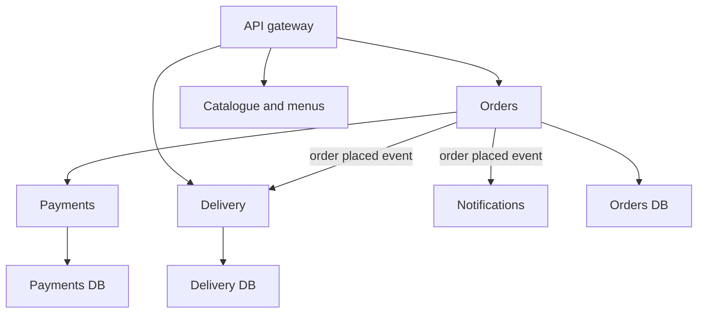

## The hook

Two startups build the same food-delivery app. Startup A starts with 25 microservices "to be like the big companies". Startup B starts with one well-organised monolith.

Six months in, A's eight engineers spend half their time on deployment pipelines, service-to-service timeouts and debugging requests that hop through seven services. B has shipped twice as many features.

Three years in, B has 200 engineers stepping on each other in one codebase, and a release takes a week of coordination. Now B starts splitting.

Which one was right? Both, at different times. That is the honest answer interviewers want, followed by the reasoning. Guess which single factor matters most in deciding. (It is not traffic.)

## The intuition

:::analogy
**One big kitchen** cooks everything: biryani, dosas, pizza. Cooks share the stove, the fridge and one head chef. It is efficient while the team is small. A **food court** has separate stalls, each with its own cook, fridge and menu. Stalls change recipes without asking anyone. But now every stall needs its own staff, licences and supplies, and an order for biryani plus pizza means walking between two counters.
:::

- The big kitchen is a **[[monolith]]**: one codebase, one deployment, usually one database.
- Each food-court stall is a **[[microservice]]**: it owns one business capability and its own data, and is deployed independently.

The answer to the hook's question: the deciding factor is mostly **organisational**. Microservices let many teams work and deploy independently. With 8 engineers, there is nothing to make independent yet.

## How it works

### What microservices buy

- **Independent deployment**: the payments team ships five times a day without coordinating with search.
- **Team autonomy**: each team owns its service end to end, including on-call.
- **Independent scaling**: scale the search service for traffic without scaling the admin panel.
- **Fault isolation**, if designed for it: a crash in recommendations need not take down checkout.
- **Technology choice per service**, used sparingly.

### What they cost

Predict this one first. A request flows through 5 services in sequence, each 99.9% available. What is the end-to-end availability?

0.999⁵ ≈ **0.995**. In a 30-day month that is up to about 216 minutes of failure, against 43 minutes for one service. Latency adds up too: five sequential calls of 20 ms each is 100 ms before any real work, and the chance that at least one of the five hits its slow 99th-percentile path is 1 − 0.99⁵ ≈ **4.9%**.

And then:

- Network calls instead of function calls: timeouts, retries, partial failures.
- No cross-service transactions: you need sagas and the outbox pattern.
- Operating many services: deployment pipelines, monitoring, tracing, service discovery, as in [The Mall Directory and Security Desk in One](article:system-design-api-gateway).
- Debugging across services needs distributed tracing.

### Drawing boundaries

Split by **business capability**, not by technical layer. A good boundary is a **[[bounded context]]**: an area with its own vocabulary and rules.

Signs of a good boundary:

- Most changes touch one service.
- The service can do its main job if a neighbour is briefly down (often by reacting to events instead of calling synchronously).
- One team can own it.

Signs of a bad one: "user-service", "order-service" and "database-service" split by layer, or two services that call each other for every request.

### Data ownership

**[[Database per service]]**: payments owns its tables; orders never reads them directly. Orders asks the payments API, or keeps its own copy of what it needs, updated from payment events.

Wait, why not just share one database, which is so much simpler? Because the shared schema becomes a hidden contract. Payments can no longer rename a column, change storage or scale independently without breaking orders. Shared tables quietly turn separate services back into one system.

:::insight
Microservices are mainly an organisational tool: they let many teams change and deploy their parts independently, paid for with network calls, distributed data and operational overhead. Split along business capabilities that own their data, and only when team independence is worth that price.
:::

## Trade-offs

| | Monolith | [[Modular monolith]] | Microservices |
|---|---|---|---|
| Deployment | One unit | One unit | Many independent units |
| Calls between parts | In-process, fast | In-process, through module interfaces | Over the network |
| Transactions | Easy, one database | Easy | Sagas and events |
| Team scaling | Hard beyond a few teams | Better: clear module ownership | Best, with good boundaries |
| Operational cost | Low | Low | High |
| Good fit | Early products, small teams | Growing products, uncertain boundaries | Many teams, mature domains |

The modular monolith is the underrated middle: one deployment, but code split into modules with strict interfaces and separate data access. If a module later needs to scale or deploy on its own, extracting it is much easier.

:::warning
Common misconception: "splitting the code into services makes the system decoupled." If the services share a database, call each other synchronously for everything, and must be deployed together, you have a **[[distributed monolith]]**: all the network and operational costs of microservices, with none of the independence. Decoupling comes from boundaries, data ownership and asynchronous communication, not from the number of deployables.
:::

:::try-this
A checkout request calls cart, pricing, inventory and payments in sequence, each 99.9% available. Pricing is only needed to show a discount banner. How can you make checkout less fragile? (Do not let checkout depend on non-essential calls: fetch pricing with a short timeout and fall back to "no banner", or precompute prices into the cart. Turn later steps such as sending emails into events. Fewer synchronous dependencies in series means higher end-to-end availability.)
:::

## What can go wrong

- **Too many, too small services** ("nanoservices") for the team size.
- **Chatty synchronous chains** that multiply latency and failure probability.
- **Shared databases** creating hidden coupling.
- **No observability**: without tracing and correlated logs, a failed request across 7 services is a mystery.
- **Inconsistent data** across services without sagas, outbox and idempotent consumers.
- **Cascading failures** when one slow service ties up callers' threads; resilience patterns (the next article) exist for this.

### Interview follow-ups

**"Would you start a new product with microservices?"** Usually no: start with a modular monolith, keep boundaries clean, and extract services when team size, deployment friction or very different scaling needs justify it.

**"How do services keep data they do not own up to date?"** Subscribe to the owner's events (published reliably with an outbox) and maintain a local read model, accepting that it is eventually consistent.

**"How do you migrate from a monolith?"** Gradually: put a gateway or proxy in front, extract one capability at a time behind the same API (the "strangler fig" approach), move its data with it, and route traffic to the new service once it is ready.

## In the real world

- Many large technology companies moved from monoliths to services as their engineering organisations grew, and many smaller teams have publicly described moving back toward simpler architectures when the overhead outweighed the benefit.
- Common supporting pieces are API gateways, service discovery, message brokers, distributed tracing, and per-service deployment pipelines.
- Cross-service workflows rely on patterns such as sagas, as in [Book the Trip, Cancel the Hotel](article:system-design-sagas).

Every network call between services is a new way to fail slowly. The next article is about surviving that: timeouts, retries with budgets, circuit breakers and bulkheads.

## Further reading

- Sam Newman, *Building Microservices* (2nd edition), especially the chapters on boundaries and on migrating from monoliths.
- Martin Fowler's articles "MonolithFirst" and "StranglerFigApplication".

## Key takeaways

- Microservices are mainly about letting many teams build, deploy and scale their parts independently; with a small team, a well-structured monolith is usually faster.
- The costs are real: network failures, multiplied latency and failure probability in call chains, no cross-service transactions, and heavy operational tooling.
- Draw boundaries around business capabilities that own their data, and let other services reach that data only through APIs or events.
- Services that share databases or must be deployed together form a distributed monolith, with the costs of both styles and the benefits of neither.
- A modular monolith keeps strict internal boundaries in one deployable, which makes later extraction into services much easier.
