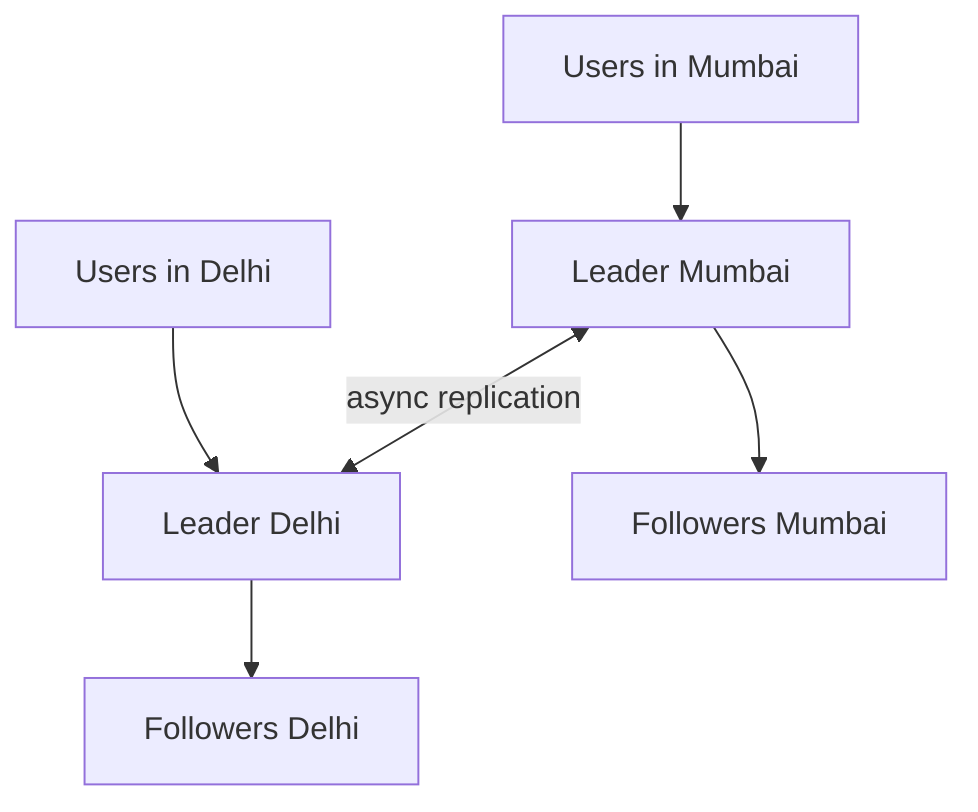

## The hook

A grocery chain has a head office in Mumbai and a regional office in Delhi. Both can edit the shared price list. On Monday at 10:00:00, Mumbai sets basmati rice to ₹120. At 10:00:01, Delhi, which has not yet heard about Mumbai's change, sets it to ₹150.

An hour later, every store shows ₹120. Delhi's manager is sure they changed it. The logs agree. No error was raised anywhere.

What happened? Hold that thought: the culprit is a rule that sounds perfectly fair, and we'll see why it misfired in a minute, with the exact timeline. By the end you will know why systems accept writes in many places, what conflicts that creates, and why the simplest resolution rule is also the most dangerous.

## The intuition

:::analogy
Two **branch managers both edit the price list**. Each edits their own copy, which is fast and works even when the phone line between branches is down. Every evening they post their changes to each other. Usually they edit different items. But sometimes both changed the same item the same day, and when the copies arrive, somebody has to decide which price is real.
:::

In [A Teacher Dictating Notes to the Class](article:system-design-replication), one leader decided the order of every write, so conflicts were impossible. Here there is no single teacher:

- **[[Multi-leader replication]]**: a few leaders (often one per region), each accepting writes, replicating to each other.
- **[[Leaderless replication]]**: every replica accepts writes; clients send each write to several replicas.

Both buy availability and low-latency writes. Both pay with **[[write conflict]]s**.

## How it works

### Multi-leader

Each region writes locally, so a write costs a local round trip instead of a cross-country one, and a region keeps working if the link between regions fails. Changes are exchanged asynchronously.

A conflict happens when the same item is written in two regions before either has seen the other's write. Predict this one: both managers change the rice price within the same second. Which write is "first"?

There is no meaningful answer. Neither write saw the other, so they are **concurrent**. Any rule that picks a winner is a policy, not a fact.

### Resolving conflicts

| Strategy | How it works | Risk |
|---|---|---|
| [[Last write wins]] (LWW) | Keep the highest timestamp, drop the rest | Silent data loss; skewed clocks pick the wrong winner |
| Merge values | Combine both, e.g. union of shopping-cart items | Only works when a sensible merge exists |
| Keep both (siblings) | Store both versions and ask the application or user | Pushes complexity to clients |
| Conflict-free data types | Data types designed to merge automatically, such as counters and sets | Limited to those types |
| Avoid conflicts | Route all writes for one item to one "home" leader | Loses some of the benefit if that home is far away |

### Leaderless

In a leaderless (Dynamo-style) system, the client or a coordinator sends each write to all N replicas of a key and considers it successful once W of them confirm. A read asks R replicas and takes the newest version it sees.

Replicas that missed a write catch up through three paths:

- **[[Read repair]]**: a read that sees an older value on one replica writes the newer value back.
- **[[Hinted handoff]]**: if a target replica is down, a neighbour stores the write with a hint and delivers it later.
- **Anti-entropy**: a background process compares replicas, often with Merkle trees, and copies what is missing.

How R and W relate to N, and what that guarantees, is the subject of the next article on quorums.

:::insight
Accepting writes in more than one place trades conflicts for availability and latency. The real design decision is not "multi-leader or leaderless", but "how will concurrent writes to the same item be resolved, and is any data allowed to disappear?"
:::

## Trade-offs

| | Single leader | Multi-leader | Leaderless |
|---|---|---|---|
| Write latency far from leader | High | Low (local leader) | Low (nearest replicas) |
| Survives loss of the leader or a region | After failover | Yes, other regions continue | Yes, if enough replicas respond |
| Write conflicts | None | Yes, between leaders | Yes, between concurrent clients |
| Ordering of writes | One clear order | Per leader only | No global order |
| Typical use | Most databases | Multi-region apps, offline-capable clients | High-availability key-value stores |

### The LWW timeline from the hook

| Real time | Mumbai leader (clock correct) | Delhi leader (clock 2 s slow) | What LWW sees |
|---|---|---|---|
| 10:00:00 | price = 120, stamp 10:00:00 | | |
| 10:00:01 | | price = 150, stamp 09:59:59 | |
| 10:00:05 | receives Delhi's write | receives Mumbai's write | 10:00:00 > 09:59:59 |
| Result | 120 | 120 | Delhi's later write silently dropped |

Here is the catch promised in the hook: the database used last write wins, and Delhi's clock ran two seconds slow. Delhi's change really was later, but its clock said otherwise. LWW is only as good as the clocks, and even with perfect clocks it discards one of two concurrent writes by design.

:::warning
Common misconception: "last write wins keeps the latest value." It keeps the value with the largest timestamp. Clocks on different machines drift, so the "latest" by timestamp may not be latest in reality, and every other concurrent write is thrown away without an error. Use LWW only for data where losing a concurrent update is acceptable.
:::

:::try-this
Two users add items to the same shopping cart on different replicas at the same time: one adds a book, the other adds a pen. Compare LWW with a merge rule. (LWW keeps one write, so the cart ends up with either the book or the pen, and an item silently vanishes. Merging by set union keeps both. Removals then need extra care, for example recording removed items, so a merge does not bring a deleted item back.)
:::

## What can go wrong

- **Silent overwrite with LWW**, as in the hook.
- **Clock skew** choosing the wrong winner, even when writes were seconds apart.
- **Conflicts that cannot be merged automatically**, such as two people booking the last seat in different regions; such data needs a single leader or a consensus step.
- **Replication loops** in multi-leader topologies, where a change bounces between leaders; writes carry the ids of leaders they have passed through to stop this.
- **Stale replicas in leaderless systems** when repair is slow; reads with small R may see old data.

### Interview follow-ups

**"Design a collaborative notes app that works offline."** Each device is effectively a leader that syncs later, so conflicts are certain. Use merge-friendly data structures (operation-based or conflict-free types) rather than LWW on whole notes.

**"When would you avoid multi-leader?"** When invariants span items (no overselling, unique usernames, account balances). Route those writes to one leader, or use consensus, and keep multi-leader for data that merges well.

**"How do you detect that two writes are concurrent rather than ordered?"** Version vectors (vector clocks): if neither version's vector dominates the other's, they are concurrent, as explained in [Catching Two Edits That Never Saw Each Other](article:famous-algos-vector-clocks).

## In the real world

- Amazon's Dynamo paper described a leaderless, highly available key-value store with vector clocks, sloppy quorums and hinted handoff; Cassandra and Riak follow similar designs.
- Multi-region relational setups often run multi-leader replication with conflict-avoidance rules, such as routing each customer's writes to a home region.
- Offline-first mobile and collaborative apps behave like multi-leader systems and lean on mergeable data types.

The background repair that compares replicas uses the hash trees from [One Fingerprint for a Billion Files](article:famous-algos-merkle-trees). Next comes the question this article left open: with N replicas, how many must answer a write and a read before you can trust what you read? That is the quorum rule R + W > N, and it is subtler than it looks.

## Further reading

- The "Multi-Leader Replication" and "Leaderless Replication" sections of Martin Kleppmann's *Designing Data-Intensive Applications*.
- DeCandia et al., "Dynamo: Amazon's Highly Available Key-value Store" (SOSP 2007).

## Key takeaways

- Multi-leader replication lets each region write to a nearby leader, and leaderless replication lets any replica accept writes; both gain availability and low write latency.
- Accepting writes in several places creates concurrent writes to the same item, which must be resolved by a policy, because neither write is objectively first.
- Last-write-wins keeps the largest timestamp and silently drops the rest, and clock skew can make it drop the write that really came later.
- Safer options are merging values, keeping siblings for the application, conflict-free data types, or routing each item's writes to one home leader.
- Leaderless systems keep replicas in sync with read repair, hinted handoff and background anti-entropy, and tune consistency with read and write quorums.
