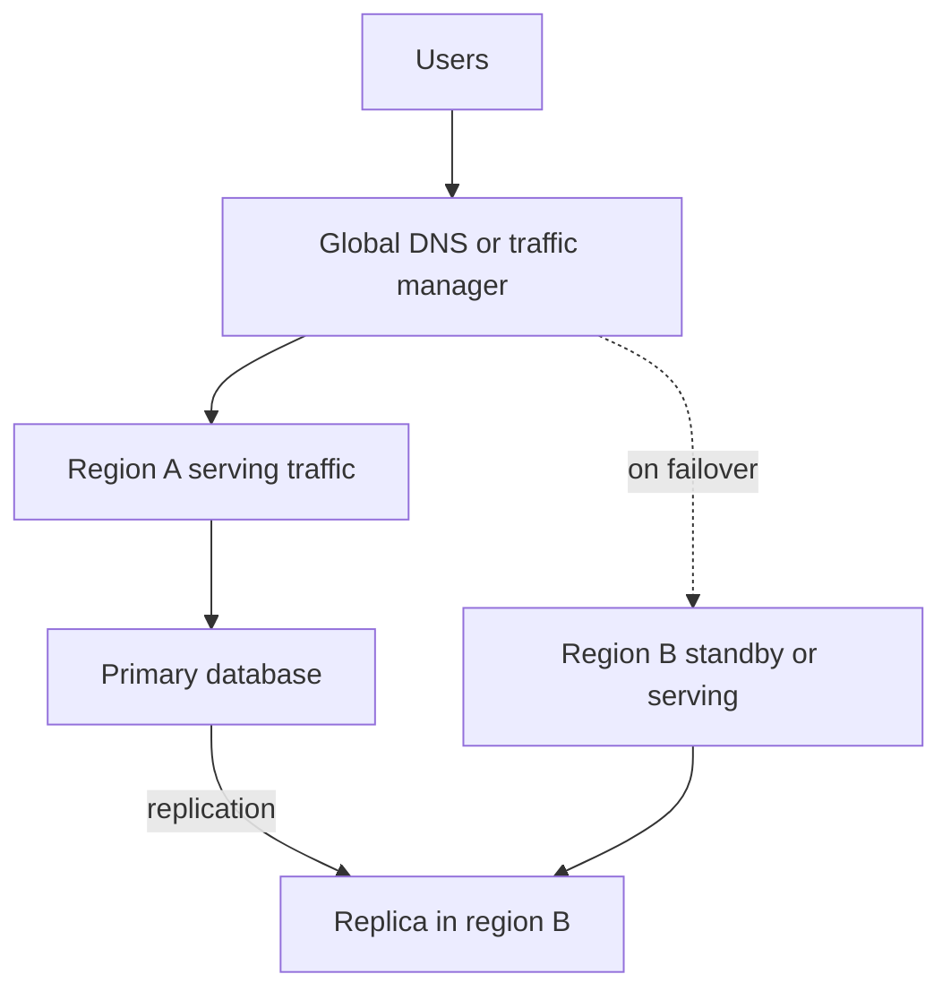

## The hook

A hospital in Mumbai has backup generators in its basement. One monsoon, the basement floods. The power fails, and so do the generators, because they were in the same building, exposed to the same water.

Cloud architectures repeat this mistake all the time. Three replicas, load balancers, autoscaling: all in one region. Then the whole region has a bad day: a network event, a power problem, a widespread outage of a core service. Everything is down, including the backups.

Multi-region design is putting the generators in another city. Before reading on, predict the two numbers every disaster-recovery plan must state. (They are abbreviations, and interviewers love them.)

## The intuition

:::analogy
**Backup generators in another city** survive the flood that takes out your basement. But electricity from another city has to travel, so there is a delay, and you must decide how much of the work in progress you can afford to lose when you switch over, and how quickly the switch must happen.
:::

The two numbers:

- **[[RPO]]** (recovery point objective): how much recent data you may lose, measured in time. "At most 5 seconds of orders."
- **[[RTO]]** (recovery time objective): how long you may be down. "Back within 15 minutes."

Everything else in multi-region design is a trade-off between those two numbers, latency and cost.

## How it works

A **[[region]]** is a geographic area with independent data centres. Regions are far apart, so a single disaster rarely hits two, but that distance also means round trips of tens to hundreds of milliseconds between them (an **estimate**; it depends on the pair of regions).

### Active-passive

One region serves everything; the other keeps a replica and standby capacity. On disaster, you promote the replica and point traffic at the standby region.

- **RPO** equals the replication lag at the moment of failure, if replication is asynchronous (often seconds).
- **RTO** is detection plus promotion plus traffic shift plus warming up: minutes, if automated and rehearsed.
- Variants by cost: **cold** standby (infrastructure created on demand, slow), **warm** (scaled-down copy running), **hot** (full copy running, fastest).

### Active-active

Every region serves users near it. Reads are fast everywhere, and losing one region just shifts its users to others.

Predict the catch. A user in Delhi and a support agent in London edit the same order at the same moment, each through their nearest region.

Both regions accept a write to the same record: a conflict, exactly the multi-leader problem from [Two Branch Managers Editing One Price List](article:system-design-multi-leader-leaderless), now at continental distance. Common answers:

- **Home region per record**: each user's data lives in one region; writes for it are routed there. Conflicts disappear; writes from far away pay extra latency.
- **Conflict resolution** for data that merges well.
- **Globally consistent databases** with consensus across regions, paying cross-region latency on writes.

### Data residency

**[[Data residency]]** rules may require some users' personal data to stay in a specific country. That constrains where replicas may live and may force a partitioned design (European users' data only in European regions), regardless of the failover plan.

Wait, does residency make multi-region impossible? No, but it narrows it: you replicate within the allowed area (two regions in the same country or legal zone, if available) and keep only permitted data elsewhere.

:::insight
Multi-region design trades latency and cost for surviving a regional disaster. State the RPO and RTO you need, choose active-passive (simpler, some downtime) or active-active (faster recovery and local reads, but cross-region conflicts), and rehearse the failover until it is boring.
:::

## Trade-offs

| | Single region (multi-zone) | Active-passive | Active-active |
|---|---|---|---|
| Survives a region outage | No | Yes, after failover | Yes, by shifting traffic |
| RTO | Until the region recovers | Minutes (hot) to hours (cold) | Near zero for routing; data must be available |
| RPO | n/a for region loss | Replication lag | Depends on replication and conflict design |
| Write latency | Low | Low (all writes in one region) | Low locally, unless writes need cross-region agreement |
| Complexity and cost | Lowest | Medium | Highest |

:::warning
Common misconception: "we have a disaster-recovery region, so we are safe." Failover paths that are never exercised decay: replicas fall behind silently, standby capacity is too small, DNS TTLs are long, secrets and configs are missing, a dependency still lives only in the primary region. Run regular failover drills and measure the actual RTO and RPO you achieve.
:::

:::try-this
A payments service needs RPO near zero and RTO under 5 minutes, and the business accepts slightly slower writes. Sketch the replication choice. (Synchronous or semi-synchronous replication to a second region, so no acknowledged payment exists in only one place, plus a hot standby with automated, rehearsed failover. Writes now pay a cross-region round trip, which the business accepted. For less critical data, asynchronous replication keeps writes fast.)
:::

## What can go wrong

- **Hidden single-region dependencies**: an auth service, a secrets store or a queue that exists only in the primary region.
- **Split brain** during partial failures, with both regions believing they are primary; fence the old primary before promoting.
- **Failback mistakes**: returning to the original region without re-syncing data written during the outage.
- **Capacity**: the surviving region cannot handle everyone's traffic at once.
- **Long DNS TTLs** keeping clients pointed at the dead region.
- **Cost**: paying for idle hot standby capacity; decide deliberately.

### Interview follow-ups

**"How would you route users to the nearest region?"** Latency-based or geographic DNS, or anycast addresses at a global load balancer, with health checks that remove a failed region.

**"What is the difference between availability zones and regions?"** Zones are separate data centres within one region, close enough for synchronous replication; they protect against a data-centre failure. Regions protect against a regional disaster but are far apart. Most systems use multiple zones always and multiple regions when the business needs it.

**"How do you test disaster recovery without causing an outage?"** Scheduled game days that fail over a non-critical service or a share of traffic, region evacuation drills, and restoring backups into a separate environment regularly.

## In the real world

- Cloud providers recommend designing across multiple availability zones by default and across regions for workloads that need regional disaster recovery.
- Globally distributed databases offer cross-region replication modes with different consistency and latency trade-offs, from asynchronous read replicas to consensus-based global writes.
- Many companies use a home region per customer or tenant to combine data residency with multi-region availability.

The single-region scaling steps that come before this are in [Photocopies of a Notice That Arrive a Little Late](article:system-design-read-replicas) and [A Teacher Dictating Notes to the Class](article:system-design-replication).

## Further reading

- Your cloud provider's disaster recovery whitepaper (backup and restore, pilot light, warm standby, multi-site active-active).
- The replication chapter of Martin Kleppmann's *Designing Data-Intensive Applications*, for multi-leader trade-offs.

## Key takeaways

- Multi-region design protects against losing a whole region, at the cost of cross-region latency, money and complexity.
- RPO (how much recent data you may lose) and RTO (how long you may be down) are the two numbers every recovery plan must state.
- Active-passive keeps one serving region and a standby, which is simpler but means some downtime and data loss up to the replication lag.
- Active-active serves users from several regions at once, which needs a home region per record or explicit conflict handling for writes.
- Data residency limits where replicas may live, and failovers that are not rehearsed regularly tend to fail when needed.
