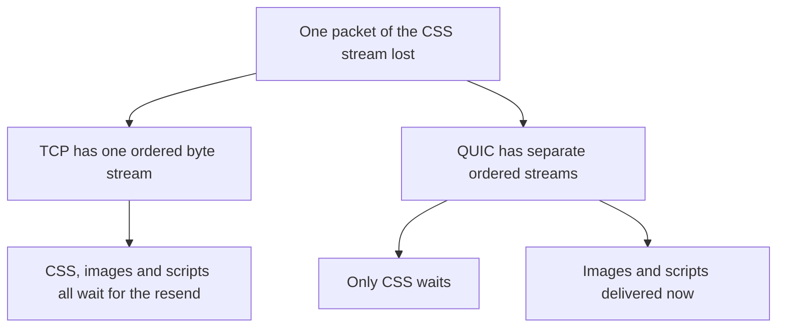

## The hook

A video call and a file download share your home Wi-Fi. The network drops 1 packet in 100.

The download does not care: the file arrives complete and correct, just a fraction slower. The call stutters for a moment, then catches up. If the call insisted on getting every lost packet back, it would freeze and fall seconds behind real time.

Same network, same loss, opposite needs. One wants every byte, in order, no matter what. The other wants the newest data, now, and would rather skip a gap than wait for it. That choice, made at the transport layer, shapes chat apps, games, streaming and the web itself. Predict which of the two most web traffic uses today. (The answer changed in the last few years.)

## The intuition

:::analogy
**Registered post** is reliable: every letter is numbered, signed for and resent if lost, and they are handed over in order. **Shouting across the street** is instant and needs no setup, but if a truck passes, that sentence is simply gone, and nobody shouts it again unless you ask.
:::

- **[[TCP]]** is registered post: a reliable, ordered stream of bytes, with retransmission and congestion control.
- **[[UDP]]** is shouting across the street: independent datagrams, no setup, no guarantees.
- **[[QUIC]]** is registered post rebuilt on top of shouting: reliable and encrypted, but with independent streams and faster setup. HTTP/3 runs on it, which is the answer to the hook: a growing share of web traffic now travels over UDP, inside QUIC.

## How it works

### What TCP gives you, and what it costs

| TCP feature | What it does | Cost |
|---|---|---|
| Handshake | Agree on sequence numbers before data | One **[[round-trip time]]** before the first byte |
| Acknowledgements and retransmission | Lost segments are resent | A loss delays delivery by at least a round trip |
| Ordered delivery | Bytes reach the app in the order sent | Later bytes wait for earlier lost ones |
| Flow and congestion control | Avoid overwhelming the receiver and the network | Starts slowly on new connections |

Congestion control is its own story, in [How the Internet Avoids Gridlock](article:famous-algos-tcp-congestion-control).

### Head-of-line blocking

Predict this. HTTP/2 sends six resources (HTML, CSS, scripts, images) over one TCP connection, interleaved. One packet carrying part of the CSS is lost. The image data behind it has already arrived. Can the browser use it?

No. TCP promises one ordered stream of bytes, so it cannot hand the image bytes to the browser while there is a gap before them. Everything waits for the retransmission. That is **[[head-of-line blocking]]**.

How often does it bite? If a page needs 100 packets and each is lost with probability 1%, the chance that at least one is lost is 1 − 0.99¹⁰⁰ ≈ **63%**. At 0.1% loss it is still about 9.5%. On mobile networks, stalls like this are common.

QUIC fixes it by giving each stream its own ordering. A lost packet stalls only the stream it belonged to; the image can be used immediately.

### Connection setup

With a 100 ms round trip (an **estimate** for a long-distance connection):

| Stack | Round trips before the request | Time at 100 ms RTT |
|---|---|---|
| TCP + TLS 1.2 | 3 | about 300 ms |
| TCP + TLS 1.3 | 2 | about 200 ms |
| QUIC (new connection) | 1 | about 100 ms |
| QUIC resumed with 0-RTT | 0 | data sent immediately |

Wait, why can QUIC save a round trip? Because it does the transport handshake and the TLS handshake together, in the same packets, instead of one after the other.

### When to use UDP directly

UDP is the right base when **late data is worthless** or the application wants its own rules:

- Live voice and video: skip lost audio rather than freeze.
- Online games: the next position update replaces the lost one.
- DNS lookups: one small question, one small answer; just ask again if lost.
- Custom protocols such as QUIC itself.

:::insight
Reliability is not free: retransmission and ordering add delay whenever something is lost, and one ordered stream makes every message wait for the slowest one. Use TCP when every byte matters in order, UDP-based designs when freshness matters more than completeness, and QUIC to keep reliability while removing head-of-line blocking between streams.
:::

## Trade-offs

| | TCP | UDP | QUIC |
|---|---|---|---|
| Delivery | Reliable, ordered stream | Best effort datagrams | Reliable, ordered per stream |
| Setup | Handshake, plus TLS on top | None | Combined transport and TLS, 1-RTT or 0-RTT |
| Head-of-line blocking | Across everything on the connection | None | Only within a stream |
| Encryption | Separate TLS layer | None built in | Built in |
| Connection migration (Wi-Fi to mobile) | Connection breaks | n/a | Supported via connection IDs |
| Typical use | Web (HTTP/1.1, HTTP/2), databases, file transfer | Voice, video, games, DNS | HTTP/3, modern mobile apps |

:::warning
Common misconception: "UDP is always faster, so use it for speed." UDP only skips features. If your application needs reliability, you will rebuild acknowledgements, retransmission, ordering and congestion control on top of UDP, often worse than TCP does. UDP wins only when you truly want different rules, such as skipping late data.
:::

:::try-this
You design a multiplayer racing game that sends each car's position 30 times a second, plus chat messages and in-game purchases. Which transport for each? (Positions: UDP-based, since a newer update replaces a lost one. Chat: reliable and ordered, so TCP or a reliable stream. Purchases: reliable, encrypted and confirmed, over HTTPS to a backend, with idempotency keys. One app can use more than one transport.)
:::

## What can go wrong

- **Reliable data over plain UDP** without retransmission: silent loss.
- **Long-lived TCP connections behind load balancers** that silently drop idle connections; use keepalives.
- **Many short TCP connections**: each pays handshakes and slow start; reuse connections.
- **UDP blocked or rate-limited** on some networks; keep a TCP fallback for UDP-based protocols.
- **Ignoring tail latency on lossy mobile networks**, where head-of-line blocking hurts most.

### Interview follow-ups

**"Why does HTTP/2 still suffer head-of-line blocking if it multiplexes streams?"** It multiplexes at the HTTP layer, but all streams share one TCP byte stream, so a lost TCP packet blocks every stream. HTTP/3 over QUIC moves multiplexing into the transport.

**"Why is QUIC built on UDP instead of being a new transport protocol?"** Middleboxes on the internet (firewalls, NATs) often only pass TCP and UDP. Building on UDP lets QUIC deploy without changing every network device, and lets it live in user space where it can evolve quickly.

**"How would you design a reliable message on top of UDP?"** Sequence numbers, acknowledgements, retransmission with timeouts and backoff, duplicate detection, and congestion control. Listing these shows why you usually should not.

## In the real world

- HTTP/3 runs over QUIC, and major browsers and large websites support it.
- Real-time media such as WebRTC calls typically run over UDP, with their own recovery for lost packets.
- DNS has classically used UDP for small queries, falling back to TCP for large responses.

How these choices show up in a page load end to end is in [Everything That Happens Before a Page Appears](article:system-design-client-server-http), and the latency budget they spend from is in [If a CPU Cycle Took One Second](article:system-design-latency-numbers).

## Further reading

- RFC 9000, which specifies QUIC, and RFC 9114 for HTTP/3.
- Ilya Grigorik, *High Performance Browser Networking*, the chapters on TCP, UDP and TLS.

## Key takeaways

- TCP provides a reliable, ordered byte stream at the cost of handshakes and waiting for retransmissions; UDP provides fast, setup-free datagrams with no guarantees.
- Head-of-line blocking means one lost TCP packet stalls everything behind it on the connection, including other HTTP/2 streams.
- QUIC, on UDP, gives reliable encrypted streams that are independent of each other and sets up connections in one round trip, or zero when resumed.
- Use UDP-based designs when late data is worthless, such as live voice, video and game state, and TCP or QUIC when every byte must arrive.
- "UDP is faster" is only true if you do not need what TCP provides; otherwise you end up rebuilding it.
