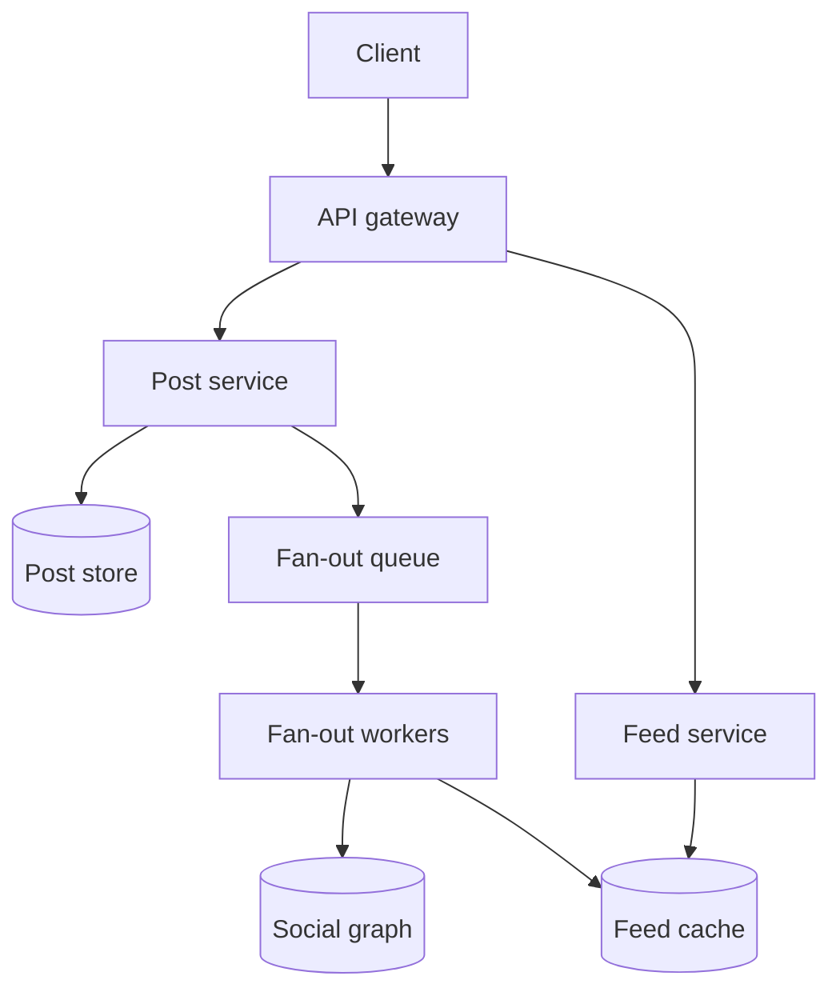
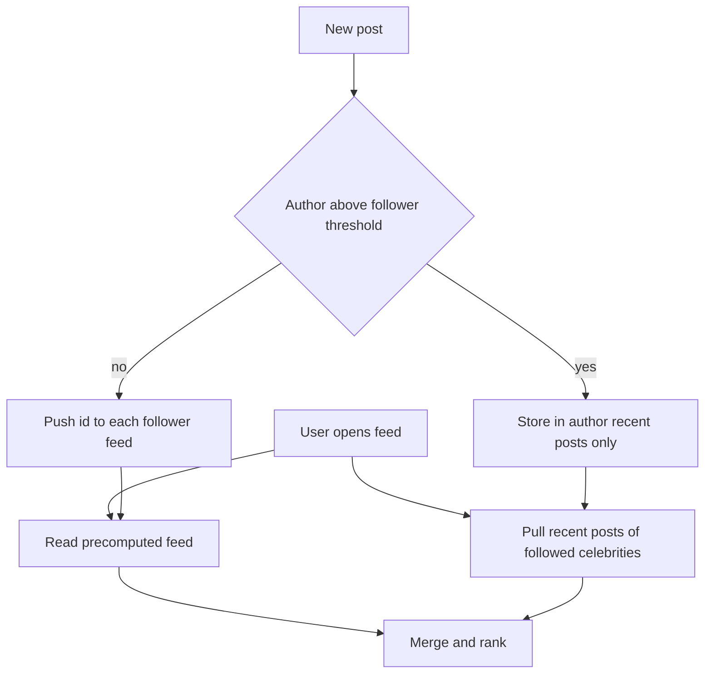

## The hook

You open the app on the train and, in under a second, a scroll of posts from hundreds of friends, pages and creators appears, already ordered. Somewhere a server had to decide which of thousands of recent posts you see first. Then a cricketer with tens of millions of followers posts a photo, and every one of those followers expects it near the top of their feed within moments.

"Design a news feed" is a classic interview question because it forces one central trade-off: do the work when someone posts, or when someone reads? Each answer breaks in a different place, and the best designs use both.

:::analogy
Imagine two ways to run a newspaper. In the first, the press prints a personal edition for every reader each time a story is filed, and drops it on their doorstep, so reading is instant. In the second, nothing is printed in advance: when you sit down, a clerk runs to every columnist you like, collects their latest pieces and assembles your paper on the spot. Printing per reader is wonderful until one star columnist has fifty million readers. Assembling on request is cheap to print but slow to read.
:::

## Requirements

**Functional**

1. Users publish posts (text plus optional media links).
2. Users follow other users or pages.
3. The home feed shows recent posts from followed accounts, newest or most relevant first.
4. Infinite scroll: fetch the feed one page at a time.

**Non-functional**

- Feed loads fast, well under a second at the 99th percentile.
- A new post shows up in followers' feeds within seconds; slight delay is acceptable.
- Highly available: a stale feed is better than an error.
- Read-heavy: feeds are read far more often than posts are written.

Out of scope: comments, notifications (see [Design a Notification System](article:system-design-notification-system)), ads and search.

## Back-of-envelope numbers

All numbers are **estimates**.

- **Users:** 300 million daily active users, each opening the feed 10 times a day: 3 × 10⁹ feed reads a day ÷ 86,400 ≈ **35,000 reads per second**, about 70,000 at a 2× peak.
- **Posts:** 10% of daily users post once a day: 30 million posts ÷ 86,400 ≈ **350 posts per second**.
- **Push cost:** with an average of 300 followers, 30 million × 300 = 9 × 10⁹ feed inserts a day ≈ **104,000 inserts per second**.
- **Pull cost:** if a reader follows 300 accounts, a pure pull feed touches 300 sources per read: 35,000 × 300 ≈ **10 million lookups per second**.
- **Feed cache:** keep the newest 500 entries per user at 16 bytes each (post id plus a score) = 8 KB per user, × 300 million ≈ **2.4 TB**, spread across a cache cluster.
- **Celebrity post:** 50 million followers. If the fan-out tier can spare 200,000 inserts per second for one post, delivery takes 50,000,000 ÷ 200,000 = **250 seconds**, over four minutes.
- **Post storage:** 30 million posts × 1 KB of text and metadata ≈ **30 GB a day**; photos and videos go to blob storage behind a CDN.

Reads dominate, which favours precomputing feeds. But the celebrity line shows why precomputing everything fails.

## High-level design

**Publishing.** The post service gives the post a time-ordered id (as in [Design a Unique ID Generator](article:system-design-unique-id-generator)), stores it, and returns at once. It then enqueues a fan-out job, exactly the accept-fast pattern from [The Dry Cleaner's Ticket](article:system-design-async-processing). Fan-out workers read the author's followers from the [[social graph]] and push the post id into each follower's feed list in the cache.

**Reading.** The feed service reads the user's feed list (just ids), merges in any celebrity posts, ranks the candidates, and performs [[hydration]]: one batched lookup turns ids into full posts from a post cache. Media URLs point at the CDN.

## Deep dives

### 1. Fan-out on write vs fan-out on read

With [[fan-out on write]], the printing press runs at publish time: every follower's personal edition gets the new post id. Reads are one cache lookup, which suits a read-heavy system. The costs are write amplification, wasted work for followers who never log in, and the celebrity problem.

With [[fan-out on read]], the clerk assembles the paper on request: fetch each followed account's recent post ids and merge them, newest first, with a heap of size equal to the number of sources (see [The Triage Nurse Who Always Knows Who Is Next](article:dsa-heap-basics)). Writes are trivial and nothing is wasted, but reads are slow and expensive, as the 10 million lookups per second estimate showed.

### 2. The celebrity problem and hybrid fan-out

The [[celebrity problem]] is the star columnist with fifty million readers: printing fifty million personal editions for one story takes minutes and floods the presses. The standard answer is [[hybrid fan-out]]:

- Accounts below a follower threshold (say 100,000, an estimate you would tune) are **pushed** as usual.
- Accounts above it are **pulled**: their posts are not fanned out. At read time the feed service fetches recent posts from the few large accounts this user follows and merges them with the precomputed list.
- Inactive users are skipped during push. When they return, their feed is rebuilt by pulling, then kept up to date by push.

A typical user follows only a handful of celebrities, so the read pays a few extra lookups instead of hundreds, and a celebrity post costs one write instead of millions.

:::insight
Put the work where it is cheapest. Most authors have few followers, so pushing their posts is cheap and makes reads instant. A few authors have enormous audiences, so pulling their posts at read time costs each reader a few lookups instead of costing the system millions of writes.
:::

### 3. Ranking

A chronological feed sorts by post id. A ranked feed scores candidates instead:

1. **Candidates:** the few hundred newest ids from the feed cache plus pulled celebrity posts.
2. **Features:** how often the reader interacts with the author, the post's age, early engagement, and content type.
3. **Score:** a model or a hand-tuned formula, such as affinity × engagement × a decay that shrinks with age.
4. **Re-rank:** remove duplicates, avoid five posts in a row from one author, and drop deleted or blocked content.

If the ranking service is slow or down, fall back to chronological order. A feed that is a little less relevant is far better than an empty one.

### 4. Pagination with cursors

Offset pagination ("skip 10, take 10") breaks on a live feed. Suppose page 1 showed posts 50 down to 41. Three new posts, 51 to 53, arrive. The request for offset 10 now returns posts 43 down to 34, so the user sees 43, 42 and 41 twice.

[[Cursor pagination]] fixes this. The response carries a cursor, such as "older than post 41", and the next request asks for the 10 items after it: posts 40 down to 31, with no duplicates and no gaps. For ranked feeds, the cursor can point into a ranked list snapshotted for this scrolling session, so ranks do not reshuffle mid-scroll. New posts are shown with a "new posts" banner at the top instead of shifting the page.

:::try-this
A feed shows posts newest first, 10 per page. Page 1 showed posts 80 down to 71, and then 5 new posts arrive. What does page 2 return with offset pagination, and what with a cursor? (Offset 10 returns 75 down to 66, repeating 75 to 71. The cursor "older than 71" returns 70 down to 61.)
:::

### 5. Storage choices

- **Posts:** a horizontally scalable store keyed by post id, with a post cache in front for hydration.
- **Social graph:** two tables, followers of X and accounts X follows, both sharded by user id, so fan-out and pull each need one lookup.
- **Feed cache:** an in-memory list or sorted set per user, capped at a few hundred ids. It is a cache, not the source of truth: if lost, rebuild it by pulling.

## Trade-offs

| Approach | Read cost | Write cost | Best for |
|---|---|---|---|
| Fan-out on write | one lookup | one insert per follower | ordinary accounts, active readers |
| Fan-out on read | one lookup per followed account | one insert | huge accounts, inactive readers |
| Hybrid | one lookup plus a few celebrity pulls | bounded by the threshold | real systems |

- **Freshness vs cost:** pushing gives near-instant delivery for most posts; celebrity posts appear as soon as followers refresh.
- **Chronological vs ranked:** chronological is predictable and cheap; ranked improves engagement but needs features, a model and a fallback.
- **Store ids vs full posts in feeds:** ids keep the cache small and make edits and deletes appear everywhere at once, at the cost of a hydration step on every read.

## What can go wrong

- **Fan-out backlog.** A burst of posts makes the fan-out queue lag and feeds go stale. Alert on queue age and add workers; the feed still loads, just slightly behind.
- **A celebrity's post becomes a hot key** in the post cache when millions hydrate it at once. Replicate it or cache it locally on feed servers, as in [When the Bakery Reopens](article:system-design-cache-problems).
- **Deletes and unfollows.** Chasing every copy of a deleted post id is slow. Filter during hydration and ranking, and let old ids age out of the capped lists.
- **Cold feed cache** after a cache node fails: thousands of users rebuild by pulling at once. Rebuild lazily on first read and rate-limit rebuilds.
- **Privacy changes.** A post made private after fan-out must disappear; checking visibility at hydration time makes this immediate.

:::warning
Common misconception: "fan-out on write is always the right answer because reads dominate." It is right for most authors, but pushing one celebrity post to tens of millions of followers can take minutes and starve every other post in the queue. Interviewers expect you to spot this and propose the hybrid with a follower threshold.
:::

## Further reading

- Silberstein, Terrace, Cooper and Ramakrishnan, "Feeding Frenzy: Selectively Materializing Users' Event Feeds", SIGMOD 2010, which formalises choosing push or pull per pair of users.
- Bronson et al., "TAO: Facebook's Distributed Data Store for the Social Graph", USENIX ATC 2013.
- [Keep the Spices on the Counter](article:system-design-caching) for the cache patterns behind the feed and post caches.

## Key takeaways

- Fan-out on write precomputes every follower's feed at publish time, making reads a single lookup at the cost of one write per follower.
- Fan-out on read builds the feed at request time by merging posts from every followed account, which is cheap to write but expensive to read.
- The celebrity problem makes pure push fail, so real systems push posts from ordinary accounts and pull posts from very large accounts at read time.
- Feeds store post ids and hydrate them in one batched lookup, which keeps the cache small and makes deletes and privacy changes take effect immediately.
- Cursor pagination anchors each page to the last item seen, so new posts arriving at the top never cause duplicates or gaps.
