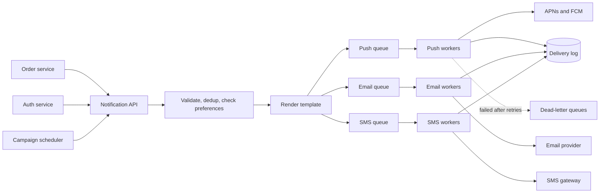

## The hook

Your food is out for delivery. Your bank flags a payment. Your flight gate changed. A friend commented on your photo. Each of these reaches you as a buzz on your phone, an SMS or an email, sent by a system most users never think about until it misfires: the same alert three times, a promotional SMS at 3 a.m., or an OTP that arrives after it expired.

A notification system looks like "call the push API". It becomes a design problem the moment there are dozens of teams sending, several channels, external providers that fail, users who opt out, and traffic that can jump tenfold when a campaign starts. That is why it is a popular interview question.

:::analogy
Think of a large company's post room. Every department drops off outgoing items: letters, parcels, urgent telegrams. The post room checks each recipient's standing instructions ("no junk mail", "do not deliver before 9 a.m."), puts each item in the right envelope, sorts letters, parcels and telegrams into separate bins, and hands each bin to a different courier. If the parcel courier is late, letters still go out. And it keeps a logbook so the same letter is never sent twice.
:::

The departments are the calling services, the standing instructions are user preferences, envelopes are templates, bins are per-channel queues, couriers are external providers, and the logbook is the deduplication and delivery log.

## Requirements

**Functional**

1. Services can send a notification to a user on one or more [[channel]]s: mobile push, SMS, email.
2. Messages are rendered from [[template]]s with per-user data and language.
3. Respect user preferences: opt-outs per category and channel, quiet hours.
4. Support immediate sends (OTPs, alerts) and scheduled or bulk sends (campaigns).
5. Track status: sent, delivered, failed, opened where the channel reports it.

**Non-functional**

- No lost notifications, and no duplicates in practice.
- Time-critical messages (OTP, security alerts) delivered within seconds even during campaigns.
- Scales with bursts; isolates failures of one [[provider]] from the others.

## Back-of-envelope numbers

All numbers are **estimates**.

- **Volume:** 400 million push, 80 million emails and 20 million SMS per day: 500 million per day ≈ **5,800 per second** on average (about 4,600 push, 930 email, 230 SMS).
- **Peak:** campaigns and breaking events can create bursts of **10x**, about 58,000 per second, so queues must absorb spikes.
- **Delivery log:** about 500 bytes per notification ≈ **250 GB per day**; keeping 90 days is about **22.5 TB**, so the log belongs in a store built for large append-heavy data, not the main relational database.
- **SMS cost** dominates money even though it is the smallest volume, which is why SMS is reserved for OTPs and critical alerts.

## High-level design

1. A calling service sends `{user_id, type, data, dedup_key, priority}` to the notification API. It does not know phone numbers, tokens or templates; it only describes the event.
2. The service checks the [[deduplication key]], loads the user's preferences and contact info (email, phone, [[device token]]s), and decides which channels to use.
3. It renders the template in the user's language and enqueues one message per channel, as in [The Ticket Rail Between Waiters and Cooks](article:system-design-message-queues).
4. Channel workers call the providers, record the result in the delivery log, and retry failures with backoff.

## Deep dives

### 1. Priorities so OTPs are never stuck behind a campaign

Use separate queues, or at least separate partitions, per priority. A 10-million-user campaign floods the low-priority push queue, while the high-priority queue for OTPs and security alerts has its own workers and stays near-empty. Without this, a login code can sit behind millions of promotions and expire.

### 2. Retries, idempotency and duplicates

Delivery between services is at-least-once, so duplicates are normal. Two layers stop them reaching the user:

- **At the API:** store each dedup key (for example `order-981:shipped`) with a TTL; a repeat is acknowledged but not processed. This is the same idea as [Pressing the Pay Button Twice Should Charge Once](article:system-design-stateless-idempotency).
- **At the worker:** record "sent" for a message id before acknowledging the queue message, so a worker crash and redelivery does not resend something already accepted by the provider.

Failed provider calls are retried with exponential backoff and jitter, as in [Why Your App Waits a Random Moment Before Retrying](article:famous-algos-exponential-backoff). After a few attempts the message goes to a [[dead-letter queue]] for inspection, and an OTP may fall back to another channel, such as SMS when push fails.

### 3. Preferences, quiet hours and per-user rate limits

The preference check happens centrally, before enqueuing:

- Category and channel opt-outs ("no marketing SMS"); transactional and legally required messages may be exempt.
- Quiet hours in the user's time zone: low-priority messages are delayed, not dropped.
- A per-user cap, such as at most a few marketing pushes per day, enforced with a per-user counter, the same technique as in [Design a Rate Limiter](article:system-design-rate-limiter).

### 4. Device tokens and bounces

Users have several devices, and tokens change when apps are reinstalled. Push providers report invalid tokens; the worker deletes them so future sends do not waste calls. Email providers report bounces and spam complaints; repeated hard bounces disable that address. Ignoring this feedback hurts deliverability for everyone.

:::insight
The core design move is to separate *deciding* what to send from *delivering* it. Decisions (dedup, preferences, rendering) happen once, centrally. Delivery is split into independent per-channel, per-priority queues, so a slow courier or a huge campaign can only slow down its own bin.
:::

## Trade-offs

| Decision | Option A | Option B |
|---|---|---|
| Rendering | before enqueue: workers stay simple | at send time: latest template and data, more work per send |
| Campaign fan-out | expand to all users at once: simple | expand in batches: smooth load, slower to finish |
| Dedup store | in-memory with TTL: fast | durable store: survives restarts, slower |
| Delivery guarantee | at-least-once plus dedup: practical | exactly-once: not achievable end to end with external providers |
| Fallback channels | push then SMS: reliable OTPs | single channel: cheaper, may fail silently |

## What can go wrong

A failure timeline:

1. **18:00** a marketing campaign enqueues 20 million pushes.
2. **18:01** OTPs share the same queue and wait behind the campaign; login attempts start failing.
3. **18:03** the push provider throttles the burst; workers retry immediately, making the throttling worse.
4. **18:05** the order service times out talking to the notification API, retries, and users get duplicate "order shipped" pushes.

Separate priority queues fix step 2, backoff with jitter and provider-aware rate limiting fix step 3, and dedup keys fix step 4. Also watch for:

- **Template bugs** that send "Hello {first_name}" to millions: validate templates and test-send before campaigns.
- **Time zones** in quiet hours and scheduled sends: store and compute in the user's zone.
- **Stale contact data** causing bounces and wasted SMS spend.

:::warning
Common misconception: "the provider accepted it, so the user got it." A 200 response from a push or SMS provider means the message was accepted for delivery, not that it reached the phone. Track delivery receipts and opens where channels provide them, and treat "accepted" and "delivered" as different states.
:::

### Interview follow-ups

**"How do you stop a user getting the same notification twice?"** Give each notification an id, have workers record sent ids (or use the provider's idempotency features), and make retries reuse the same id.

**"How do you respect user preferences and quiet hours?"** Check a preferences service before enqueueing: channel opt-outs, frequency caps, time zone and quiet hours. Delay non-urgent messages instead of dropping them.

**"How do you prioritise an OTP over a marketing blast?"** Separate queues (or priorities) and separate worker pools per class, with rate limits on bulk sends, so a campaign can never delay a login code.

**"How do you track whether notifications work?"** Record sent, delivered, opened and clicked events per notification, and watch bounce and failure rates per provider.

## Further reading

- RFC 8030, Generic Event Delivery Using HTTP Push (the Web Push protocol): https://www.rfc-editor.org/rfc/rfc8030
- RFC 5321, Simple Mail Transfer Protocol: https://www.rfc-editor.org/rfc/rfc5321
- Apple Developer documentation, "Sending notification requests to APNs", and Firebase documentation, "Firebase Cloud Messaging".

## Key takeaways

- Calling services describe events, and a central notification service decides channels, applies preferences and renders templates.
- Each channel and priority gets its own queue and workers, so a slow provider or a large campaign cannot delay urgent messages.
- Delivery is at-least-once, so deduplication keys at the API and sent-records at the workers prevent duplicate notifications.
- Retries use exponential backoff with jitter, and messages that keep failing go to a dead-letter queue or a fallback channel.
- Provider feedback about invalid tokens and email bounces must be processed to keep contact data clean and delivery reliable.
