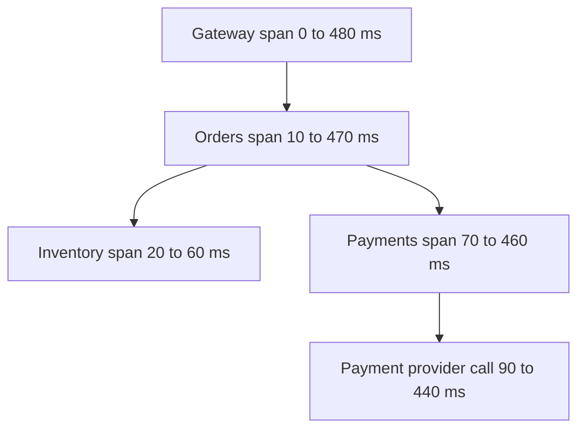

## The hook

It is 2 am. A customer tweets that checkout is slow. Your dashboards are all green: CPU fine, memory fine, no errors. The checkout request touches nine services. Which one is slow? For whom? Since when?

With logs alone, you are reading millions of lines from nine services, trying to match timestamps by eye. With only CPU graphs, you are looking at the wrong thing entirely.

Observability is being able to answer new questions about your system from the outside, without shipping new code first. Predict which of three tools would find the slow service in under a minute: a dashboard of averages, a search through logs, or a trace of one slow request. (The trace, and you'll see exactly how.)

## The intuition

:::analogy
A car offers three views of a trip. The **dashboard** shows speed and fuel right now. The **trip log** records events: "low tyre pressure at 14:05". The **GPS trace** shows the exact route one journey took and how long each stretch took. To find why today's drive was late, the dashboard tells you something is wrong, the trace shows where, and the log says why.
:::

These are the three pillars:

- **[[Metric]]s** are the dashboard: cheap numbers over time, great for spotting that something changed.
- **[[Log]]s** are the trip log: detailed events, great for explaining one failure.
- **[[Trace]]s** are the GPS trace: one request's path across services, great for finding where time went.

## How it works

### What to measure: RED and USE

For every **service**, the **[[RED method]]**:

- **Rate**: requests per second.
- **Errors**: failed requests per second or as a share.
- **Duration**: latency as a distribution: median, 95th and 99th percentiles, never just the average.

For every **resource** (CPU, memory, disks, connection pools, queues), the **[[USE method]]**:

- **Utilisation**: how busy it is.
- **Saturation**: how much work is waiting (queue length).
- **Errors**: failures of the resource itself.

Wait, why percentiles instead of averages? Because an average of 100 ms can hide 1% of users waiting 5 seconds. Those users are the ones tweeting at 2 am.

### Tracing one request

Each request gets a trace id at the edge. Every service creates a **[[span]]** for its work, and passes the trace id and its span id to downstream calls in request headers. The tracing system assembles the tree.

| Span | Start (ms) | End (ms) | Duration | Self time (duration minus children) |
|---|---|---|---|---|
| Gateway | 0 | 480 | 480 | 20 |
| Orders | 10 | 470 | 460 | 30 |
| Inventory | 20 | 60 | 40 | 40 |
| Payments | 70 | 460 | 390 | 40 |
| Payment provider | 90 | 440 | 350 | **350** |

The provider call accounts for 350 of 480 ms. Notice also that inventory and payments run one after the other; running them in parallel would save 40 ms. A trace shows both facts at a glance; a CPU graph shows neither.

### Logs that help

- **Structured** (JSON fields such as user id, order id, status), so they can be searched and aggregated.
- **Include the trace id**, so you can jump from a slow trace to its exact log lines.
- Log events and errors with context; avoid logging every successful request at full detail at high traffic.

### Alerting on symptoms

Alert on what users feel, tied to objectives: error rate or latency against the SLO, as in [What Three Nines Actually Buys You](article:system-design-availability-slos). CPU at 80%, a single host down in a redundant pool, or a spike in warnings are causes to look at on dashboards, not pages that wake people.

:::insight
Metrics tell you that something is wrong, traces tell you where, and logs tell you why. Measure every service with rate, errors and latency percentiles, every resource with utilisation and saturation, connect everything with a trace id, and page humans only for symptoms users can feel.
:::

## Trade-offs

| | Metrics | Logs | Traces |
|---|---|---|---|
| Cost per event | Lowest (aggregated) | Highest at high volume | Medium; usually sampled |
| Best for | Trends, alerts, dashboards | Details of one event | Latency across services |
| Cardinality tolerance | Low (keep labels bounded) | High | High per trace |
| Retention | Long, downsampled | Shorter or tiered | Short, sampled |

**Sampling** keeps tracing affordable: record a small share of all traces, but keep all traces that errored or were slow (tail-based sampling), so the interesting ones are never thrown away.

:::warning
Common misconception: "more alerts mean better monitoring." Alerts on every metric produce constant noise, and people learn to ignore pages, including the one that matters. Page on a few symptom-based alerts tied to service objectives, and leave cause metrics for dashboards and investigation.
:::

:::try-this
Checkout's 99th-percentile latency doubled at 14:00, but its error rate and CPU are unchanged. What would you look at first, and why? (Traces of slow checkout requests from after 14:00, to see which span grew, then that service's RED metrics and recent deploys. Unchanged CPU and errors suggest waiting on something downstream or on a saturated pool, which the USE method on connection pools would reveal.)
:::

## What can go wrong

- **Averages only**, hiding tail latency.
- **Unbounded metric labels** (user ids) exploding storage, as in [A Diary Where Only New Entries Are Written](article:system-design-time-series-db).
- **Missing context propagation** at one hop (a queue, a background job), breaking traces into disconnected pieces.
- **Log volume costs** growing faster than traffic; set levels and sampling deliberately.
- **Alert fatigue** from noisy pages.
- **Monitoring that fails with production**, leaving you blind during the incident.

### Interview follow-ups

**"What would you put on a service's main dashboard?"** Request rate, error rate and latency percentiles (RED), saturation of its key resources (USE), and the same for its most important dependencies, plus markers for deploys.

**"How do traces work across an asynchronous queue?"** Put the trace context into the message headers when producing, and start a child or linked span when consuming.

**"How do you debug an issue that affects only one customer?"** Find their requests in logs by user or request id, follow the trace id to the full trace, and compare with a healthy customer's trace.

## In the real world

- OpenTelemetry provides standard APIs and formats for metrics, logs and traces across languages.
- Prometheus-style systems store metrics; Jaeger and Zipkin are open-source tracing systems; log platforms index structured logs.
- The RED method was described by Tom Wilkie and the USE method by Brendan Gregg; both are widely used checklists.

Observability is also the foundation for the next two topics: shipping changes safely and scaling automatically both depend on trustworthy signals. It matters most in systems of many services, as in [One Big Kitchen or a Food Court?](article:system-design-microservices).

## Further reading

- *Site Reliability Engineering* (Google), chapter "Monitoring Distributed Systems".
- The OpenTelemetry documentation on traces, spans and context propagation.

## Key takeaways

- Metrics show that something changed, traces show where time went across services, and logs explain individual events; good observability links all three with a trace id.
- Measure every service with rate, errors and latency percentiles (RED) and every resource with utilisation, saturation and errors (USE).
- Distributed tracing passes a trace id and parent span id with every call, so one request's spans can be assembled and their self times compared.
- Use percentiles rather than averages, and keep metric labels bounded while putting per-request detail in logs and traces.
- Page humans only on symptoms users feel, tied to service objectives, and keep cause metrics for dashboards.
