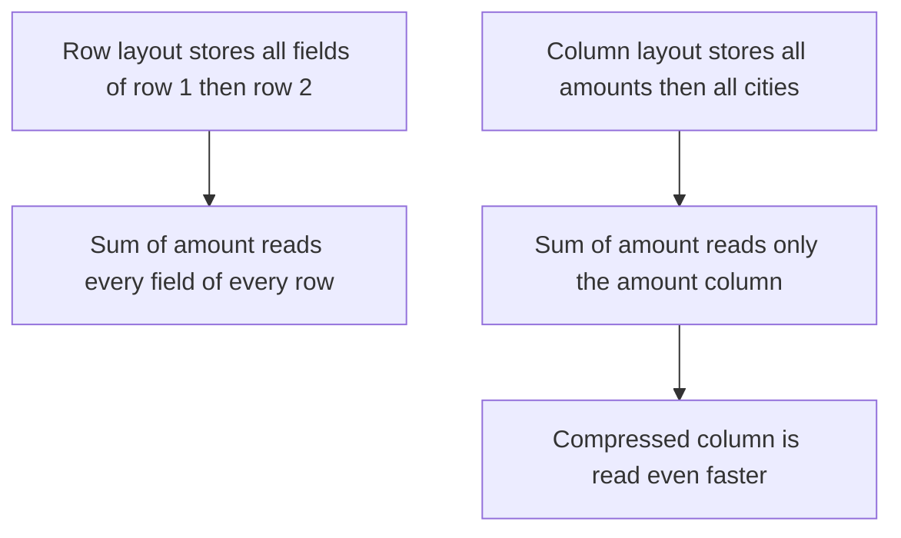

## The hook

The CEO wants a dashboard: revenue per city per month for the last three years. An engineer writes the SQL against the production orders database and presses run.

Ten minutes later the query is still running, and the checkout page has slowed to a crawl. Customers are abandoning carts. The dashboard query is reading every column of every order ever placed, just to add up one number per city.

The fix is not a faster server. It is storing the data sideways. Guess how much less data the same query reads when the table is stored by column instead of by row: twice less, ten times less, or fifty times less? (For this table, about fifty, before compression even starts.)

## The intuition

:::analogy
You have a spreadsheet with a billion rows and fifty columns, and you need the total of the "amount" column. Reading row by row means touching all fifty cells in each row just to pick out one. **Reading one column instead of every row** means running your finger straight down the amount column and ignoring the other forty-nine.
:::

That is **[[columnar storage]]**. Operational databases store data row by row, which is perfect for **[[OLTP]]**: "fetch order 501 with all its fields" reads one place. Analytics (**[[OLAP]]**) asks the opposite kind of question: "sum one field over a billion orders", which wants all values of a column side by side.

## How it works

### Reading less

For a table of 10⁹ rows and 50 columns of 8 bytes:

| Layout | Data read to sum one column |
|---|---|
| Row store | 10⁹ × 50 × 8 bytes = 400 GB |
| Column store | 10⁹ × 8 bytes = 8 GB |
| Column store, compressed 10× (illustrative) | about 0.8 GB |

### Compression multiplies the gain

Wait, why do columns compress so much better than rows? Because a column holds one kind of value, often repetitive: a `city` column has a few hundred distinct values repeated across a billion rows; a sorted `date` column changes slowly. Encodings exploit this:

- **Dictionary encoding**: store each distinct city once, then small integer codes.
- **Run-length encoding**: "Mumbai × 52,000" instead of 52,000 copies.
- **Delta encoding**: store differences between neighbouring sorted values, as in [Writing Only the Change in the Score](article:famous-algos-varints-delta).

The real compression ratio depends on the data; the point is that it is usually large, and smaller data means fewer bytes from disk and more of it in memory and CPU caches. Engines also process columns in batches with tight loops (vectorised execution), which modern CPUs run very fast.

### Star schemas

Warehouses typically organise data as a **[[star schema]]**:

| Table | Holds | Size |
|---|---|---|
| Fact: sales | One row per sale: date key, product key, store key, quantity, amount | Billions of rows |
| Dimension: product | Product name, category, brand | Thousands to millions |
| Dimension: store | City, region, format | Thousands |
| Dimension: date | Day, month, quarter, festival flag | A few thousand |

A query such as "revenue by city and month" scans two or three columns of the huge fact table and joins small dimensions.

### Getting data in

Data reaches the warehouse through **[[ETL]]** or ELT pipelines: periodic batch loads, or streams of change events from the operational databases. The warehouse is a copy, refreshed every few minutes to every day depending on the pipeline.

:::insight
Analytics queries read few columns of many rows, so storing data by column cuts the bytes read dramatically, and similar values stored together compress further. Keep transactions in a row-oriented OLTP database and copy the data into a column-oriented warehouse for analysis.
:::

## Trade-offs

| | OLTP database | OLAP warehouse |
|---|---|---|
| Typical query | Read or update a few rows by key | Scan and aggregate millions or billions of rows |
| Layout | Rows | Columns |
| Writes | Many small, transactional | Large batch or micro-batch loads |
| Freshness | Real time | Minutes to hours behind, depending on the pipeline |
| Indexes | B-trees on keys | Sort orders, partitions, min/max statistics per block |
| Users | Applications | Analysts, dashboards, data scientists |

Column stores are poor at single-row updates: changing one order touches every column file. That is why they load in batches and are rarely the system of record for transactions.

:::warning
Common misconception: "our database can run SUM and GROUP BY, so analytics can run on production." It can, until the data grows: full scans on a row store read every column and compete with customer traffic for CPU, memory and disk. Move heavy analytics to a warehouse, or at minimum to a dedicated replica.
:::

:::try-this
A query filters sales to the last 7 days and sums the amount. The fact table is partitioned by date and each column file keeps the min and max value per block. Which data does the warehouse avoid reading? (Every partition older than 7 days is skipped entirely, and within the remaining partitions, blocks whose min/max dates fall outside the range are skipped too. Only the date and amount columns of the matching blocks are read.)
:::

## What can go wrong

- **Analytics on the OLTP primary** slowing customer traffic.
- **Treating the warehouse as real time** when the pipeline runs hourly; label dashboard freshness.
- **Pipelines that silently fail**, leaving stale or missing data; monitor row counts and freshness.
- **Very wide `SELECT *` queries** on a column store, which throw away its main advantage.
- **Small frequent updates** to column stores, which are expensive; batch them.

### Interview follow-ups

**"Design analytics for an e-commerce site."** Keep orders in the OLTP database; stream changes (change data capture) or batch-load nightly into a columnar warehouse; model sales as a fact table with product, store and date dimensions; build dashboards on the warehouse.

**"What is a data lake, and how does it relate?"** Raw and processed data stored as files in object storage, queried by distributed engines. Modern lakehouse formats add table features (schemas, transactions) on top of those files, blurring the line with warehouses.

**"How would you get sub-second dashboards over billions of rows?"** Pre-aggregate into summary tables (rollups by day and city), partition and sort the fact table by the common filters, and cache popular dashboard queries.

## In the real world

- Cloud warehouses such as BigQuery, Snowflake and Amazon Redshift store data in columnar form and separate storage from compute.
- Open columnar file formats such as Apache Parquet and ORC are widely used for data stored in object storage.
- Analytical databases such as ClickHouse use columnar storage for fast aggregation over large event data.

The batch processing that builds and feeds these tables at scale is the next article. The broader database choice is in [Filing Cabinet, Labelled Boxes or Giant Spreadsheet?](article:system-design-sql-vs-nosql).

## Further reading

- The "Column-Oriented Storage" section of Martin Kleppmann's *Designing Data-Intensive Applications*.
- Ralph Kimball and Margy Ross, *The Data Warehouse Toolkit*, for star schemas and dimensional modelling.

## Key takeaways

- OLTP systems handle many small transactional reads and writes; OLAP systems run large scans and aggregations over history, and they want different storage layouts.
- Columnar storage reads only the columns a query needs, which for wide tables cuts the data read by a large factor before compression.
- Similar values stored together compress very well with dictionary, run-length and delta encodings, and vectorised execution processes them fast.
- Warehouses typically use a star schema: a huge fact table of events joined to small dimension tables.
- Copy data from operational databases into a warehouse with ETL or change streams, and never run heavy analytics on the production primary.
