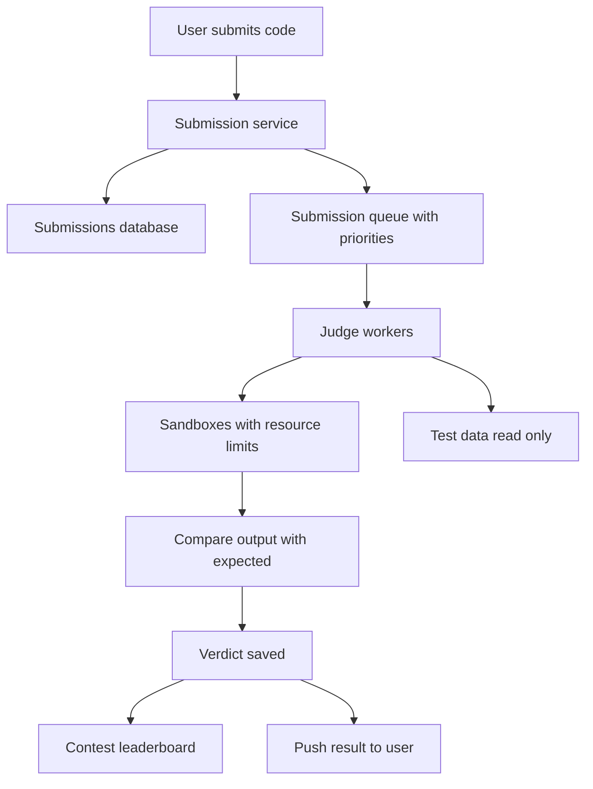

## The hook

Ten minutes before a contest ends, 20,000 people press "Submit" on their last attempt. Each submission is a program written by a stranger: some correct, some in infinite loops, some allocating all the memory they can, and a few deliberately trying to read the test data or attack the server.

The judge must compile and run every one of them against dozens of test cases, enforce limits to the millisecond, give a fair verdict, and keep the leaderboard updating.

Predict which requirement shapes the architecture most: speed, fairness or security? (Security. Everything else is easier once you treat every submission as hostile.)

## Requirements

**Functional**
- Problems with test cases; users submit code in several languages.
- Compile, run against all tests within time and memory limits; return a **[[verdict]]**.
- Contests with live leaderboards; submission history.

**Non-functional**
- Untrusted code must never escape its sandbox.
- Verdicts consistent and fair: the same code gets the same result.
- Handle contest spikes; verdicts within seconds normally.

:::analogy
An online judge is **an exam hall with invigilated cubicles**. Candidates hand in answer scripts at the front desk, which queues them. Each script is checked in a sealed cubicle with no phone, no internet and a strict clock; the invigilator stops anyone who overruns. Nobody can see another cubicle or the answer key.
:::

## Back-of-envelope numbers

All **estimates**.

- A contest with 50,000 submissions over 2 hours: 50,000 ÷ 7,200 ≈ **7 per second** on average; the last minutes can be **about 10 times** that, around 70 per second.
- Each submission runs 30 to 100 tests; say **5 CPU-seconds** in total.
- Peak judging capacity: 70 × 5 ≈ **350 CPU cores** busy, so the worker pool must scale out for contests or queue the burst.

## High-level design

## Deep dives

### 1. The sandbox

Each run executes in a **[[sandbox]]**:

- Its own container or lightweight VM, with a fresh, read-only file system except a small scratch directory.
- **No network.**
- A system-call filter allowing only what a normal program needs.
- **[[Resource limits]]** through the operating system: CPU time, wall time, memory, number of processes (stopping fork bombs) and output size.
- Runs as an unprivileged user; nothing reused between submissions.

Defence in depth applies, as in [Castle Walls, Gates and Guards](article:system-design-security-at-scale): even if one layer fails, the others hold.

### 2. Measuring time fairly

The main time limit uses **CPU time**, which reflects the program's own work, with a looser **wall-clock** limit to catch programs that sleep or block. Judge machines run a fixed number of sandboxes per core and avoid noisy neighbours, so timing is consistent. Wait, why does that matter? Because a solution that passes at 0.9 seconds on a quiet machine might take 1.2 on an overloaded one, and the verdict would depend on luck.

### 3. Queueing and fairness

Submissions go into a queue, as in [The Dry Cleaner's Ticket](article:system-design-async-processing). **[[Judge worker]]s** pull from it. **[[Fair scheduling]]**:

- Separate priority queues: contest submissions before practice ones during a contest.
- Limit in-flight submissions per user, so one person submitting 50 times cannot starve others.
- Autoscale workers before scheduled contests; queue the burst rather than overload machines (which would distort timing).

### 4. Test data and judging

Test cases are stored read-only and mounted into sandboxes (never readable over the network). Output comparison is exact by default, with special checkers for problems with multiple valid answers or floating-point tolerance. Early exit on the first failing test saves CPU for wrong answers.

### 5. Leaderboard

Contest verdicts update scores and penalties; a sorted set computes ranks, as in [Design a Real-Time Leaderboard](article:system-design-leaderboard). Many contests freeze the public board in the last hour while still judging.

:::insight
An online judge is a queue-and-workers system whose workers run hostile code. Strong sandboxes (no network, read-only files, system-call filters, hard resource limits) come first; fair, consistent timing and fair queueing come next; contest spikes are handled by queueing and pre-scaling, never by overloading judges.
:::

## Trade-offs

| Decision | Choice | Trade-off |
|---|---|---|
| Isolation | Containers with strict limits, or microVMs | Fast startup versus stronger isolation |
| Timing | CPU time plus wall-time backstop | Fair verdicts; needs careful measurement |
| Spikes | Queue plus pre-scaling | Verdicts may take longer at the end of a contest |
| Judging | Stop at first failing test | Saves CPU; less feedback per submission |
| Languages | Per-language images and multipliers | Broad support; maintaining toolchains |

:::warning
Common misconception: "run the code in a Docker container and it is safe." Default container settings still allow networking, many system calls and unlimited resources. A judge needs deliberately restricted sandboxes: no network, a system-call allowlist, unprivileged users, read-only files and hard limits, ideally with a second isolation layer.
:::

:::try-this
A submission prints 2 GB of output in a loop. What protects the judge, and what verdict should it get? (An output-size limit in the sandbox stops the program once it exceeds, say, 64 MB, and the verdict is "output limit exceeded" or "wrong answer". Without the limit, it could fill the judge's disk.)
:::

## What can go wrong

- **Sandbox escapes** from weak isolation.
- **Fork bombs and memory hogs** without process and memory limits.
- **Inconsistent timing** on overloaded judges, giving unfair verdicts.
- **Test data leaks** through readable files or network access.
- **Queue starvation** by a few heavy users.
- **Toolchain drift** between judges producing different results; pin images.

### Interview follow-ups

**"How would you support interactive problems?"** Run the user's program and an interactor process in the same sandbox, connected by pipes, with limits on both.

**"How would you detect plagiarism in a contest?"** Compare normalised submissions (token streams or syntax trees) with similarity measures after the contest, and review flagged pairs by hand.

**"How do you rejudge after fixing a test case?"** Re-enqueue all affected submissions at low priority and update verdicts and standings.

## Further reading

- Documentation of open-source judges and sandboxing tools (for example isolate, nsjail or gVisor).
- Linux documentation on cgroups, namespaces and seccomp.

## Key takeaways

- An online judge queues submissions and has worker pools compile and run them, treating every program as hostile.
- Sandboxes need no network, a read-only file system, system-call filtering, an unprivileged user and hard limits on CPU, wall time, memory, processes and output.
- Fair verdicts need consistent timing: CPU-time limits with a wall-time backstop, and judges that are never overloaded.
- Priority queues, per-user limits and pre-scaled workers handle contest spikes without distorting results.
- Test data stays read-only and inaccessible, and contest results feed a leaderboard built on a sorted set.
