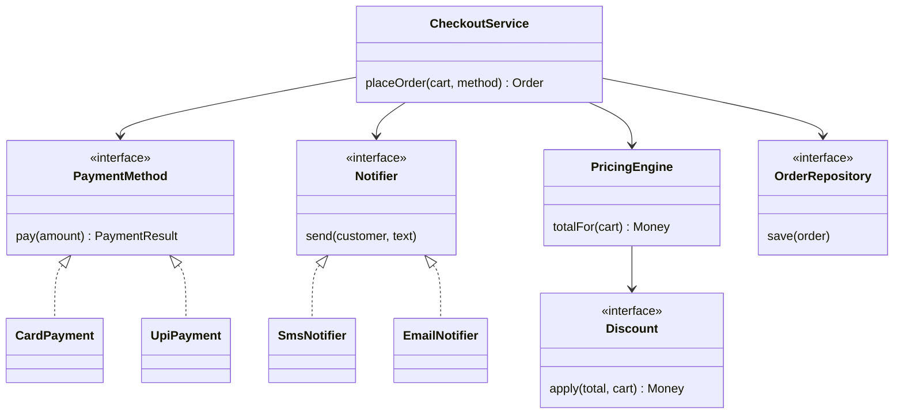

## The hook

Here is a real-looking class from a food-delivery app. It is 400 lines long, and every product meeting adds to it.

```pseudo
class Checkout:
    placeOrder(cart, paymentType, notifyType):
        total = sum of item prices
        if cart.coupon == "FIRST50": total = total * 0.5
        if paymentType == "card": call card API ...
        else if paymentType == "upi": call UPI API ...
        else if paymentType == "wallet": ...
        save order with raw SQL ...
        if notifyType == "sms": send SMS ...
        else if notifyType == "email": send email ...
```

Tomorrow the business wants pay-later, WhatsApp notifications and a new coupon type. Predict how many places in this class you would have to touch, and how many existing features you could break while doing it.

The answer is "most of it" and "any of them". This article shows how object-oriented design turns this tangle into parts you can snap on and off. It is also exactly the reasoning an interviewer wants to hear in a low-level design round, the close cousin of the high-level round in [Forty-Five Minutes to Design Instagram](article:system-design-interview-framework).

:::analogy
Lego bricks work because every brick has **standard studs**. A brick does not need to know what will sit on top of it; it only promises the stud pattern. That is why a wheel, a window or a minifigure can click onto the same base. Good classes are Lego bricks: each does one job, and they connect through standard studs called interfaces.
:::

## Requirements

We will redesign the checkout above. Treat this like the first five minutes of an interview: pin down what must be supported.

- Place an order from a cart: compute the total, apply discounts, take payment, save the order, notify the customer.
- Payment by card, UPI or wallet today; more methods later.
- Notification by SMS, email or push; a customer may want several.
- Discounts come in several kinds (percentage, flat amount, free delivery) and change often.
- Must be unit-testable without calling real payment providers.

Non-functional: new payment methods, discounts and channels must be addable **without editing** tested checkout code.

## Core objects

Read the requirements and underline the nouns. Most of them become objects; the verbs become methods.

- **Order** and **Cart**: what is being bought.
- **PaymentMethod**: card, UPI, wallet, each knows how to pay.
- **Discount**: percentage, flat, free delivery, each knows how to change a total.
- **Notifier**: SMS, email, push, each knows how to deliver a message.
- **OrderRepository**: saves and loads orders.
- **CheckoutService**: the coordinator that uses all of the above.

### The four pillars, in this example

Before the principles, the four classic ideas of object-oriented programming, each shown on our checkout:

| Pillar | Plain meaning | In the checkout |
|---|---|---|
| [[Encapsulation]] | Hide data, expose safe methods | Order's status changes only through pay() and cancel(), never by assigning a field |
| [[Abstraction]] | Show what, hide how | CheckoutService calls method.pay(amount) without knowing about card networks |
| Inheritance | A child class reuses a parent's contract | CardPayment is a PaymentMethod |
| [[Polymorphism]] | Same call, different behaviour | pay() runs card logic for a card and UPI logic for UPI |

## Class design

Now the five SOLID principles. Robert C. Martin popularised them as a checklist for classes that stay easy to change. Each one fixes a specific pain from the hook.

### S: Single responsibility

A class should have **one reason to change**. Our original Checkout changes when pricing rules change, when a payment provider changes, when the database changes and when notification text changes. Four reasons, four teams editing one file.

Split it so each class has one job: pricing, paying, storing, notifying. CheckoutService only coordinates.

### O: Open for extension, closed for modification

Wait, how can a class be open and closed at once? It is **open** to new behaviour and **closed** to edits: you add a new class instead of editing tested code.

```pseudo
// Before: every new method edits this function
pay(type, amount):
    if type == "card": ...
    else if type == "upi": ...

// After: new methods are new classes behind one interface
interface PaymentMethod:
    pay(amount) -> PaymentResult

class CardPayment implements PaymentMethod:
    pay(amount): charge the card through the card gateway

class UpiPayment implements PaymentMethod:
    pay(amount): send a collect request to the UPI app

// Adding pay-later = one new class. Checkout code is untouched.
class PayLater implements PaymentMethod:
    pay(amount): create a credit entry for the customer
```

This is the Lego stud: the [[interface]] PaymentMethod is the standard shape every payment brick must fit.

### L: Liskov substitution

Named after Barbara Liskov: any subclass must work **anywhere its parent is expected**, without surprises.

Predict the bug. A WalletPayment class implements pay(amount), but when the wallet balance is short it silently charges only what is available and returns success.

CheckoutService was written for PaymentMethod, whose promise is "either the full amount is paid or you get a failure". The wallet breaks that promise, so orders ship half-paid. The fix is not a special case in checkout; it is making WalletPayment honour the contract (return a failure, or split into wallet plus another method explicitly).

:::warning
Common misconception: "inheritance is for reusing code." Inheriting just to borrow methods creates is-a relationships that are not true, such as Penguin extends Bird when birds promise fly(). Use inheritance only when the child truly can stand in for the parent. To reuse code, hold a helper object instead ([[composition]]).
:::

### I: Interface segregation

Do not force a class to implement methods it does not need. Suppose the interface were:

```pseudo
interface PaymentMethod:
    pay(amount)
    refund(amount)
    saveCardForLater()
```

UPI and cash-on-delivery have no card to save, so they would implement saveCardForLater() by throwing errors, a Liskov violation waiting to happen. Split it: PaymentMethod (pay, refund) and a separate SavableInstrument (saveForLater) that only cards implement.

### D: Dependency inversion

High-level policy (checkout) should depend on **abstractions**, not on concrete providers. Instead of CheckoutService creating a RazorpayGateway inside itself, it receives interfaces through its constructor. That is [[dependency injection]].

```pseudo
class CheckoutService:
    constructor(pricing: PricingEngine,
                repo: OrderRepository,
                notifiers: list of Notifier):
        store them

    placeOrder(cart, method: PaymentMethod) -> Order:
        total = pricing.totalFor(cart)              // discounts inside
        result = method.pay(total)
        if result.failed: return Order.failed(cart, result.reason)
        order = Order.paid(cart, total, result.reference)
        repo.save(order)
        for n in notifiers: n.send(cart.customer, "Order " + order.id + " placed")
        return order
```

In a unit test you pass a FakePaymentMethod that returns success instantly and an in-memory repository. No network, no database, and the test runs in milliseconds.



:::insight
Every SOLID principle is the same Lego idea from a different angle: give each brick one job, connect bricks only through standard studs (interfaces), and add features by adding bricks, never by carving into the ones already holding weight.
:::

## Key flows

**Place an order, traced** with a cart of ₹400, a 10% discount and UPI:

| Step | Object | Action | Result |
|---|---|---|---|
| 1 | PricingEngine | Sum items | ₹400 |
| 2 | PercentageDiscount | Apply 10% | ₹360 |
| 3 | UpiPayment | pay(360) | success, reference U123 |
| 4 | Order | Order.paid(...) | status PAID |
| 5 | OrderRepository | save(order) | stored |
| 6 | SmsNotifier, PushNotifier | send | two messages |

**Add a new discount** ("free delivery above ₹500"): write FreeDeliveryDiscount implementing Discount, register it in the pricing configuration. CheckoutService, the tests for card payments and the notifiers do not change.

**Payment fails**: pay() returns a failure, CheckoutService returns a failed order without saving a paid one or notifying "order placed". Because the contract says "full amount or failure", there is no half-paid state to handle.

:::try-this
A new requirement: some restaurants want an order confirmation sent to them on WhatsApp too. Which classes do you add or change? (Add WhatsAppNotifier implementing Notifier, and pass it in the notifier list for those orders. CheckoutService does not change, which is open/closed and dependency inversion working together.)
:::

## Patterns used

- **Strategy** (PaymentMethod, Discount, Notifier): swap an algorithm behind one interface at run time. It is the pattern behind open/closed here.
- **Composition over inheritance**: CheckoutService *has* a pricing engine, a repository and notifiers rather than inheriting from a base checkout. Pieces can be swapped independently and tested alone.
- **Dependency injection**: collaborators arrive through the constructor, which makes testing with fakes trivial.
- **Repository**: hides storage details behind save and load, so switching databases does not touch business logic.

Factories and builders, which decide *which* concrete brick to create, come in the next article on creational patterns.

## Extensions

What an interviewer often asks next, with the design moves that answer it:

- **"Split payment: half wallet, half card."** A CompositePayment that holds a list of PaymentMethods and pays each in turn, refunding earlier parts if a later part fails. It still implements PaymentMethod, so checkout does not change.
- **"Retries and idempotency."** Wrap any PaymentMethod in a RetryingPayment that retries transient failures with the same idempotency key. Wrapping instead of editing is the decorator idea.
- **"Different discount stacking rules per city."** Make the stacking policy its own strategy inside PricingEngine.
- **"Audit every payment."** An AuditedPayment decorator that logs before and after delegating to the real method.

### Interview follow-ups

**"Composition or inheritance: how do you choose?"** Ask whether the child can truly be used everywhere the parent is (is-a with the same promises). If yes, inheritance or an interface is fine. If you only want to reuse code, hold the helper as a field instead.

**"Is SOLID always worth it?"** No. Five interfaces for a 50-line script is over-engineering. Apply the principles where change is expected: payment providers, pricing rules, notification channels. Say this out loud; interviewers like the judgement.

**"Abstract class or interface?"** An interface is a pure contract and a class can implement several. An abstract class can share some code and state, but a class has only one parent. Prefer interfaces for the studs between components.

**"How would you test placeOrder?"** Inject fakes: a payment that succeeds or fails on demand, an in-memory repository, a notifier that records messages. Then assert on the returned order and the recorded messages.

Next in this track, the creational patterns decide which brick to build and when, and the same studs make those factories clean.

## Key takeaways

- Object-oriented design rests on encapsulation, abstraction, inheritance and polymorphism, and SOLID is a practical checklist for using them so code stays easy to change.
- Single responsibility and open/closed together mean each class has one job and new features arrive as new classes behind an interface, not as edits to tested code.
- Liskov substitution and interface segregation keep contracts honest: subclasses must keep the parent's promises, and no class should implement methods it cannot support.
- Dependency inversion with constructor injection makes high-level code depend on interfaces, which allows swapping providers and testing with fakes.
- Prefer composition over inheritance for reuse, and apply SOLID where change is expected rather than everywhere.
