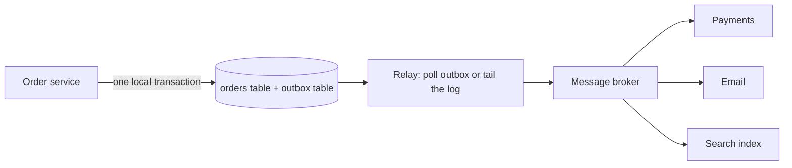

## The hook

An order service saves a new order and then publishes "OrderCreated" to a message broker so that payments, email and analytics can react. It works in every test. Then, in production, the broker is briefly unreachable during a deploy: orders are saved, but their events never go out. Customers are never charged, never emailed, and the warehouse never ships. Nobody notices for hours, because each system on its own looks healthy.

Flip the order, publish first and then save, and you get the opposite bug: events announcing orders that do not exist. This is the **dual-write problem**, and it sits underneath every saga, every event-driven system and every cache or search index kept in sync with a database.

## The intuition

:::analogy
Imagine writing a letter and addressing the envelope as two separate trips to the post office. On some days you post the envelope and forget the letter; on others the letter goes without an address. The fix is obvious once you see it: put the letter in the envelope at your desk, in one motion, and drop the sealed envelope in your own outbox tray. A postal worker collects everything from the tray and delivers it later. Whatever happens, the letter and its envelope travel together.
:::

The letter is the business change, the envelope is the event, the tray is a [[transactional outbox]], and the postal worker is the [[relay (message relay)]].

## How it works

### Why dual writes fail

A [[dual write]] is two independent operations: commit to the database, publish to the broker. There is no transaction spanning both, and two-phase commit across them is usually unavailable or undesirable, as explained in [Everyone Says I Do, or Nobody Is Married](article:system-design-two-phase-commit). Any crash, timeout or network error between the two leaves them disagreeing:

| Order of operations | Failure between them | Result |
|---|---|---|
| DB commit, then publish | crash or broker down | change saved, event lost |
| Publish, then DB commit | DB rejects or crash | event announces a change that never happened |

Retrying in the application does not help if the process itself dies.

### The transactional outbox

1. In the same local database transaction as the business change, insert a row into an `outbox` table: event id, type, payload, created time.
2. Commit. Now the change and the event are atomically together: both exist or neither does.
3. A relay reads unpublished outbox rows in order, publishes each to the broker, and then marks it published (or deletes it).



```pseudo
place_order(order):
    begin transaction
        insert into orders values (...)
        insert into outbox (event_id, type, payload) values (uuid(), 'OrderCreated', ...)
    commit

relay loop:
    rows = select * from outbox where published = false order by id limit 100
    for row in rows:
        broker.publish(row.payload, key = row.aggregate_id, id = row.event_id)
        update outbox set published = true where id = row.id
```

If the relay crashes after publishing but before marking, it publishes the row again on restart. So the outbox gives [[at-least-once delivery]], and consumers must be [[idempotent consumer]]s that remember event ids they have processed.

### Change data capture

Polling an outbox table works but adds load and delay. [[Change data capture (CDC)]] goes one level lower: databases already write every committed change to a log for durability and replication (PostgreSQL's write-ahead log, MySQL's binlog), as in [Write It in the Ledger Before You Hand Over the Cash](article:famous-algos-write-ahead-log). A CDC connector reads that log like a replica would and emits each committed change as an event, in commit order.

Two ways to use it:

- **CDC on the outbox table**: the service still writes explicit outbox events, and CDC replaces the polling relay. Events stay clean, versioned contracts.
- **CDC on business tables directly**: every row change becomes an event. Great for feeding caches, search indexes and analytics, but it exposes your internal schema to consumers, so it is less suited to events between teams.

:::insight
The outbox does not make two systems agree by coordinating them. It removes the second system from the transaction entirely: the only atomic write is to one database, and publishing becomes a retryable copy job that can lag but never diverge.
:::

### Ordering

Publish with a key such as the order id, so all events for one order land in the same partition and keep their order. The relay must read outbox rows in commit order per key; CDC gets this for free from the log.

## Trade-offs

| Approach | Gains | Costs |
|---|---|---|
| Dual write | simplest code | silently loses or invents events on failure |
| Outbox with polling relay | works on any database, explicit event contracts | polling load and latency, outbox cleanup |
| Outbox with CDC relay | low latency, no polling | CDC infrastructure to run and monitor |
| CDC on business tables | no application changes | couples consumers to the internal schema |
| Event sourcing (events are the source of truth) | no dual write at all | large change in how data is modelled and queried |

## What can go wrong

- **Relay stops** (crash, bad deploy): events pile up in the outbox. Monitor the age of the oldest unpublished row and alert on it.
- **Duplicates after relay restart**: consumers must deduplicate by event id.
- **Out-of-order events** if the relay publishes rows in parallel without keys.
- **Outbox table growth**: delete or archive published rows on a schedule.
- **CDC connector falls behind** and the database must keep old log segments for it, which can fill the disk. Watch replication slot lag.
- **Schema changes** break consumers of raw CDC events; version event payloads.

:::warning
Common misconception: "publish the event right after commit, and retry if it fails, and you are safe." Retries help with transient broker errors, but not with the process crashing between commit and publish, which is exactly when the event is lost. Only writing the event in the same transaction, then publishing from that durable record, closes the gap.
:::

:::try-this
A service updates a customer's email and must update the search index. Which approach would you choose, and what must the indexer do? (CDC on the customers table, or an outbox event CustomerEmailChanged, then an idempotent indexer that applies changes by customer id and ignores events older than the version it has already applied.)
:::

### Interview follow-ups

**"Why not just write to the database and then publish to Kafka?"** If the service crashes between the two, one happens without the other: a saved order with no event, or an event for an order that rolled back. The outbox writes the event in the same database transaction as the data, so both happen or neither does.

**"Polling relay or change data capture?"** A polling relay periodically selects unpublished outbox rows; simple, but adds database load and some delay. CDC (for example Debezium) tails the database's log and publishes changes with low latency and no polling queries, at the cost of running another system.

**"How do consumers handle duplicates?"** Delivery is at least once, so each event carries a unique id and consumers record processed ids, or make their updates idempotent.

## In the real world

- Debezium is a widely used open-source CDC platform that reads database logs and publishes changes to Kafka.
- PostgreSQL exposes committed changes for CDC through logical decoding and replication slots; MySQL CDC tools read the binlog.
- The outbox pattern is a standard building block in microservice sagas, alongside idempotent consumers.

## Further reading

- Chris Richardson, "Pattern: Transactional outbox": https://microservices.io/patterns/data/transactional-outbox.html
- Debezium documentation: https://debezium.io/documentation/
- PostgreSQL documentation, Logical Decoding: https://www.postgresql.org/docs/current/logicaldecoding.html

## Key takeaways

- Writing to a database and publishing to a broker as two separate steps can lose events or announce changes that never happened.
- The transactional outbox writes the event row in the same local transaction as the business change, so both commit or neither does.
- A relay or a change data capture connector then publishes outbox rows, giving at-least-once delivery that consumers deduplicate by event id.
- Change data capture reads the database's own write-ahead log or binlog, emitting committed changes in order with low latency.
- Monitor relay lag and outbox size, key events for ordering, and version payloads so consumers survive schema changes.
