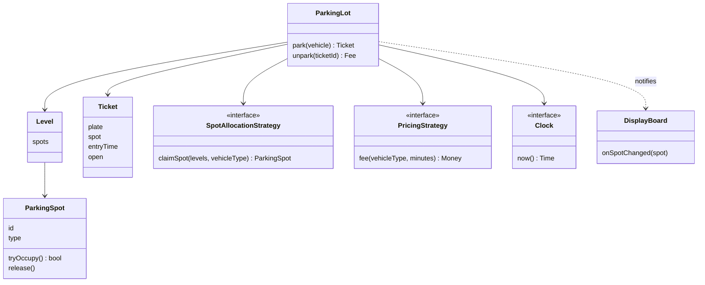

## The hook

Saturday evening at a mall. Two cars pull up to two different entry gates at the same second. Both gate screens flash "Proceed to Level 0, Spot C1". Both barriers lift.

One of those drivers is about to spend ten minutes circling a full basement, and the mall's support line is about to get an angry call. Nothing crashed. No exception was thrown. Every line of code did exactly what it was told.

The parking lot is the most-asked machine coding problem because it looks trivial and hides two real questions: who decides which spot you get, and what stops two people from getting the same one? By the end you will have a design and a running program that answer both.

## Requirements

Following the plan from [Build the Model House One Room at a Time](article:system-design-machine-coding-approach), you clarify first and write it down.

**Functional**

- Multiple levels, each with spots of three types: small, compact, large.
- Vehicles: bike, car, truck. A bike fits any spot, a car fits compact or large, a truck fits only large.
- Entry: assign a spot, issue a ticket. If nothing fits, refuse entry.
- Exit: close the ticket, compute the fee, free the spot.
- Fee: our example rates per started hour are ₹10 for a bike, ₹30 for a car and ₹60 for a truck, minimum one hour.
- A display board shows free spots per level and type.

**Non-functional**

- Several gates work at once, so spot assignment must be safe under concurrency.
- Pricing and allocation rules will change, so both must be swappable.
- Testable without waiting for real hours to pass.

**Out of scope, said out loud**: reservations, EV charging, monthly passes. Mention them as extensions.

:::analogy
Picture an old-school **car park attendant with a clipboard**. The clipboard lists every spot on every level, with a tick next to each taken one. The attendant follows a rulebook for which spot to give each vehicle, writes the ticket, and at the exit reads the fee off a printed chart. There is **one clipboard and one pen**, and only the person holding the pen can tick a spot. Every class in this design is a piece of that attendant's kit.
:::

## Core objects

Underline the nouns and give each one job:

- **ParkingLot**: holds levels and wires everything together. Not a [[god class]]: it coordinates, it does not price or choose.
- **Level** and **ParkingSpot**: the clipboard's rows. A spot knows its id, type and whether it is taken.
- **Vehicle**: plate and type.
- **Ticket**: plate, spot, entry time, open or closed. The [[ticket]] is the only thing that connects entry to exit.
- **SpotAllocationStrategy**: the attendant's rulebook.
- **PricingStrategy**: the printed fee chart.
- **EntryGate**, **ExitGate**: thin entry points that call the lot.
- **DisplayBoard**: listens for spot changes and shows free counts.
- **Clock**: where "now" comes from.

Wait, why is Clock an object? Because fees depend on time. If ExitGate calls the system clock directly, testing "a car stays 175 minutes" means waiting 175 minutes. An [[injected clock]] lets the test simply say "now is minute 200".

## Class design



```pseudo
enum VehicleType: BIKE, CAR, TRUCK
enum SpotType: SMALL, COMPACT, LARGE

fits(vehicleType) -> list of SpotType, best fit first:
    BIKE:  [SMALL, COMPACT, LARGE]
    CAR:   [COMPACT, LARGE]
    TRUCK: [LARGE]

class ParkingSpot:
    id, type, taken = false
    tryOccupy() -> bool:    atomically: if taken return false; taken = true; return true
    release():              taken = false

interface SpotAllocationStrategy:
    claimSpot(levels, vehicleType) -> ParkingSpot or NONE

class BestFitNearest implements SpotAllocationStrategy:
    claimSpot(levels, vt):
        for spotType in fits(vt):            // smallest suitable type first
            for level in levels:             // then nearest level
                for spot in level.spots of spotType:
                    if not spot.taken and spot.tryOccupy(): return spot
        return NONE

interface PricingStrategy:
    fee(vehicleType, minutes) -> Money

class HourlyPricing implements PricingStrategy:
    fee(vt, minutes): rate(vt) * max(1, ceil(minutes / 60))

class ParkingLot:
    constructor(levels, allocation, pricing, clock, listeners)
    park(vehicle) -> Ticket or Refusal:
        spot = allocation.claimSpot(levels, vehicle.type)
        if spot is NONE: return Refusal("lot full for this vehicle")
        ticket = tickets.create(vehicle, spot, clock.now())
        notify listeners(spot)
        return ticket
    unpark(ticketId) -> Fee:
        ticket = tickets.closeOnce(ticketId) or fail "invalid or already closed"
        ticket.spot.release()
        notify listeners(ticket.spot)
        return pricing.fee(ticket.vehicleType, clock.now() - ticket.entryTime)
```

### Why best fit, not nearest

Predict where a car should go if level 0 has only a large spot free and level 1 has a compact spot free. Nearest says level 0. [[Best fit]] says level 1, and best fit is right.

A car can use a compact or a large spot; a truck can use only a large one. Putting a car in a large spot spends the least flexible resource on a vehicle that had other options. You will see this matter in the try-this exercise below. It is the attendant's rulebook in one line: give each vehicle the smallest spot it fits, and only then think about walking distance.

## Key flows

### Park and unpark, traced

The demo lot has two levels. Level 0: L0-S1 (small), L0-C1 and L0-C2 (compact), L0-G1 (large). Level 1: L1-C1 (compact), L1-G1 (large). Time is in minutes from opening.

| t | Event | Strategy reasoning | Result |
|---|---|---|---|
| 0 | car KA01 enters | compact first, level 0 | T1, L0-C1 |
| 5 | car KA02 enters | compact first, level 0 | T2, L0-C2 |
| 10 | car KA03 enters | level 0 compact full, level 1 compact free | T3, L1-C1 |
| 15 | truck KA04 enters | large only, level 0 | T4, L0-G1 |
| 20 | bike KA05 enters | small first, level 0 | T5, L0-S1 |
| 25 | car KA06 enters | no compact left anywhere, try large | T6, L1-G1 |
| 30 | truck KA07 enters | no large left | refused: lot full for this vehicle |
| 50 | exit T5 | bike, 30 min, 1 started hour × ₹10 | ₹10, frees L0-S1 |
| 150 | exit T1 | car, 150 min, 3 started hours × ₹30 | ₹90, frees L0-C1 |
| 151 | exit T1 again | ticket already closed | rejected |
| 200 | exit T6 | car, 175 min, 3 started hours × ₹30 | ₹90, frees L1-G1 |
| 205 | truck KA07 retries | large only, L1-G1 free | T7, L1-G1 |

Before you look at row 10, guess: why did KA03 climb to level 1 when level 0 still had a large spot? Best fit. Row 151 matters as much as the happy path: closing a ticket must happen exactly once, or a replayed exit frees a spot that someone else now occupies.

:::try-this
Same empty lot, but use a nearest-first strategy (level 0 first, any spot that fits). Cars KA01, KA02, KA03 enter, then two trucks. How many trucks get in, and how many under best fit? (Nearest-first: the cars take L0-C1, L0-C2 and L0-G1, the first truck takes L1-G1, and the second truck is refused, so 1 truck. Best fit: the third car takes L1-C1, so the trucks get L0-G1 and L1-G1, so 2 trucks.)
:::

### The race at the gates

Back to the hook. Here is the naive claim, written as two steps:

```pseudo
if not spot.taken:        // step 1: check
    spot.taken = true     // step 2: claim
```

| Time | Gate A | Gate B | L0-C1 taken |
|---|---|---|---|
| 1 | reads taken = false | | false |
| 2 | | reads taken = false | false |
| 3 | sets taken = true, prints ticket | | true |
| 4 | | sets taken = true, prints ticket | true |

Two tickets, one spot. Wait, why did no check catch it? Both checks were true when they ran. The bug lives in the gap between check and claim. With one clipboard and one pen, the attendant never has this problem, because checking and ticking happen while holding the pen.

The code's version of the pen is [[compare-and-set]]: "set taken to true only if it is still false, and tell me whether you did". Exactly one gate wins. The loser gets false and simply continues to the next spot.

| Time | Gate A | Gate B | L0-C1 taken |
|---|---|---|---|
| 1 | CAS(false to true) succeeds | | true |
| 2 | | CAS(false to true) fails | true |
| 3 | ticket for L0-C1 | moves on, CAS on L0-C2 succeeds | true |

:::insight
Concurrency bugs in machine coding almost always live between a check and an action. Make each check-and-act on shared state one atomic step, owned by the object whose data it is, and let the loser of a race retry or move on.
:::

### Three ways to hold the pen

| Approach | How | Gain | Cost |
|---|---|---|---|
| One lock for the lot | park and unpark run under one mutex | Simplest, obviously correct | Gates wait on each other; fine for a handful of gates |
| Per-spot compare-and-set | Each spot claims itself atomically | No global waiting; the demo uses this | The scan may hit many taken spots |
| Free lists per spot type | Each type keeps an ordered set of free spots under its own lock | Allocation in O(log n) instead of a full scan | More bookkeeping on release |

With a database behind it, the same idea is a conditional update: "set status to taken where id is L0-C1 and status is free", then check that one row changed.

### The code

The runnable version below uses per-spot compare-and-set, best fit and hourly pricing, and its `main` replays the traced table.

```cpp
#include <bits/stdc++.h>
using namespace std;

enum class VehicleType { BIKE, CAR, TRUCK };
enum class SpotType { SMALL, COMPACT, LARGE };

// Which spot types a vehicle may use, best fit first.
vector<SpotType> fits(VehicleType v) {
    if (v == VehicleType::BIKE) return {SpotType::SMALL, SpotType::COMPACT, SpotType::LARGE};
    if (v == VehicleType::CAR) return {SpotType::COMPACT, SpotType::LARGE};
    return {SpotType::LARGE};
}

struct Spot {
    string id; SpotType type;
    atomic<bool> taken{false};
    Spot(string i, SpotType t) : id(move(i)), type(t) {}
    bool tryOccupy() { bool expected = false; return taken.compare_exchange_strong(expected, true); }
    void release() { taken = false; }
};

struct Ticket { int id; string plate; VehicleType type; Spot* spot; int entryMin; bool open = true; };

struct PricingStrategy {
    virtual int fee(VehicleType v, int minutes) const = 0;
    virtual ~PricingStrategy() = default;
};
struct HourlyPricing : PricingStrategy {     // example rates per started hour
    int fee(VehicleType v, int minutes) const override {
        int rate = v == VehicleType::BIKE ? 10 : v == VehicleType::CAR ? 30 : 60;
        int hours = max(1, (minutes + 59) / 60);
        return rate * hours;
    }
};

struct ParkingLot {
    vector<vector<unique_ptr<Spot>>> levels;
    unique_ptr<PricingStrategy> pricing;
    map<int, Ticket> tickets;
    mutex ticketsLock;
    int nextTicket = 1;

    // Best fit first, then nearest level. A failed tryOccupy means another gate won: keep looking.
    Spot* claimSpot(VehicleType v) {
        for (SpotType t : fits(v))
            for (auto& level : levels)
                for (auto& s : level)
                    if (s->type == t && !s->taken && s->tryOccupy()) return s.get();
        return nullptr;
    }
    string park(const string& plate, VehicleType v, int now) {
        Spot* s = claimSpot(v);
        if (!s) return plate + ": lot full for this vehicle";
        lock_guard<mutex> g(ticketsLock);
        int id = nextTicket++;
        tickets[id] = {id, plate, v, s, now};
        return plate + ": ticket T" + to_string(id) + " spot " + s->id;
    }
    string unpark(int ticketId, int now) {
        lock_guard<mutex> g(ticketsLock);
        auto it = tickets.find(ticketId);
        if (it == tickets.end() || !it->second.open) return "T" + to_string(ticketId) + ": invalid or already closed";
        Ticket& t = it->second;
        t.open = false;
        t.spot->release();
        int mins = now - t.entryMin;
        return t.plate + ": " + to_string(mins) + " min, pay Rs " + to_string(pricing->fee(t.type, mins)) + ", frees " + t.spot->id;
    }
};

int main() {
    ParkingLot lot;
    lot.pricing = make_unique<HourlyPricing>();
    lot.levels.resize(2);
    auto add = [&](int lv, string id, SpotType t) { lot.levels[lv].push_back(make_unique<Spot>(id, t)); };
    add(0, "L0-S1", SpotType::SMALL); add(0, "L0-C1", SpotType::COMPACT);
    add(0, "L0-C2", SpotType::COMPACT); add(0, "L0-G1", SpotType::LARGE);
    add(1, "L1-C1", SpotType::COMPACT); add(1, "L1-G1", SpotType::LARGE);

    cout << lot.park("KA01", VehicleType::CAR, 0) << "\n";     // L0-C1
    cout << lot.park("KA02", VehicleType::CAR, 5) << "\n";     // L0-C2
    cout << lot.park("KA03", VehicleType::CAR, 10) << "\n";    // L1-C1, compact before large
    cout << lot.park("KA04", VehicleType::TRUCK, 15) << "\n";  // L0-G1
    cout << lot.park("KA05", VehicleType::BIKE, 20) << "\n";   // L0-S1
    cout << lot.park("KA06", VehicleType::CAR, 25) << "\n";    // L1-G1, no compact left
    cout << lot.park("KA07", VehicleType::TRUCK, 30) << "\n";  // full for trucks
    cout << lot.unpark(5, 50) << "\n";                         // bike, 30 min, Rs 10
    cout << lot.unpark(1, 150) << "\n";                        // car, 150 min, Rs 90
    cout << lot.unpark(1, 151) << "\n";                        // already closed
    cout << lot.unpark(6, 200) << "\n";                        // car in large spot, 175 min, Rs 90
    cout << lot.park("KA07", VehicleType::TRUCK, 205) << "\n"; // L1-G1
}
```

To keep it short, the demo passes the time into park and unpark directly; that plays the role of the injected clock. In the full design, a Clock interface supplies it and tests use a fake one.

## Patterns used

| Pattern | Where | Why it earns its place |
|---|---|---|
| Strategy | SpotAllocationStrategy | Best fit, nearest-to-lift, reserved-for-VIP: the rulebook changes, the lot does not |
| Strategy | PricingStrategy | Hourly, flat weekend rate, first hour free: the fee chart changes often |
| Observer | DisplayBoard listening to spot changes | Boards, apps and analytics can subscribe without the lot knowing them |
| Factory | Creating the right Vehicle or Spot from input strings | One place maps "TRUCK" to a type |
| Singleton, carefully | One ParkingLot per process | Create it once in main and inject it; never call ParkingLot.getInstance() from deep inside gates |

:::warning
Common misconception: "ParkingLot should be a singleton because there is only one lot." There is one lot in this deployment, not one possible lot. A hard-coded singleton makes tests share state and blocks a multi-lot company later. Create one instance at startup and pass it to the gates, as [The Car Factory and the Custom Configurator](article:system-design-creational-patterns) recommends.
:::

## Extensions

### The god class trap

The most common failure in this round is a ParkingLot with 600 lines: spot search, fee arithmetic, ticket printing, payment calls and the display board all inside. Every new rule edits it. Remember the attendant: the clipboard, the rulebook and the fee chart are separate things even though one person carries them. Keep them separate classes.

### Edge cases worth naming

- **Lost ticket**: exit by plate lookup and a fixed lost-ticket fee; this is why tickets are indexed by plate too.
- **Double exit**: closing an already closed ticket is rejected (row 151).
- **Time going backwards** from a bad clock: clamp negative durations to zero and log it.
- **Spot under maintenance**: a third spot status, skipped by the strategy.
- **Vehicle already inside**: refuse a second entry for the same plate.

### Faster allocation

The scan in claimSpot is O(total spots) per entry. For a lot with thousands of spots, keep one ordered set of free spots per (spot type), ordered by (level, spot number). Allocation pops the smallest, release reinserts: O(log n) each.

### Interview follow-ups

**"How do you add EV charging spots?"** Add a spot type (or a capability flag) and a vehicle attribute, then extend fits(). Charging fees become a pricing decorator that adds energy cost on top of the parking fee. Allocation and gates do not change.

**"Now there are 20 gates and a central database. What changes?"** Spot claims become conditional updates in the database, and tickets are rows with a unique ticket id. The in-memory atomic becomes a database guarantee; the classes stay the same behind repository interfaces.

**"How would you test the race?"** Start many threads that all park cars at once into a lot with fewer spots than cars. Assert that the number of tickets equals the number of spots and that no spot id appears twice.

**"How do reservations work?"** A reservation claims a spot for a time window. The spot moves to a reserved status with an expiry, and the strategy skips it unless the arriving plate matches. Expired reservations are released, the same lock-with-timeout idea that powers seat holds in ticket booking.

Next in this track, [Design an Elevator System](article:system-design-elevator-system) swaps a static resource like spots for moving ones, where the hard question becomes which car should answer which call.

## Key takeaways

- A parking lot design separates the spot registry, the allocation rule and the fee rule into different classes, so new rules arrive as new strategies instead of edits to a god class.
- Best fit gives each vehicle the smallest spot type it fits before considering distance, which keeps scarce large spots available for vehicles that can use nothing else.
- Two gates can assign the same spot when checking and claiming are separate steps, so the claim must be atomic, such as a compare-and-set that exactly one gate can win.
- Tickets must close exactly once, and an injected clock makes time-based fees testable without waiting.
- Name the extensions you would add next, such as reservations, EV spots and faster free lists, and show that each one fits behind an existing interface.
