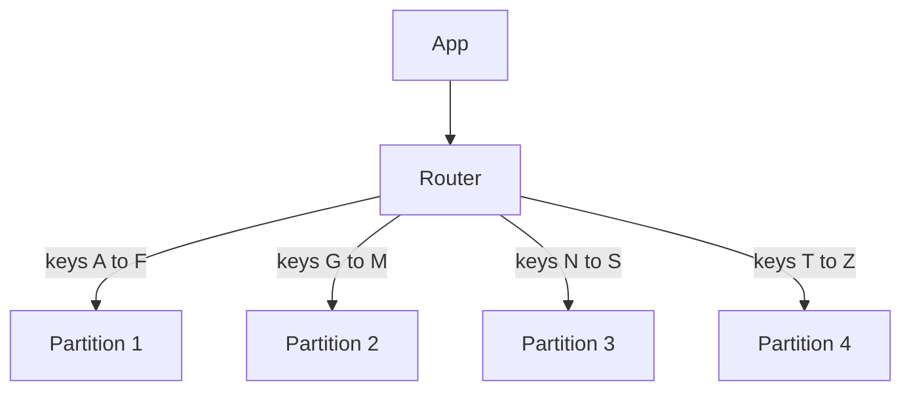

## The hook

Your chat app stores 50 billion messages. Read replicas got you through last year: every replica holds a full copy, and they share the reads. But now the *writes* are too many for one primary, and the data no longer fits comfortably on one machine at all.

There is no bigger box to buy. The only way forward is to stop keeping all the data in one place. Each machine will hold a slice.

Easy to say. But choose the wrong way to slice, and one machine gets crushed while nine others idle. Choose another way, and a simple query has to ask every machine. By the end you will know how to pick, and you will be ready for the question every interviewer asks: "what is your shard key?"

## The intuition

:::analogy
A city's phone book is too thick to bind as one volume, so the publisher **splits it by surname letter**: A-F, G-M, N-S, T-Z. To find "Sharma", you open only the N-S volume. But there are a lot of Sharmas and Singhs, so the N-S volume is twice as fat as the others. And if you want "everyone on MG Road", no single volume helps; you have to flip through all four.
:::

That is partitioning, including both of its classic problems:

- Each volume is a **[[partition]]** (also called a shard), stored on its own node.
- The surname is the **[[partition key]]**: it decides which volume a record lives in.
- The fat N-S volume is a **[[hot partition]]**.
- "Everyone on MG Road" is a query without the partition key, forcing a **[[scatter-gather]]** across all volumes.

## How it works

The core rule: every record lives in exactly one partition, chosen from its key. The router (a library, a proxy or the database itself) computes the partition from the key and sends the query there.

There are two main ways to map keys to partitions.

### Range partitioning

**[[Range partitioning]]** gives each partition a contiguous range of keys, exactly like the phone book.

- **Good:** range queries are cheap. "Messages in this chat between 9:00 and 10:00" touch one or two partitions if the key is (chat id, timestamp).
- **Bad:** real data is rarely uniform. Surnames cluster, and time-based keys are worst of all.

Predict this one. You range-partition orders by order date. What happens at midnight on sale day?

Every new order has today's date, so every write lands in the single partition that holds today. The other partitions sit idle. A time-ordered key turns range partitioning into a one-node bottleneck for writes.

### Hash partitioning

**[[Hash partitioning]]** hashes the key and lets the hash pick the partition. A good hash scatters keys evenly, so "Sharma" and "Singh" land in unrelated places and no letter can make one partition fat.

- **Good:** even spread of keys and writes, no hand-tuned boundaries.
- **Bad:** neighbouring keys are scattered, so range queries on the key must ask every partition.

A common hybrid uses a **compound key**: hash the first part to choose the partition, keep the second part sorted inside it. Partition by hash(chat id), sort by timestamp within. One chat's messages live together and are range-scannable; different chats spread across the cluster.

### Comparing them on one dataset

| | Range | Hash |
|---|---|---|
| Spread of keys | Depends on data; often uneven | Even, if the hash is good |
| Range query on the key | One or few partitions | Every partition |
| Time-ordered keys | All writes to the newest range | Spread out |
| Choosing boundaries | Must be chosen and adjusted | Automatic |
| Typical use | Time series with care, sorted scans | Key-value lookups, user-centric data |

:::insight
The partition key decides everything. Pick it so that (1) load spreads evenly and (2) your most frequent queries include it. A query that knows its key goes to one partition; a query that does not must ask them all.
:::

## Trade-offs

### Hot partitions and celebrity keys

Even perfect hashing cannot split **one key**. If partition key = user id, and one celebrity's profile gets a million reads a second, that one id lives on one partition. Hashing spreads *keys*, not *traffic*.

Standard fixes:

- **Cache the hot key** in front of the database, so most reads never reach the partition.
- **Replicate hot partitions** more and spread reads across copies.
- **Split the key**: write as celebrity_id#0 … celebrity_id#9 (a "salted" key), and read all ten and combine. Writes spread ten ways; reads cost ten lookups, so do this only for the few keys that need it.

:::warning
Common misconception: "hash partitioning prevents hot spots." It prevents hot spots caused by uneven *key ranges*. It does nothing for one very popular *key*. Celebrity accounts, viral posts and flash-sale items need caching, replication or key splitting on top.
:::

### Rebalancing without moving everything

Nodes get added, removed, or partitions grow unevenly, so data must move. This is **[[rebalancing]]**, and the naive approach is a trap.

With hash(key) mod N, a key stays put only if its remainder is the same for the old and new N. Growing from 4 to 5 nodes, that is about 1 key in 5, so **about 80% of all data moves**. Simulated over 100,000 keys, 80.0% moved.

Better schemes:

- **Many fixed partitions**: create, say, 1,000 partitions on day one and assign several to each node. Adding a node means moving whole partitions to it; keys never change partition. Only about 1/N of the data moves.
- **Consistent hashing**: nodes own arcs of a hash ring, and adding a node takes over only its neighbours' arcs, as in [Adding a Server Without Moving Everything](article:famous-algos-consistent-hashing).
- **Dynamic splitting**: range partitions split in two when they grow past a size limit, and halves can move to other nodes.

Moving data is heavy: it competes with live traffic. Throttle it, and prefer moving partitions at quiet times.

### Secondary indexes: local or global

Users are partitioned by user id. Now someone wants "all users in Pune". City is not the partition key. Two choices:

| | Local index (per partition) | Global index (partitioned by the indexed field) |
|---|---|---|
| How it works | Each partition indexes only its own rows | A separate index, itself partitioned by city |
| Write cost | Cheap: update the index in the same partition | Higher: the index entry may live on another node |
| Read by city | Scatter-gather to every partition | Go to the one index partition for Pune |
| Freshness | Same as the data | Often updated asynchronously, so briefly stale |

Read-heavy secondary queries favour a global index; write-heavy data with rare secondary queries favours local indexes.

:::try-this
You are partitioning a ride-sharing trips table. Queries: "trips for this rider, newest first" (very frequent), "trips for this driver" (frequent), "all trips yesterday" (nightly report). What partition key and indexes would you choose? (Partition by hash(rider id), sorted by trip time inside, so the most frequent query hits one partition in order. Add a global secondary index on driver id for the driver query. Run the nightly report as a scatter-gather on a replica or from an analytics copy, because it is rare and not latency-sensitive.)
:::

## What can go wrong

- **Wrong shard key**: a key that most queries do not include turns every request into a scatter-gather, and the cluster gets slower as it grows.
- **Cross-partition transactions**: transferring money between users on different partitions needs a distributed transaction or a saga. Choose keys so most transactions stay inside one partition.
- **Cross-partition joins**: joins between tables partitioned on different keys become expensive application work. Co-locate related data (for example, partition orders and order items by the same customer id).
- **Hot partitions** from celebrity keys or time-ordered keys, as above.
- **Rebalancing storms**: moving too much data at once saturates disks and network and slows live traffic.
- **Resharding later is painful**: changing the partition key means rewriting all data. Spend design time on the key up front.

### Interview follow-ups

**"What is your shard key for a chat app?"** Conversation id, hashed, with messages sorted by time inside each conversation. Reading a chat touches one partition, and conversations spread evenly. User inboxes ("my recent chats") get their own table partitioned by user id.

**"How do you handle a celebrity with 100 million followers?"** Hashing cannot split one key. Cache their profile and posts aggressively, replicate their partition, and for writes such as follower counts, split the key into several sub-counters and sum them on read.

**"Range or hash for time-series metrics?"** Hash (or prefix) by series or device id so writes spread, then keep time sorted inside each series. Pure time ranges send every current write to one node.

**"How would you add a node without downtime?"** Use many fixed partitions or consistent hashing, copy a partition to the new node while it still serves from the old one, catch up on recent writes, then switch ownership in the routing metadata and delete the old copy.

## In the real world

- Wide-column and key-value stores, such as Cassandra and DynamoDB, are built around a partition key plus an optional sort key, the compound-key idea above.
- Relational databases can be sharded at the application level or with sharding middleware, typically by tenant or user id, keeping each customer's data together.
- Search engines partition indexes by document and query every shard, a deliberate scatter-gather.

Partitioning usually arrives after the earlier steps in [One Stronger Horse or a Team of Horses?](article:system-design-vertical-horizontal) and [Photocopies of a Notice That Arrive a Little Late](article:system-design-read-replicas): first scale up, then add replicas for reads, then split the data when writes or size demand it. In practice partitions are also replicated, so each slice survives a node failure; the replication article covers how those copies stay in sync.

## Further reading

- The partitioning chapter of Martin Kleppmann's *Designing Data-Intensive Applications*.
- The data modelling guides for Cassandra or DynamoDB, which explain partition and sort keys with worked examples.

## Key takeaways

- Partitioning splits data so each node holds one slice, which scales writes and storage beyond one machine; the partition key decides where each record lives.
- Range partitioning keeps neighbouring keys together for cheap range scans but suffers from skew, especially with time-ordered keys; hash partitioning spreads keys evenly but scatters ranges.
- Hashing spreads keys, not traffic: celebrity keys still create hot partitions and need caching, replication or key splitting.
- Rebalancing with hash mod N moves about 80% of data when going from 4 to 5 nodes, so real systems use many fixed partitions or consistent hashing to move only about 1/N.
- Queries without the partition key need scatter-gather or a secondary index, local (cheap writes) or global (cheap reads), so choose the key from your most frequent queries.
