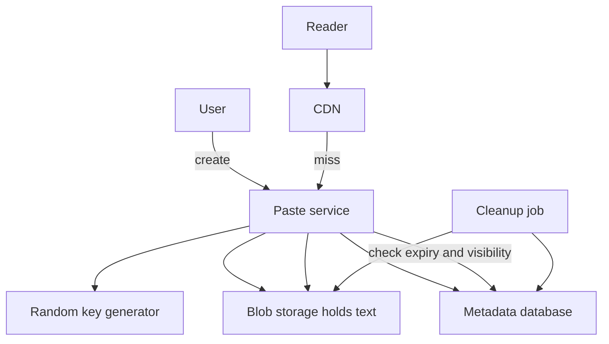

## The hook

A developer pastes a stack trace, gets a short link, and sends it to a colleague. Tomorrow the paste should be gone. Simple.

Then someone pastes a leaked password list, marked "unlisted". Within an hour a bot has found it, because the keys were sequential and the bot just counted upwards. And a viral snippet shared on social media gets 50,000 views a second on a service that usually sees 100.

Pastebin looks like the URL shortener with text instead of a target URL, and it mostly is. Predict which part interviewers push on. (Keys, storage placement and expiry, in that order.)

## Requirements

**Functional**
- Create a paste (text up to, say, 10 MB) and get a short URL.
- Read a paste by URL; optional expiry (10 minutes to never); public or unlisted; optional owner accounts to delete pastes.

**Non-functional**
- About 1 million new pastes a day and 10 reads per write (**estimates**).
- Low read latency; unlisted pastes must not be discoverable.

:::analogy
Pastebin is **a shared clipboard with an expiry date**: you drop text on it, get a ticket number, and anyone with the ticket can read it until the date passes, when the clipboard wipes itself.
:::

## Back-of-envelope numbers

All **estimates**.

- Writes: 1,000,000 ÷ 86,400 ≈ **12 per second**; reads at 10:1 ≈ **116 per second** on average, with rare viral spikes.
- Average paste 10 KB: **10 GB per day**, about **18 TB over five years** if nothing expired.
- Keys: 8 random characters from 62 symbols give 62⁸ ≈ **2.2 × 10¹⁴** possible keys, so random guesses almost never hit a real paste.

## High-level design

## Deep dives

### 1. Keys

Generate **[[unguessable key]]s**: 8 or more random characters from a cryptographically secure random generator, retrying on the rare collision (enforced by a unique constraint). The URL shortener's counter-based approach, in [Design a URL Shortener](article:system-design-url-shortener), is fine for public links but would make **[[unlisted paste]]s** enumerable.

### 2. Where the text lives

Metadata rows (key, owner, created, expiry, visibility, size, storage location) live in a small database; the text lives in blob storage, as in [The Cloakroom That Never Loses a Coat](article:system-design-blob-storage). Very small pastes could sit in the database directly, but one path for all sizes keeps the design simple.

### 3. Expiry

Every read checks the **[[expiry]]** in metadata before serving, so an expired **[[paste]]** is never shown even if cleanup has not run. A background job deletes expired metadata and blobs in batches, or the blob store's lifecycle rules delete objects after a set age.

Wait, why check expiry on read if the cleanup job deletes them anyway? Because cleanup runs periodically and can fall behind. Correctness should not depend on a background job's timing.

### 4. Hot pastes

Paste content never changes after creation, so it is ideal for a CDN, as in [Local Warehouses for the Whole Internet](article:system-design-cdn). Cache with a TTL no longer than the paste's remaining lifetime, and purge on deletion. A viral paste then costs the origin almost nothing.

:::insight
Pastebin is a small design with three real decisions: random keys so unlisted pastes cannot be enumerated, metadata in a database and text in blob storage, and expiry enforced at read time with cleanup as housekeeping. Immutability makes caching easy.
:::

## Trade-offs

| Decision | Choice | Trade-off |
|---|---|---|
| Keys | Random, 8+ characters | Not enumerable; collision checks needed |
| Storage | Blob storage for text | Cheap and scalable; one extra fetch per read |
| Expiry | Checked on read, cleaned in background | Always correct; storage freed slightly later |
| Caching | CDN with bounded TTL | Absorbs viral spikes; purges needed on delete |

:::warning
Common misconception: "unlisted means private." An unlisted paste is protected only by the secrecy of its URL. Anyone with the link can read it, links leak, and predictable keys make it trivial to find. For truly private content, require authentication.
:::

:::try-this
A user sets a paste to expire in 10 minutes, and it is cached at the CDN with a 1-hour TTL. What goes wrong, and what is the fix? (The CDN keeps serving it for up to an hour after it should have vanished. Set the cache TTL to the remaining lifetime of the paste, at most 10 minutes here, and purge it from the CDN on expiry or deletion.)
:::

## What can go wrong

- **Enumerable keys** exposing unlisted pastes.
- **Serving expired pastes** from caches with long TTLs.
- **Abuse**: malware, leaked data or spam; rate-limit creation and support takedowns.
- **Very large pastes** consuming bandwidth; enforce size limits.
- **Orphaned blobs** when metadata is deleted but objects are not; reconcile periodically.

### Interview follow-ups

**"How would you add syntax highlighting?"** Store the language with the metadata and render in the browser, keeping stored content raw.

**"How would you support editing?"** Create a new version (new blob, version number in metadata) rather than mutating, so cached copies and old links stay consistent.

**"How is this different from the URL shortener?"** It stores content instead of a pointer, so storage size, expiry and privacy matter far more.

## Further reading

- The URL shortener case study in this track, for key generation trade-offs.
- Your blob store's documentation on lifecycle (expiry) rules.

## Key takeaways

- Pastebin stores small metadata rows in a database and the paste text in blob storage, served through a CDN.
- Keys must be random and long enough that unlisted pastes cannot be found by guessing or counting.
- Expiry is enforced on every read, while a background job or lifecycle rule reclaims storage later.
- Paste content is immutable, so CDN caching with a TTL bounded by the paste's remaining lifetime absorbs viral traffic.
