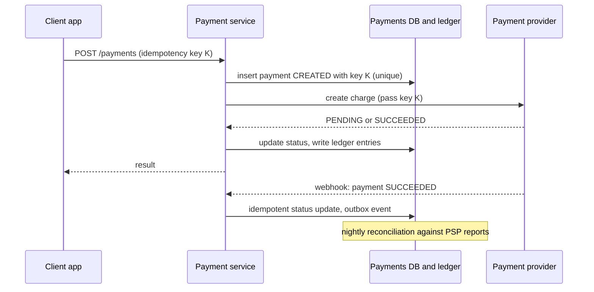

## The hook

A customer taps "Pay ₹1,000". Their phone's connection drops for two seconds. The app retries. Did the first attempt go through? If you guess wrong in one direction, the customer is charged twice and posts an angry screenshot. Guess wrong in the other, and the merchant ships goods for free. Now multiply by millions of payments a day, an external provider that sometimes answers late, and auditors who will ask you to account for every rupee.

Payment systems are a favourite interview case study because almost nothing about them is about scale. The traffic is modest. Everything is about correctness under failure: retries, timeouts, lost callbacks and records that must always add up.

:::analogy
Think of an old bank ledger. Every movement of money is written as two lines: a debit in one account and a matching credit in another, so the columns always balance. Nobody erases a line; mistakes are fixed by writing a new correcting line. At the end of each day, the clerk compares the ledger against the vault and the statements from other banks, and any difference is investigated before anyone goes home.
:::

Our system is that ledger, plus a careful clerk who never writes the same cheque twice.

## Requirements

**Functional**

1. Accept a payment for an order through an external [[payment service provider (PSP)]].
2. Track each payment's status and notify the order service.
3. Support refunds, full and partial.
4. Pay out merchants their balances.

**Non-functional**

- **Never double charge**, never lose a payment: correctness over latency.
- Every money movement is auditable, append-only and explainable.
- Highly available for accepting payments; the ledger can lag slightly but must converge.
- Secure: never store raw card numbers ourselves; the PSP handles card data.

## Back-of-envelope numbers

All numbers are **estimates**.

- **Volume:** 10 million payments per day ≈ **116 payments per second** on average; with a 10× peak during sales, about **1,200 per second**. A single well-tuned relational database can handle this write rate, so correctness drives the design, not sharding.
- **Ledger growth:** each payment creates at least 2 entries of about 200 bytes: 10⁷ × 2 × 200 B ≈ **4 GB per day**, about **1.5 TB per year**. Payments records must be kept for years, so plan archival storage.
- **Webhooks:** at least one per payment, plus retries, so the webhook endpoint sees traffic similar to the payment rate.

## High-level design



1. The client generates an [[idempotency key]] once per checkout and sends it with every attempt.
2. The payment service inserts the payment with that key under a unique constraint, before calling anyone. A retry finds the existing row and returns its current status.
3. It calls the PSP, passing the same key (most providers accept one) so the provider also deduplicates.
4. Results arrive either synchronously or later through a [[webhook]]. Both paths apply the same idempotent state transition.
5. Successful payments write balanced entries to the [[double-entry ledger]], and an outbox event tells the order service, as in [Write the Letter and the Envelope Together](article:system-design-outbox-cdc).
6. A nightly [[reconciliation]] job compares the ledger with the PSP's settlement files.

## Deep dives

### 1. Idempotency end to end

The rule, explained in [Pressing the Pay Button Twice Should Charge Once](article:system-design-stateless-idempotency): one logical payment, one key, at every hop.

```pseudo
create_payment(key, order, amount):
    row = insert into payments(key, order, amount, status=CREATED)
          on conflict(key) do nothing returning *
    if row is none:                          // duplicate request
        return current status of payment with this key
    result = psp.charge(amount, idempotency_key = key)
    transition(row, result.status)
    return result
```

If the PSP call times out, do not create a new key. Retry with the same key, or query the PSP for the status of that key. A timeout means "unknown", never "failed".

### 2. The payment state machine

A [[payment state machine]] makes every update explicit and safe to repeat:

```pseudo
CREATED -> PENDING -> SUCCEEDED -> (PARTIALLY_)REFUNDED
                   -> FAILED
transition(payment, new):
    update payments set status = new
    where id = payment.id and status in allowed_previous(new)
```

The conditional update means a late webhook saying PENDING cannot overwrite SUCCEEDED, and two webhooks saying SUCCEEDED apply only once.

### 3. The double-entry ledger

Store money as integers in the smallest unit (paise, cents), never as floating point. Each business event becomes entries that balance. A ₹1,000 payment with a 2% platform fee:

| Account | Debit | Credit |
|---|---|---|
| PSP receivable | ₹1,000 | |
| Merchant payable | | ₹980 |
| Platform fee revenue | | ₹20 |
| **Total** | **₹1,000** | **₹1,000** |

When the PSP settles cash to our bank, debit Bank ₹1,000 and credit PSP receivable ₹1,000. A refund is new entries in the opposite direction, never an edit. Any account's balance is the sum of its entries, and the sum of all balances is always zero, which makes errors detectable.

### 4. Reconciliation

Three independent records should agree: our ledger, the PSP's report of transactions and fees, and the bank's statement of settlements. A daily job matches them by payment id and flags:

- payments the PSP has but we do not (missed webhook, crash after charge),
- payments we marked SUCCEEDED that the PSP failed,
- amount or fee mismatches.

Mismatches go to a queue for automated fixes or human review.

:::insight
Payments do not achieve exactly-once by trusting any single message. They combine three layers: idempotency keys stop duplicates, a state machine makes every update safe to repeat, and reconciliation against independent records catches whatever slipped through.
:::

## Trade-offs

| Choice | Gains | Costs |
|---|---|---|
| Relational DB with strong transactions | simple correctness for ledger and state | must shard or archive eventually |
| Synchronous PSP call | immediate answer for most payments | slow PSP adds latency; still need webhooks |
| Webhook-driven status | handles slow and asynchronous methods | must be idempotent, verified and ordered |
| Hosted payment page from PSP | no card data in our systems | less control over the checkout experience |
| Saga for order, payment and inventory | services stay independent | refunds as compensations, intermediate states visible |

## What can go wrong

A timeline of the classic failure:

1. **t1** Payment service calls the PSP with key K.
2. **t2** PSP charges the card and replies SUCCEEDED; the reply is lost.
3. **t3** Payment service times out; status stays PENDING (not FAILED).
4. **t4** Client retries with key K; service sees the existing row and asks the PSP about K.
5. **t5** PSP returns SUCCEEDED for K; status updated once, ledger written once.
6. **t6** The webhook for K arrives late; the conditional update finds SUCCEEDED already and does nothing.

Other hazards:

- **Treating a timeout as failure** and letting the user pay again with a new key: double charge.
- **Forged webhooks**: verify the provider's signature on every webhook.
- **Floating-point money**: rounding errors that reconciliation will find months later.
- **Editing ledger rows** to fix mistakes: destroys the audit trail. Always append corrections.
- **Partial refunds exceeding the original amount** without a check.

:::warning
Common misconception: "if every retry carries an idempotency key, we have exactly-once payments." Keys protect against duplicates you send. They do not protect against a lost webhook, a provider-side error, or a settlement that differs from what was promised. That is why reconciliation is a required part of the design, not an optional report.
:::

:::try-this
A customer's ₹1,000 payment (2% fee) is fully refunded, and the platform refunds its fee. Write the ledger entries for the refund. (Debit Merchant payable ₹980, debit Platform fee revenue ₹20, credit PSP receivable ₹1,000. The totals balance, and the original entries stay untouched.)
:::

## Further reading

- Stripe API documentation, Idempotent requests: https://stripe.com/docs/api/idempotent_requests
- Martin Fowler, "Accounting Patterns" in *Analysis Patterns* (1996), for ledger and posting rules.
- [Book the Trip, Cancel the Hotel](article:system-design-sagas) for refunds as compensations.

## Key takeaways

- Payment systems are judged on correctness under failure, so the design centres on retries, timeouts and records that always balance.
- One idempotency key per logical payment, stored under a unique constraint and passed to the provider, prevents double charges on retries.
- A timeout means the outcome is unknown, so query the provider with the same key instead of marking the payment failed.
- A double-entry ledger in integer minor units records every movement as balanced, append-only entries.
- Daily reconciliation against provider and bank reports catches lost webhooks and mismatches that idempotency alone cannot.
