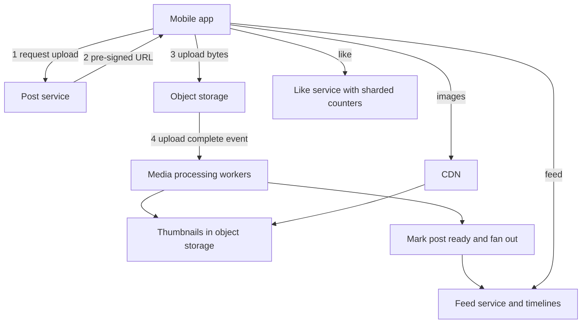

## The hook

A photographer posts a picture. Within seconds it appears, crisp but small, in the feeds of her followers on slow mobile networks across the country. Ten minutes later it has a million likes, and the like count on every screen keeps ticking up.

Three different problems hide in that sentence: moving megabytes of image data efficiently, building feeds from who follows whom, and counting a million likes on one post without the database melting. Predict which one breaks first if you build it the obvious way. (The like counter, and it is the smallest piece of data in the whole system.)

## Requirements

**Functional**
- Upload photos with captions; view them in a profile grid and in followers' feeds.
- Follow users; like and comment on posts.

**Non-functional**
- About 500 million daily active users and 100 million photo uploads a day (**estimates**).
- Feeds load quickly on mobile networks; images are not lost.
- Read-heavy: views vastly outnumber uploads.

:::analogy
Picture **a photo lab with a gallery wall for every follower**. Photographers drop off film at the counter, which only writes a receipt. In the back, technicians develop prints in several sizes. Copies of each new print are pinned on the gallery walls of everyone who follows that photographer. A tally sheet next to each print counts likes, and for a famous photographer the lab splits it across several sheets so visitors do not queue at one pen.
:::

## Back-of-envelope numbers

All **estimates**.

- Uploads: 100,000,000 per day ÷ 86,400 ≈ **1,160 per second**.
- Storage: about 2 MB original plus about 0.5 MB of resized versions per photo: 100,000,000 × 2.5 MB ≈ **250 TB per day**, about **90 PB per year** before replication.
- Feed loads: 500 million users × 20 a day ≈ **116,000 per second**.
- Likes: 5 billion a day ≈ **58,000 per second** overall; one celebrity post with 1 million likes in 10 minutes ≈ **1,700 per second on a single counter**.

## High-level design

## Deep dives

### 1. Uploading without touching app servers

The app asks the post service for a **[[pre-signed URL]]**, uploads the original directly to object storage, then confirms. App servers handle only small JSON requests. Uploads can be resumable in parts for slow mobile connections. Storage design is in [The Cloakroom That Never Loses a Coat](article:system-design-blob-storage).

### 2. Processing

An upload-complete event triggers the **[[media processing pipeline]]**: validate the file, strip location metadata if required, generate **[[thumbnail]]s** (for example a small grid size, a feed size and a full-screen size), compress, scan for policy violations, then mark the post ready. This runs asynchronously; the user sees "posting…" for a moment.

Wait, why generate sizes up front instead of on demand? Because every image is viewed many times and generated once. Pre-computing the common sizes keeps the read path a simple CDN fetch; rare sizes can still be generated on demand and cached.

### 3. Feeds

When the post is ready, the feed service distributes it, using hybrid fan-out: push the post id into followers' precomputed timelines for most accounts, and merge celebrity posts at read time, as in [Design a News Feed](article:system-design-news-feed) and [A Copy of the Phone Number in Every Address Book](article:system-design-data-modeling-scale). The feed API returns post ids and metadata; images load from the **CDN**, as in [Local Warehouses for the Whole Internet](article:system-design-cdn).

### 4. Likes at scale

The obvious design: one row per post with `like_count`, incremented on each like. Now the hook's answer: a celebrity post makes about 1,700 increments per second hit one row, a **[[hot key]]**. Row locks serialise them, and latency explodes.

Fixes:

| Approach | How | Trade-off |
|---|---|---|
| [[Sharded counter]] | 10 sub-counters per post, pick one at random to increment, sum on read | 10 reads per count; no single hot row |
| Buffer and flush | Increment in memory or a fast cache, flush totals to the database every second | Count lags slightly; a crash loses at most the buffer, rebuildable from like records |
| Approximate display | Show "1.2M" for large counts, updated every few seconds | Users rarely notice exactness at that scale |

Separately store "who liked what" (user id, post id) to answer "did I like this?" and to rebuild counts if needed.

:::insight
Photo apps are bandwidth problems wrapped around a social graph: bytes go client to object storage to CDN, never through app servers; resizing happens once, asynchronously; feeds use hybrid fan-out; and tiny but hot pieces of data, like counters, need sharding or buffering because contention, not size, is what breaks them.
:::

## Trade-offs

| Decision | Choice | Trade-off |
|---|---|---|
| Upload path | Direct to storage with pre-signed URLs | Scales well; must verify uploads before publishing |
| Thumbnails | Pre-generated common sizes | Fast reads; more storage per photo |
| Feed | Hybrid fan-out | Cheap reads for most; read-time merge for celebrities |
| Counters | Sharded or buffered | No hot rows; counts slightly delayed |
| Storage tiers | Recent in standard storage, old in cheaper tiers | Lower cost; slower access to very old photos |

:::warning
Common misconception: "counters are trivial, it is just +1." A single row incremented thousands of times a second becomes the bottleneck of the whole system, because every increment waits for the previous one's lock. Hot counters need sharding, batching or approximate display.
:::

:::try-this
A user scrolls a feed of 20 posts on a phone screen 400 pixels wide. Originals average 2 MB; a 400-pixel-wide feed version is about 60 KB (an estimate). How many bytes does the right thumbnail save per feed load? (20 × 2 MB = 40 MB versus 20 × 60 KB = 1.2 MB, about 33 times less. On mobile data that is the difference between a usable app and an unusable one.)
:::

## What can go wrong

- **Uploads through app servers** saturating them.
- **Publishing before processing completes**, showing broken images; publish only when thumbnails exist.
- **Hot counters** on viral posts.
- **Celebrity fan-out** overwhelming timeline writes.
- **Storage costs** growing without lifecycle rules for old originals.
- **Location metadata leaking** from photos if not stripped.

### Interview follow-ups

**"How would you handle videos?"** The same upload pattern, plus transcoding into several bitrates and adaptive streaming, as in the video streaming case study.

**"How do you generate a user's profile grid quickly?"** Store each user's post ids in time order (a per-user list), and fetch grid thumbnails from the CDN.

**"How would you detect duplicate photo uploads?"** Hash the original (exact duplicates) or compute a perceptual hash (near duplicates) during processing.

The overall interview approach for a question like this is in [Forty-Five Minutes to Design Instagram](article:system-design-interview-framework).

## Further reading

- Engineering blog posts from large photo-sharing services about their storage, feed and counting systems.
- The fan-out discussion in Martin Kleppmann's *Designing Data-Intensive Applications* (the Twitter home timeline example).

## Key takeaways

- Photo bytes travel directly from the client to object storage through pre-signed URLs and reach viewers through a CDN, never through app servers.
- Asynchronous workers generate thumbnails and validate media once, so every later view is a cheap CDN fetch of the right size.
- Feeds use hybrid fan-out: precomputed timelines for most accounts, read-time merging for accounts with huge followings.
- Like counters on viral posts become hot keys; sharded counters, buffered flushes and approximate display remove the contention.
- Plan storage tiers and lifecycle rules early, since photo storage grows by many petabytes a year.
