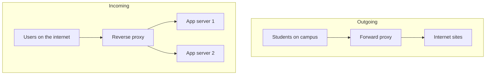

## The hook

Type almost any big website's address and look at the response headers. Very often the first machine that answered was not the application at all. It was a proxy: NGINX, Envoy, HAProxy or a cloud load balancer, standing in front of the real servers.

Your college network probably does the opposite: when you open a website from the hostel, a proxy may be making the request on your behalf, and the website sees the college, not you.

Same word, opposite jobs. Guess which one of the two would let a company swap out every one of its backend servers without a single user noticing. (The one that hides the servers.)

## The intuition

:::analogy
A large office has **a receptionist who forwards every call**. Outsiders never learn the internal extensions; they call the front desk, and the receptionist decides who should take it, screens out spam callers, and can even answer common questions herself ("the office closes at six"). The staff can move desks, go on leave or be replaced, and callers never notice.
:::

That receptionist is a **[[reverse proxy]]**. Its mirror image, a **[[forward proxy]]**, is the switchboard that places outgoing calls for employees, so the outside world sees the company's number, not the employee's.

## How it works

| | Forward proxy | Reverse proxy |
|---|---|---|
| Acts on behalf of | Clients | Servers |
| Hides | Clients from websites | Servers from clients |
| Typical owner | A company, school or ISP | The website or API owner |
| Used for | Filtering, monitoring, caching outbound traffic, anonymity | Load balancing, TLS termination, caching, compression, security |

### What a reverse proxy does

- **Routing and load balancing** across its **[[upstream]]** servers, as in [The Host Who Seats Every Guest](article:system-design-load-balancers).
- **[[TLS termination]]**: it holds the certificates and decrypts HTTPS once. Backends get simpler, and certificate renewal happens in one place.
- **Caching** of static files and cacheable responses, so repeated requests never reach the app.
- **Compression** (gzip, Brotli) of responses to save bandwidth.
- **Protection**: rate limits, request size limits, blocking bad patterns, hiding internal addresses.
- **[[Connection pooling]]**: thousands of client connections funnel into a smaller set of reused connections to the app servers.

Wait, why put all of this in a separate box instead of the app? Because these jobs are the same for every app, a dedicated proxy does them extremely efficiently, and the app team can focus on business logic. It is the same reasoning as the API gateway in [The Mall Directory and Security Desk in One](article:system-design-api-gateway), which is a reverse proxy with API-specific features.

Predict one effect of TLS termination. Your app logs show every request coming from the same IP address. Why? Because the app now sees the proxy's connection, not the user's. Proxies pass the real client address in a header such as X-Forwarded-For, and the app must read it from there, trusting it only when it was set by your own proxy.

:::insight
A reverse proxy is a single, well-tuned front door: it hides and protects your servers, terminates TLS, balances load, caches and compresses, so backends can change freely behind it. A forward proxy is the same idea pointed the other way, acting for clients going out.
:::

## Trade-offs

| You gain | You give up |
|---|---|
| Backends hidden and replaceable | An extra hop of latency |
| One place for TLS, caching, compression, limits | The proxy must be highly available |
| Fewer, reused connections to apps | Client IPs must be passed through headers |
| Easier blue-green and canary releases by routing | Misconfiguration affects every request |

:::warning
Common misconception: "a reverse proxy is just a load balancer." Load balancing is one of its jobs. TLS termination, caching, compression, request filtering and connection pooling are just as important, and many systems put a reverse proxy in front of a single server purely for those.
:::

:::try-this
Your API returns large JSON responses and serves the same product images to millions of users. List three things a reverse proxy can do to cut load on the app servers. (Compress JSON responses; cache the images, or put them on a CDN, which is a distributed set of reverse proxies; keep pooled keep-alive connections to the app servers. A short cache for popular, identical API responses can help too.)
:::

## What can go wrong

- **Single proxy instance**: one failure takes everything down; run several behind a virtual IP or DNS.
- **Trusting spoofed headers**: an attacker sends their own X-Forwarded-For; strip and reset it at the edge.
- **Caching private responses** under a shared key, showing one user's page to another.
- **Timeouts mismatched** with the app: the proxy gives up before a slow but valid request finishes, or waits far longer than the client.
- **Large uploads buffered** in proxy memory or disk; set limits and streaming options deliberately.

### Interview follow-ups

**"Where do you terminate TLS, and is the internal hop safe?"** At the edge proxy or load balancer. Inside a trusted private network, plain HTTP may be acceptable; in shared or zero-trust environments, re-encrypt to the backends (often with mutual TLS).

**"How is a CDN related to a reverse proxy?"** A CDN is a worldwide network of caching reverse proxies close to users, as in [Local Warehouses for the Whole Internet](article:system-design-cdn).

**"How do you do a zero-downtime deploy with a reverse proxy?"** Add new app servers, mark them healthy, shift traffic to them at the proxy, drain connections from the old ones, then remove them.

## In the real world

- NGINX, HAProxy and Envoy are widely used open-source reverse proxies; cloud providers offer managed load balancers that act as reverse proxies.
- Corporate and school networks use forward proxies for filtering and monitoring outbound traffic.
- Service meshes place a small proxy (often Envoy) next to every service instance, so even internal calls go through a proxy.

## Further reading

- The NGINX documentation on reverse proxying and caching.
- The HAProxy and Envoy documentation on load balancing and TLS termination.

## Key takeaways

- A forward proxy acts for clients going out and hides them from websites; a reverse proxy acts for servers and hides them from clients.
- Reverse proxies terminate TLS, balance load, cache, compress, filter requests and pool connections, so backends stay simple and replaceable.
- Because apps then see the proxy's address, the real client IP travels in headers that must only be trusted when set by your own proxy.
- Every request passes through the proxy, so run it redundantly and configure timeouts and caching carefully.
