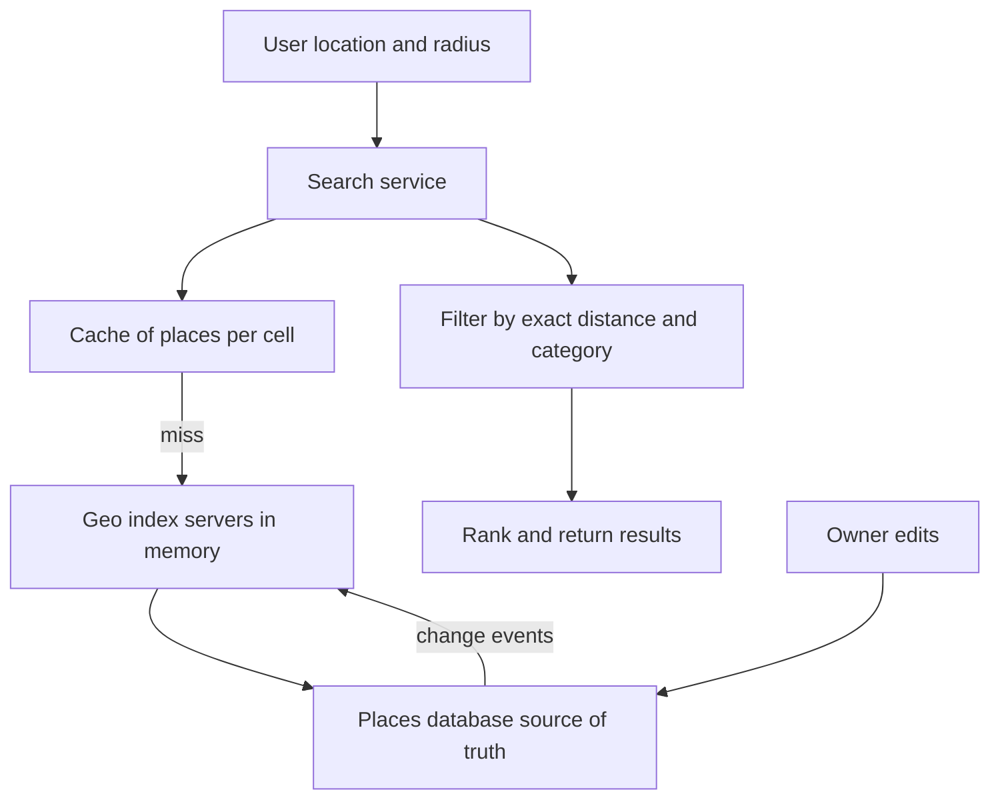

## The hook

It is lunchtime. You open a food app and tap "restaurants near me". In under a second you see twenty places within a kilometre, sorted by distance and rating.

The app did not compute the distance from you to all 100 million places in its database. That would be 100 million calculations per search, thousands of times a second. It looked in a few small squares of the map around you.

Predict the first bug every first version has. (A restaurant across the street does not show up, while one two kilometres away does.)

## Requirements

**Functional**
- Given a location and radius (or "nearby"), return places, filterable by category and sorted by distance or rating.
- Business owners add and edit places; changes may take a while to appear.
- View a place's details and reviews.

**Non-functional**
- About 100 million places (**estimate**); searches far outnumber edits.
- Low latency (a few hundred milliseconds end to end).
- High availability; slightly stale place data is acceptable.

:::analogy
You are **looking for restaurants within walking distance on a gridded map**. You do not read the whole city directory. You look in your own grid square and the eight squares around it, list the restaurants there, and then check which are actually close enough to walk.
:::

## Back-of-envelope numbers

All **estimates**.

- 100,000,000 places × about 50 bytes for (id, location, cell) in the geo index ≈ **5 GB**: fits in memory on each index server.
- Searches: about 5,000 per second on average, perhaps **25,000 per second** at peak lunchtime.
- A 6-character geohash cell is about 1.2 km × 0.6 km at the equator. In a dense area with 2,000 places per km², one cell holds about 1,500 places, so the 3 × 3 block holds up to about 13,000 candidates: filter by category early.

## High-level design

1. The search service computes the user's cell and its 8 neighbours.
2. For each cell, it fetches place ids from a cache, falling back to the in-memory **[[geospatial index]]**.
3. It filters candidates by exact distance and category, ranks them, and fetches display details.
4. Edits go to the places database and reach the geo index and caches asynchronously.

## Deep dives

### 1. Cells and neighbours

Each place is assigned to a **[[geohash cell]]** at one or more precisions, as in [Turning a Map Into a String](article:famous-algos-geohash). A **[[radius search]]** picks a precision whose cell size is close to the radius, collects the user's cell plus its 8 neighbours, then filters by exact distance.

The hook's bug is the **[[boundary miss]]**: searching only the user's own cell. A place 50 m away across a cell edge can have a completely different geohash prefix. The 3 × 3 block fixes it, and the exact-distance filter removes the far corners of the block.

Wait, why not just pick a much bigger cell so the edge is far away? Because big cells in a city contain tens of thousands of places, which makes every search slow. Smaller cells plus neighbours keep candidate sets small.

### 2. Adapting to density

Fixed cells are uneven: thousands of places downtown, none in a forest. Options:

| Index | How it adapts | Good for |
|---|---|---|
| Geohash, multiple precisions | Pick precision by radius; store places at several precisions | Simple key-value storage and caching |
| **[[Quadtree]]** | Split any node with too many places into four | Very uneven density; in-memory index |
| Hexagonal grids | Uniform neighbour distances | Analytics and ride-hailing style aggregation |

Many designs build an in-memory quadtree per index server from the database on startup, replicated across servers since it fits in memory.

### 3. Read-heavy, so cache by cell

Places rarely move; searches are constant. Cache the list of place ids per cell (and per popular category). A lunchtime spike in one neighbourhood then hits the cache, not the index. Invalidate or expire cell entries when a place in that cell changes.

### 4. Writes and freshness

Owner edits go to the transactional places database. A change stream updates geo index servers and invalidates cached cells. A delay of minutes before a new restaurant appears in search is acceptable, so the index can be updated in batches.

:::insight
Proximity search never measures distance to everything: it maps the user to a grid cell, searches that cell and its 8 neighbours, then filters by exact distance. Because places rarely move, the cell-level results cache extremely well, and adaptive structures like quadtrees keep dense areas fast.
:::

## Trade-offs

| Decision | Choice | Trade-off |
|---|---|---|
| Index | Geohash cells or a quadtree in memory | Simple and cacheable, or adaptive to density |
| Search area | Own cell plus 8 neighbours | No boundary misses; more candidates to filter |
| Freshness | Asynchronous index updates | Fast reads; new places appear after a short delay |
| Storage | Index in memory, details in a database | Fast candidate lookup; a second fetch for details |
| Scaling reads | Replicate whole index on many servers | Simple; every server holds all places (fits at about 5 GB) |

:::warning
Common misconception: "a database index on latitude and longitude solves nearby search." A normal B-tree on latitude narrows only one dimension, then scans a long strip of the world. Geospatial queries need cells, trees or built-in geospatial indexes that narrow both dimensions at once.
:::

:::try-this
A user asks for places within 2 km. Which geohash precision would you search: 5 characters (about 4.9 km cells) or 6 characters (about 1.2 km × 0.6 km)? (With 6-character cells, a 3 × 3 block spans only about 3.7 km by 1.8 km, so a 2 km radius can extend beyond it, especially north to south. Use 5-character cells, whose 3 × 3 block spans about 15 km, and filter by exact distance; or search a larger block of 6-character cells.)
:::

## What can go wrong

- **Boundary misses** from searching only one cell.
- **Huge candidate sets** in dense areas with large cells; use finer cells or quadtrees.
- **Hot cells** during events (a stadium); cache them aggressively.
- **Distance computed on raw degrees** instead of real distance; a degree of longitude shrinks towards the poles.
- **Stale caches** showing closed businesses for long; set reasonable expiry.

### Interview follow-ups

**"How is this different from finding nearby drivers?"** Drivers move every few seconds, so the index is write-heavy and lives in memory with frequent updates, as in [Design a Ride-Sharing App](article:system-design-ride-sharing). Places are read-heavy and cache well.

**"How would you support 'open now' and rating filters?"** Filter candidates after the geo lookup using attributes stored with each place, or precompute per-cell lists per popular category.

**"How would you shard if the index no longer fit in memory?"** Shard by region (cell prefix), routing each search to the shards covering its 3 × 3 block.

## Further reading

- The geospatial query documentation of databases such as PostgreSQL with PostGIS, Redis (GEO commands) or Elasticsearch.
- Finkel and Bentley, "Quad Trees: A Data Structure for Retrieval on Composite Keys" (Acta Informatica, 1974).

## Key takeaways

- Nearby search maps a location to a grid cell, searches that cell and its 8 neighbours, and filters candidates by exact distance.
- Searching only the user's own cell causes boundary misses, because close places can sit across a cell edge with a different geohash prefix.
- Choose cell size from the search radius, or use quadtrees so dense areas get smaller cells.
- Places change rarely and searches are constant, so cache results per cell and update the index asynchronously from the source of truth.
- The whole geo index of about 100 million places fits in memory, so replicating it to many servers is a simple way to scale reads.
