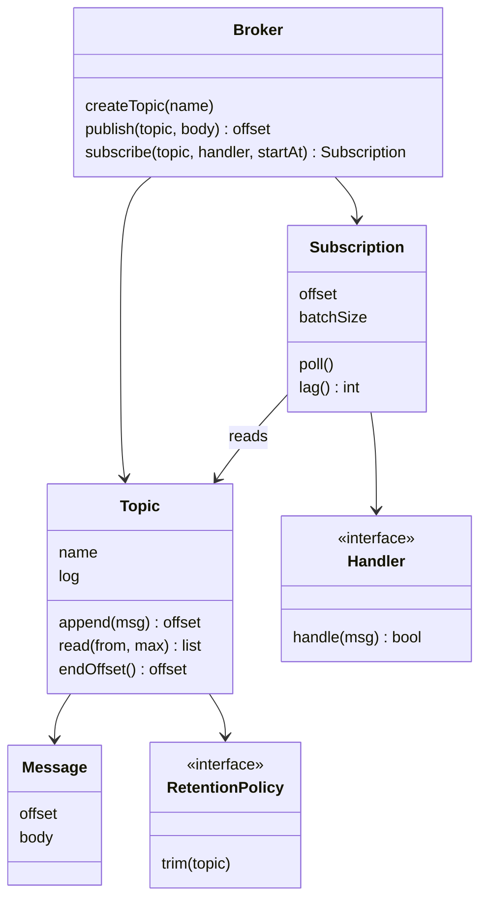

## The hook

A food delivery app publishes an event every time an order is placed. Three services listen: one emails the receipt, one updates the restaurant's screen, one feeds analytics.

On Monday someone ships a new analytics report that takes two seconds per event. On Tuesday, customers complain that receipts arrive late. Restaurants complain that orders appear on their screens late. The order service team says their "place order" call got slow, and they changed nothing.

One slow listener just slowed down three other teams.

That is what happens when you build a pub-sub system as a `for` loop over callbacks. So what does your broker have to remember, and who has to stop waiting for whom, so that every subscriber moves at its own speed?

## Requirements

**Functional**

- Create [[topic|topics]]. Publishers publish messages to a topic.
- Subscribers subscribe to a topic and receive every message published after they joined, in order.
- A new subscriber can ask to start from the beginning and replay history.
- If a subscriber's handler fails, the message is retried, not skipped.
- See how far behind each subscriber is.

**Non-functional**

- Publishing never waits for any subscriber.
- A slow or failing subscriber never delays the others.
- Safe with many publishers and subscribers on different threads.
- Memory is bounded: old messages are eventually deleted.

**Out of scope, said out loud:** persistence to disk, replication across machines, partitions. They come back as extensions, and [The Ticket Rail Between Waiters and Cooks](article:system-design-message-queues) covers them at the system level.

:::analogy
Think of **a newsletter service with subscriber lists**. The office prints each issue with a number and files a copy in its archive. It never waits for readers to finish before printing the next issue. Each subscriber keeps a bookmark: "I have read up to issue 41." A fast reader is always on the latest issue; a slow one is a few behind; a new subscriber can ask for the archive and start at issue 1. Nobody's reading speed changes anybody else's.
:::

## Core objects

- **Broker**: the newsletter office. Creates topics, accepts publishes, manages subscriptions.
- **Topic**: a name plus an append-only log of messages: the archive.
- **Message**: offset, body, and optionally a key and timestamp.
- **Subscription**: one subscriber's bookmark on one topic. Holds the [[offset]], a handler and a delivery worker.
- **Subscriber** or **Handler**: the code that processes a message and reports success or failure.
- **RetentionPolicy**: decides when old messages leave the log.

Wait, why does the subscription, not the topic, hold the position? Predict what goes wrong if you give the topic one "next message to deliver" pointer.

The email service and analytics read at different speeds. One shared pointer can only be in one place, so either email waits for analytics or analytics misses messages.

The bookmark belongs to the reader.

## Class design



```pseudo
class Topic:
    name, log = [], lock, newData = condition variable
    append(body):
        with lock:
            log.push(Message(offset = log.size, body))
            newData.notifyAll()                    // wake waiting subscription workers
            return offset
    read(from, max):
        with lock: return copy of log[from .. from + max)

class Subscription:
    topic, handler, offset, batchSize
    workerLoop():                                  // one worker per subscription
        loop:
            batch = topic.read(offset, batchSize)  // waits on newData when empty
            for msg in batch:
                if not handler.handle(msg):
                    back off, then retry from msg  // offset not advanced
                    break
                offset = msg.offset + 1            // commit after success
    lag(): topic.endOffset() - offset

class Broker:
    publish(topicName, body):  return topics[topicName].append(body)    // never touches subscribers
    subscribe(topicName, handler, startAt):
        start = 0 if startAt == EARLIEST else topic.endOffset()
        sub = Subscription(topic, handler, start)
        start sub's worker; return sub
```

### Push in a loop, and why it breaks

The version most people write first is the Observer pattern from [The Remote Control With Reprogrammable Buttons](article:system-design-behavioural-patterns), used directly:

```pseudo
publish(topic, msg):
    for each subscriber of topic:
        subscriber.handle(msg)        // on the publisher's thread
```

Take a guess: with example handler times of 5 ms for email, 5 ms for the restaurant screen and 2000 ms for the new analytics report, how long does one publish take, and when does the screen update if analytics is first in the list?

| Order in loop | Handler time (example) | Starts at | Finishes at |
|---|---|---|---|
| analytics | 2000 ms | 0 ms | 2000 ms |
| email | 5 ms | 2000 ms | 2005 ms |
| restaurant screen | 5 ms | 2005 ms | 2010 ms |

The publisher returns after 2010 ms, and the restaurant sees the order two seconds late. That is the hook, in three rows.

Worse, if analytics throws an exception, your loop may never reach the others at all.

The newsletter office fixes this by not reading the newsletter aloud to each subscriber. It files the issue and moves on. Publishing becomes an append to the log; each subscription has its own worker that reads at its own pace.

:::insight
Decouple the writer from the readers with a log and per-reader positions. Publishing is just an append; each subscription advances its own offset on its own thread. Then a slow, failing or newly joined subscriber affects only itself, and replay is just starting from an earlier offset.
:::

## Key flows

### Four delivery rounds, traced

Topic `orders`. Email reads up to 10 messages per round; analytics, the slow one, reads 1. Both subscribe at the latest offset, which is 0 because the topic is empty. Analytics fails once on order-3. Offsets are the *next* message to process.

| Step | Event | email offset, lag | analytics offset, lag | audit offset, lag |
|---|---|---|---|---|
| 1 | publish order-1, 2, 3 (offsets 0, 1, 2) | 0, 3 | 0, 3 | not subscribed |
| 2 | round 1 | 3, 0 | 1, 2 | not subscribed |
| 3 | publish order-4, 5 (offsets 3, 4) | 3, 2 | 1, 4 | not subscribed |
| 4 | round 2 | 5, 0 | 2, 3 | not subscribed |
| 5 | audit subscribes from earliest | 5, 0 | 2, 3 | 0, 5 |
| 6 | round 3: analytics fails on order-3 | 5, 0 | 2, 3 (not advanced) | 5, 0 |
| 7 | round 4: analytics retries order-3 | 5, 0 | 3, 2 | 5, 0 |

You should notice three things.

Email never waited for analytics, even when analytics was three behind. Audit joined late and replayed the whole archive in one round. And in step 6, analytics' offset stayed at 2, so order-3 came back in step 7 instead of being lost.

:::try-this
Rerun the table with analytics reading 2 messages per round and never failing. What are its offset and lag after rounds 1, 2 and 3? (Round 1 reads order-1 and order-2: offset 2, lag 1. After two more publishes, round 2 reads order-3 and order-4: offset 4, lag 1. Round 3 reads order-5: offset 5, lag 0.)
:::

### Commit after, not before

Here is a question to pause on. Your subscription reads message 7.

Should it save offset 8 *before* calling the handler, or *after*?

| Commit point | Crash between commit and handler finishing | Guarantee |
|---|---|---|
| Before the handler | Offset says 8, message 7 was never processed | At most once: messages can be lost |
| After the handler | Offset still says 7, message 7 runs again | At least once: messages can repeat |

The demo commits after, which gives [[at-least-once delivery]].

The cost is that your handler may see a message twice, so you make handlers idempotent: sending a receipt checks "already sent for order-3?" first. Getting effectively-once on top of that is the subject of [A Cheque the Bank Cashes Only Once](article:system-design-exactly-once).

### The archive cannot grow forever

Remember the newsletter archive. A real office throws away old issues eventually. That is [[retention]]: keep the last N messages, or the last seven days, and trim the rest.

Now the curiosity loop that slow consumers open. Suppose retention keeps 3 messages and analytics' offset is 1 when offset 2 becomes the oldest one kept. Its next message no longer exists. The broker has three choices:

| Choice | Effect |
|---|---|
| Never trim past the slowest subscriber | No loss, but one dead subscriber makes memory grow without limit |
| Trim anyway, move the subscriber to the oldest kept offset and raise an alert | Bounded memory; the subscriber knows exactly what it lost |
| Pause publishing until the slowest catches up | Turns one slow reader back into the hook |

Most brokers pick the second row.

That is why [[consumer lag]] is the number you watch most closely: a lag that keeps growing is a subscriber heading for data loss.

:::warning
Common misconception: "Give each subscriber its own in-memory queue and the slow-consumer problem is solved." It moves the problem. The slow subscriber's queue grows until memory runs out, and copying every message into every queue multiplies memory by the number of subscribers. A shared log with per-subscriber offsets stores each message once, and retention puts an explicit limit on how far behind anyone can fall.
:::

### The code

The demo drives delivery in explicit rounds so that its output is the same on every run; in a real broker each subscription's `poll` runs in its own worker thread, woken when the topic appends. The topic's lock guards the log for both cases.

```cpp
#include <bits/stdc++.h>
using namespace std;

struct Message { long offset; string body; };

// A topic is an append-only log. Publishing never waits for any subscriber.
struct Topic {
    string name; vector<Message> log; mutex m;
    long append(const string& body) {
        lock_guard<mutex> g(m);
        log.push_back({(long)log.size(), body});
        return log.back().offset;
    }
    vector<Message> read(long from, size_t max) {
        lock_guard<mutex> g(m);
        vector<Message> out;
        for (long i = from; i < (long)log.size() && out.size() < max; i++) out.push_back(log[i]);
        return out;
    }
    long end() { lock_guard<mutex> g(m); return log.size(); }
};

// Each subscription remembers its own position, so a slow one only delays itself.
struct Subscription {
    string name; Topic& topic; long offset; size_t batch;
    function<bool(const Message&)> handler;            // returns false on failure
    void poll() {
        for (auto& msg : topic.read(offset, batch)) {
            if (!handler(msg)) { cout << "    " << name << " failed on " << msg.body << ", will retry\n"; return; }
            offset = msg.offset + 1;                    // commit only after success
        }
    }
    long lag() { return topic.end() - offset; }
};

struct Broker {
    map<string, unique_ptr<Topic>> topics;
    vector<unique_ptr<Subscription>> subs;
    Topic& topic(const string& n) { auto& t = topics[n]; if (!t) { t = make_unique<Topic>(); t->name = n; } return *t; }
    long publish(const string& t, const string& body) { return topic(t).append(body); }
    Subscription& subscribe(const string& name, const string& t, bool fromStart, size_t batch,
                            function<bool(const Message&)> h) {
        Topic& tp = topic(t);
        subs.push_back(make_unique<Subscription>(Subscription{name, tp, fromStart ? 0 : tp.end(), batch, move(h)}));
        return *subs.back();
    }
    void round(int r) {                                 // one delivery round; real brokers run these in threads
        cout << "round " << r << "\n";
        for (auto& s : subs) { s->poll(); cout << "  " << s->name << " offset " << s->offset << ", lag " << s->lag() << "\n"; }
    }
};

int main() {
    Broker b;
    int analyticsFailures = 1;                          // analytics fails once on order-3
    b.subscribe("email", "orders", false, 10, [](const Message& m) { cout << "    email sends receipt for " << m.body << "\n"; return true; });
    b.subscribe("analytics", "orders", false, 1, [&](const Message& m) {
        if (m.body == "order-3" && analyticsFailures-- > 0) return false;
        cout << "    analytics counts " << m.body << "\n"; return true;
    });

    for (int i = 1; i <= 3; i++) b.publish("orders", "order-" + to_string(i));
    b.round(1);
    b.publish("orders", "order-4"); b.publish("orders", "order-5");
    b.round(2);
    b.subscribe("audit", "orders", true, 10, [](const Message& m) { cout << "    audit replays " << m.body << "\n"; return true; });
    b.round(3);
    b.round(4);
}
```

The printed offsets and lags match the table: after round 2 it shows `analytics offset 2, lag 3`, round 3 shows `analytics failed on order-3, will retry` alongside five `audit replays` lines, and round 4 ends with `analytics offset 3, lag 2`. Retention and back-off are left out to keep it short.

## Patterns used

| Pattern | Where | Why it earns its place |
|---|---|---|
| Observer, decoupled | Subscriptions on a topic | Publishers never know who listens; subscribers join and leave freely |
| Producer-consumer | Topic log and subscription workers | Publishers produce, each worker consumes at its own speed |
| Strategy | RetentionPolicy, retry back-off, start position | By size or age, fixed or exponential back-off, earliest or latest |
| Mediator | Broker | Publishers and subscribers talk only to the broker, never to each other |
| Iterator, in spirit | Offset as a cursor over the log | Replay is just moving the cursor back |

## Extensions

### Consumer groups

Analytics is slow. You might run three copies of it.

But with three separate subscriptions each copy gets *every* message, and the work triples instead of splitting.

A [[consumer group]] fixes that. The topic is split into partitions, each partition is its own log, and each partition is assigned to exactly one member of the group. The group keeps one offset per partition. Add a member and partitions are rebalanced; messages with the same key go to the same partition, so their order is kept.

### Push, pull, or both

Our subscription pulls: its worker asks the topic for the next batch. Pull lets each subscriber control its own rate, which is the whole point. A push API on top is easy: the worker pulls and then calls the handler, which is what the demo does. What you must never do is let the *publisher's* thread push.

### Dead letters

If a message fails forever, say a malformed order, your retry loop blocks that subscription for good. After N attempts, move the message to a dead-letter topic, advance the offset, and alert. The subscription keeps moving, and a human looks at the bad message later.

### Edge cases worth naming

- **Subscribe to a topic that does not exist:** create it lazily, or fail clearly; decide and say so.
- **Unsubscribe during a delivery:** the worker finishes the current message, commits, then stops.
- **Publisher and reader racing on the log:** both go through the topic's lock; the reader copies a batch and releases the lock before calling handlers.
- **Handler that blocks forever:** a per-message timeout counts as a failure and triggers the retry rule.
- **Ordering:** guaranteed within a topic (or partition), not across topics.

### Common mistakes

- Calling handlers on the publisher's thread.
- One position pointer per topic instead of per subscription.
- Committing the offset before the handler runs, then losing messages on a crash.
- Holding the topic lock while calling a handler, so a slow handler blocks publishers.
- Unbounded per-subscriber queues with no retention or lag alert.

### Interview follow-ups

**"How do you make it survive a restart?"** Append the log to a file per topic, and store each subscription's committed offset durably, either in a small offsets file or as messages on an internal topic. On restart, reload offsets and continue. Nothing else changes.

**"How would you support message filtering, such as only orders above Rs 500?"** Put the filter in the subscription: the worker skips messages that do not match but still advances the offset. The broker stays generic.

**"Two publishers publish at the same instant. What order do subscribers see?"** Whatever order the topic's lock granted the appends. Every subscriber sees that same order, because they all read the same log.

**"How do you test it?"** Use the round-based driver as in the demo: publish, run rounds, and assert offsets and lags. For the threaded version, publish N messages and wait until every subscription's lag is zero, then assert each handler saw all N in order.

Pub-sub keeps every subscriber on its own bookmark. The next design keeps every shopper on their own cart, and then makes them compete for the last item on the shelf: [Design a Shopping Cart and Inventory](article:system-design-shopping-cart-lld).

## Key takeaways

- A pub-sub broker stores each topic as an append-only log, and each subscription keeps its own offset, so subscribers read at their own pace and never wait for one another.
- Publishing is only an append under the topic's lock, which is why a slow or failing subscriber cannot slow down the publisher.
- Committing the offset after the handler succeeds gives at-least-once delivery, so handlers must tolerate the occasional repeat.
- Retention bounds memory, and consumer lag tells you which subscriber is about to fall off the end of the log.
- Consumer groups split one subscriber's work across several workers by assigning each partition to exactly one member.
