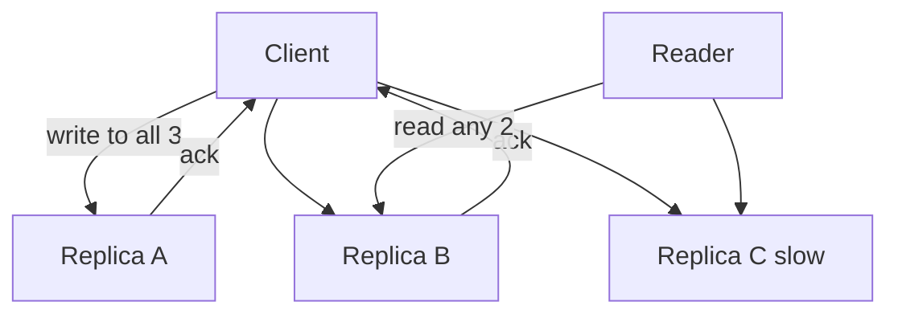

## The hook

Three friends are at a party when the venue changes. The organiser can only reach two of them before the phones die. Later, you arrive and want the latest venue. You can ask any two of the three friends.

Can you be sure to get the right answer? Think before reading on.

Yes, always. Two people who heard the news, two people you ask, and only three people in total: at least one person is in both groups. That small counting fact is how databases like Cassandra let any replica accept writes and still promise you read your latest data. And it has a catch, which shows up when you arrive *while* the organiser is still dialling.

## The intuition

:::analogy
You need the latest news, and you know it was told to some of the group. **Ask enough people that at least one of them heard the latest news.** If the news reached W people and you ask R people, and W + R is more than the whole group, your askers and the hearers must share someone.
:::

In a leaderless store, each item lives on N replicas. A **[[quorum]]** is how many must take part:

- a **write** succeeds once **W** replicas confirm it;
- a **read** asks **R** replicas and returns the newest version among their answers.

If **R + W > N**, every read set and every write set share at least one replica. That shared replica is the **[[overlap]]**, and it carries the latest finished write into the read. This is the follow-up to [Two Branch Managers Editing One Price List](article:system-design-multi-leader-leaderless), where we left this rule as a promise.

## How it works

With N = 3, W = 2, R = 2: the write is acknowledged by A and B. The reader happens to ask B and C. C is stale, but B has the new value, and versions (timestamps or vector clocks) tell the reader which one is newer.

### Tuning N, R and W

Each setting buys a different mix of consistency, availability and speed. Every row below was checked by brute force over all possible read and write sets.

| N | W | R | R + W > N? | Smallest overlap | Writes survive failures | Reads survive failures | Good for |
|---|---|---|---|---|---|---|---|
| 3 | 2 | 2 | yes | 1 | 1 | 1 | Balanced default |
| 3 | 3 | 1 | yes | 1 | 0 | 2 | Read-heavy, rare writes |
| 3 | 1 | 3 | yes | 1 | 2 | 0 | Write-heavy, rare reads |
| 3 | 1 | 1 | no | 0 | 2 | 2 | Fastest, may read stale data |
| 5 | 3 | 3 | yes | 1 | 2 | 2 | Survives two failures each way |
| 5 | 2 | 2 | no | 0 | 3 | 3 | Very available, no overlap |

Wait, why not always choose R = W = N for maximum safety? Because then a single slow or dead replica blocks every read and write. Quorums exist precisely so you do not have to wait for everyone.

### Latency: waiting for the k-th fastest

The client sends to all N replicas and waits for the first W (or R) answers. So a write's latency is the W-th fastest replica's response time. Larger W means waiting for slower replicas, which hurts **[[tail latency]]**. Many systems let you choose per request: a small R for a fast, possibly stale timeline read; a quorum for a balance check.

:::insight
R + W > N is pure counting: the read and write sets cannot avoid each other, so at least one replica in every read has every finished write. Turning R and W up buys consistency; turning them down buys speed and availability.
:::

## Trade-offs

### Sloppy quorums

Suppose two of the three home replicas for a key are unreachable. A strict quorum with W = 2 must reject the write. A **[[sloppy quorum]]** instead writes to any 2 reachable nodes, including ones that do not normally hold the key, and hands the data back to the home replicas when they recover (hinted handoff).

You gain write availability during failures. You lose the overlap guarantee: a reader asking the home replicas may miss writes that are sitting on stand-in nodes.

### Not the same as linearizability

Predict what this timeline returns. N = 3, W = 2, R = 2, value starts at 0, and a write of 1 is in progress:

| Time | Replica A | Replica B | Replica C | Event |
|---|---|---|---|---|
| t1 | 1 | 0 | 0 | Write reaches A only so far |
| t2 | 1 | 0 | 0 | Reader 1 asks A and C: sees 1 (newest) → returns **1** |
| t3 | 1 | 0 | 0 | Reader 2 asks B and C: sees only 0 → returns **0** |
| t4 | 1 | 1 | 0 | Write reaches B, completes |

Reader 1 saw the new value, then reader 2, who asked later, saw the old one. No rule was broken: the write had not finished, so the overlap guarantee did not apply yet. But a single-copy system ([[linearizability]]) would never go "new then old". Making quorum reads linearizable needs extra work, such as the reader writing the newest value back to a quorum before returning.

:::warning
Common misconception: "R + W > N means the system is strongly consistent." It guarantees that a read overlaps every write that has already completed. Concurrent writes, sloppy quorums, last-write-wins conflict resolution and failed partial writes can all still produce stale or out-of-order results.
:::

:::try-this
N = 5 replicas spread over two data centres: 3 in Mumbai, 2 in Chennai. You need reads and writes to keep working if the whole Chennai data centre goes offline, and every read to overlap completed writes. Pick W and R. (W = 3, R = 3: 3 + 3 = 6 > 5, and Mumbai alone has 3 replicas, so both quorums can still be met. W = 4 would fail when Chennai is down.)
:::

## What can go wrong

- **Stale reads with R + W ≤ N**: chosen for speed, often unknowingly.
- **Partial writes**: a write that reached fewer than W replicas is reported as failed, but it is not rolled back on the replicas it did reach, so later reads may see it anyway.
- **Concurrent writes** resolved by last-write-wins silently drop one of them.
- **Sloppy quorums** break the overlap during failures.
- **Slow replicas** dominate latency when W or R is close to N.

### Interview follow-ups

**"N = 3, W = 2, R = 2, and one replica dies. Does anything stop working?"** No. Writes need 2 of the remaining 2, and reads need 2 of 2. A second failure stops both.

**"How would you make a cheap, possibly stale read path and a safe path in the same system?"** Let clients choose per request: R = 1 for feeds and counters, quorum reads for account settings or balances.

**"How do stale replicas eventually converge?"** Read repair during reads, hinted handoff after outages, and background anti-entropy that compares Merkle trees, all described in the previous article.

## In the real world

- Cassandra lets each request choose a consistency level such as ONE, QUORUM or ALL, which sets R or W per request.
- Dynamo-style systems typically use N = 3 with configurable R and W, plus sloppy quorums and hinted handoff for availability.
- Consensus protocols such as Raft also rely on majority quorums, but add a leader and an ordered log, which is how they get linearizability, as in [How Five Servers Agree on One Truth](article:famous-algos-raft).

The next step puts these pieces together: consistent hashing to place keys, replication to N nodes, quorums to read and write them. That is the design of a distributed key-value store.

## Further reading

- The "Quorums for reading and writing" and "Limitations of Quorum Consistency" sections of Martin Kleppmann's *Designing Data-Intensive Applications*.
- The consistency-level documentation of Apache Cassandra.

## Key takeaways

- With N replicas, writes wait for W confirmations and reads ask R replicas; if R + W > N, every read set overlaps every completed write's set.
- Tuning R and W trades consistency against availability and latency: small values are fast and fault-tolerant but may read stale data.
- Requests wait for the W-th or R-th fastest replica, so quorums close to N suffer from slow replicas.
- Sloppy quorums keep writes available during failures by writing to stand-in nodes, but they give up the overlap guarantee until data is handed back.
- Quorums alone are not linearizable: concurrent writes, partial writes and last-write-wins can still return stale or out-of-order values.
