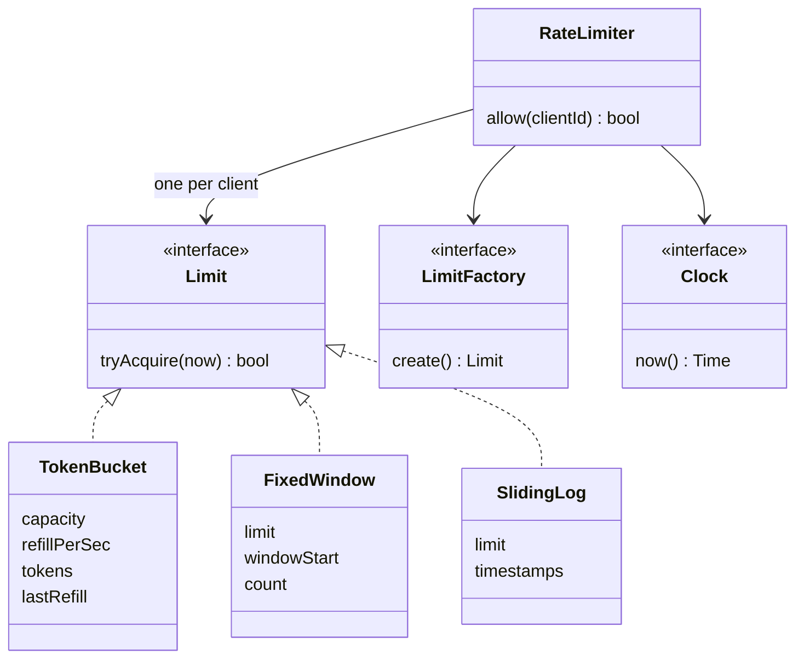

## The hook

The login API is under a password-guessing attack. You ship a rate limiter at 2 am: five tries per user per minute. The attack slows down. So does everything else.

By morning, the limiter is the slowest part of the system. Every request, from every user, waits in line for one mutex around one big map. Your limiter is protecting the API from attackers by making it slow for everyone.

The high-level questions, where the limiter sits and how it shares counts across servers, live in [Design a Rate Limiter](article:system-design-rate-limiter). This is the machine coding version: classes, algorithms as plug-ins, and the locking that makes or breaks it. Which object should hold a user's count, and who should be allowed to wait for whom?

## Requirements

**Functional**

- `allow(clientId)` returns allow or reject for one request.
- Limits are per client: a user id, an API key or an IP address.
- The algorithm is configurable: [[token bucket]], [[fixed window]] and [[sliding log]] to start.
- Example rules for the traces: 3 requests per second.

**Non-functional**

- The decision is fast and in-memory, O(1) for the token bucket.
- Safe under many threads; one client's traffic must never slow another client down.
- Memory stays bounded when millions of clients come and go.
- Testable with an injected clock, without sleeping.

**Out of scope, said out loud:** sharing counts across servers (a shared store with atomic scripts), and response headers telling clients when to retry. Mention both at the end.

:::analogy
Think of **a ticket punch per customer**. At a busy counter, every regular has their own punch card with three squares. Each request, the clerk punches one square. Squares slowly grow back, one per second, but a card never holds more than three. If your card has no free square, you wait. The clerk keeps a drawer of cards, one per customer, and pulls out only yours. Nobody else's card is touched, and nobody else waits while yours is punched.
:::

## Core objects

- **RateLimiter**: the clerk. Finds the client's state and asks it to decide.
- **Limit**: one client's card. An interface with `tryAcquire(now)`.
- **TokenBucket**, **FixedWindow**, **SlidingLog**: three kinds of card, each a Limit.
- **LimitFactory**: makes a fresh card for a new client, from config.
- **Clock**: where "now" comes from.
- **Rule**, optionally: which limit applies to which route or plan (free tier, paid tier).

Wait, why is the algorithm's state per client instead of one algorithm object with a map inside it? Because the lock follows the state. If one `TokenBucketAlgorithm` holds a map of every user's tokens, its lock covers every user. If each client has its own small `TokenBucket` object, each one can carry its own lock. That single choice is the fix for the hook.

## Class design



```pseudo
interface Limit:
    tryAcquire(now) -> bool             // each implementation guards itself with its own lock

class TokenBucket implements Limit:
    capacity, refillPerSec, tokens = capacity, last = now
    tryAcquire(now):
        with own lock:
            tokens = min(capacity, tokens + (now - last) * refillPerSec)   // lazy refill
            last = now
            if tokens < 1: return false
            tokens -= 1; return true

class FixedWindow implements Limit:
    limit, window, windowStart, count
    tryAcquire(now):
        with own lock:
            start = floor(now / window) * window
            if start != windowStart: windowStart = start; count = 0
            if count == limit: return false
            count += 1; return true

class SlidingLog implements Limit:
    limit, window, times = empty queue
    tryAcquire(now):
        with own lock:
            drop times <= now - window from the front
            if times.size == limit: return false
            times.push(now); return true

class RateLimiter:
    factory, perClient: map clientId -> Limit, mapLock, clock
    allow(clientId):
        with mapLock:                               // short: find or create only
            limit = perClient.getOrCreate(clientId, factory.create)
        return limit.tryAcquire(clock.now())        // outside mapLock
```

### Why nobody runs a timer

A token bucket "refills one token per second". Predict how you would implement that for a million users on your first try. A background thread that wakes every second and adds a token to every bucket: a million writes a second, mostly to buckets nobody is using.

[[Lazy refill]] does it with arithmetic instead. A bucket remembers when it was last touched. When a request arrives, it adds `elapsed × rate` tokens in one step, capped at capacity. Idle buckets cost nothing, and the answer is exactly the same as if a timer had been running.

:::insight
A rate limiter is a tiny state machine per client plus a clock. Compute refills lazily from elapsed time, give each client's state its own lock, and keep the shared map's lock only for finding that state. Then the limiter scales with the number of clients instead of choking on them.
:::

## Key flows

### One second of Asha's traffic, traced

Token bucket, capacity 3, refill 1 token per second. Times in milliseconds. Tokens are shown after the refill and after the spend.

| t | Client | Tokens after refill | Decision | Tokens after |
|---|---|---|---|---|
| 0 | asha | 3.0 (new card) | allow | 2.0 |
| 100 | asha | 2.1 | allow | 1.1 |
| 200 | asha | 1.2 | allow | 0.2 |
| 300 | asha | 0.3 | reject | 0.3 |
| 300 | ravi | 3.0 (new card) | allow | 2.0 |
| 1000 | asha | 0.3 + 0.7 = 1.0 | allow | 0.0 |
| 1500 | asha | 0.5 | reject | 0.5 |
| 2600 | asha | 0.5 + 1.1 = 1.6 | allow | 0.6 |

Row 300 is the point of per-client state, and the line you should say out loud in the interview. Asha is out of punches; Ravi, arriving at the same millisecond, has a full card. In the punch-card drawer, his card was never touched by her traffic.

:::try-this
Same bucket. Asha sends four requests at t = 0 and four more at t = 2500. How many are allowed in total? (At t = 0 the first three spend all three tokens and the fourth is rejected. By t = 2500 she has earned 2.5 tokens, so two more are allowed, leaving 0.5, and the last two are rejected. Five allowed in total.)
:::

### The boundary burst

Now the surprise. Same limit, 3 per 1000 ms, but two other algorithms, and requests at 900, 950, 990, 1000, 1010, 1050 and 1901 ms. Before you look, guess how many of the first six a fixed window allows.

| t | Fixed window slot | Fixed window | Sliding log contents before | Sliding log |
|---|---|---|---|---|
| 900 | 0-999, count 0 | allow | none | allow |
| 950 | 0-999, count 1 | allow | 900 | allow |
| 990 | 0-999, count 2 | allow | 900, 950 | allow |
| 1000 | 1000-1999, count reset to 0 | allow | 900, 950, 990 | reject |
| 1010 | 1000-1999, count 1 | allow | 900, 950, 990 | reject |
| 1050 | 1000-1999, count 2 | allow | 900, 950, 990 | reject |
| 1901 | 1000-1999, count 3 | reject | 950, 990 (900 dropped) | allow |

All six.

The fixed window allowed 6 requests in 150 ms, twice the intended rate, because the count reset at the slot boundary. The sliding log looks back exactly 1000 ms from every request, so it never allows more than 3 in any 1000 ms span.

Wait, why not always use the sliding log, then?

Memory. It stores one timestamp per allowed request, up to the limit, for every active client. With a limit of 1000 per minute and a million clients, that is up to a billion timestamps. The token bucket stores two numbers per client and still smooths bursts. That is why you will see it as the usual default.

| Algorithm | State per client | Burst behaviour | Typical use |
|---|---|---|---|
| Token bucket | 2 numbers | Allows a burst up to capacity, then the steady rate | General API limits |
| Fixed window | 2 numbers | Up to 2 × limit across a boundary | Simple quotas, daily caps |
| Sliding log | Up to limit timestamps | Exact | Low limits where precision matters, such as login attempts |
| Sliding window counter | 2 to 3 numbers | Approximate, weights the previous window by its overlap | A cheap middle ground |

### Who waits for whom

Back to the hook. Here are three ways you could hold the clerk's drawer, from worst to best.

| Design | What one lock covers | Effect |
|---|---|---|
| One global lock around allow | Every client's state | Every request in the system waits in one line: the hook |
| Lock the map during the whole decision | Same as above, in disguise | Still one line, because the decision runs while holding the map lock |
| Short map lock, then the client's own lock | Map: find or create. Client lock: that card only | Clients wait only for requests from the same client |

This is [[lock granularity]]. The punch card analogy says it plainly: the clerk holds the drawer open only long enough to pull out your card, then closes it and punches your card at the counter. If the map itself becomes hot, stripe it into N shards, each with its own lock, or use a concurrent map.

:::warning
Common misconception: "Each Limit has its own lock, so the limiter is thread-safe and fast." Only if the code releases the map lock before calling tryAcquire. A `lock_guard` on the map that is still in scope when the bucket decides quietly turns per-client locks back into one global lock. Scope the map lock to the lookup, as the code does with an extra pair of braces.
:::

### The code

The program replays both tables, then fires 800 requests from 8 threads at one client whose bucket holds 50 tokens and never refills. If the locking is right, exactly 50 are allowed on every run.

```cpp
#include <bits/stdc++.h>
using namespace std;

// One client's state under one algorithm. Each has its own lock, so clients never wait on each other.
struct Limit {
    mutex m;
    virtual bool tryAcquire(long nowMs) = 0;
    virtual ~Limit() = default;
};

struct TokenBucket : Limit {              // tokens kept in thousandths to stay in integers
    long capacity, refillPerSec, milli, last = 0;
    TokenBucket(long cap, long rate) : capacity(cap), refillPerSec(rate), milli(cap * 1000) {}
    bool tryAcquire(long now) override {
        lock_guard<mutex> g(m);
        milli = min(capacity * 1000, milli + (now - last) * refillPerSec);   // lazy refill
        last = now;
        if (milli < 1000) return false;
        milli -= 1000; return true;
    }
};

struct FixedWindow : Limit {
    long limit, windowMs, windowStart = -1, count = 0;
    FixedWindow(long l, long w) : limit(l), windowMs(w) {}
    bool tryAcquire(long now) override {
        lock_guard<mutex> g(m);
        long start = now / windowMs * windowMs;
        if (start != windowStart) { windowStart = start; count = 0; }
        if (count == limit) return false;
        count++; return true;
    }
};

struct SlidingLog : Limit {
    long limit, windowMs; deque<long> log;
    SlidingLog(long l, long w) : limit(l), windowMs(w) {}
    bool tryAcquire(long now) override {
        lock_guard<mutex> g(m);
        while (!log.empty() && log.front() <= now - windowMs) log.pop_front();
        if ((long)log.size() == limit) return false;
        log.push_back(now); return true;
    }
};

// The registry: finds or creates a client's limit under a short lock, then lets go before deciding.
struct RateLimiter {
    function<unique_ptr<Limit>()> factory;
    unordered_map<string, shared_ptr<Limit>> perClient;
    mutex mapLock;
    bool allow(const string& client, long now) {
        shared_ptr<Limit> l;
        {
            lock_guard<mutex> g(mapLock);
            auto& slot = perClient[client];
            if (!slot) slot = factory();
            l = slot;
        }
        return l->tryAcquire(now);       // not under mapLock: other clients are not blocked
    }
};

void trace(const string& name, RateLimiter& rl, vector<pair<string, long>> reqs) {
    cout << name << "\n";
    for (auto [who, t] : reqs) cout << "  t=" << t << " " << who << " " << (rl.allow(who, t) ? "ALLOW" : "reject") << "\n";
}

int main() {
    RateLimiter tb{[] { return make_unique<TokenBucket>(3, 1); }};
    trace("token bucket: 3 tokens, 1 per second", tb,
          {{"asha", 0}, {"asha", 100}, {"asha", 200}, {"asha", 300}, {"ravi", 300}, {"asha", 1000}, {"asha", 1500}, {"asha", 2600}});

    vector<pair<string, long>> edge = {{"asha", 900}, {"asha", 950}, {"asha", 990}, {"asha", 1000}, {"asha", 1010}, {"asha", 1050}, {"asha", 1901}};
    RateLimiter fw{[] { return make_unique<FixedWindow>(3, 1000); }};
    trace("fixed window: 3 per 1000 ms", fw, edge);
    RateLimiter sl{[] { return make_unique<SlidingLog>(3, 1000); }};
    trace("sliding log: 3 per 1000 ms", sl, edge);

    // 8 threads fire 100 requests each, at the same instant, for one client with 50 tokens.
    RateLimiter burst{[] { return make_unique<TokenBucket>(50, 0); }};
    atomic<int> allowed{0};
    vector<thread> ts;
    for (int i = 0; i < 8; i++)
        ts.emplace_back([&] { for (int j = 0; j < 100; j++) if (burst.allow("bot", 0)) allowed++; });
    for (auto& t : ts) t.join();
    cout << "800 concurrent requests, 50 tokens: allowed " << allowed << "\n";
}
```

The output matches the tables row for row and ends with `800 concurrent requests, 50 tokens: allowed 50`. Remove the `lock_guard` from `TokenBucket::tryAcquire` and that last number is no longer guaranteed, because two threads can read the same token count and both spend it.

## Patterns used

| Pattern | Where | Why it earns its place |
|---|---|---|
| Strategy | Limit with TokenBucket, FixedWindow, SlidingLog | The algorithm is a config choice; the limiter never changes |
| Factory | LimitFactory per rule | Each new client gets a fresh limit of the configured kind and size |
| Registry | RateLimiter's map of client to limit | One place finds or creates per-client state |
| Dependency injection | Clock | Traces and tests move time by hand |
| Decorator, optionally | A logging or metrics limiter wrapping a Limit | Count rejects per client without touching the algorithms |

## Extensions

### Memory that does not grow forever

Every new IP address creates a bucket, and your map grows without end.

Here is the trick: a token bucket that has been idle long enough to refill completely is identical to a brand-new bucket. So a sweeper can delete any bucket idle for longer than `capacity / rate` seconds, and nobody can tell the difference. For windows, delete clients whose last window has ended.

### Several rules at once

Real APIs combine limits: 10 per second *and* 1000 per day, per user *and* per IP. Model a `CompositeLimit` that holds a list of limits and allows only if all allow. The subtle part: if the second limit rejects, the first has already spent a token. Either check all before spending (peek, then spend) or refund the earlier ones.

### Across many servers

With ten API servers, each with its own in-memory limiter, a client can get ten times its limit by spreading requests. The state then moves to a shared store, and the check-and-spend becomes one atomic operation there. The classes stay the same: a `RemoteTokenBucket` implements Limit and talks to the store. [Design a Rate Limiter](article:system-design-rate-limiter) covers that architecture.

### Edge cases worth naming

- **Clock going backwards:** a negative elapsed time would remove tokens; clamp it to zero, or use a monotonic clock.
- **Long idle periods:** refill must be capped at capacity, or a client idle for a day gets a day's worth of burst.
- **Cost per request:** an expensive endpoint can spend 5 tokens; `tryAcquire(now, cost)` generalizes cleanly.
- **Rejected requests:** decide whether they count. In a sliding log they should not be logged, or a client who keeps retrying locks themselves out forever.
- **New client:** starting with a full bucket is the usual choice; starting empty punishes the first request.

### Common mistakes

- One global lock, or a map lock held during the decision.
- A refill timer per client.
- Floating-point token counts that drift; the demo keeps thousandths of a token in integers.
- A fixed window presented as exact, with no mention of the boundary burst.
- A map of clients that never shrinks.

### Interview follow-ups

**"How do you tell the client when to retry?"** The token bucket knows: the time until one token is earned is `(1 − tokens) / rate`. Return it with the reject so the API can send a retry-after value.

**"How do you test it without sleeping?"** Inject the clock, as the trace does by passing `t`. Assert allow and reject at exact times, including the boundary cases.

**"Free users get 10 per minute, paid users 100. Where does that live?"** In the factory: a rule lookup by plan returns a factory that makes buckets of the right size. The limiter code does not change.

**"Should the limiter fail open or closed if its store is down?"** It is a product choice. Failing open keeps the API up and loses protection briefly; failing closed protects the backend and blocks everyone. Most user-facing APIs fail open and alert.

A rate limiter decides who gets through. The next design decides who hears about what, with topics, subscribers and offsets: [Design a Pub-Sub Message Broker](article:system-design-pub-sub-lld).

## Key takeaways

- A low-level rate limiter keeps one small state object per client behind a common interface, so token bucket, fixed window and sliding log are interchangeable strategies.
- Token buckets refill lazily from elapsed time, which gives the same answer as a timer while costing nothing for idle clients.
- A fixed window can allow twice its limit across a slot boundary, while a sliding log is exact but stores a timestamp per allowed request.
- The map lock should only cover finding or creating a client's state, and each client's own lock should cover its decision, so unrelated clients never wait for each other.
- Full, idle token buckets carry no information and can be deleted, which keeps memory bounded as clients come and go.
