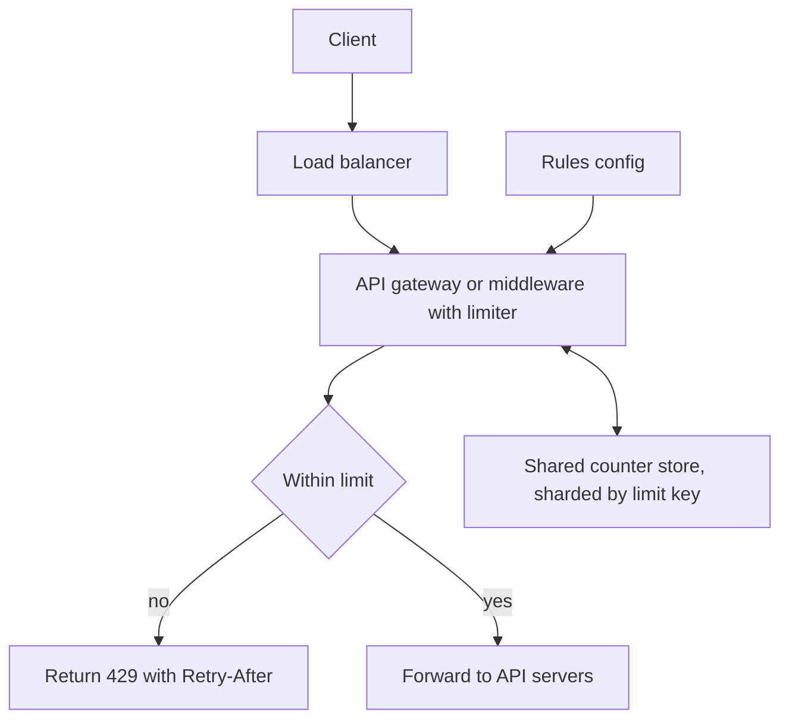

## The hook

A public API serves 50,000 developers. One of them deploys a script with a bug and starts sending 20,000 requests per second. Within minutes, database connections are exhausted, latencies spike for everyone, and the on-call engineer's phone starts ringing.

A rate limiter would have rejected that script's excess requests at the front door with a polite `429 Too Many Requests`, while every other customer carried on normally. Designing one is a favourite interview question because it combines an algorithm, a distributed systems problem and an operational judgement call.

:::analogy
Think of a turnstile at a stadium gate. It lets each ticket holder through at a sensible pace, holds back a crowd that surges all at once, and works the same way at every gate, so pushing to a different entrance does not help. If a turnstile jams, the stewards must decide: wave people through, or stop everyone?
:::

That last question, wave through or stop, will matter in the failure section.

## Requirements

**Functional**

1. Limit requests per client, for example 100 requests per minute per API key, with different limits for different endpoints and plans.
2. Reject excess requests with HTTP `429` and headers telling clients their limit, how much remains and when to retry.
3. Allow configurable bursts, so an app opening a screen can send several requests at once.
4. Support limits by user, API key, IP address, or combinations, the [[limit key]].

**Non-functional**

- Adds very little latency to every request, ideally around a millisecond.
- Works across a fleet of many API servers: the limit is global, not per server.
- Highly available: the limiter must not become the outage.
- Accurate enough: small overshoots are acceptable, large ones are not.

## Back-of-envelope numbers

All numbers are **estimates**.

- **Traffic:** 200,000 requests per second at peak across the fleet.
- **Clients:** 10 million active limit keys per day.
- **State per key:** a token bucket needs two numbers, tokens and last refill time, about 16 bytes plus key and overhead, say 100 bytes. 10 million × 100 B ≈ **1 GB** of state: small enough for a modest Redis cluster with replicas.
- **Store load:** one atomic check per request ≈ 200,000 operations per second at peak. Spread over a few shards, each handling tens of thousands of operations per second, that is reasonable.

The numbers say: the state is tiny; the challenge is doing a shared, atomic check at high rate with low latency.

## High-level design

**Where to enforce it:** in an API gateway or a middleware layer that every request passes through, before expensive work begins. Limiting only inside individual services is too late: the request has already used resources.

**Rules** live in configuration: endpoint, plan, key type, rate and burst. The gateway loads them and refreshes periodically.

**State** lives in a shared in-memory store such as Redis, sharded by limit key, so every gateway node sees the same counts.

## Deep dives

### 1. Choosing the algorithm

| Algorithm | How it works | Strength | Weakness |
|---|---|---|---|
| [[Fixed window counter]] | count per minute, reset each minute | simplest, one counter | double burst at boundaries |
| Sliding window log | store timestamps of recent requests | exact | memory grows with request rate |
| [[Sliding window]] counter | blend current and previous window counts | close to exact, small state | an approximation |
| Token bucket | tokens refill at a rate up to a capacity | allows controlled bursts, two numbers per key | slightly more logic |

For most APIs, a token bucket is the best default: "100 per minute, bursts of 20" maps directly onto its two settings, and it needs constant memory per key. The algorithm is explained in [The Punch Card That Says Slow Down](article:famous-algos-token-bucket).

### 2. Keeping it correct across many servers

Every gateway node must update the same bucket. The read-refill-spend sequence must be [[atomic operation|atomic]], or two nodes can both see one remaining token and both allow a request. In Redis, the standard approach is a short Lua script that reads the bucket, refills it from elapsed time, decides, and writes it back, all executed as one step. Fixed-window counters can use atomic `INCR` with an expiry.

:::insight
A distributed rate limiter is a tiny algorithm wrapped around a hard requirement: one consistent count, updated atomically, reachable in about a millisecond from every server. Getting the atomic shared update right matters more than the choice between similar algorithms.
:::

### 3. Latency and hot keys

A Redis round trip inside a data centre is roughly sub-millisecond, acceptable for most APIs. To go further:

- **Local pre-checks:** each node keeps a small local bucket per key and syncs with Redis in batches, trading a little accuracy for less network traffic.
- **Hot keys:** one huge customer's key can overload a shard. Split their limit across several sub-keys or give them a dedicated allocation per node.

### 4. Telling clients what happened

Return `429` with headers such as `Retry-After` and the remaining quota. Well-behaved clients then back off with jitter, as in [Why Your App Waits a Random Moment Before Retrying](article:famous-algos-exponential-backoff), instead of hammering harder.

## Trade-offs

- **Accuracy vs latency:** a central atomic check is accurate but costs a round trip on every request; local buckets synced periodically are faster but can overshoot.
- **Global vs per-region limits:** a single global count across regions needs cross-region calls; per-region limits are fast but let clients get more by spreading traffic.
- **Fail open vs fail closed:** when the store is unavailable, [[fail open|failing open]] keeps the API serving but removes protection; failing closed protects backends but causes an outage. Many teams fail open for general traffic, keep strict local fallbacks, and fail closed for sensitive endpoints like login or OTP sending.
- **Rejecting vs queuing:** rejecting is simple and honest; queuing (a leaky bucket) smooths traffic but adds latency and memory.

## What can go wrong

- **Race conditions** from non-atomic check-then-set logic let clients exceed limits under concurrency.
- **Store outage** turns the limiter into either an outage or no protection, depending on the fail mode, so decide in advance.
- **Clock skew** between servers distorts refill calculations; use the store's time or monotonic clocks.
- **Wrong limit key:** limiting by IP punishes many users behind one office or mobile carrier address; limiting only by user lets attackers rotate accounts. Combine keys where needed.
- **Retry storms:** rejected clients that retry immediately multiply load; return `Retry-After` and document backoff.

:::warning
Common misconception: "a rate limiter protects against all overload." It caps individual clients. A sudden surge from millions of well-behaved clients, or a slow dependency, still needs global limits, load shedding, autoscaling and circuit breakers. Rate limiting is one layer of defence, not the whole wall.
:::

:::try-this
Your limit is 100 requests per minute with a fixed window. A client sends 100 requests at 10:00:58 and 100 at 10:01:01. How many get through, and how would a token bucket with rate 100 per minute and capacity 100 behave instead? (Fixed window: all 200 pass, because the window reset at 10:01:00. Token bucket: the first 100 drain the bucket; three seconds later only about 5 tokens have refilled, so about 5 of the second burst pass.)
:::

## Further reading

- Stripe engineering blog, "Scaling your API with rate limiters": https://stripe.com/blog/rate-limiters
- Cloudflare blog, "How we built rate limiting capable of scaling to millions of domains": https://blog.cloudflare.com/counting-things-a-lot-of-different-things/
- Redis documentation, "Rate limiting" patterns and Lua scripting: https://redis.io/docs/latest/develop/interact/programmability/eval-intro/

## Key takeaways

- A rate limiter caps requests per limit key, such as user, API key or IP, and rejects excess traffic with 429 and retry hints.
- Enforce it at the gateway or middleware, before requests consume expensive resources.
- Token buckets are a strong default because they allow controlled bursts with constant state per key, while fixed windows allow boundary bursts.
- Across many servers, keep counts in a shared store and make the check and update atomic, for example with a Redis Lua script.
- Decide in advance whether to fail open or closed when the limiter's store fails, and combine rate limits with other overload defences.
