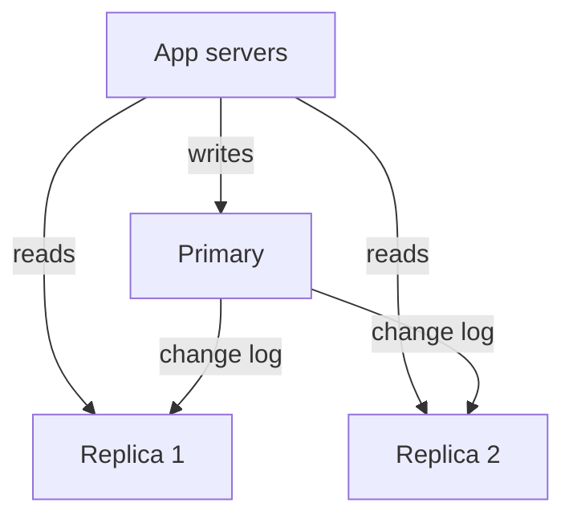

## The hook

You change your display name to "Asha 🎉", hit save, and the page reloads with... "Asha". You hit refresh. Still the old name. Refresh again, and there it is.

Nothing failed. Your write landed on one database server, and your read went to a different one that had not heard the news yet. Millions of products do this on purpose, because it lets one database serve ten times the readers.

By the end of this article you will be able to explain exactly why that happened, why it is usually a good trade, and the three standard tricks that make it invisible to the person who made the change.

## The intuition

:::analogy
The principal's office pins the official notice on its own board, then sends **photocopies** to every classroom notice board. Students read the copy in their own classroom, so nobody crowds the office. But the copies **arrive a little late**. If the principal changes the exam date, the office board shows the new date at once, while a classroom copy may show the old one for a few minutes.
:::

That is a database with read replicas:

- The **[[primary]]** is the office board: every write goes there, and it is always current.
- Each **[[read replica]]** is a classroom copy: it receives every change from the primary and serves reads.
- **[[Replication lag]]** is the delivery delay of the photocopies.

Most products read far more than they write. A feed is read thousands of times for each post. Replicas exploit that imbalance.

## How it works

### Writes in one place, reads everywhere

1. The app sends every INSERT, UPDATE and DELETE to the primary.
2. The primary records the change in its log and applies it.
3. It streams that log to each replica, which replays the same changes in the same order.
4. The app spreads SELECT queries across replicas, usually through a read endpoint or a connection pool that knows which nodes are replicas.

### Why replicas are almost always asynchronous

With **[[asynchronous replication]]**, the primary says "done" to the app as soon as it has the write, and ships it to replicas a moment later. The user gets a fast response. The cost is lag, and if the primary dies before shipping, the newest writes may be lost.

With synchronous replication, the primary waits for a replica to confirm before saying "done". No lag on that replica, no lost writes, but every write now pays an extra network round trip, and if that replica is slow or down, writes stall. Many systems compromise: one synchronous replica for safety, the rest asynchronous for reads.

### How much capacity do replicas add?

Predict this before reading the table. Your load is 9,000 reads and 1,000 writes per second (an **estimate** for illustration). Each node can do about 4,000 operations per second. How many replicas until reads stop being the problem?

| Setup | Load on primary | Load on each replica | Fits? |
|---|---|---|---|
| Primary only | 10,000 | n/a | No, 2.5x over |
| Primary + 2 replicas | 1,000 writes | 1,000 writes + 4,500 reads = 5,500 | No |
| Primary + 3 replicas | 1,000 writes | 1,000 + 3,000 = 4,000 | Just, no headroom |
| Primary + 4 replicas | 1,000 writes | 1,000 + 2,250 = 3,250 | Yes, about 80% busy |

Notice the "+ 1,000" on every replica. Wait, why do replicas pay for writes they never received from the app? Because each replica must replay every change to stay a copy. That is why replicas scale **reads** but never **writes**: add ten replicas, and every one of them still applies all 1,000 writes per second.

:::insight
Read replicas trade freshness for read capacity. They multiply how many reads you can serve, add a standby for failover, and give you somewhere to run heavy reports, but every replica repeats every write, so write capacity stays exactly where it was.
:::

## Trade-offs

| You gain | You give up |
|---|---|
| Read capacity grows with each replica | Reads may be stale by the replication lag |
| A warm standby that can be promoted on failure | Failover can lose the last asynchronous writes |
| Isolate heavy analytics queries on their own replica | More machines to pay for, monitor and patch |
| Serve reads from a replica near users in another region | Cross-region lag is larger |

### The lag scenario, step by step

Here is the profile bug from the hook, traced with times:

| Time | Primary | Replica | What the user sees |
|---|---|---|---|
| t = 0 ms | name = "Asha" | name = "Asha" | |
| t = 5 ms | UPDATE commits: "Asha 🎉" | still "Asha" | "Saved!" |
| t = 20 ms | | change not yet applied | Page reloads, reads replica: **"Asha"** |
| t = 300 ms | | applies the update | |
| t = 2 s | | "Asha 🎉" | Refresh shows "Asha 🎉" |

Lag is usually small, often well under a second. But it is not bounded: a long-running query on the replica, a burst of writes or a network hiccup can push it to seconds or minutes.

### Three tricks for read-your-writes

The user does not care that *other* people see the old name for a second. They care that *they* do. [[Read-your-writes]] fixes exactly that:

1. **Read your own data from the primary.** Profile and settings pages, which a user edits, read from the primary; everyone else's data comes from replicas.
2. **Stick to the primary briefly after a write.** After a user writes, route their reads to the primary for a short window (say a few seconds, longer than typical lag), for example by setting a flag in their session.
3. **Wait for the replica to catch up.** The primary returns the log position of the write; the app stores it, and only reads from a replica whose applied position is at least that far. This is the most precise option, and the most work.

:::warning
Common misconception: "replication lag only matters for other users." The most visible bug is the opposite one: a user reading their *own* write from a lagging replica. Comments that vanish after posting and settings that "do not save" are classic symptoms. Design read-your-writes in from the start.
:::

:::try-this
A checkout flow decrements stock on the primary and then shows "Only 2 left!" read from a replica. Two shoppers buy the last item one second apart. What can go wrong, and which read must go to the primary? (Both may see "1 left" on a lagging replica and both proceed. The read that decides whether to sell, the stock check inside the purchase, must happen on the primary inside the same transaction as the decrement. The "only 2 left" banner can stay on a replica.)
:::

## What can go wrong

- **Stale reads that matter**: stock levels, balances and uniqueness checks read from replicas allow overselling and duplicates. Keep decisions on the primary.
- **Lag spikes**: a heavy report on a replica slows its replay. Monitor lag per replica and take replicas out of the read pool when they fall too far behind.
- **Failover data loss**: with asynchronous replication, promoting a replica can drop the last writes the old primary confirmed. Decide whether that is acceptable, or keep one synchronous replica.
- **Split brain**: if the old primary comes back and still accepts writes after a replica was promoted, you have two sources of truth. Fence the old primary (cut its access) before promoting.
- **Replicas do not fix write overload**: if the primary is busy with writes, replicas only add more machines replaying the same writes.

### Interview follow-ups

**"Your read traffic grows 10x. Replicas or cache?"** Usually both. A cache in front absorbs repeated hot reads cheaply; replicas handle the long tail of varied queries that a cache cannot hold. Start with the cache if a small set of keys dominates.

**"How do you route reads and writes?"** Separate connection strings (a writer endpoint and a reader endpoint), or a proxy that sends writes to the primary and spreads reads. Code that needs fresh data explicitly asks for the writer.

**"How do you detect lag?"** Compare the primary's current log position with each replica's applied position, or write a heartbeat row with a timestamp every second on the primary and check how old it looks on each replica.

**"What happens when the primary dies?"** A replica is promoted (manually or by an orchestrator), the writer endpoint moves to it, and the other replicas start following the new primary. Mention fencing the old one and the possible loss of the latest asynchronous writes.

## In the real world

- Managed relational databases commonly offer a "create read replica" button, a separate reader endpoint, and metrics for replica lag.
- Social and content products send almost all feed and profile views to replicas and keep writes plus read-your-writes paths on the primary.
- Analytics teams often get a dedicated replica, so a slow report never competes with user traffic.

When writes, not reads, are the wall, the next step is splitting the data itself across machines, which trades even more simplicity for capacity. The journey so far is in [One Stronger Horse or a Team of Horses?](article:system-design-vertical-horizontal), and the consistency ideas behind read-your-writes are in [Why Your Like Count Can Be Wrong for a Second](article:system-design-consistency-basics).

## Further reading

- The replication chapter of Martin Kleppmann's *Designing Data-Intensive Applications*, which covers leaders, followers, lag and read-your-writes in depth.
- Your database's own replication documentation (for example PostgreSQL streaming replication or MySQL replication) for how lag is measured.

## Key takeaways

- A read replica is a copy of the primary that replays every change and serves reads, so read capacity grows with each replica while writes still go to one primary.
- Replicas are usually asynchronous, which keeps writes fast but means replicas lag and a failover can lose the newest writes.
- Every replica repeats every write, so replicas never increase write capacity; that needs partitioning.
- The classic lag bug is a user not seeing their own change, fixed by read-your-writes: read from the primary for your own data, stick to the primary briefly after writing, or wait for the replica to catch up.
- Decisions that must be correct, such as stock or balance checks, belong on the primary; displays that can be a second old belong on replicas.
