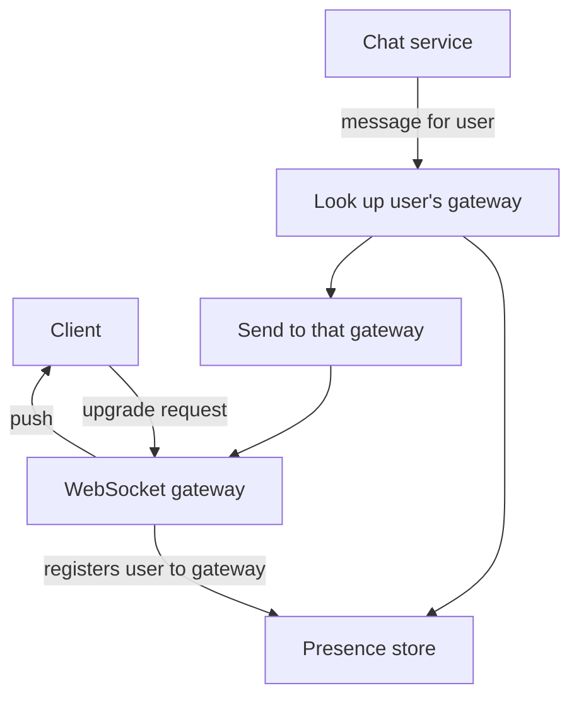

## The hook

HTTP was designed for asking: the client requests, the server replies, the conversation ends. But a chat message, a driver's location or a cricket score is something the server learns first. How does the server tell you, when you did not ask?

There are four answers, from crude to elegant, and every real-time feature you use is built on one of them. Choosing the right one, and knowing how it scales to millions of connections, is a staple of chat, feed and ride-sharing design questions.

## The intuition

:::analogy
Imagine waiting for an important letter. You could walk to the mailbox every ten minutes, mostly finding it empty. You could stand at the mailbox until the postman comes, then walk back and start waiting again. You could ask the post office to read updates to you over a phone line that stays open. Or you could install a two-way intercom at the door, so either of you can talk at any moment.
:::

Those are [[polling]], [[long polling]], [[server-sent events]] and [[WebSocket]]s. The difference is who waits, how much is wasted, and whether talk flows one way or both ways.

## How it works

**Short polling.** The client asks every few seconds: "anything new?" Simple, works everywhere, cacheable. But most answers are "no", and updates arrive up to one interval late.

**Long polling.** The client asks, and the server holds the request open until there is news or a timeout (say 30 seconds), then responds. The client immediately asks again. Updates arrive quickly, using only ordinary HTTP, but each message costs a full request cycle, and servers hold many pending requests.

**Server-sent events (SSE).** The client opens one HTTP request, and the server keeps the response open, writing events as they happen. One direction only, plain text, and browsers reconnect automatically. Ideal for notifications, live scores and progress updates.

**WebSockets.** The client sends an HTTP request asking to upgrade; the connection becomes a persistent, two-way channel. Both sides send messages at any time with tiny framing overhead. Ideal for chat, multiplayer games and collaborative editing.

### A quick estimate

Suppose 10 million users are online at peak, each holding one WebSocket (an estimate for a large chat app). If one gateway server comfortably holds around 100,000 mostly idle connections, an assumption that depends heavily on memory per connection and tuning, you need on the order of 100 gateways, plus spare capacity so that losing one does not overload the rest. Heartbeats every 30 seconds from 10 million clients add about 330,000 tiny messages per second on their own, which is why heartbeat intervals are a real design parameter.

### Scaling persistent connections

A WebSocket or SSE connection lives for minutes or hours. Real systems put them on a dedicated [[connection gateway]] tier:

- Gateways hold connections and do little else; business logic lives in stateless services behind them.
- A shared store maps each user to the gateway currently holding their connection, so a service can route a message to the right gateway.
- Load balancers must support long-lived connections, and draining a gateway for a deploy means gently asking clients to reconnect elsewhere.

:::insight
Real-time is less about the protocol and more about routing: knowing which machine holds a user's open connection right now, and getting each event there. Once you separate "hold connections" from "decide what to send", both sides scale independently.
:::

## Trade-offs

| Option | Direction | Latency | Server cost | Good for |
|---|---|---|---|---|
| Short polling | client asks | up to the interval | many wasted requests | rare updates, simplest setups |
| Long polling | client asks, server waits | low | a held request per client, re-sent per message | fallbacks, older networks |
| SSE | server to client | low | one open response per client | notifications, feeds, scores |
| WebSocket | both ways | lowest | one open connection per client, stateful gateways | chat, games, collaboration |

- **Simplicity vs efficiency:** polling needs nothing special but wastes work; WebSockets are efficient but stateful and harder to operate.
- **Mobile realities:** phones sleep and switch networks, so connections drop often. Many apps combine an open connection while active with platform push notifications when in the background.
- **[[Fan-out]] cost:** one message to a group of 10,000 means 10,000 deliveries across many gateways. Large groups often need batching or a pull model for the less active members.

## What can go wrong

- **Reconnect storms:** a gateway restart drops a million connections that all reconnect at once. Add randomised backoff on the client and spread reconnections out.
- **Lost messages during reconnects:** a message sent while a client was between connections disappears unless messages are stored and clients resume from their last received id.
- **Stale presence:** if a gateway dies without cleaning up, the presence store still thinks users are connected there. Use heartbeats and expiring entries.
- **Proxies and timeouts:** some proxies close idle connections; periodic ping messages keep them alive.

:::warning
Common misconception: "WebSockets are always better than polling." For data that changes every few minutes, or for features with few users, polling is simpler, cacheable and perfectly adequate. Pick the cheapest option that meets the latency requirement.
:::

:::try-this
For each feature, pick polling, SSE or WebSockets: a cricket score page, a two-way chat, a dashboard refreshed every five minutes, and a live auction where users place bids. (A reasonable answer: SSE for scores, WebSockets for chat, polling for the dashboard, and WebSockets or SSE plus normal POST requests for the auction, since bids are client actions and updates are server pushes.)
:::

### Interview follow-ups

**"Polling, long polling, SSE or WebSockets?"** Short polling is simplest but wastes requests. Long polling holds the request open until there is news, which suits occasional updates. Server-Sent Events stream one way from server to browser over plain HTTP, good for live scores or notifications. WebSockets are two-way and low latency, needed for chat, games and collaborative editing.

**"How do you send a message to a user connected to a different server?"** Keep a registry of which gateway holds each user's connection (for example in Redis), or publish to a pub/sub channel that every gateway subscribes to. The receiving gateway pushes the message down its socket.

**"How many connections can one server hold?"** Idle connections are cheap in memory, so one well-tuned server can hold a large number, often limited by memory, file descriptors and per-connection buffers rather than CPU. Say you would load test it, and plan for reconnect storms rather than steady state.

## In the real world

Chat and collaboration products typically run gateway fleets holding persistent connections and a separate service layer for logic, as in the diagram above. Live sports and notification feeds often use SSE or similar streaming because traffic is one-way. Mobile apps fall back to platform push services when the app is in the background. All of these sit on top of the request lifecycle in [Everything That Happens Before a Page Appears](article:system-design-client-server-http): an upgrade still starts as an ordinary HTTP request.

## Further reading

- MDN Web Docs, "The WebSocket API": https://developer.mozilla.org/en-US/docs/Web/API/WebSockets_API
- MDN Web Docs, "Using server-sent events": https://developer.mozilla.org/en-US/docs/Web/API/Server-sent_events/Using_server-sent_events
- RFC 6455, The WebSocket Protocol: https://www.rfc-editor.org/rfc/rfc6455

## Key takeaways

- Short polling asks on a schedule and wastes most requests, while long polling holds each request until there is news.
- Server-sent events stream one-way updates over plain HTTP, and WebSockets give a persistent two-way channel.
- Persistent connections are best held by a dedicated gateway tier, with a shared store mapping users to their gateway.
- Reconnect storms, lost messages and stale presence are the usual failure modes, handled with backoff, resumable message ids and heartbeats.
- Choose the simplest option that meets the latency need; polling is still right for slow-changing data.
