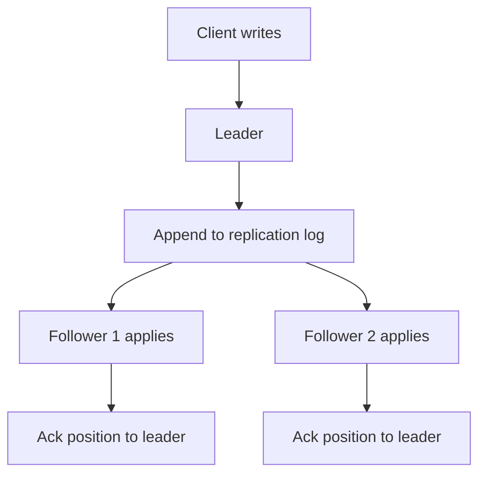

## The hook

At 2:14 am the primary database of a busy shop loses power. Within thirty seconds a replica is promoted, the app reconnects, and the dashboards turn green again. Everyone goes back to sleep.

Next morning, support gets three emails: "I paid, I got a confirmation, and my order does not exist."

Nobody wrote a bug. The system did exactly what it was configured to do. By the end of this article you will be able to find the exact moment those three orders vanished, and name the setting that would have saved them, along with what it would have cost.

## The intuition

:::analogy
A **teacher dictates notes** to the class. The teacher decides what is said and in what order; the students copy each sentence into their notebooks in exactly that order. A fast student is one sentence behind, a slow one is five sentences behind. If the teacher suddenly leaves, the best-caught-up student can take over the dictation, but anything the teacher said that nobody wrote down yet is simply gone.
:::

That is leader-follower replication:

- The **[[leader]]** is the teacher. It accepts every write and decides their order.
- The **[[follower]]s** are the students. They apply the same changes in the same order.
- The dictation is the **[[replication log]]**.
- The teacher leaving is a **failover**, and "what nobody wrote down" is the data loss from the hook.

Read replicas, covered in [Photocopies of a Notice That Arrive a Little Late](article:system-design-read-replicas), are this mechanism used to scale reads. This article is about the mechanism itself: what gets shipped, when a write counts as safe, and how leadership changes hands.

## How it works

1. The leader receives a write, applies it locally and appends it to its log, giving it a position (a log sequence number).
2. Followers stream the log from the position they last applied, apply each change in order, and report back how far they have got.
3. Because every follower applies the same changes in the same order, they converge on the same data.

### What exactly goes into the log?

Predict the bug before reading on. The leader logs the SQL statement `UPDATE orders SET placed_at = NOW() WHERE id = 7` and each follower re-runs it.

Each follower runs NOW() at a slightly different moment, so the copies disagree. The same goes for RAND(), auto-increment ids under concurrency, or anything depending on the current state.

| Log format | What is shipped | Pros | Cons |
|---|---|---|---|
| Statement-based | The SQL text | Compact | Non-deterministic functions diverge |
| Physical (write-ahead log shipping) | Low-level storage changes: which bytes in which page | Exact copy, simple | Tied to the storage format, so leader and followers usually need the same version |
| Logical (row-based) | "Row 7 in orders: these columns changed to these values" | Deterministic, version-independent, readable by other systems | Larger than statements for bulk updates |

Logical logs are also what change data capture tools read to feed caches, search indexes and analytics, the idea behind [Write the Letter and the Envelope Together](article:system-design-outbox-cdc).

### When is a write "done"? Sync vs async

| Mode | Leader acknowledges when | Write latency | Data loss on leader crash | Availability |
|---|---|---|---|---|
| Asynchronous | It has the write locally | Lowest | Possible: unshipped writes are lost | Writes continue even if all followers are down |
| Synchronous (all followers) | Every follower confirms | Highest, set by the slowest follower | None for confirmed writes | Any follower down blocks writes |
| [[Semi-synchronous replication]] | At least one follower confirms | One round trip to the nearest follower | None if that follower survives | Blocks only if no follower can confirm |

Fully synchronous replication to every follower is rarely used: one slow node would stall every write. Semi-synchronous replication is the common middle ground for data you cannot lose.

:::insight
The replication mode is a promise about which acknowledged writes survive a crash. Asynchronous replication buys speed by allowing the leader to say "saved" for writes that exist in only one place; semi-synchronous replication pays one extra round trip so that "saved" means "saved on two machines".
:::

## Trade-offs

### Failover, step by step

When the leader dies, someone must notice, pick a new leader and move traffic:

1. **Detect**: followers or an orchestrator stop receiving heartbeats for a timeout.
2. **Choose**: pick the most up-to-date follower, ideally by a majority vote so a partitioned minority cannot elect its own leader.
3. **Fence**: make sure the old leader cannot accept writes if it comes back ([[fencing]]).
4. **Reconfigure**: point clients and the other followers at the new leader.

Now trace the hook's lost orders with asynchronous replication:

| Time | Leader | Follower | Client |
|---|---|---|---|
| 02:13:59.900 | Order 501 committed, acknowledged | has up to order 500 | "Payment confirmed" |
| 02:13:59.950 | Order 502 committed, acknowledged | has up to order 500 | "Payment confirmed" |
| 02:14:00.000 | Power lost | has up to order 500 | |
| 02:14:30 | | Promoted to leader | App reconnects |
| Morning | | No orders 501, 502 | "My order does not exist" |

The orders were acknowledged by a leader that never shipped them. With semi-synchronous replication, the acknowledgement would have waited for the follower, and those orders would have survived the promotion.

:::warning
Common misconception: "a replica means my data is safe." With asynchronous replication, the newest acknowledged writes can exist only on the leader. A failover loses them silently, and if the old leader comes back with them, they now conflict with new writes on the new leader. Decide explicitly which data needs semi-synchronous replication.
:::

### Timeout tuning

- **Too short**: a garbage-collection pause or a brief network blip triggers an unnecessary failover, which itself causes downtime and risk.
- **Too long**: a dead leader means minutes of failed writes.

Systems often combine a timeout with a majority check, so a single follower's view of the network is not enough to depose a leader.

:::try-this
Your leader is in Mumbai, one follower in Mumbai (1 ms round trip) and one in Singapore (about 60 ms round trip, an **estimate**). You want no acknowledged write to be lost if the Mumbai data centre fails entirely. Which follower must confirm each write, and what does it cost? (The Singapore follower must confirm, because the Mumbai follower dies with the leader. Every write then waits roughly one 60 ms round trip. Many teams accept that only for critical tables, such as payments, and replicate the rest asynchronously.)
:::

## What can go wrong

- **Lost writes on async failover**, as traced above.
- **[[Split brain]]**: the old leader survives a partition, keeps accepting writes, and a new leader is elected on the other side. Without fencing, both sets of writes are accepted and must be reconciled by hand.
- **Lagging follower promoted**: picking the wrong follower loses more data than necessary. Promote the one with the highest applied log position.
- **Replica divergence** from statement-based logging or from someone writing directly to a follower. Make followers read-only and prefer row-based logs.
- **Cascading load**: when one follower is removed, its read traffic shifts to the others, which may then lag or fall over.

### Interview follow-ups

**"How do you avoid split brain?"** Elect leaders only with a majority of nodes, and give each leadership term a number (an epoch). Storage and followers reject writes from an older epoch, so a returning old leader is fenced automatically.

**"How does a new follower get a copy of a 2 TB database?"** Take a consistent snapshot of the leader (with its log position), copy it to the new node, then stream the log from that position until it catches up.

**"Leader-follower vs multi-leader vs leaderless?"** Leader-follower gives one clear order of writes and simple consistency. Multi-leader lets each region accept writes locally but needs conflict resolution. Leaderless (quorum reads and writes, as in Dynamo-style stores) has no failover step at all but needs read repair and careful quorum settings.

**"What is the RPO and RTO of your design?"** Recovery point objective is how much data you can lose (zero with semi-sync on the right follower, seconds with async). Recovery time objective is how long writes are down during failover (detection timeout plus promotion).

## In the real world

- Relational databases such as PostgreSQL and MySQL ship physical or row-based logs to followers and offer synchronous or semi-synchronous modes per follower or per setting.
- Managed database services automate detection, promotion and endpoint changes, often promising a failover within a minute or two, while documenting that asynchronous replicas can lose recent writes.
- Coordination systems that cannot afford split brain elect leaders with consensus algorithms, as in [How Five Servers Agree on One Truth](article:famous-algos-raft).

Replication copies all the data to every follower. When the data itself is too big for one machine, it is first split across machines, as in [Splitting the Phone Book by Surname](article:system-design-partitioning), and then each slice is replicated with exactly the mechanism you just learned.

## Further reading

- The replication chapter of Martin Kleppmann's *Designing Data-Intensive Applications*.
- The replication documentation of PostgreSQL (streaming and synchronous replication) and MySQL (semi-synchronous replication).

## Key takeaways

- In leader-follower replication, one leader orders all writes and followers apply the same changes in the same order from a replication log.
- Row-based logical logs avoid the divergence that replaying non-deterministic SQL statements causes, and they also feed change data capture.
- Asynchronous replication is fast but can lose acknowledged writes on failover; semi-synchronous replication waits for one follower so that "saved" means saved on two machines.
- Failover means detecting the failure, promoting the most up-to-date follower by majority, fencing the old leader and redirecting clients; skipping fencing invites split brain.
- Choose replication modes per data type from the data loss (RPO) and downtime (RTO) you can accept.
