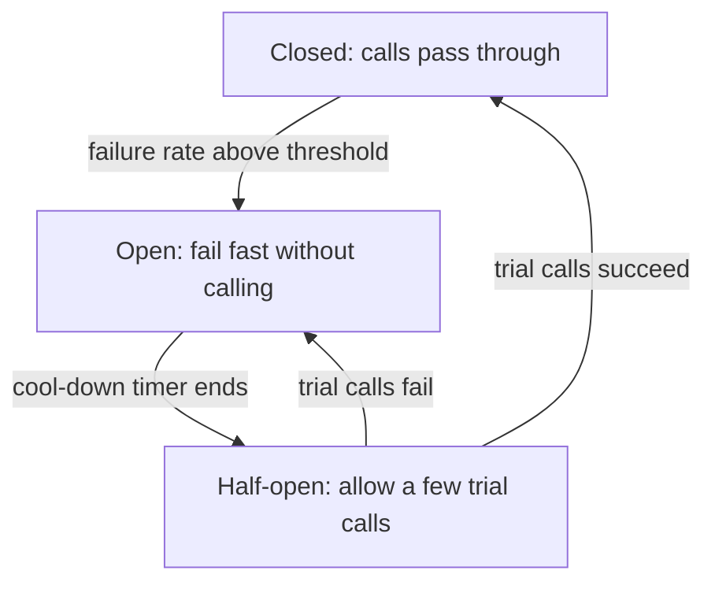

## The hook

Your checkout service calls a recommendations service to show "you might also like". One evening, recommendations becomes slow: not down, just slow, answering after 30 seconds instead of 50 ms.

Within two minutes, checkout is down too. Nobody can pay. The thing that broke was a widget nobody would have missed.

Why did a slow, unimportant dependency kill an important service? Before reading on, think about what checkout's threads were doing for those 30 seconds. (Nothing. That was the problem.)

## The intuition

:::analogy
Every home has a **fuse box that trips before the house burns**. When one circuit draws too much current (a faulty heater, say), its fuse cuts that circuit. The lights in the rest of the house stay on. Without the fuse, the heater's fault spreads heat through the wiring until everything is at risk. And each room is on its own circuit, so one fault cannot take all of them.
:::

Resilience patterns are the fuses and the separate circuits of a distributed system:

- **[[Timeout]]s**: stop waiting on a call that is taking too long.
- **Retries with a [[retry budget]]**: try again, but never so much that you make things worse.
- **[[Circuit breaker]]s**: stop calling a dependency that keeps failing, and fail fast.
- **[[Bulkhead]]s**: separate pools, so one fault cannot drain everything.
- **[[Fallback]]s**: a sensible reduced answer when a dependency is unavailable.

Their shared goal is stopping a **[[cascading failure]]**.

## How it works

### Timeouts everywhere

Back to the hook. Checkout has 200 worker threads. Each request ties up a thread until it finishes, so throughput is roughly threads ÷ time per request:

| Recommendations latency | Requests per second checkout can finish |
|---|---|
| 50 ms (normal) | 200 ÷ 0.05 = 4,000 |
| 2 s (with a 2 s timeout) | 200 ÷ 2 = 100 |
| 30 s (default timeout) | 200 ÷ 30 ≈ 7 |

Every thread was parked waiting for recommendations. Checkout did not fail; it simply had no free threads left.

Rules of thumb:

- Every network call gets a timeout, set from the dependency's normal latency (for example, a bit above its 99th percentile), not a library default.
- Use **deadlines** that travel with the request: if the user's request has 1 second left, a downstream call should not wait 5.
- Calls for non-essential features get short timeouts and a fallback (no recommendations shown).

### Retries without storms

Retries fix transient failures: a dropped connection, one bad instance. But predict the worst case: three layers each retry 3 times, and the bottom service is overloaded.

Every failure is multiplied: 3 × 3 × 3 = **27** attempts per user request hit the struggling service, just when it can least handle them. That is a retry storm.

Safe retries:

- **Retry at one layer** (usually the one closest to the client or the caller that knows the context), not every layer.
- **Cap attempts** (2 or 3) and use **exponential backoff with jitter**, as in [Why Your App Waits a Random Moment Before Retrying](article:famous-algos-exponential-backoff).
- **Retry budget**: retries may add at most, say, 10% to normal traffic. At 1,000 requests per second, that is at most 100 retries per second, however bad things get.
- Retry only **idempotent** operations or ones with an idempotency key, as in [Pressing the Pay Button Twice Should Charge Once](article:system-design-stateless-idempotency).
- Never retry errors that will fail again, such as 400 Bad Request.

### Circuit breakers

- **Closed**: normal. The breaker counts failures and timeouts over a recent window.
- **Open**: too many failures (say 50% of the last 100 calls). Calls fail immediately or use the fallback. The dependency gets breathing room, and callers stop wasting threads.
- **Half-open**: after a cool-down, a few trial calls go through. If they succeed, close; if not, open again.

Wait, why fail fast instead of trying anyway? Because a call that will almost certainly time out costs a thread for the whole timeout and adds load to a service that is trying to recover. Failing in a microsecond is better for everyone, including the struggling service.

### Bulkheads

Give each dependency its own limited pool: 20 threads (or connections) for recommendations, 50 for payments, 30 for inventory. If recommendations hangs, it can tie up at most its 20 threads. Checkout keeps the rest for paying customers. The name comes from ships, whose hulls are split into watertight compartments so one leak does not sink the whole ship.

:::insight
Most cascading failures are resource exhaustion: callers wait too long, retry too much, and share one pool. Timeouts bound the waiting, retry budgets bound the extra load, circuit breakers stop calling what is broken, and bulkheads keep one fault in its own compartment.
:::

## Trade-offs

| Pattern | Protects against | Cost or risk |
|---|---|---|
| Timeouts | Threads stuck on slow calls | Too short: healthy-but-slow calls fail |
| Retries with budget | Transient failures | Extra load; duplicates without idempotency |
| Circuit breaker | Hammering a failing dependency | Tuning; may cut off a dependency that is partly healthy |
| Bulkheads | One dependency draining all resources | Less pooling efficiency; more settings |
| Fallbacks | Total feature failure | Stale or reduced answers must be acceptable to users |
| Load shedding | Overload at the service itself | Rejecting some requests on purpose |

:::warning
Common misconception: "more retries make the system more reliable." Past one or two well-spaced attempts, retries make outages worse, because they multiply load exactly when a service is weakest. Retry at one layer, cap attempts, add jitter, and enforce a retry budget.
:::

:::try-this
Checkout calls payments (essential) and recommendations (optional). Recommendations' 99th-percentile latency is 120 ms. Design timeouts, retries, breaker and fallback for each. (Recommendations: timeout around 150 ms, no retries, a circuit breaker, and a fallback of "show nothing" or cached popular items, in its own small bulkhead. Payments: a timeout from the provider's normal latency, at most one retry with the same idempotency key and backoff, its own bulkhead, and no silent fallback; on failure, show a clear "payment pending" or "try again" state.)
:::

## What can go wrong

- **Default timeouts** of 30 to 60 seconds in HTTP clients, silently inherited.
- **Retry storms** from retries at every layer without budgets.
- **Synchronized retries** without jitter, arriving as a second spike.
- **Breakers that never open** because thresholds count only errors, not timeouts.
- **Fallbacks that hit the same broken dependency** (for example, a fallback reading from the same failing database).
- **Untested failure paths**: patterns that have never been exercised fail when needed; test them by injecting faults.

### Interview follow-ups

**"How do you choose a timeout?"** From the dependency's measured latency (a little above its 99th percentile), within the caller's own deadline. Revisit when latency profiles change.

**"Where should retries happen in a chain of services?"** Ideally at one layer, near the edge or the caller that owns the user request, with deeper layers failing fast. Deeper retries multiply.

**"What is load shedding and how is it different from a circuit breaker?"** Load shedding is the overloaded service itself rejecting excess requests early (often lower-priority ones) to keep serving the rest. A circuit breaker is the caller choosing to stop calling a failing dependency.

**"How do you know these patterns work?"** Fault-injection tests and game days: deliberately add latency or failures to a dependency in a controlled way and watch whether callers stay healthy.

## In the real world

- Resilience libraries such as Resilience4j (Java) and Polly (.NET) provide timeouts, retries, circuit breakers and bulkheads as building blocks.
- Service meshes and proxies such as Envoy can enforce timeouts, retry policies, circuit breaking and outlier ejection outside application code.
- The "Stability Patterns" in Michael Nygard's book *Release It!* popularised circuit breakers and bulkheads for software.

These patterns are the price of the network calls introduced in [One Big Kitchen or a Food Court?](article:system-design-microservices): every call between services needs a fuse.

## Further reading

- Michael T. Nygard, *Release It!* (2nd edition), chapters on stability patterns and anti-patterns.
- Google's *Site Reliability Engineering* book, the chapters on handling overload and addressing cascading failures.

## Key takeaways

- Most cascading failures come from resource exhaustion: callers wait too long on slow dependencies, retry too much, and share one pool of threads or connections.
- Put a timeout on every network call, derived from real latency and within the request's overall deadline, with short timeouts and fallbacks for optional features.
- Retry only idempotent calls, at one layer, with capped attempts, exponential backoff, jitter and a retry budget, because retries multiply load during outages.
- A circuit breaker fails fast while a dependency is unhealthy and probes recovery through a half-open state, giving the dependency room to recover.
- Bulkheads isolate each dependency's resources so one fault cannot take down unrelated features.
