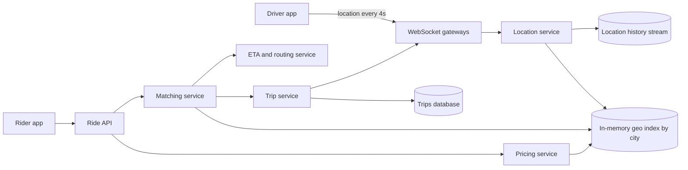
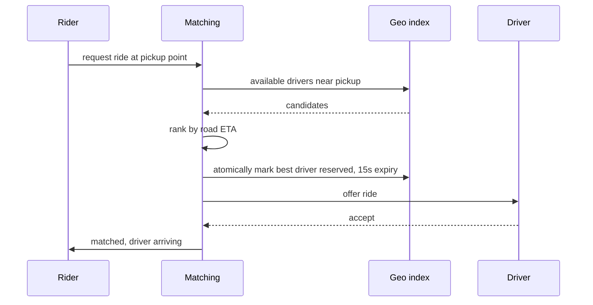

## The hook

You tap "Request ride". Within seconds, the app shows a car icon heading toward you, a driver's name, and "4 min away". To get there, the system knew where hundreds of thousands of drivers were, to within a few metres, a few seconds ago. It found the handful near you, estimated which could arrive first along real roads, offered the ride to one, and made sure no other rider grabbed that same driver at the same moment.

"Design Uber" or "design Ola" is a favourite interview question because it combines a very high write rate (locations), a geospatial query, a concurrency problem (matching), and a long-running workflow (the trip).

:::analogy
Think of an old taxi dispatcher in a control room with a huge live map on the wall. Each taxi radios in its position every few seconds, and the dispatcher moves its pin. A caller asks for a cab; the dispatcher looks at the area of the map around the caller, picks the taxi that can get there fastest by road, radios it, and puts a "busy" tag on its pin so it is not sent anywhere else. On match nights, the dispatcher notices the stadium area is swamped with callers and raises the fare there to pull in more taxis.
:::

The wall map is the [[geospatial index]], radioed positions are location updates, picking a cab is [[matching]], the busy tag is a driver lock, and the match-night fare is [[surge pricing]].

## Requirements

**Functional**

1. Drivers go online and stream their location.
2. Riders see nearby cars, request a ride, and get matched to a driver.
3. Both see live progress; the trip moves through pickup, ride and payment.
4. Prices adjust to supply and demand.

**Non-functional**

- Matching within a few seconds; locations fresh to within a few seconds.
- A driver is never assigned to two trips at once.
- Trip and payment data are never lost.
- Scales by city, with very uneven density.

Out of scope: payments internals, maps and routing engine internals, ratings.

## Back-of-envelope numbers

All numbers are **estimates**.

- **Location updates:** 1 million active drivers, one update every 4 seconds: **250,000 writes per second**. At about 100 bytes each, 25 MB/s of ingest.
- **Location history:** if every update is kept for analytics, 250,000 × 100 B × 86,400 s ≈ **2.2 TB per day**, so history goes to cheap append-only storage, not the live index.
- **Ride requests:** 20 million trips per day ≈ **230 per second** on average, perhaps 700 per second at peak.
- **Trip records:** about 1 KB each ≈ 20 GB per day, **7.3 TB per year**.
- **Density:** a city with 20,000 online drivers over 600 km² has about 24 drivers per 1.2 km × 0.6 km cell on average, but an airport cell can have hundreds.

Locations are a write-heavy, short-lived data stream; trips are lower-volume but must be durable and consistent.

## High-level design

1. Drivers keep a persistent connection, as in [Checking the Mailbox vs Hearing the Doorbell](article:system-design-realtime-communication), and send locations every few seconds.
2. The [[location service]] updates each driver's latest position in an in-memory geospatial index, partitioned by city, and appends updates to a history stream.
3. A ride request goes to the matching service, which queries the index for nearby available drivers, ranks them by [[ETA]], and offers the ride to the best one.
4. On acceptance, the trip service records the match and drives the trip through its states, pushing updates to both apps.

## Deep dives

### 1. The geospatial index

Store each driver under the cell of their current location, for example a 6-character geohash covering about 1.2 km × 0.6 km, as in [Turning a Map Into a String](article:famous-algos-geohash). Each update moves the driver from their old cell to the new one if it changed. To find drivers near a rider, look up the rider's cell and its 8 neighbours, then filter by exact distance.

The index lives in memory (for example Redis GEO sets or a custom in-process grid), sharded by city or region, because 250,000 updates per second on disk-backed rows would be wasteful for data that is stale within seconds. If a node dies, drivers' next updates rebuild it within seconds.

Alternatives: quadtrees adapt cell size to density, and hexagonal grids such as Uber's open-source H3 give more uniform neighbours.

### 2. Matching without double booking

The reservation is an atomic compare-and-set, "set status to reserved only if it is available", so two concurrent requests cannot claim the same driver. If the driver declines or the offer expires, the reservation is released and the next candidate is offered. Batching requests over a second or two and solving the assignment jointly can produce better overall matches than greedy first-come assignment, at the cost of a slight delay.

### 3. The trip state machine

A [[trip state machine]]: requested → matched → driver arriving → in progress → completed, with cancelled reachable from early states. The trip service stores each transition durably in the trips database and accepts only valid transitions, so retried or out-of-order messages ("complete" arriving twice) are handled idempotently. This record, unlike locations, must never be lost because it drives billing.

### 4. Surge pricing

The pricing service counts open requests and available drivers per cell over a sliding window. Where demand greatly exceeds supply, it raises a multiplier for that area, which both rations demand and attracts drivers. Multipliers are smoothed over time and neighbouring cells to avoid flickering prices.

:::insight
Separate the fast, disposable data from the slow, precious data. Driver locations are a firehose that is useless after a few seconds, so they live in a sharded in-memory index. Trips are low-volume but must be correct and durable, so they live in a transactional database with a strict state machine.
:::

## Trade-offs

| Decision | Benefit | Cost |
|---|---|---|
| Update interval 4 s vs 1 s | 4x fewer writes and less battery | positions up to a few seconds stale |
| Geohash grid vs quadtree vs H3 | grid is simple; quadtree adapts to density; H3 has uniform neighbours | complexity and tooling differ |
| Greedy vs batched matching | instant offers | batched gives better global matches, adds a short wait |
| In-memory index | very fast | rebuilt from updates after failures |
| Sharding by city | simple, local queries | cross-border trips and huge cities need finer splits |

## What can go wrong

- **[[Hot cell]]s** at airports, stadiums and stations: one shard handles far more drivers and requests than others. Use finer cells or split hot regions across shards.
- **Double booking** if reservations are not atomic.
- **GPS noise**: jumps across a river or into buildings; smooth positions and snap them to roads.
- **Network drops** in tunnels: drivers appear frozen; expire drivers whose updates stop, and let the trip state machine tolerate gaps.
- **Shard failure** loses live locations briefly; drivers' next updates repopulate it, while trip data remains safe in the durable database.
- **Retry storms** after a gateway outage when every driver reconnects at once; jitter reconnects.

:::warning
Common misconception: "store each location update as a row in the main database." At 250,000 updates per second, that hammers the database with data that is obsolete within seconds. Keep only the latest position in memory, and send the history to a stream or analytics store.
:::

## Further reading

- H3, a hexagonal hierarchical geospatial indexing system (documentation): https://h3geo.org
- Redis documentation, "GEOSEARCH" and the Redis geospatial commands.
- Uber Engineering blog, "H3: Uber's Hexagonal Hierarchical Spatial Index" (2018).

## Key takeaways

- Driver locations are a very high-rate stream, so only each driver's latest position is kept, in an in-memory geospatial index sharded by city.
- Nearby drivers are found by looking up the rider's cell and neighbouring cells, then ranked by road-network ETA rather than straight-line distance.
- Matching reserves a driver atomically with an expiry, so concurrent requests can never assign the same driver twice.
- Trips move through a durable state machine that accepts only valid transitions, making retries and duplicate events safe.
- Dense areas create hot cells, so the index needs finer cells or extra shards where drivers and requests concentrate.
