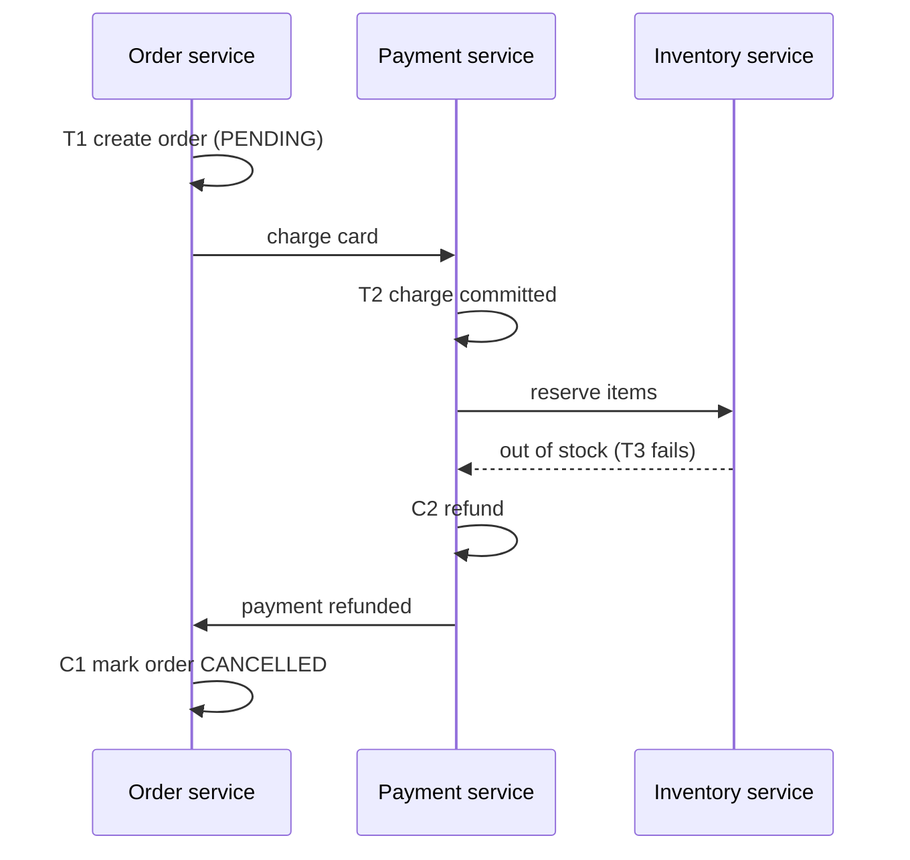

## The hook

An order in a shopping app touches four services: Orders creates the order, Payments charges the card, Inventory reserves the items, Shipping books a courier. Each owns its own database. If Inventory finds the last unit was sold a second ago, the customer has already been charged. You cannot roll back a committed charge in another team's database, and two-phase commit, from [Everyone Says I Do, or Nobody Is Married](article:system-design-two-phase-commit), would make all four services hold locks while waiting on each other.

The answer used in most microservice systems is the saga. The idea was named by Hector Garcia-Molina and Kenneth Salem in their 1987 paper "Sagas", originally for long-lived transactions inside databases, and it fits services perfectly.

## The intuition

:::analogy
Think of booking a holiday yourself. You book the hotel, then the flight, then the car. Each booking is confirmed immediately; nobody holds anything for you while you shop around. If the flight turns out to be full, you do not wish the hotel booking had never happened: you cancel it, perhaps paying a small fee. Each booking has a matching cancellation, and if a later step fails, you cancel the earlier ones in reverse order.
:::

That holiday is a [[saga]]. Each booking is a local transaction that commits at once, and each cancellation is a [[compensating action]].

## How it works

A saga for steps T₁, T₂, ..., Tₙ defines compensations C₁, C₂, ..., Cₙ₋₁. Either all steps succeed, or for some failure at step k the saga runs Cₖ₋₁, ..., C₁ in reverse. Each Tᵢ and Cᵢ is an ordinary local transaction in one service.

### Compensations are not rollbacks

A database rollback makes it as if nothing happened. A compensation is a new, visible business action: a refund appears on the card statement, a cancellation email is sent. Some actions cannot be undone at all, such as sending an email or shipping a parcel. Order the steps so that irreversible ones come last.

The step after which the saga will definitely complete is the [[pivot step]]. Before it, failures are compensated; after it, steps are retried until they succeed. In the order example, charging the card is often the pivot: once paid, reserve and ship are retried rather than refunding.

### Choreography vs orchestration

**[[Choreography]]**: each service listens for the previous event and publishes its own. Order service emits OrderCreated; Payments hears it, charges, emits PaymentCompleted; Inventory hears that, and so on. Compensations also travel as events (InventoryFailed triggers a refund).

**[[Orchestration]]**: a saga orchestrator, often a small state machine in its own service or a workflow engine, calls each step, records progress durably, and on failure calls the compensations in reverse.

| Aspect | Choreography | Orchestration |
|---|---|---|
| Control | spread across services | one place |
| Coupling | services know each other's events | services know only the orchestrator's commands |
| Visibility | flow is hard to see or debug | state of each saga is in one table |
| Good for | short sagas with 2 to 4 steps | longer flows, many branches, timeouts |

### Making it reliable

- **Idempotent steps and compensations**: messages arrive at least once, so each step uses an idempotency key, as in [Pressing the Pay Button Twice Should Charge Once](article:system-design-stateless-idempotency).
- **Durable saga state**: the orchestrator writes "step 2 done" before moving on, so after a crash it resumes instead of restarting.
- **Reliable messaging**: a service must commit its local change and publish its event together, which is the outbox pattern in [Write the Letter and the Envelope Together](article:system-design-outbox-cdc).
- **Retries with backoff and timeouts**: a step that does not answer is retried; after a deadline the saga compensates.

### Isolation, or the lack of it

Each step commits immediately, so other requests can see a half-finished saga: an order PENDING with money taken but no stock reserved. Countermeasures:

- **[[Semantic lock]]s**: mark records PENDING so other flows know not to act on them.
- **Commutative updates**: design changes like "add 1" that give the same result in any order.
- **Reorder steps**: do the step most likely to fail first, such as reserving inventory before charging.

:::insight
A saga gives up the illusion that everything happens at once and replaces it with a promise that the system will end in a consistent business state. Atomicity is rebuilt from local commits plus explicit undo actions, and isolation is rebuilt by design rather than by locks.
:::

## Trade-offs

| Choice | Gains | Costs |
|---|---|---|
| Saga vs 2PC | services stay available and independent; no cross-service locks | intermediate states visible; compensations must be written and tested |
| Choreography | no central component; simple for short flows | flows are implicit; cyclic event chains are hard to debug |
| Orchestration | explicit state machine; easy monitoring and timeouts | the orchestrator is another service to run and scale |
| Charging early | fewer orders without payment | more refunds when later steps fail |
| Reserving inventory first | fewer refunds | reservations must expire if payment never happens |

## What can go wrong

A failure timeline for an orchestrated order saga:

1. **t1** Orchestrator records "started", creates order PENDING.
2. **t2** Payment charges ₹2,000 and replies; orchestrator records "paid".
3. **t3** Inventory call times out. The orchestrator does not know whether the reservation happened.
4. **t4** It retries with the same idempotency key; Inventory replies "out of stock".
5. **t5** Orchestrator calls Refund with key "order-77-refund"; the response is lost.
6. **t6** It retries the refund; Payment recognises the key and returns the original result instead of refunding twice.
7. **t7** Order marked CANCELLED.

Other hazards:

- **Compensations that fail**: a refund API is down. Compensations must be retried until they succeed, with alerts and a manual queue for the rare stuck case.
- **Non-idempotent steps** that double-charge on retry.
- **Lost events** when a service commits but crashes before publishing.
- **Concurrent sagas** acting on the same record without semantic locks.

:::warning
Common misconception: "a compensation is just a rollback." A rollback erases a change no one saw. A compensation is a new action that other systems and the customer can observe, may have its own fees or rules, and can itself fail. Design and test compensations as first-class features.
:::

:::try-this
A saga books a hotel, a flight and a car. The car step fails. List the actions the saga takes, in order. (Cancel the flight, then cancel the hotel: compensations run in reverse order of the successful steps, each with its own idempotency key.)
:::

### Interview follow-ups

**"Saga or two-phase commit?"** Two-phase commit gives atomicity but holds locks across services and blocks if the coordinator fails, so it rarely spans microservices. A saga runs local transactions one after another and undoes finished steps with compensations, accepting that others may briefly see intermediate states.

**"Choreography or orchestration?"** Choreography: services react to each other's events, with no central brain; fine for 2-3 steps, hard to follow beyond that. Orchestration: one coordinator tells each service what to do and records progress; easier to reason about, monitor and change.

**"What makes a good compensation?"** It must be idempotent and always possible: refund rather than "un-charge", release a reservation rather than delete history. Some actions, such as a sent email, cannot be undone, so put them last.

## In the real world

- Microservice frameworks and workflow engines commonly provide orchestration primitives for sagas, with durable state, retries and timeouts.
- Travel booking, e-commerce checkout and money movement between accounts are classic saga workloads, because they cross services that cannot share locks.
- Payment providers expose refunds and voids as the compensations for charges.

## Further reading

- Garcia-Molina and Salem, "Sagas", ACM SIGMOD 1987.
- Chris Richardson, "Pattern: Saga": https://microservices.io/patterns/data/saga.html
- Martin Kleppmann, *Designing Data-Intensive Applications*, chapters 9 and 12.

## Key takeaways

- A saga splits a long business transaction into local transactions, each paired with a compensating action that undoes its business effect.
- When a step fails, the saga runs the compensations for the completed steps in reverse order.
- Choreography passes events between services, while orchestration uses a central state machine that is easier to monitor.
- Steps and compensations must be idempotent and retried, and each service must commit and publish atomically, typically with an outbox.
- Sagas give up isolation, so designs use semantic locks, careful step ordering and a pivot step to limit visible anomalies.
