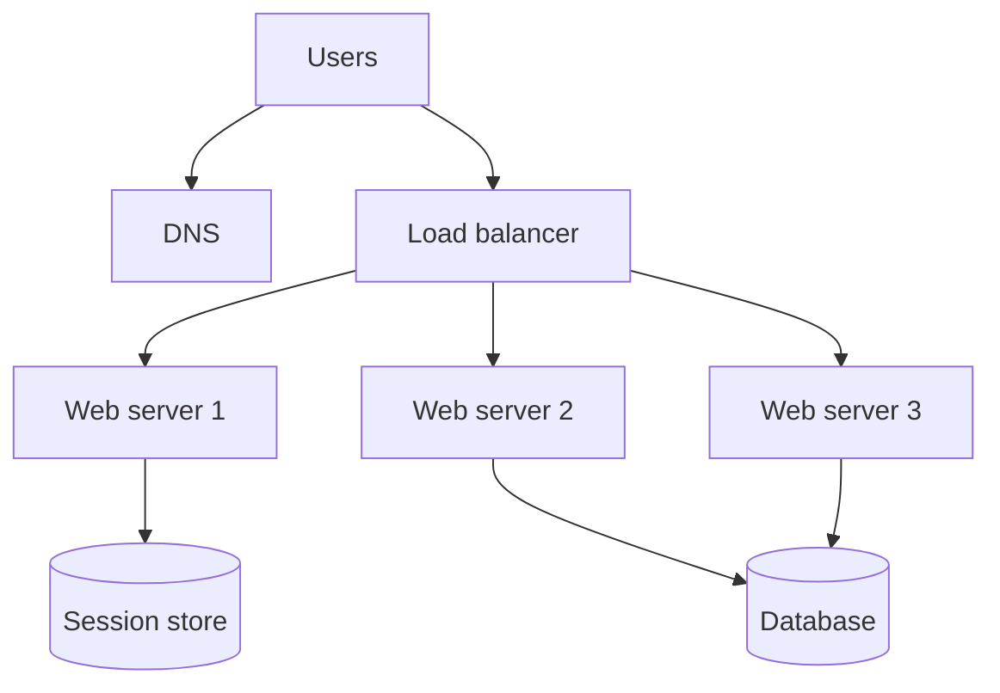
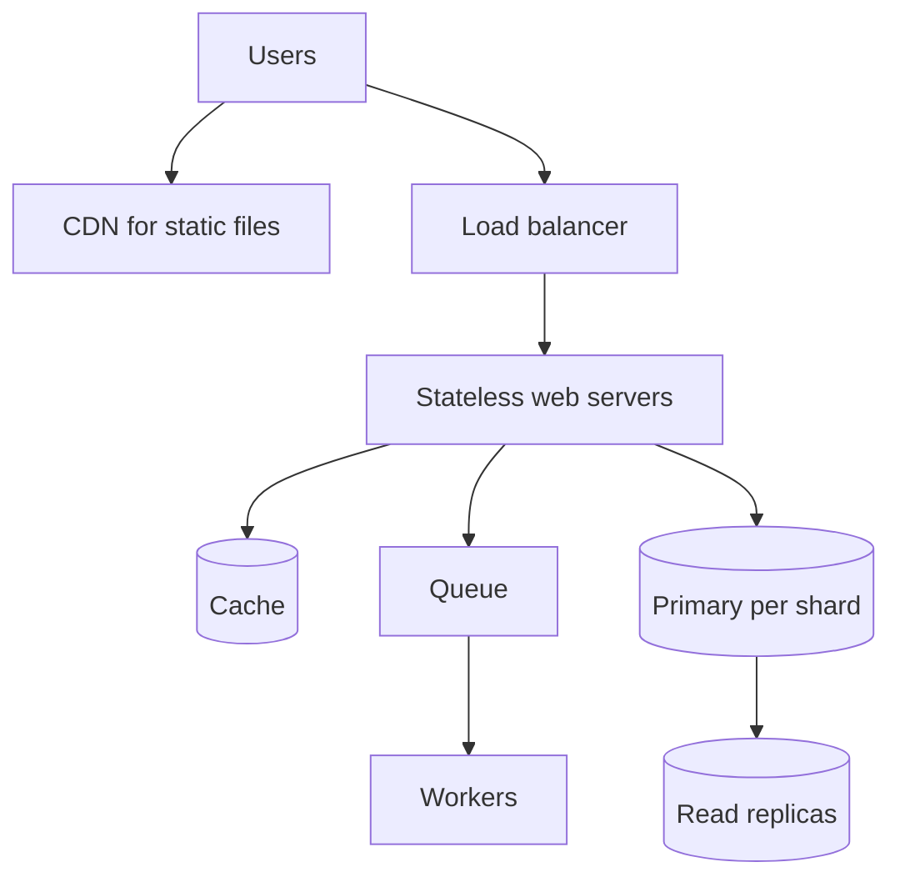

## The hook

Your side project goes viral on a Tuesday night. At 9 pm the single server that runs your web app and its database is at 20% CPU. At 10 pm it is at 100%, pages take eight seconds, and the database starts refusing connections. You could buy a bigger server, and for a while that works. Then it stops working, and you face the question every interviewer loves: what do you change, in what order, and why?

"Scale this from one user to a million" is less about memorising a final architecture and more about knowing the journey. Each step fixes the bottleneck that is hurting right now and introduces a new problem you must handle. Knowing both halves of every step is what interviewers listen for.

## The intuition

:::analogy
Think of a food stall that becomes a restaurant chain. At first one cook takes orders, cooks, washes plates and stores ingredients in the same tiny cart. As queues grow, the owner moves storage to a back room, hires more counter staff who all follow the same menu, keeps popular dishes ready on a warming shelf, opens a few tasting counters that copy the master recipe book, ships packaged snacks to corner shops, sends catering orders to a separate kitchen that works through them later, and finally opens branches that each own a part of the city.
:::

Every move in that story maps to a stage of web architecture: separate database, stateless web servers, cache, read replicas, CDN, queues and sharding. And just like the stall, you add each piece only when the current [[bottleneck]] demands it.

## How it works

### Stage 1: one box

DNS points your domain at one server running the web app and the database. It is cheap and simple, with nothing to keep in sync. The first fix for slowness is [[vertical scaling]]: a bigger machine. It has no code changes, but it has a ceiling and a single point of failure. When that one box dies, the stall is closed.

### Stage 2: a separate database

Move the database to its own machine. The web app and the database stop fighting for memory and CPU, and each can be sized for its own job: the database for memory and fast disks, the web server for CPU. This is the stall owner moving ingredients to the back room.

### Stage 3: a load balancer and a stateless web tier

Put a load balancer in front of several identical web servers, as in [The Host Who Seats Every Guest](article:system-design-load-balancers). This is [[horizontal scaling]]: more counter staff instead of one faster cook.

The catch is state. If a server keeps login sessions or shopping carts in its own memory, the next request may land on a different server that knows nothing about the user. Build a [[stateless web tier]]: keep sessions in a shared store such as Redis, or in a signed token the client sends with each request. Now any server can handle any request, and you can add or remove servers at will.

### Stage 4: a cache

Most apps read far more than they write, and many reads ask for the same popular rows. Put a cache in front of the database, as in [Keep the Spices on the Counter](article:system-design-caching): check the cache first, and on a miss read the database and store the result. In the analogy this is the warming shelf of ready dishes. Caches bring their own failures, such as stampedes and stale data, covered in [When the Bakery Reopens](article:system-design-cache-problems).

### Stage 5: read replicas

When even cache misses overload the database, add [[read replica|read replicas]]. The primary takes every write and streams changes to the replicas, which serve reads. Reads now scale with the number of replicas; writes still go to one primary.

The new problem is [[replication lag]]. A user saves a profile edit, the next page reads from a replica that has not caught up, and the edit seems lost. Common fixes: read a user's own data from the primary for a few seconds after they write, or route by session. [Why Your Like Count Can Be Wrong for a Second](article:system-design-consistency-basics) explains the trade-off.

### Stage 6: a CDN

Images, scripts, stylesheets and videos never change per user, yet they can be most of your bandwidth. Serve them from a CDN, as in [Local Warehouses for the Whole Internet](article:system-design-cdn): copies sit close to users, so pages load faster and your servers stop shipping bytes. These are the packaged snacks in the corner shops.

### Stage 7: queues for slow work

Sending emails, resizing photos and generating reports should not make the user wait. The web server drops a message on a queue and returns at once, and workers process it in the background, as in [The Ticket Rail Between Waiters and Cooks](article:system-design-message-queues) and [The Dry Cleaner's Ticket](article:system-design-async-processing). The queue also absorbs bursts: a spike makes the queue longer instead of crashing the workers.

### Stage 8: sharding

Replicas multiply reads, but every write still lands on one primary, and the whole dataset must fit on it. When writes or data size outgrow the biggest sensible machine, you shard. [[Sharding]] splits the data by a key, such as user id, so each shard is an independent database holding part of the users. These are the branches that each own part of the city.

Sharding is powerful and expensive. Queries that span shards, such as "top posts across all users", need fan-out and merging. Joins and transactions across shards become hard. Moving data when you add shards needs a plan, such as many small logical shards or [Adding a Server Without Moving Everything](article:famous-algos-consistent-hashing). And a celebrity user can make one shard hot. [Filing Cabinet, Labelled Boxes or Giant Spreadsheet?](article:system-design-sql-vs-nosql) covers which databases shard for you.

### What the numbers say

All of the following are **estimates** for an interview, not measurements.

- **Traffic:** 1 million daily users × 20 requests each = 20 million requests a day. 20,000,000 ÷ 86,400 seconds ≈ **230 requests per second** on average. Assume peak is 3 times average: about **700 per second**.
- **Web tier:** if one server handles about 200 dynamic requests per second, 700 ÷ 200 = 3.5, so 4 servers, plus one spare so a failure does not overload the rest: **5 servers**.
- **Database load:** assume 90% reads and 10% writes: about 625 reads and 70 writes per second at peak. With a 90% cache hit ratio only 62.5 reads reach the database, so it sees about **130 queries per second** in total.
- **Data growth:** 10% of 20 million requests are writes, so 2 million writes a day. At about 1 KB each that is 2 GB a day, or roughly **730 GB a year**.
- **Static bytes:** 5 page loads per user at 2 MB of images and scripts each is 1,000,000 × 5 × 2 MB = **10 TB a day**, about 0.93 Gbps on average. That is the CDN's job, not your servers'.

The conclusion matters more than the numbers: a million daily users fits comfortably on a cached, replicated single primary. At a hundred times the traffic, data would grow by about 73 TB a year, and sharding starts to earn its cost.

:::insight
Scaling is a loop, not a recipe: measure, find the one bottleneck, apply the cheapest fix that removes it, then measure again. Each stage trades simplicity for capacity, so the right architecture is the simplest one that holds your current load with headroom.
:::

:::try-this
Using the estimates above, suppose the cache hit ratio falls from 90% to 80%. How many reads per second reach the database at peak? (625 × 0.2 = 125, double the earlier 62.5. A small drop in hit ratio doubles database reads, which is why cache health is watched closely.)
:::

## Trade-offs

| Stage | You gain | You give up |
|---|---|---|
| Bigger single server | zero code changes | a hard ceiling and a single point of failure |
| Separate database | independent sizing | one more network hop and machine to run |
| Load balancer and stateless servers | easy horizontal scale, survive server loss | sessions must live elsewhere |
| Cache | fast reads, much less database load | stale data, invalidation, stampedes |
| Read replicas | read capacity, a standby for failover | replication lag and read-your-writes bugs |
| CDN | faster pages, less bandwidth | cache purging when files change, extra cost |
| Queues and workers | fast responses, burst absorption | eventual completion, retries, monitoring |
| Sharding | write and storage capacity | cross-shard queries, resharding, hot shards |

## What can go wrong

- **The database is still a single point of failure** after you replicate the web tier. Keep a replica ready for automatic failover, and practise the failover.
- **Sticky sessions hide state.** Pinning users to one server makes things work until that server dies and everyone pinned to it is logged out.
- **Replication lag** shows users their own stale data; route their reads to the primary right after a write.
- **A cold cache after a restart** sends every request to the database at once. Warm it gradually.
- **A poorly chosen shard key**, such as country or signup date, puts most traffic on one shard. Prefer keys with many values spread evenly, such as user id.
- **Queues hide failures.** A stuck worker lets the backlog grow silently; alert on queue depth and on the age of the oldest message.

:::warning
Common misconception: "real systems at scale must be sharded from day one." Premature sharding buys complexity you pay for on every feature: cross-shard queries, resharding scripts and harder transactions. A single well-indexed primary with a cache and replicas handles a surprising amount of traffic. Shard when the numbers say writes or data size will outgrow one machine, and design the key early so the move is possible.
:::

## In the real world

- The Twelve-Factor App guidelines popularised running web processes as stateless and share-nothing, with all state in backing services, which is exactly what stage 3 needs.
- Stack Overflow has spoken publicly about serving its large traffic from a small number of powerful SQL Server machines with heavy caching, a well-known example of scaling up and caching before sharding.
- Facebook's memcache paper describes how a very large cache tier sits in front of sharded MySQL, with careful handling of stale reads across regions.
- Managed cloud databases offer read replicas and automatic failover as settings, so stage 5 is often a configuration change rather than a project. The hard part that remains is making the application tolerate replication lag.

## Further reading

- The Twelve-Factor App, Processes: https://12factor.net/processes
- Nishtala et al., "Scaling Memcache at Facebook", NSDI 2013: https://www.usenix.org/conference/nsdi13/technical-sessions/presentation/nishtala
- Martin Kleppmann, *Designing Data-Intensive Applications*, chapters on replication and partitioning.

## Key takeaways

- Scale one bottleneck at a time: measure, apply the cheapest fix that removes the current limit, then measure again.
- A stateless web tier behind a load balancer is the foundation of horizontal scaling, so sessions must move to a shared store or a signed token.
- Caches and read replicas absorb read-heavy load, at the cost of stale data and replication lag that you must design around.
- CDNs take static bytes off your servers, and queues move slow work out of the request path while absorbing bursts.
- Sharding is the last step, taken when writes or data size outgrow one primary, because cross-shard queries, resharding and hot shards make every later change harder.
