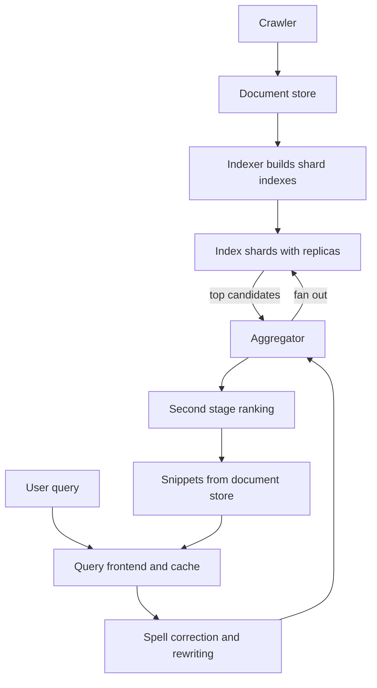

## The hook

You type four words and press enter. Within a fraction of a second, a search engine has looked through an index of billions of pages, scored the candidates, and returned ten blue links and a snippet for each.

No single machine holds that index. The query was sent to hundreds or thousands of machines at once, and the answer could only be assembled when they replied. Here is the uncomfortable maths: if each machine is slow just 1% of the time, and you wait for 1,000 of them, how often is your query slow?

Predict the answer before scrolling. (It is not 1%. It is almost always.)

## Requirements

**Functional**
- Crawl the web, build an index, and answer keyword queries with ranked results and snippets.
- Keep the index fresh: new and changed pages appear within hours, news within minutes.

**Non-functional**
- Index around 10 billion pages (**estimate**).
- Return results in a few hundred milliseconds at high percentiles.
- Very high query volume; highly available.

:::analogy
Picture **a library with a catalogue for every word in every book**, so huge it is split across a thousand reading rooms, each cataloguing its own share of books. A question goes to every room at once; each room returns its best few books; a head librarian merges them. The answer is only as fast as the slowest room.
:::

## Back-of-envelope numbers

All **estimates**.

- 10 billion pages × about 20 KB of text each ≈ **200 TB** of text; assume an index of similar size.
- Split into 1,000 shards: about **200 GB per shard**, each replicated several times for throughput and availability.
- Fan-out tail effect, if each shard exceeds its 99th-percentile latency 1% of the time:

| Shards per query | Chance at least one shard is slow |
|---|---|
| 10 | 1 − 0.99¹⁰ ≈ 9.6% |
| 100 | 1 − 0.99¹⁰⁰ ≈ 63% |
| 1,000 | 1 − 0.99¹⁰⁰⁰ ≈ 99.996% |

That is the answer to the hook.

## High-level design

Four stages: **crawl** (as in [Design a Web Crawler](article:system-design-web-crawler)), **index**, **rank**, **serve**.

## Deep dives

### 1. Building the index

Indexers parse pages into terms, build inverted indexes (term → list of document ids with positions), compute per-document signals (link-based importance, quality, freshness), and write immutable index segments per shard, as in [A Library Catalogue for Every Word](article:system-design-search-systems).

Partitioning is **[[document-partitioned index|by document]]**: each shard owns a subset of pages and a complete index for them. Every query visits every shard (one replica each), but shards are independent and evenly loaded.

Freshness comes in tiers: a large base index rebuilt in batches, plus a small, frequently updated index for new and fast-changing pages, merged at query time.

### 2. Serving a query

1. The frontend checks a result cache: many queries repeat.
2. The query is normalised, spell-corrected and expanded (synonyms).
3. An aggregator performs **[[query fan-out]]** to one replica of every shard.
4. Each shard intersects posting lists and runs a cheap first-pass score, returning its top candidates.
5. The aggregator merges candidates and runs **[[two-stage ranking|a second, expensive ranking stage]]** on the best few hundred.
6. Snippets are generated from the document store for the final ten.

### 3. Taming the tail

The **[[tail at scale]]** effect means per-shard speed is not enough. Techniques:

- **[[Hedged request]]s**: if a shard replica has not answered within its 95th-percentile time, ask another replica. If each replica is slow 1% of the time independently, both being slow is 0.01 × 0.01 = 0.01%, and across 1,000 shards the chance any shard is still slow drops to about 9.5%.
- **Partial results**: after a deadline, return results without the last few shards; for web search, missing 0.1% of the index rarely changes the top ten.
- **Replicas and load balancing** so no single replica is overloaded.
- **Smaller, more numerous shards** finish faster, but raise fan-out; balance the two.

Wait, does hedging double the load? No: only requests that are already slow get a second copy, so the extra load is a few percent.

:::insight
A search engine is a pipeline (crawl, index, rank, serve) whose serving path fans out to every shard of a document-partitioned index. At that fan-out, rare slow shards become the common case, so the design depends on hedged requests, replicas, deadlines with partial results and caching as much as on clever ranking.
:::

## Trade-offs

| Decision | Choice | Trade-off |
|---|---|---|
| Partitioning | By document | Balanced, independent shards; every query fans out |
| Ranking | Cheap first stage, expensive second stage | Fast and good; candidates missed by stage one cannot be recovered |
| Freshness | Base index plus fresh tier | Fresh results; two indexes to merge |
| Completeness | Partial results after a deadline | Predictable latency; tiny loss of recall |
| Caching | Result cache for popular queries | Huge savings; stale for fast-changing topics |

:::warning
Common misconception: "if every shard is fast on average, the search is fast." The query waits for the slowest shard, and with hundreds of shards the slowest is almost always in its tail. Design for tail latency explicitly with hedging, deadlines and partial results.
:::

:::try-this
Your aggregator fans out to 200 shards, each with a 99th-percentile latency of 40 ms. What fraction of queries see at least one shard slower than 40 ms, and what is a reasonable hedging rule? (1 − 0.99²⁰⁰ ≈ 87% of queries. A reasonable rule: if a shard replica has not replied by its 95th-percentile time, send the request to a second replica and take the first answer.)
:::

## What can go wrong

- **Tail latency** from fan-out without hedging or deadlines.
- **Hot queries** after news events overloading shards; serve from cache and the fresh tier.
- **Index build failures** publishing a broken index; validate before swapping and keep the previous version.
- **Spam and manipulation** gaming ranking signals.
- **Stale results** for fast-changing topics without a fresh tier.

### Interview follow-ups

**"How would you implement autocomplete?"** A separate prefix structure built from query logs, served from memory, as in the typeahead case study.

**"How do you rank results?"** Combine text relevance (such as BM25), link-based importance, freshness, quality and user engagement signals, usually with a learned ranking model in the second stage.

**"How do you update the index without downtime?"** Build new segments or a new index version offline, replicate them to shard servers, warm them, then switch atomically; keep the old version for rollback.

## Further reading

- Brin and Page, "The Anatomy of a Large-Scale Hypertextual Web Search Engine" (1998).
- Dean and Barroso, "The Tail at Scale" (Communications of the ACM, 2013).

## Key takeaways

- A web search engine is a pipeline: crawl pages, build inverted indexes, rank candidates and serve results with snippets.
- Indexes are partitioned by document, so each shard is independent and every query fans out to one replica of every shard.
- With large fan-out, rare slow shards become common for whole queries: at 1,000 shards and a 1% chance each, nearly every query hits one.
- Hedged requests, replicas, deadlines with partial results and result caching control tail latency.
- Ranking runs in two stages: a cheap per-shard pass to find candidates and an expensive pass on the best few hundred.
