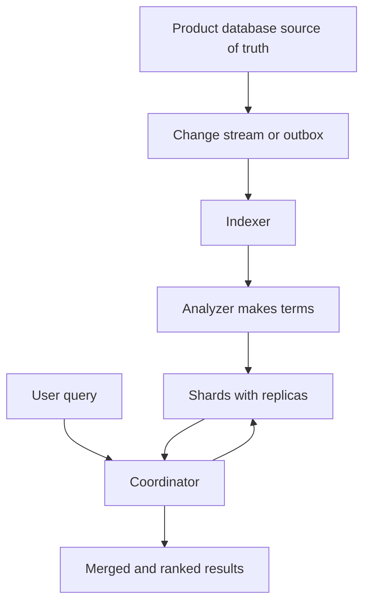

## The hook

A shopping site has 100 million products in a relational database. A user types "red running shoes under 3000". The first version of search runs `WHERE title LIKE '%red%' AND title LIKE '%running%'`.

Predict what happens. Every query scans every row, because an index on title sorted alphabetically cannot help find words in the middle of a title. It takes seconds, ranks nothing, and misses "Running Shoe (Red)" because of plurals and capital letters.

Real product search answers in tens of milliseconds, handles typos and word forms, ranks the best matches first, and filters by price at the same time. It does that with a different kind of system, built around one idea you have already met: an index of words, not of rows.

## The intuition

:::analogy
An old library keeps a card catalogue by author and by title. Now imagine **a library catalogue for every word**: for each word in any book, a card listing every book that contains it, and where. To find books about "red" and "shoes", you pull two cards and keep the books on both. You never open a single book until the end.
:::

That catalogue is the inverted index from [The Index at the Back of Every Search Engine](article:famous-algos-inverted-index). A search system is the machinery around it: turning text into terms, splitting the index across machines, scoring results, and keeping it fresh.

## How it works

### 1. From text to terms

Each **[[document]]** (a product: title, description, brand, price) passes through an **[[analyzer]]**: split into words, lowercase, strip accents, and optionally stem ("running" → "run"). The same analyzer runs on queries, so "Running Shoes" and "running shoe" meet in the same terms. Numbers and categories go into structures built for filters and ranges.

### 2. Shards and replicas

The index is split into **[[shard]]s**, usually by document id, so each shard holds a slice of documents with its own inverted index. Each shard has replicas for availability and read throughput.

Sizing, as **estimates**: 100 million products × 2 KB ≈ 200 GB of source data, and assume the index is of similar size. With 8 primary shards, each is about 25 GB; one replica of each doubles storage to about 400 GB.

A query goes to a coordinator, which sends it to **one copy of every shard**, collects each shard's top results and merges them. Wait, why every shard? Because documents were spread by id, not by word, so matches for "red" could be anywhere. At 5,000 queries per second over 8 shards with 2 copies each, each shard copy serves about 5,000 × 8 ÷ 16 = **2,500 queries per second**. More replicas spread that load further.

### 3. Relevance

Each match gets a **[[relevance score]]**. BM25 rewards rare query words that appear in short documents, as in [A Word That Appears Everywhere Tells You Nothing](article:famous-algos-tf-idf-bm25). Products add business signals on top: popularity, rating, availability, freshness, personalisation. Often a fast first stage (BM25 plus filters) picks a few hundred candidates and a heavier model re-ranks them.

### 4. Near-real-time indexing

New documents are written into small in-memory segments and become searchable at the next **[[refresh]]**, typically after about a second in Elasticsearch's default configuration. Segments are merged in the background, the same idea as LSM trees. This is why search is near-real-time, not instant.

:::insight
A search system is a derived, query-optimised copy of your data: an inverted index split into shards, kept fresh from the source of truth, scored for relevance. Treat it like a smart cache you can always rebuild, never as the only place data lives.
:::

## Trade-offs

| Decision | Option A | Option B |
|---|---|---|
| Freshness | Frequent refresh: changes visible sooner | Less frequent refresh: faster bulk indexing |
| Shard count | Few shards: less fan-out overhead | Many shards: more parallelism and room to grow |
| Replicas | More: higher read throughput and availability | Fewer: less storage and indexing cost |
| Stemming and synonyms | More recall, finds more | More risk of irrelevant matches |
| Sync from database | Change data capture: near-real-time, more moving parts | Periodic batch reindex: simple, stale between runs |

Keep the index in sync with change data capture or an outbox, as in [Write the Letter and the Envelope Together](article:system-design-outbox-cdc), and keep the ability to rebuild the whole index from the database.

:::warning
Common misconception: "the search cluster has all the data, so it can be the database." Search indexes trade durability guarantees and transactions for query speed; they lag behind writes and are routinely rebuilt when mappings change. Keep the source of truth in a database and treat search as a derived copy.
:::

:::try-this
Users complain that searching "iphone 15 case" shows iPhone 15 phones first. Name two fixes. (Boost matches in the category or product-type field, so "case" carries more weight when it matches the type; add a re-ranking signal from clicks or purchases for that query. Field boosts and business signals usually beat tweaking the text score alone.)
:::

## What can go wrong

- **Search as source of truth**: data lost when the cluster is rebuilt or fails.
- **Index drift**: missed change events leave search out of sync; run periodic reconciliation or full reindexes.
- **Mapping mistakes**: a field indexed as text instead of a number breaks price filters; changing it usually requires reindexing.
- **Too many small shards** waste memory and slow queries; too few large shards make recovery slow.
- **Deep pagination** (page 500) forces every shard to return thousands of results; use search-after cursors.
- **Expensive queries** such as leading wildcards scanning all terms.

### Interview follow-ups

**"How do you reindex with zero downtime after changing the mapping?"** Build a new index in the background from the source of truth, keep it updated with the change stream, then switch an alias from the old index to the new one atomically.

**"How do you handle typos?"** Fuzzy matching with an edit-distance limit, or n-gram indexing; for prefix suggestions, a separate autocomplete structure as in [Design Search Autocomplete](article:system-design-typeahead).

**"Database index or search engine?"** A B-tree index answers exact and range lookups on structured columns, as in [Why Some Queries Are Instant and Others Take Minutes](article:system-design-database-indexing). A search engine answers word-based, ranked, fuzzy queries over text. Most products use both.

## In the real world

- Elasticsearch and OpenSearch, built on Apache Lucene, are widely used for product, log and site search.
- Large products combine keyword search with vector (embedding) search for meaning, then re-rank with learned models.
- Log analytics platforms use the same inverted-index-and-shards design for searching machine logs.

## Further reading

- The Elasticsearch documentation on analyzers, shards and refresh.
- *Introduction to Information Retrieval* by Manning, Raghavan and Schütze, for indexing and scoring foundations.

## Key takeaways

- Search systems build an inverted index of terms, produced by analyzers that normalise text the same way for documents and queries.
- The index is split into shards with replicas; every query fans out to one copy of each shard and a coordinator merges the top results.
- Relevance combines text scoring such as BM25 with business signals, often in a fast retrieval stage followed by re-ranking.
- Indexing is near-real-time: new documents become searchable after a refresh, and segments are merged in the background.
- The search index is a derived copy fed from the source of truth by change data capture or an outbox, and must always be rebuildable.
