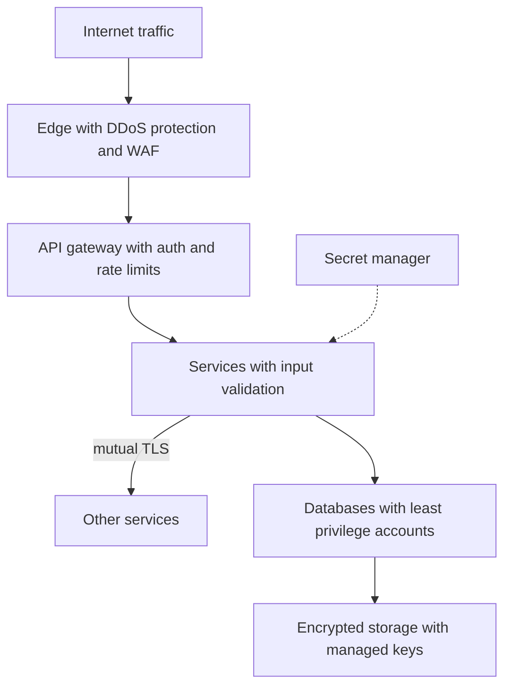

## The hook

Most breaches you read about do not involve genius hackers breaking strong encryption. They involve a database password in a public code repository, a storage bucket left publicly readable, an internal admin tool reachable from the internet, or a service account with far more permissions than its job needed.

Security at scale is less about clever cryptography and more about structure: making sure that one mistake, which will happen, does not become a disaster. Before reading on, guess which single habit prevents the largest share of incidents in that list. (It is the one with "least" in its name.)

## The intuition

:::analogy
A castle is not protected by one tall wall. It has **walls, gates and guards**: a moat, an outer wall, a gate that checks everyone, inner walls around the keep, guards who only carry keys to the rooms they patrol, and the treasure locked in a vault. An intruder who climbs one wall still faces the next, and a guard who is bribed can only open a few doors.
:::

That is **[[defence in depth]]**. Each layer is imperfect; together they make a breach unlikely and limit its damage. The guards carrying only the keys they need is **[[least privilege]]**, the answer to the hook.

## How it works

### Layer 1: the edge

- **DDoS protection** absorbs floods of traffic at the network edge or CDN, far from your servers.
- A **[[WAF]]** blocks common attack patterns such as SQL injection probes and known bad bots.
- **Rate limits** per client and per IP at the gateway, as in [Design a Rate Limiter](article:system-design-rate-limiter).
- Expose only what must be public; admin tools and internal APIs stay on private networks.

### Layer 2: identity and access

- Authenticate users at the gateway and pass a verified identity to services, as in [The Front Desk and the Key Card](article:system-design-auth-basics).
- **Authorise every request** in the service that owns the data: "may this user read this order?" Never trust a client-supplied user id.
- **Least privilege** for services: each has its own identity and only the permissions it needs, such as read-only access to specific tables, or write access to one storage bucket path.
- **Service-to-service authentication** with **[[mutual TLS]]** or signed tokens, so a compromised machine cannot impersonate any service it likes.

### Layer 3: secrets

A **[[secret]]** in code is a secret shared with everyone who can read the code, its history and its build logs.

- Store secrets in a secret manager or vault, fetched at runtime by service identity.
- Rotate them regularly and automatically; prefer short-lived credentials.
- Scan repositories and images for accidental secrets before they are pushed.

Wait, why rotate a secret that has not leaked? Because you often do not know it leaked. Regular rotation limits how long a stolen secret works, and practising rotation makes the emergency rotation after a real leak routine.

### Layer 4: data

- **Encryption in transit**: TLS everywhere, including inside the network.
- **[[Encryption at rest]]**: disks, databases and backups encrypted with keys held in a key management service, with access to keys audited.
- **Minimise data**: do not store what you do not need; mask or tokenise sensitive fields such as card numbers.

### Layer 5: detection and response

Audit logs of who accessed what, alerts on unusual access, and a rehearsed incident process. Assume something will get through, and make it visible quickly.

:::insight
Breaches usually start with a small mistake: an exposed secret, an open endpoint, an over-powered account. Defence in depth with least privilege makes each mistake survivable: every layer filters something, and every identity can only reach what its job requires.
:::

## Trade-offs

| Control | Gain | Cost |
|---|---|---|
| Strict least privilege | Small blast radius | More permission management work |
| Mutual TLS everywhere | Strong service identity | Certificate management, often automated by a service mesh |
| Short-lived credentials | Leaks expire quickly | Systems must refresh credentials reliably |
| WAF rules | Blocks common attacks early | False positives can block real users; needs tuning |
| Encryption at rest | Protects stolen disks and backups | Key management and some performance cost |

:::warning
Common misconception: "our services are inside a private network, so they do not need authentication." Once an attacker gets any foothold inside (a vulnerable dependency, a leaked credential), a flat trusted network lets them reach everything. Authenticate and authorise service-to-service calls, and segment the network.
:::

:::try-this
An internal admin dashboard can delete user accounts. List four layers you would put around it. (Private network or VPN only, not internet-facing; strong authentication with multi-factor for staff; role-based authorisation so only a small group can delete; audit logs and alerts on deletions, ideally with a second-person approval or a soft-delete that can be undone.)
:::

## What can go wrong

- **Secrets in code, images or logs**, and never rotated.
- **Public storage buckets** or databases with open network access.
- **Over-privileged service accounts** turning one compromised service into full access.
- **Missing authorisation checks** (users reading other users' data by changing an id in the URL).
- **Unpatched dependencies** with known vulnerabilities.
- **No audit trail**, so an incident cannot be investigated.

### Interview follow-ups

**"How would you protect an API from abuse?"** Authentication, per-client rate limits and quotas at the gateway, input validation in services, bot detection at the edge, and monitoring for unusual patterns.

**"How should services get database credentials?"** From a secret manager using the service's own identity, ideally short-lived, generated credentials scoped to that service, never from configuration files in the repository.

**"What is zero trust?"** Not trusting requests because they come from inside the network: every request is authenticated and authorised based on identity, wherever it comes from.

## In the real world

- Cloud providers offer DDoS protection, WAFs, key management services and secret managers as managed services.
- Service meshes automate mutual TLS between services.
- The OWASP Top 10 lists the most common web application security risks and is a standard checklist.

## Further reading

- The OWASP Top 10 and the OWASP Application Security Verification Standard.
- Your cloud provider's security best-practices documentation (identity and access management, key management, logging).

## Key takeaways

- Most breaches start from ordinary mistakes such as exposed secrets, public storage, open admin tools and over-privileged accounts.
- Defence in depth layers edge protection, gateway authentication and rate limits, per-request authorisation in services, and encrypted data, so one failure is not a breach.
- Least privilege gives every person, service and key only the access its job requires, which limits the damage of any compromise.
- Keep secrets in a secret manager, prefer short-lived credentials, rotate regularly, and scan code for accidental leaks.
- Encrypt data in transit and at rest, authenticate service-to-service calls, and keep audit logs so incidents can be detected and investigated.
