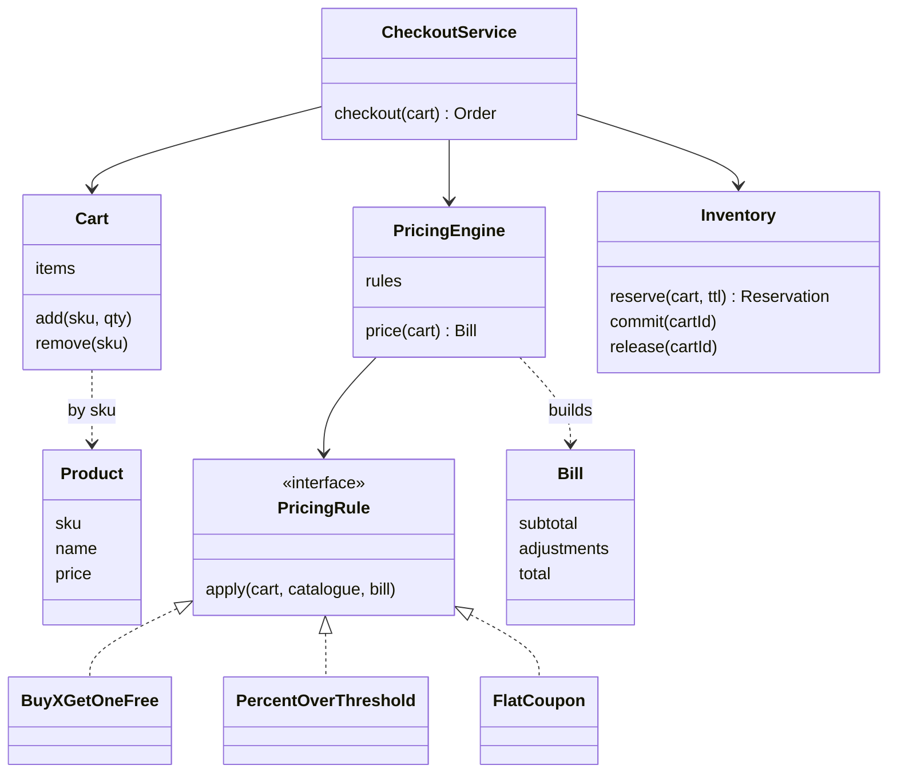

## The hook

A festive sale. The marketing team adds "10% off orders above ₹800". The product page shows one price, the cart shows another, the checkout page a third, and the invoice a fourth. Each screen had its own copy of the discount code, and each copy was edited by a different person at a different time.

Meanwhile, the last two coffee mugs in the warehouse were sold to three people.

A shopping cart is the most "obvious" design you will meet in the machine coding round. Products, a cart, a total.

The two bugs above are why interviewers keep asking it. Where should every discount live so there is exactly one answer to "what does this cost?", and how do you stop three people buying two mugs?

## Requirements

**Functional**

- A catalogue of products with a price and a stock count.
- Add, remove and change quantities in a cart.
- Compute the bill: subtotal, every discount with its reason, and the total.
- Discounts: buy X get one free on an item, a percentage off above a cart threshold, and flat coupons. More will come.
- Checkout reserves stock; payment confirms the order; abandoned checkouts give stock back.

**Example rules for this article:** Tea at ₹250, Biscuits at ₹40, Mug at ₹300; buy 2 biscuits get 1 free; 10% off when the total after item offers is at least ₹800; coupon FLAT100 for ₹100 off; checkout holds last 10 minutes.

**Non-functional**

- Money is exact: no floating point, no lost paise.
- Many shoppers check out at once without [[overselling]].
- New discount types arrive without editing the cart, checkout or invoice code.

:::analogy
Think of **a supermarket trolley with a smart price scanner**. The trolley is dumb: it just holds things. All the cleverness sits in one scanner at the till, which knows every offer and applies them in the order printed on its rule card, then prints each saving on the receipt. And the shelf is separate from both: an item leaves the shelf for good only when it is paid for at the till. One trolley, one scanner, one shelf, three different jobs.
:::

## Core objects

- **Product**: SKU, name, price in [[minor units]].
- **Cart** and **CartItem**: the trolley. SKU and quantity, nothing else. No prices stored, no discount logic.
- **PricingRule**: one [[pricing rule]], such as BuyXGetOneFree, PercentOverThreshold or FlatCoupon.
- **PricingEngine**: the [[pricing engine]]. Applies the rules in order and returns a Bill.
- **Bill**: subtotal, a list of adjustments with reasons, total.
- **Inventory**: on-hand and reserved counts per SKU.
- **Reservation**: one cart's [[reservation]] with an expiry.
- **CheckoutService**: reserve, take payment, commit or release.

Wait, why does the cart not store prices? Because prices change.

If your cart saved ₹300 for the mug on Monday and the sale ends on Tuesday, which price is right at checkout? The cart stores *what* you want; the engine decides *what it costs* at the moment you ask. The trolley does not know prices. The scanner does.

## Class design



```pseudo
class Cart:
    items: map sku -> quantity           // nothing else
    add(sku, qty); remove(sku); setQuantity(sku, qty)

interface PricingRule:
    apply(cart, catalogue, bill)         // reads the cart, appends an adjustment to the bill

class PricingEngine:
    rules: ordered list                  // item rules, then cart percentages, then coupons
    price(cart):
        bill.subtotal = sum of catalogue[sku].price * qty
        bill.total = bill.subtotal
        for rule in rules: rule.apply(cart, catalogue, bill)
        return bill

class BuyXGetOneFree(sku, x):
    apply: free = qty(sku) div (x + 1); subtract free * price(sku); add line

class PercentOverThreshold(pct, threshold):
    apply: if bill.total >= threshold: subtract floor(bill.total * pct / 100); add line

class FlatCoupon(code, amount):
    apply: subtract min(amount, bill.total); add line      // never below zero

class Inventory:
    stock: sku -> (onHand, reserved); holds: cartId -> (items, expiresAt); lock
    reserve(cart, now, ttl):
        with lock:
            for each line: if onHand - reserved < qty: fail with that sku   // check all first
            for each line: reserved += qty                                  // then take all
            holds[cart.id] = (cart.items, now + ttl)
    commit(cartId, now):
        with lock:
            hold = holds[cartId]; if missing or expired: fail
            for each line: onHand -= qty; reserved -= qty
            remove hold
    sweep(now):
        with lock: for each expired hold: reserved -= qty per line; remove hold

class CheckoutService:
    checkout(cart):
        bill = engine.price(cart)
        inventory.reserve(cart, now, HOLD_TTL) or fail "out of stock"
        if payments.charge(bill.total, idempotencyKey = cart.id + attempt):
            inventory.commit(cart.id); create Order(bill)
        else:
            inventory.release(cart.id)
```

### Order is a business rule

Here is the predict moment. Asha's cart, after the biscuit offer, is ₹930. The engine has two cart rules left: 10% off, and FLAT100. Guess the total if the percentage runs first, and if the coupon runs first.

Percentage first: 10% of ₹930 is ₹93, leaving ₹837, then ₹100 off gives ₹737. Coupon first: ₹830, then 10% of ₹830 is ₹83, giving ₹747. Same cart, same rules, ₹10 apart.

Neither order is wrong. The business must pick one, and you must not pick it by accident, and the code must apply it in exactly one place. That is the scanner's rule card from the analogy. When discount code is spread across the product page, cart and invoice, each copy quietly picks its own order, and the hook's four prices appear.

:::insight
Put every price-changing rule behind one interface and apply them in one engine, in one documented order. The cart stores only what the shopper wants, and every screen that shows a price asks the same engine, so there is exactly one answer to "what does this cost?".
:::

## Key flows

### Asha's bill, traced

Asha's cart: Tea × 1, Biscuits × 3, Mug × 2. All amounts are stored in paise and shown in rupees.

| Step | Rule | Calculation | Running total |
|---|---|---|---|
| 1 | subtotal | 250 + 3 × 40 + 2 × 300 | ₹970 |
| 2 | buy 2 get 1 biscuits | 3 div 3 = 1 free × ₹40 | ₹930 |
| 3 | 10% over ₹800 | 930 ≥ 800, so floor(93000 × 10 / 100) paise = ₹93 | ₹837 |
| 4 | coupon FLAT100 | min(100, 837) | ₹737 |

The bill keeps one line per adjustment, so your receipt can say *why* the price dropped, and support can answer "why did I not get 10% off?" by reading the lines.

:::try-this
Asha removes one packet of biscuits, leaving 2. What is her new total? Then she also removes one mug instead. What then? (With 2 biscuits: subtotal ₹930, no free biscuit, 10% gives ₹837, coupon gives ₹737, the same total, because the third packet was the free one. With 3 biscuits and 1 mug: subtotal ₹670, minus ₹40 is ₹630, below ₹800 so no 10%, coupon gives ₹530.)
:::

### The race for the last mug

The warehouse has 2 mugs. Without reservations, checkout reads the stock count, takes payment, then decrements. Two shoppers, A wanting 2 and B wanting 1, run at once:

| Time | Checkout A | Checkout B | Mugs in stock |
|---|---|---|---|
| 1 | reads 2, enough | | 2 |
| 2 | | reads 2, enough | 2 |
| 3 | charges card, sets stock 0 | | 0 |
| 4 | | charges card, sets stock 1 | 1 |

Two charges, three mugs promised, and the count says 1. Wait, why did no check catch it? Both checks were true when they ran; the bug lives in the gap between reading and writing. You saw the same gap at the parking lot gate. The fix is the same: check and take in one atomic step, under the inventory's lock or as a conditional update in the database.

### Holds that expire

Now the second question: when should the item leave the shelf? Predict what happens if you reserve stock on add-to-cart.

Abandoned carts.

A shopper adds the last mug, gets distracted, and never returns; the mug is locked for days while real buyers see "out of stock". So the store reserves at *checkout*, with a short expiry, and a sweeper releases holds that time out. That is the shelf in the analogy: the item is really gone only when paid for at the till.

Here is the trace, with times in minutes and a 10-minute hold. Mug stock: 2 on hand.

| t | Event | Mugs on hand, reserved, [[available stock]] | Result |
|---|---|---|---|
| 0 | Asha checks out, wants 2 | 2, 2, 0 | reserved until t = 10 |
| 2 | Ravi checks out, wants 1 | 2, 2, 0 | fails: only 0 available |
| 11 | sweeper runs | 2, 0, 2 | releases Asha's expired hold |
| 12 | Ravi checks out again | 2, 1, 1 | reserved until t = 22 |
| 13 | Asha's payment arrives | 2, 1, 1 | refused: hold expired |
| 14 | Ravi's payment succeeds | 1, 0, 1 | committed |
| 15 | Asha checks out again, wants 2 | 1, 0, 1 | fails: only 1 available |

Row 13 is the subtle one, and the one interviewers love to ask you about. Asha's bank was slow, and her payment arrived after her hold expired. The system must refuse to commit, or it would ship mugs it already gave to Ravi. In a real store, a payment that succeeds after its hold expired is refunded automatically, or the store tries to re-reserve before confirming.

:::warning
Common misconception: "Reserve each line one by one, and if a later line fails, the earlier ones are fine." A half-reserved cart holds tea and biscuits hostage while the mug fails. Reservation is all or nothing: check every line first, then take every line, under the same lock; or take them in a fixed SKU order and roll back the ones already taken.
:::

### The code

The program prices Asha's cart in both rule orders, then replays the inventory trace. Money is `long long` paise throughout.

```cpp
#include <bits/stdc++.h>
using namespace std;

using Paise = long long;
string rs(Paise p) { return "Rs " + to_string(p / 100) + (p % 100 ? "." + to_string(p % 100 / 10) + to_string(p % 10) : ""); }

struct Product { string sku, name; Paise price; };
struct Cart { string id; map<string, int> items; };    // sku -> quantity; no prices, no rules

// ---------- pricing: one engine, rules applied in a fixed order ----------
struct Bill { Paise subtotal = 0, total = 0; vector<string> lines; };
struct PricingRule {
    virtual void apply(const Cart& c, const map<string, Product>& cat, Bill& b) const = 0;
    virtual ~PricingRule() = default;
};
struct BuyXGetOneFree : PricingRule {                    // item level
    string sku; int x;
    BuyXGetOneFree(string s, int x) : sku(move(s)), x(x) {}
    void apply(const Cart& c, const map<string, Product>& cat, Bill& b) const override {
        auto it = c.items.find(sku);
        if (it == c.items.end()) return;
        Paise off = it->second / (x + 1) * cat.at(sku).price;
        if (off) { b.total -= off; b.lines.push_back("buy " + to_string(x) + " get 1 " + sku + ": -" + rs(off)); }
    }
};
struct PercentOverThreshold : PricingRule {             // cart level
    int pct; Paise threshold;
    PercentOverThreshold(int p, Paise t) : pct(p), threshold(t) {}
    void apply(const Cart&, const map<string, Product>&, Bill& b) const override {
        if (b.total < threshold) return;
        Paise off = b.total * pct / 100;                 // integer paise, rounds down
        b.total -= off; b.lines.push_back(to_string(pct) + "% over " + rs(threshold) + ": -" + rs(off));
    }
};
struct FlatCoupon : PricingRule {                       // applied last
    string code; Paise amount;
    FlatCoupon(string c, Paise a) : code(move(c)), amount(a) {}
    void apply(const Cart&, const map<string, Product>&, Bill& b) const override {
        Paise off = min(amount, b.total);
        b.total -= off; b.lines.push_back("coupon " + code + ": -" + rs(off));
    }
};
Bill price(const Cart& c, const map<string, Product>& cat, const vector<const PricingRule*>& rules) {
    Bill b;
    for (auto& [sku, q] : c.items) b.subtotal += cat.at(sku).price * q;
    b.total = b.subtotal;
    for (auto* r : rules) r->apply(c, cat, b);
    return b;
}

// ---------- inventory: reserve at checkout, commit on payment, release on expiry ----------
struct Inventory {
    struct Stock { int onHand, reserved = 0; };
    struct Hold { map<string, int> items; int expiresAt; };
    map<string, Stock> stock; map<string, Hold> holds;  // cart id -> hold
    mutex m;
    string reserve(const Cart& c, int now, int ttl) {    // all lines or none
        lock_guard<mutex> g(m);
        for (auto& [sku, q] : c.items) {
            int avail = stock[sku].onHand - stock[sku].reserved;
            if (avail < q) return c.id + " checkout failed: " + sku + " only " + to_string(avail) + " available";
        }
        for (auto& [sku, q] : c.items) stock[sku].reserved += q;
        holds[c.id] = {c.items, now + ttl};
        return c.id + " reserved until t=" + to_string(now + ttl);
    }
    string commit(const string& cartId, int now) {       // payment succeeded
        lock_guard<mutex> g(m);
        auto it = holds.find(cartId);
        if (it == holds.end() || it->second.expiresAt <= now) return cartId + " payment refused: hold expired";
        for (auto& [sku, q] : it->second.items) { stock[sku].onHand -= q; stock[sku].reserved -= q; }
        holds.erase(it);
        return cartId + " paid, stock committed";
    }
    string sweep(int now) {                              // release expired holds
        lock_guard<mutex> g(m);
        string out = "sweep:";
        for (auto it = holds.begin(); it != holds.end();) {
            if (it->second.expiresAt > now) { ++it; continue; }
            for (auto& [sku, q] : it->second.items) stock[sku].reserved -= q;
            out += " released " + it->first;
            it = holds.erase(it);
        }
        return out;
    }
};

int main() {
    map<string, Product> cat = {{"TEA", {"TEA", "Tea", 25000}}, {"BISC", {"BISC", "Biscuits", 4000}}, {"MUG", {"MUG", "Mug", 30000}}};
    Cart asha{"asha", {{"TEA", 1}, {"BISC", 3}, {"MUG", 2}}};
    Cart ravi{"ravi", {{"MUG", 1}}};

    BuyXGetOneFree b2g1("BISC", 2); PercentOverThreshold tenPct(10, 80000); FlatCoupon flat("FLAT100", 10000);
    Bill bill = price(asha, cat, {&b2g1, &tenPct, &flat});
    cout << "subtotal " << rs(bill.subtotal) << "\n";
    for (auto& l : bill.lines) cout << "  " << l << "\n";
    cout << "total " << rs(bill.total) << "\n";
    Bill other = price(asha, cat, {&b2g1, &flat, &tenPct});
    cout << "same cart, coupon before percent: total " << rs(other.total) << "\n\n";

    Inventory inv;
    inv.stock = {{"TEA", {10}}, {"BISC", {50}}, {"MUG", {2}}};
    cout << "t=0  " << inv.reserve(asha, 0, 10) << "\n";
    cout << "t=2  " << inv.reserve(ravi, 2, 10) << "\n";
    cout << "t=11 " << inv.sweep(11) << "\n";
    cout << "t=12 " << inv.reserve(ravi, 12, 10) << "\n";
    cout << "t=13 " << inv.commit("asha", 13) << "\n";
    cout << "t=14 " << inv.commit("ravi", 14) << "\n";
    cout << "t=15 " << inv.reserve(asha, 15, 10) << "\n";
    cout << "MUG on hand " << inv.stock["MUG"].onHand << ", reserved " << inv.stock["MUG"].reserved << "\n";
}
```

It prints the four bill lines ending in `total Rs 737`, then `same cart, coupon before percent: total Rs 747`, and the inventory lines match the table, ending with `MUG on hand 1, reserved 0`. The demo passes rule lists directly; a real engine would build its ordered list from configuration.

## Patterns used

| Pattern | Where | Why it earns its place |
|---|---|---|
| Strategy | Each PricingRule | A new offer is a new class, never an edit to the cart or checkout |
| Chain, ordered | PricingEngine applying rules in sequence | Each rule sees the total left by the previous one; the order is data, not scattered code |
| Specification, lightly | Eligibility checks inside rules | "Category is snacks and quantity at least 3" composes from small predicates |
| Facade | CheckoutService | One call hides pricing, reservation, payment and order creation |
| Repository | Catalogue, inventory, orders | Tests use maps; production uses a database with conditional updates |

## Extensions

### Rules that compete

Real stores add "best offer wins" or "coupons do not stack with sale items". Model the first as a `BestOf` rule that holds several rules, prices each on a copy of the bill, and applies only the cheapest for the customer. Model the second as an eligibility flag that the coupon rule checks. Both stay inside the engine.

### Rounding

Percentages create fractions of a paisa. Pick one rule, such as round down per adjustment, and apply it in one place. Splitting a discount across items for an invoice uses the same trick as [Design Splitwise](article:system-design-splitwise): divide in paise, then hand the leftover paise to specific lines by a fixed rule, so the lines add up exactly.

### Many warehouses

Stock becomes per (SKU, warehouse). Reservation picks a warehouse with a strategy (nearest, cheapest shipping, most stock) and holds there. The cart and pricing do not change.

### Edge cases worth naming

- **Quantity zero or negative:** setting quantity to zero removes the line; negative is rejected.
- **Price changed since the cart was viewed:** show the new bill at checkout and ask the shopper to confirm.
- **Coupon larger than the total:** clamp at zero; never produce a negative bill.
- **Product discontinued while in a cart:** pricing skips it and the bill says why.
- **Payment retried after a timeout:** charge with an idempotency key so the second attempt does not charge twice.

### Common mistakes

- Discount logic in the cart, the product page and the invoice, with three slightly different results.
- Floating-point rupees: `0.1 + 0.2` is not `0.3` in binary.
- Reading stock and decrementing it in two separate steps.
- Reserving on add-to-cart with no expiry.
- Committing a payment against an expired hold.

### Interview follow-ups

**"How do you add a 'free delivery above ₹500' rule?"** A new rule class that appends a delivery line of ₹0 instead of the usual charge, placed after the discounts so it sees the discounted total. Nothing else changes.

**"How do you show the right price on the product page?"** Ask the same engine to price a one-item cart. Every screen that shows a price goes through one function.

**"What if two carts check out at the same instant for different SKUs?"** With one inventory lock they take turns, which is correct and fine at small scale. At large scale, use per-SKU locks taken in sorted SKU order, so two carts can never each hold one lock and wait for the other's.

**"How do you test discounts?"** Each rule gets small unit tests against a bill. The engine gets an order test, like the ₹737 versus ₹747 case, that fails loudly if someone reorders the rules.

That last follow-up, locks taken in a fixed order so nobody waits forever, is the heart of the next article: [Concurrency in Machine Coding: Locks, Atomics and Thread Pools](article:system-design-concurrency-lld).

## Key takeaways

- A shopping cart stores only SKUs and quantities, while a single pricing engine computes every price, so every screen shows the same number.
- Pricing rules are strategies applied in one documented order, and the order matters: 10% then ₹100 off gives ₹737 where ₹100 then 10% gives ₹747.
- Money is stored in integer paise with one rounding rule, so totals are exact and adjustments add up.
- Stock is reserved all-or-nothing at checkout under one lock or atomic update, so two shoppers can never both take the last unit.
- Reservations expire and are swept back to available stock, and a payment that arrives after its hold expired must not be committed.
