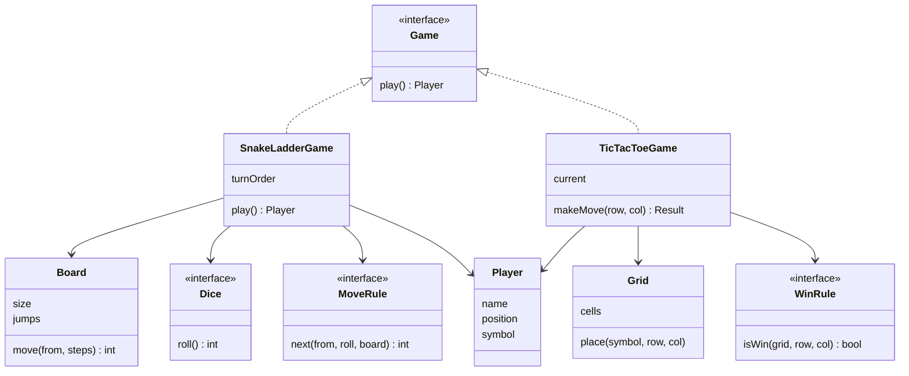

## The hook

You finish a clean snake-and-ladder program in forty minutes. The interviewer smiles and says, "Nice. Now make the board 150 cells, add a second dice, and let a player who rolls a six roll again."

You scroll through your code. The number 100 appears in eleven places. The dice roll lives inside the move function. The six-means-roll-again rule would need an `if` in the middle of the loop that already handles snakes, ladders and winning.

That moment is the real test in board-game problems. Nobody doubts you can move a piece. The question is whether your design survives the second set of rules. So which pieces must be separate, and which one decides who won?

## Requirements

As [Build the Model House One Room at a Time](article:system-design-machine-coding-approach) suggests, clarify and write it down.

**Snake and ladder, functional**

- A board of N cells (not always 100) with any number of snakes and ladders.
- Two or more players take turns; each rolls a dice and moves that many cells.
- Landing on a ladder's foot climbs it; landing on a snake's head slides down.
- Our example rule: you must land exactly on the last cell. If a roll would overshoot, you stay put.
- The first player to reach the last cell wins.

**Tic-tac-toe, functional**

- An n by n board (not always 3), two players with symbols X and O.
- Players alternate; a move on an occupied or off-board cell is rejected and the same player tries again.
- A full row, column or diagonal wins. A full board with no winner is a draw.

**Non-functional**

- Board size, number of players, number of dice and the rules can change without rewriting the game.
- Games are reproducible in tests: no hidden randomness.
- The console is only one way to play; the core must not print or read input itself.

:::analogy
Think of a **board game rulebook as code**. Open any board game box and you find separate things: a board, some pieces, a dice and a rulebook. The board does not know the rules. The dice does not know the board. Change the rulebook, and the same board and dice play a different game. Your design should look like that box: each thing in its own compartment, and the rulebook the only part that knows how they fit together.
:::

## Core objects

- **Board**: the cells. For snake and ladder, a size and a map of jumps. For tic-tac-toe, an n by n grid.
- **Jump**: one [[jump]] from a start cell to an end cell. A ladder goes up, a snake goes down.
- **Player**: a name and, depending on the game, a position or a symbol.
- **Dice**: anything that returns a roll. Production uses a random one; tests use [[injected dice]].
- **MoveRule**: how a roll turns into a new position (exact landing, bounce back, six rolls again).
- **WinRule**: the [[win rule]] that inspects the last move.
- **Game**: owns the turn order and runs the [[game loop]].

Wait, why are snakes and ladders not two classes? Predict what a `Snake` class and a `Ladder` class would each contain. Both would hold a start and an end, and both would do "if you land on start, go to end". The only difference is the sign of end minus start. One class, one map, no duplicated logic.

## Class design



```pseudo
interface Dice:            roll() -> int
class RandomDice(faces, seed) implements Dice
class FixedDice(sequence) implements Dice        // for tests: returns the sequence in order

class Board:
    size
    jumps: map from start cell to end cell       // snakes and ladders together
    validate():
        no jump starts on the last cell or ends outside 1..size
        no jump ends on the start of another jump  // no chains
        no cell starts two jumps

interface MoveRule:
    next(from, roll, board) -> int

class ExactLanding implements MoveRule:
    next(from, roll, board):
        to = from + roll
        if to > board.size: return from            // overshoot: stay
        return board.jumps.get(to, default = to)

class SnakeLadderGame:
    constructor(board, dice, moveRule, players)
    play():
        loop:
            player = turnOrder.popFront()
            roll = dice.roll()
            player.position = moveRule.next(player.position, roll, board)
            emit MoveEvent(player, roll, player.position)  // UI listens, game never prints
            if player.position == board.size: return player
            turnOrder.pushBack(player)
```

### The constant-time win check

Here is a puzzle. On a 3 by 3 board, checking all 8 lines after each move is cheap. On a 1000 by 1000 board, scanning the whole grid after every move costs a million cell reads. Guess how few reads you actually need per move.

The answer is a handful, and none of them is a cell read. Keep one [[line counter]] per row, per column, and one each for the two diagonals. X adds 1, O subtracts 1. After placing at (r, c), update `rows[r]`, `cols[c]`, and the diagonals if the cell sits on them. If any of those reaches +n or -n, that line is full of one symbol.

```pseudo
class LineCounterWinRule implements WinRule:
    rows[n], cols[n], diag, anti all start at 0
    afterMove(symbol, r, c):
        d = +1 if symbol is X else -1
        rows[r] += d; cols[c] += d
        if r == c: diag += d
        if r + c == n - 1: anti += d
        return any of |rows[r]|, |cols[c]|, |diag|, |anti| equals n
```

Wait, why can a counter not reach +n by accident, say from two X's and one O? Because O subtracts. A row with two X's and one O sums to 1, not 3. The only way to reach n is n cells of X, and the only way to reach -n is n cells of O.

:::insight
Every board game in machine coding splits the same way: a board that stores state, a source of moves (dice or input), and rules that turn a move into a new state and maybe a winner. Keep the rules out of the board and the randomness out of the game, and every follow-up becomes a new rule class instead of a rewrite.
:::

## Key flows

### One snake-and-ladder game, traced

The demo board has 20 cells. Ladders: 3 to 11 and 6 to 17. Snakes: 14 to 4 and 19 to 8. Asha and Ravi start off the board at 0. The injected dice returns 3, 6, 3, 2, 6, 6, 5, 2, 6, 3.

| Turn | Player | From | Roll | Landed | Rule applied | To |
|---|---|---|---|---|---|---|
| 1 | Asha | 0 | 3 | 3 | ladder | 11 |
| 2 | Ravi | 0 | 6 | 6 | ladder | 17 |
| 3 | Asha | 11 | 3 | 14 | snake | 4 |
| 4 | Ravi | 17 | 2 | 19 | snake | 8 |
| 5 | Asha | 4 | 6 | 10 | none | 10 |
| 6 | Ravi | 8 | 6 | 14 | snake | 4 |
| 7 | Asha | 10 | 5 | 15 | none | 15 |
| 8 | Ravi | 4 | 2 | 6 | ladder | 17 |
| 9 | Asha | 15 | 6 | 21 | overshoot, stay | 15 |
| 10 | Ravi | 17 | 3 | 20 | reaches last cell | 20, wins |

Before you look at turn 9, predict: Asha needs a 5 and rolls a 6. Does she move? Under the exact-landing rule she stays at 15, and that one rule handed Ravi the game. Swap in a bounce-back rule and she would go to 20 and bounce back 1 cell to 19, which is a snake head, sending her to 8. Same board, same dice, different rulebook, different story.

:::try-this
Same board, same rolls, but the move rule is "bounce back": overshoot by k cells and you move back k from the last cell, then apply any jump. Who is where after turn 9? (Asha at 15 rolls 6, reaches 21, overshoots by 1, lands on 19, which is a snake head, and slides to 8. Ravi is still at 17.)
:::

### One tic-tac-toe game, traced

A 3 by 3 board, X starts. Counters are shown after each accepted move.

| Move | Cell | Result | Counters touched |
|---|---|---|---|
| X | (0,0) | ok | rows[0]=1, cols[0]=1, diag=1 |
| O | (1,1) | ok | rows[1]=-1, cols[1]=-1, diag=0, anti=-1 |
| X | (0,1) | ok | rows[0]=2, cols[1]=0 |
| O | (0,1) | invalid, occupied; O plays again | none |
| O | (2,2) | ok | rows[2]=-1, cols[2]=-1, diag=-1 |
| X | (0,2) | rows[0]=3 equals n | X wins |

The invalid move is the row interviewers look for. It must not change any counter and must not pass the turn.

### The code

Both games in one program, with injected dice and the line-counter win check. The games return results instead of printing from deep inside, except for the small move log in the demo loop.

```cpp
#include <bits/stdc++.h>
using namespace std;

// ---------- shared pieces ----------
struct Dice {                                   // injected, so tests control every roll
    virtual int roll() = 0;
    virtual ~Dice() = default;
};
struct FixedDice : Dice {
    vector<int> seq; size_t i = 0;
    explicit FixedDice(vector<int> s) : seq(move(s)) {}
    int roll() override { return seq[i++ % seq.size()]; }
};

// ---------- snake and ladder ----------
struct SnakeLadderBoard {
    int size;
    map<int, int> jumps;                        // start -> end; end < start is a snake
    int move(int from, int steps) const {
        int to = from + steps;
        if (to > size) return from;             // exact landing rule: overshoot means stay
        auto it = jumps.find(to);
        return it == jumps.end() ? to : it->second;
    }
};

struct SnakeLadderGame {
    SnakeLadderBoard board;
    Dice& dice;
    deque<pair<string, int>> turnOrder;         // name, position
    string play() {
        while (true) {
            auto [name, pos] = turnOrder.front(); turnOrder.pop_front();
            int r = dice.roll();
            int landed = pos + r, next = board.move(pos, r);
            cout << name << " at " << pos << " rolls " << r << " -> " << next;
            if (landed > board.size) cout << " (overshoot, stays)";
            else if (next < landed) cout << " (snake from " << landed << ")";
            else if (next > landed) cout << " (ladder from " << landed << ")";
            cout << "\n";
            if (next == board.size) return name;
            turnOrder.push_back({name, next});
        }
    }
};

// ---------- tic-tac-toe ----------
struct TicTacToe {
    int n;
    vector<string> grid;
    vector<int> rows, cols; int diag = 0, anti = 0, moves = 0;
    explicit TicTacToe(int n) : n(n), grid(n, string(n, '.')), rows(n), cols(n) {}
    // Returns "invalid", "win", "draw" or "ok". O(1) win check with signed counters.
    string place(char sym, int r, int c) {
        if (r < 0 || r >= n || c < 0 || c >= n || grid[r][c] != '.') return "invalid";
        grid[r][c] = sym; moves++;
        int d = sym == 'X' ? 1 : -1;
        rows[r] += d; cols[c] += d;
        if (r == c) diag += d;
        if (r + c == n - 1) anti += d;
        if (abs(rows[r]) == n || abs(cols[c]) == n || abs(diag) == n || abs(anti) == n) return "win";
        return moves == n * n ? "draw" : "ok";
    }
};

int main() {
    cout << "Snake and ladder, 20 cells\n";
    FixedDice dice({3, 6, 3, 2, 6, 6, 5, 2, 6, 3});
    SnakeLadderBoard board;
    board.size = 20;
    board.jumps = {{3, 11}, {6, 17}, {14, 4}, {19, 8}};    // two ladders, two snakes
    SnakeLadderGame g{board, dice, {{"Asha", 0}, {"Ravi", 0}}};
    string winner = g.play();
    cout << "winner: " << winner << "\n\n";             // Ravi, on turn 10

    cout << "Tic-tac-toe, 3x3\n";
    TicTacToe t(3);
    vector<tuple<char, int, int>> mv = {{'X', 0, 0}, {'O', 1, 1}, {'X', 0, 1}, {'O', 0, 1}, {'O', 2, 2}, {'X', 0, 2}};
    for (auto [s, r, c] : mv) cout << s << " at (" << r << "," << c << "): " << t.place(s, r, c) << "\n";
    for (auto& row : t.grid) cout << row << "\n";       // XXX / .O. / ..O
}
```

The output matches both tables line for line: it ends the first game with `Ravi at 17 rolls 3 -> 20` and `winner: Ravi`, and the second with `X at (0,2): win`. In the full design the move rule is its own class; the demo folds exact landing into `Board::move` to stay short.

## Patterns used

| Pattern | Where | Why it earns its place |
|---|---|---|
| Strategy | Dice | Random in production, fixed in tests, two dice or a loaded dice for a variant |
| Strategy | MoveRule | Exact landing, bounce back, six rolls again: each variant is one class |
| Strategy | WinRule | Full line for tic-tac-toe, k in a row for a bigger board |
| Template method, lightly | Game loop | The loop shape (take turn, apply, check, pass) is fixed; the steps vary per game |
| Observer | Move events | A console, a web UI and a replay recorder all listen; the game never prints |
| Factory | Building a board from a config | One place reads "size 20, jumps 3:11, 14:4" and validates it |

:::warning
Common misconception: "Board size is a requirement, so hardcoding 100 or 3 is fine." The size is a parameter that the interviewer will change within minutes. Hardcoded sizes also hide bugs, such as a diagonal check that only works for 3. Pass the size into the constructor and let every loop and check use it.
:::

## Extensions

### Six means roll again

Back to the hook. Where does this rule live? Not in the board and not in the dice. It is a turn rule: after a move, decide whether the same player goes again.

Add `TurnRule.nextPlayer(current, roll)`; the default passes the turn, the variant keeps it on a six. Some house rules cap it at three sixes in a row; the turn rule counts them. The game loop asks the rule and never needs an `if (roll == 6)`.

### Bigger tic-tac-toe

On a 15 by 15 board where five in a row wins (Gomoku-style), line counters no longer work, because a line can be long without being full. The win rule changes to: from the last move, count matching symbols in each of the four directions, both ways. That is at most four directions times two sides times four cells, constant work for a fixed k, and it is still only the win rule that changed.

### Edge cases worth naming

- **Invalid boards**: a snake at the last cell, a ladder ending outside the board, a jump ending on another jump's start, a cell that starts two jumps. Validate at construction and refuse to start.
- **Player count**: one player is a solitaire game, not an error; zero players is.
- **Tic-tac-toe draw**: check the win first, then the draw, because the last move can fill the board and win at once.
- **Move after game over**: reject it with a clear result.
- **Infinite games**: a board where snakes always undo progress can loop for a long time; real products add a turn cap.

### Common mistakes

- Calling `rand()` inside the game, so no test can reproduce a run.
- Printing and reading input inside the game class, so the core cannot be reused in a web UI.
- Checking only the main diagonal, or only for 3 by 3.
- Letting an invalid move pass the turn.
- One `play()` method of 150 lines that handles dice, jumps, overshoot and winning together.

### Interview follow-ups

**"How do you add multiple dice?"** Wrap them: a `CompositeDice` holds a list of dice and returns the sum. The game still calls `dice.roll()` once and never learns there are two.

**"How would you save and resume a game?"** The state is small: board config, each player's position or the grid, whose turn it is, and the dice state if seeded. Serialize those. Because the rules are classes chosen at construction, the save also records which rules were in play.

**"How would you test the snake at 14?"** Build a 20-cell board with that one snake and a single player, inject dice that return 6, 6 and 2 (the player reaches 6, 12, then 14), and assert the position is 4. No randomness, no waiting.

**"Two players on two phones: what changes?"** The game moves to a server and becomes the single source of truth. Each move request carries the player and a turn number; the server rejects a move that is not that player's turn or that uses a stale turn number. The board, rules and dice classes do not change.

Board games have simple, visible states. The next problem in this track has states with real money behind them: [Design an ATM](article:system-design-atm-lld).

## Key takeaways

- A board game design keeps the board, the source of moves and the rules in separate classes, so a new variant is a new rule class rather than an edit to the game loop.
- Snakes and ladders are the same thing, a jump from one cell to another, so a single map from start cell to end cell handles both.
- Injecting the dice makes every game reproducible, which turns "it fails sometimes" into a test that fails every time.
- Tic-tac-toe can detect a win in constant time per move with signed counters per row, column and diagonal, because only a line of n identical symbols can reach plus or minus n.
- Board size, player count and win length are parameters, never constants, because they are the first thing an interviewer changes.
