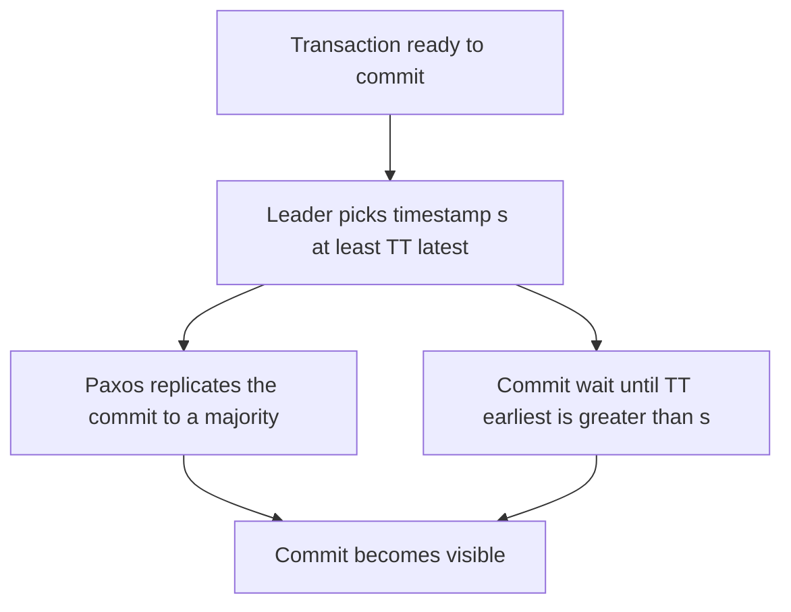

## The hook

A bank in Mumbai transfers money, and a millisecond later an auditor in New York reads the accounts. The auditor must see the transfer, in the right order, as if there were one database in one place. But the database is spread across continents, and each continent has its own clocks.

The earlier article showed that wall clocks cannot order events reliably across machines. Google's Spanner database, described by Corbett and colleagues in 2012, does it anyway. The trick is not perfect clocks. It is clocks that admit how wrong they might be, and a database patient enough to wait.

Predict what the database waits for. (Not for the network, not for disks.)

## The intuition

:::analogy
An election officer knows the official clock might be off by up to 5 minutes. Polls close at 8 pm. Before **announcing the result**, the officer **waits out the uncertainty**: until 8:05 by her clock, when she is certain that 8 pm has passed everywhere. Then nobody can claim they voted "before 8 pm" after the result was announced.
:::

That is Spanner:

- **[[TrueTime]]** says "the real time is somewhere between earliest and latest", with an **[[uncertainty bound]]** ε.
- After picking a commit timestamp, Spanner does a **[[commit wait]]**: it waits until TrueTime is certain that timestamp has passed. Then it makes the commit visible.

The answer to the hook: it waits for its own clock uncertainty to pass.

## How it works

### TrueTime

Each data centre has time masters with GPS receivers and atomic clocks; servers poll them and track how far their own clock may have drifted since. TrueTime returns an interval rather than a point. Its width is typically a few milliseconds; Spanner's design depends on keeping it small.

### Commit wait

1. A transaction acquires its locks and the leader picks a commit timestamp s no earlier than TrueTime's "latest" at that moment.
2. The leader replicates the commit through its **[[Paxos group]]** (a majority of replicas).
3. In parallel, it waits until TrueTime's "earliest" is greater than s. Only then does it release locks and report success.

Wait, why does that make order match reality? Any transaction that starts after this one is reported committed must pick a timestamp from a clock reading taken later than s is certainly past. So its timestamp is larger. Real-time order and timestamp order agree, which is **[[external consistency]]** (the same guarantee as linearizability, for transactions).

The wait costs on the order of the uncertainty, a few milliseconds, and overlaps with Paxos replication, which takes time anyway.

### Paxos groups and two-phase commit

Data is split into ranges, each replicated across zones or regions by its own Paxos group with a leader. A transaction touching several ranges uses two-phase commit across those groups' leaders. Unlike classic two-phase commit, as in [Everyone Says I Do, or Nobody Is Married](article:system-design-two-phase-commit), each participant is itself a replicated group, so a single machine failing does not leave the transaction stuck.

### Snapshot reads for free

Because timestamps are globally meaningful, a read at timestamp t sees exactly the transactions committed before t, on every replica. Read-only transactions can read a consistent snapshot from nearby replicas without locks.

:::insight
Spanner turns clock error from a hidden danger into a known number: TrueTime bounds the uncertainty, and commit wait sits out that bound before making a write visible. Timestamps then follow real time, which gives globally consistent transactions and lock-free snapshot reads.
:::

## Trade-offs

| You gain | You pay |
|---|---|
| External consistency across regions | Special time infrastructure (GPS, atomic clocks) |
| Lock-free consistent snapshot reads anywhere | Commit wait adds latency proportional to clock uncertainty |
| Non-blocking distributed transactions over Paxos groups | Writes pay cross-zone or cross-region consensus latency |
| SQL with global distribution | A complex system to build or a managed service to pay for |

Other databases borrow parts of the idea without special hardware, for example hybrid logical clocks with a configured maximum clock offset, accepting weaker guarantees or occasional transaction restarts when uncertainty matters.

:::warning
Common misconception: "Spanner works because Google's clocks are perfect." Its clocks are not perfect; they are honest about their imperfection. Correctness comes from knowing the bound and waiting it out. If the bound were wrong, the guarantee would break, which is why the time infrastructure is engineered and monitored so carefully.
:::

:::try-this
If TrueTime's uncertainty grew from a few milliseconds to 100 ms during a time-master problem, what would happen to write latency and to correctness? (Every commit would wait roughly the larger uncertainty, so write latency would rise sharply. Correctness would hold, as long as the reported bound is still true, because commit wait simply gets longer. The design trades latency, not safety.)
:::

## What can go wrong

- **Underestimated clock uncertainty** would silently break ordering guarantees; time infrastructure must be monitored and servers with bad clocks removed.
- **Cross-region writes** are slow by physics; design schemas so most transactions touch nearby data.
- **Hot ranges** concentrate on one Paxos leader; split ranges and choose keys that spread load.
- **Long transactions holding locks** block others, as in any lock-based system.

### Interview follow-ups

**"What is external consistency in one sentence?"** If one transaction finishes before another starts, the database orders them the same way, as if there were a single copy in one place.

**"Could you use the same idea without atomic clocks?"** Yes, with a larger uncertainty bound: commit waits get longer. Or use hybrid logical clocks with a maximum offset and restart reads that fall inside the uncertainty window.

**"Why are read-only transactions cheap in Spanner?"** They pick a timestamp and read a consistent snapshot from any sufficiently up-to-date replica, with no locks and no two-phase commit.

## In the real world

- Spanner runs inside Google and is offered as Cloud Spanner.
- CockroachDB and YugabyteDB, inspired by Spanner, use consensus-replicated ranges and hybrid clocks instead of specialised time hardware.

The clock problems this solves are introduced in [Watches That Never Quite Agree](article:system-design-time-ordering).

## Further reading

- Corbett et al., "Spanner: Google's Globally-Distributed Database" (OSDI 2012).
- Brewer, "Spanner, TrueTime and the CAP Theorem" (Google, 2017).

## Key takeaways

- Spanner orders transactions globally by using TrueTime, which reports the current time as an interval with a known uncertainty bound.
- Commit wait delays making a commit visible until its timestamp is certainly past everywhere, so later transactions always get larger timestamps.
- This gives external consistency: the database order matches real-time order, as if there were one copy in one place.
- Data ranges are replicated by Paxos groups, and two-phase commit across groups does not block on a single machine failure.
- The cost is specialised time infrastructure and commit latency proportional to the clock uncertainty.
