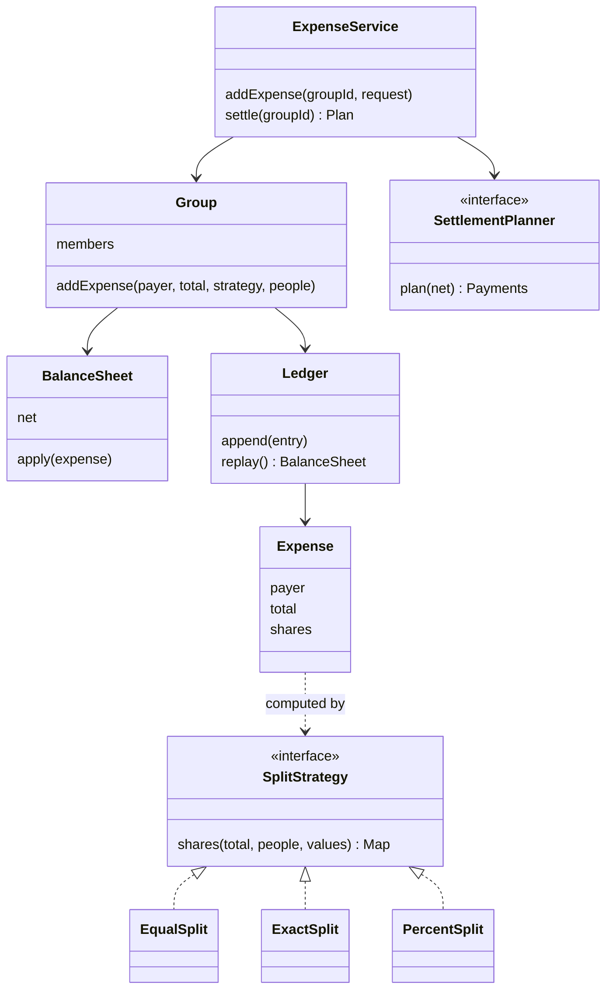

## The hook

Four friends are back from Goa. The WhatsApp group is a crime scene. Asha paid for the hotel, Bhavin for one dinner (Dev skipped it), Chitra for the airport cab with everyone paying different amounts, Dev for snacks he shared only with Asha, and Asha again for chai.

Someone writes out who owes whom, adding up everything each friend owes each other friend. The list has nine lines. Everybody owes everybody, and Bhavin and Chitra each owe the other exactly ₹300.

Here is the puzzle: how few bank transfers can settle all of it? Take a guess now. The answer turns out to be three, and getting there correctly needs two things a careless design gets wrong: money that never loses a paisa, and a simplification step with a surprising limit.

## Requirements

**Functional**

- Users, and groups of users.
- Add an expense: who paid, how much, among whom, and how to split it.
- Split types: equal, exact amounts, percentages. More types later (shares, by item).
- Show each person's balance in a group, and who owes whom.
- Simplify: suggest the fewest practical payments to settle the group.
- Record a settlement payment.

**Non-functional**

- Money is exact: shares of an expense always add up to its total.
- Two members adding expenses at once must not lose an update.
- New split types must not change existing code.

:::analogy
Think of the group as a **shared notebook of who owes whom**. Every expense is one line written in pen on the front pages: who paid, how much, who shared it. Nobody erases a line; a correction is a new line. On the back page is a running tally with one number per friend. When it is time to settle, you ignore the front pages and read only the back page, because that tally is all anyone actually needs to know.
:::

## Core objects

- **User**: id and name.
- **Group**: members, its expenses, its balances.
- **Expense**: payer, total, participants, the split used, the computed shares.
- **SplitStrategy**: Equal, Exact, Percent. Turns a total into shares.
- **BalanceSheet**: one [[net balance]] per member. The notebook's back page.
- **Ledger**: the append-only list of expenses and settlements. The notebook's front pages.
- **SettlementPlanner**: turns balances into a payment plan.
- **ExpenseService**: validates input and coordinates.

Wait, why keep both a ledger and balances? The [[ledger]] is the truth; balances are a cache of it. If a bug ever corrupts a balance, you can rebuild every number by replaying the ledger. If you kept only balances, a bad update would be permanent.

## Class design

### Money first: integer paise

Predict what this prints in most languages: `0.1 + 0.2 == 0.3`. It prints false, because binary floating point cannot represent 0.1 exactly. In a shared-expense app, those tiny errors pile up until balances no longer sum to zero, and somebody owes ₹0.0000001 forever.

Store money in [[minor units]]: integer paise. ₹1200 is 120000. Every share, balance and payment is a whole number.

Then the remainder problem appears. ₹100 among three is 10000 paise ÷ 3 = 3333 remainder 1. A fixed rule hands out the leftover paise: here, the first participants in the list get one extra paisa each. So the shares are 3334, 3333 and 3333, which add up to exactly 10000.

### Split strategies

```pseudo
interface SplitStrategy:
    shares(total, participants, values) -> map person -> paise   // or throw

class EqualSplit implements SplitStrategy:
    shares(total, people, _):
        q, r = total div len(people), total mod len(people)
        first r people get q + 1, the rest get q

class ExactSplit implements SplitStrategy:
    shares(total, people, amounts):
        if sum(amounts) != total: throw "exact shares do not add up"
        return amounts

class PercentSplit implements SplitStrategy:
    shares(total, people, pct):
        if sum(pct) != 100: throw "percentages must add to 100"
        each share = floor(total * pct / 100); leftover paise to the first person
```

Each [[split strategy]] validates its own input. ExpenseService never knows how percentages work, and adding a "by shares" split (2 shares for an adult, 1 for a child) is one new class.

### Balances and settlement

```pseudo
class BalanceSheet:
    net = map person -> paise        // sum over everyone is always 0
    apply(expense):
        for person, share in expense.shares:
            net[person] -= share
            net[expense.payer] += share

class Group:
    addExpense(payer, total, strategy, people, values):
        shares = strategy.shares(total, people, values)   // validate before any change
        lock group:
            ledger.append(Expense(payer, total, shares))
            balances.apply(expense)

class GreedySettlementPlanner implements SettlementPlanner:
    plan(net):
        creditors = max-heap of people with net > 0
        debtors   = max-heap of people with net < 0 (by amount owed)
        while creditors not empty:
            c = pop largest creditor; d = pop largest debtor
            x = min(c.amount, d.amount)
            record "d pays c x"
            push back whichever still has a remainder
```



## Key flows

### The Goa notebook, traced

Five expenses. Running net balances in rupees after each one (positive means the group owes that person):

| Expense | Paid by | Split | Asha | Bhavin | Chitra | Dev |
|---|---|---|---|---|---|---|
| E1 hotel ₹1200 | Asha | equal among all 4: 300 each | +900 | -300 | -300 | -300 |
| E2 dinner ₹900 | Bhavin | equal among Asha, Bhavin, Chitra: 300 each | +600 | +300 | -600 | -300 |
| E3 cab ₹1000 | Chitra | exact: 200, 300, 100, 400 | +400 | 0 | +300 | -700 |
| E4 snacks ₹500 | Dev | percent: Asha 40%, Dev 60% | +200 | 0 | +300 | -500 |
| E5 chai ₹100 | Asha | equal among Bhavin, Chitra, Dev: 33.34, 33.33, 33.33 | +300.00 | -33.34 | +266.67 | -533.33 |

Check the last row: 300.00 - 33.34 + 266.67 - 533.33 = 0. Because shares are integer paise that always sum to the total, the balances sum to exactly zero after every expense. That invariant is your cheapest test.

### Three ways to read the back page

| Approach | Payments | Total money moved |
|---|---|---|
| Every IOU, one per person per expense | 12 | ₹2,700.00 |
| Add up IOUs in the same direction (all of Bhavin's debts to Asha, and so on) | 9 | ₹2,700.00 |
| Net each pair (cancel Bhavin and Chitra's mutual ₹300, and so on) | 4 | ₹700.00 |
| Net balances, greedy simplification | 3 | ₹566.67 |

Here is the greedy run on the final balances:

| Step | Largest creditor | Largest debtor | Payment | Left over |
|---|---|---|---|---|
| 1 | Asha +300.00 | Dev -533.33 | Dev pays Asha ₹300.00 | Dev -233.33 |
| 2 | Chitra +266.67 | Dev -233.33 | Dev pays Chitra ₹233.33 | Chitra +33.34 |
| 3 | Chitra +33.34 | Bhavin -33.34 | Bhavin pays Chitra ₹33.34 | everyone at 0 |

Three payments, as promised in the hook. This step is called [[debt simplification]]. Notice Bhavin paid for a dinner and still ends up paying: his chai share tipped him just below zero. The simplified plan never asks who paid for what, only who is up and who is down. That is the notebook's back page doing all the work.

:::insight
Only net balances matter for settling up. Any set of payments that brings every net balance to zero is a valid settlement, so you are free to ignore who originally paid whom and search for the plan with the fewest payments.
:::

### Why greedy is good, but not perfect

Each greedy step clears at least one person completely, and the last step clears two, so a group of n people with non-zero balances needs at most n - 1 payments. That is a solid guarantee.

Here is the catch: n - 1 is not always the minimum. If some subgroup's balances already sum to zero, that subgroup can settle among itself, and each such subgroup saves one payment. The true minimum is n minus the largest number of disjoint zero-sum subgroups, and finding that is a hard partition problem (NP-hard in general). For a group of friends the numbers are small enough to search exhaustively, but most designs use greedy and say so.

:::try-this
Balances (₹): P -600, Q -500, R +200, S +400, T +500. Run greedy, largest debtor against largest creditor. How many payments? Can you do better? (Greedy: P pays T 500, Q pays S 400, then P pays R 100 and Q pays R 100, so 4 payments. Better: Q pays T 500, P pays S 400 and R 200, so 3 payments, because {Q, T} is a zero-sum subgroup that greedy missed.)
:::

### The code

`main` replays the Goa trip, shows one rejected expense, prints the balances and the simplified plan.

```cpp
#include <bits/stdc++.h>
using namespace std;
using Paise = long long;                         // integer money: 1 rupee = 100 paise

string rupees(Paise p) {
    ostringstream o; o << (p < 0 ? "-" : "") << llabs(p) / 100 << "." << setw(2) << setfill('0') << llabs(p) % 100;
    return o.str();
}

struct SplitStrategy {                           // returns each participant's share, or throws
    virtual map<string, Paise> shares(Paise total, const vector<string>& people, const vector<long long>& values) const = 0;
    virtual ~SplitStrategy() = default;
};
struct EqualSplit : SplitStrategy {
    map<string, Paise> shares(Paise total, const vector<string>& people, const vector<long long>&) const override {
        map<string, Paise> s; Paise q = total / people.size(), r = total % people.size();
        for (size_t i = 0; i < people.size(); ++i) s[people[i]] = q + ((Paise)i < r ? 1 : 0);  // first r get 1 paisa more
        return s;
    }
};
struct ExactSplit : SplitStrategy {
    map<string, Paise> shares(Paise total, const vector<string>& people, const vector<long long>& v) const override {
        if (accumulate(v.begin(), v.end(), 0LL) != total) throw invalid_argument("exact shares do not add up");
        map<string, Paise> s; for (size_t i = 0; i < people.size(); ++i) s[people[i]] = v[i];
        return s;
    }
};
struct PercentSplit : SplitStrategy {
    map<string, Paise> shares(Paise total, const vector<string>& people, const vector<long long>& pct) const override {
        if (accumulate(pct.begin(), pct.end(), 0LL) != 100) throw invalid_argument("percentages must add to 100");
        map<string, Paise> s; Paise given = 0;
        for (size_t i = 0; i < people.size(); ++i) { s[people[i]] = total * pct[i] / 100; given += s[people[i]]; }
        s[people[0]] += total - given;           // rounding leftover goes to the first person
        return s;
    }
};

struct Group {
    map<string, Paise> net;                      // positive: is owed money; negative: owes
    mutex m;
    void addExpense(const string& payer, Paise total, const SplitStrategy& how,
                    const vector<string>& people, const vector<long long>& values = {}) {
        auto s = how.shares(total, people, values);  // validate before touching balances
        lock_guard<mutex> g(m);
        for (auto& [p, amt] : s) { net[p] -= amt; net[payer] += amt; }
    }
    // Greedy: largest debtor pays largest creditor until everyone is square.
    vector<tuple<string, string, Paise>> simplify() {
        lock_guard<mutex> g(m);
        priority_queue<pair<Paise, string>> cred, debt;
        for (auto& [p, v] : net) { if (v > 0) cred.push({v, p}); if (v < 0) debt.push({-v, p}); }
        vector<tuple<string, string, Paise>> out;
        while (!cred.empty()) {
            auto [c, cp] = cred.top(); cred.pop();
            auto [d, dp] = debt.top(); debt.pop();
            Paise x = min(c, d);
            out.push_back({dp, cp, x});
            if (c > x) cred.push({c - x, cp});
            if (d > x) debt.push({d - x, dp});
        }
        return out;
    }
};

int main() {
    Group goa; EqualSplit eq; ExactSplit ex; PercentSplit pc;
    vector<string> all = {"Asha", "Bhavin", "Chitra", "Dev"};
    goa.addExpense("Asha", 120000, eq, all);                                         // hotel 1200
    goa.addExpense("Bhavin", 90000, eq, {"Asha", "Bhavin", "Chitra"});               // dinner 900
    goa.addExpense("Chitra", 100000, ex, all, {20000, 30000, 10000, 40000});         // cab 1000
    goa.addExpense("Dev", 50000, pc, {"Asha", "Dev"}, {40, 60});                     // snacks 500
    goa.addExpense("Asha", 10000, eq, {"Bhavin", "Chitra", "Dev"});                  // chai 100
    try { goa.addExpense("Dev", 30000, ex, {"Asha", "Dev"}, {10000, 10000}); }
    catch (const exception& e) { cout << "rejected: " << e.what() << "\n"; }

    for (auto& [p, v] : goa.net) cout << p << " " << rupees(v) << "\n";
    for (auto& [from, to, x] : goa.simplify()) cout << from << " pays " << to << " " << rupees(x) << "\n";
}
```

It prints the rejection, then Asha 300.00, Bhavin -33.34, Chitra 266.67, Dev -533.33, and the three payments from the greedy table. Note that addExpense computes and validates shares **before** taking the lock and touching balances, so a bad expense changes nothing.

:::warning
Common misconception: "rounding to two decimals at display time fixes floating-point money." The errors are inside the stored values, so balances drift and stop summing to zero no matter how you print them. Store integer paise, and decide explicitly who receives leftover paise in every split.
:::

### Two people, one group, one second

Asha and Dev add expenses to the Goa group at the same moment. Each request reads Asha's balance (+300), adds its own change, and writes it back. One write overwrites the other, and an expense vanishes from the balances while staying in the ledger.

The fix is to make "append to ledger and update balances" one atomic step per group: a lock per group in memory, as in the code, or a single database transaction that inserts the expense and increments balances with `balance = balance + x` rather than writing back a value read earlier. Phone apps also retry on flaky networks, so each add-expense request carries an idempotency key, as in [Pressing the Pay Button Twice Should Charge Once](article:system-design-stateless-idempotency).

## Patterns used

| Pattern | Where | Why |
|---|---|---|
| Strategy | SplitStrategy | Equal, exact and percent today; shares or itemised tomorrow |
| Strategy | SettlementPlanner | Greedy by default; an exhaustive planner for small groups |
| Factory | Building a split strategy from the request's "type" field | One place maps "PERCENT" to PercentSplit |
| Command-style ledger | Expenses and settlements as immutable entries | Edits and deletes become reversing entries, and balances can be replayed |

## Extensions

### Editing and deleting expenses

Never mutate an old expense in place. Append a reversal (the same shares with opposite signs) and, for an edit, a new corrected expense. The notebook stays in pen, the history explains every number, and balances remain the sum of the ledger.

### Balances across groups

A friend list showing "Dev owes you ₹533.33 overall" is a sum of per-group balances between two people. Keep per-group balances as the source, and compute or cache the cross-group view separately; simplification should usually stay inside a group, because people expect a group's debts to settle within that group.

### Multiple currencies

Store each expense in its own currency's minor units. Keep balances per currency, and convert only when someone asks to settle in one currency, recording the rate used as part of that settlement entry.

### Edge cases worth naming

- **Empty participant list**: reject it, or EqualSplit divides by zero.
- **Payer not among participants**: allowed. Asha paid for chai she did not drink, so her own share is simply absent.
- **Participant outside the group**: reject at the service boundary, before any strategy runs.
- **Zero or negative total**: reject; refunds are separate entries, not negative expenses.
- **Duplicate names in the list**: merge or reject, or one person gets charged twice.

### Common mistakes

- **Doubles for money**, which break the zero-sum invariant.
- **Dropping the remainder paisa** in equal splits.
- **Validating after updating balances**, which leaves half-applied expenses on errors.
- **Storing only pairwise debts**, which makes simplification and auditing painful; keep the ledger and net balances.
- **Claiming greedy is optimal**; it guarantees at most n - 1 payments, not the minimum.

### Interview follow-ups

**"What is the complexity of greedy simplification?"** With heaps, each step is O(log n) and there are at most n - 1 steps, so O(n log n) for n members, after building balances in time proportional to the total number of shares.

**"How do you prove the balances are right?"** Two invariants: every expense's shares sum to its total, and all net balances in a group sum to zero. Test both after every operation, and add a test that replays the ledger and compares with the cached balances.

**"How would you add a split by shares, like 2:1:1?"** A SharesSplit class: total × shares ÷ total shares for each person in integer arithmetic, with leftover paise assigned by the same fixed rule. Nothing else changes.

**"What happens when a member leaves a group with a non-zero balance?"** Block the exit until they are settled, or move their balance into a direct balance with the person they owe. Never just delete them, or the group's balances stop summing to zero.

Next in this track, [Design a Movie Ticket Booking System](article:system-design-bookmyshow-lld) brings concurrency to the centre: thousands of people, one seat chart, and seats that must be held but never lost.

## Key takeaways

- A Splitwise-style design keeps an append-only ledger of expenses as the truth and a per-member net balance as a cache that can always be rebuilt from it.
- Split rules such as equal, exact and percent belong in separate strategy classes that validate their own input and return shares in integer paise.
- Store money in integer minor units and hand out leftover paise by a fixed rule, so shares always add up to the total and group balances always sum to zero.
- Greedy simplification, where the largest debtor pays the largest creditor, settles any group in at most n - 1 payments, but the true minimum depends on zero-sum subgroups and is hard to find in general.
- Apply each expense to the ledger and balances atomically per group, and use idempotency keys so retried requests are not counted twice.
