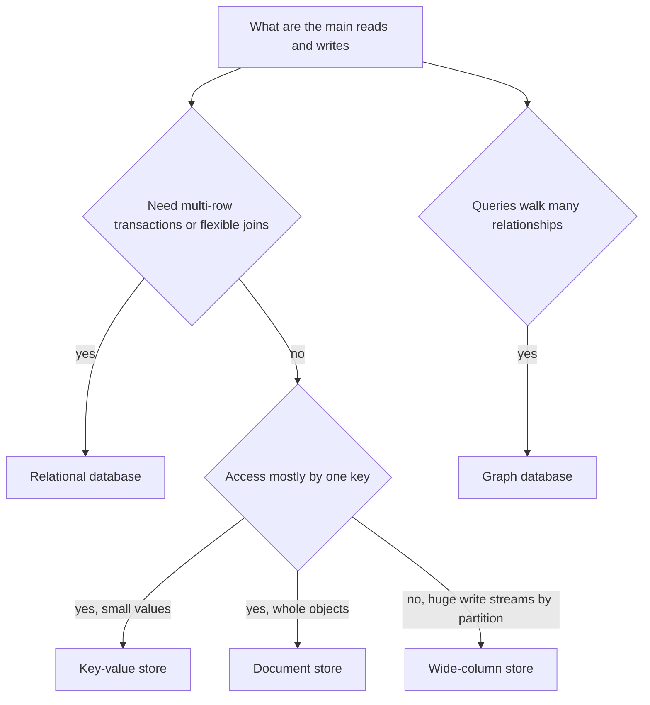

## The hook

"Which database would you use?" is asked in almost every design interview, and the weakest answers are slogans: "SQL doesn't scale", "NoSQL is faster", "just use MongoDB". Real systems at large companies run on relational databases, key-value stores, document stores and wide-column stores, often all at once.

The useful skill is not knowing a favourite. It is asking the few questions that make the right choice for each piece of data obvious.

## The intuition

:::analogy
Think about storing things in an office. A filing cabinet with labelled folders and cross-references is perfect when papers relate to each other and you search them in many ways. A wall of numbered boxes is perfect when you always fetch by box number and need it instantly. A box per customer with everything about them inside is perfect when you usually want all of one customer at once. A giant spreadsheet split across many rooms is perfect when an enormous stream of rows keeps arriving and you read them by row key in order. None is "best"; each suits a way of working.
:::

The filing cabinet is a [[relational database]]. The numbered boxes are a [[key-value store]]. The box per customer is a [[document store]]. The spreadsheet split across rooms is a [[wide-column store]].

## How it works

### The families

| Family | Shape | Strengths | Typical examples |
|---|---|---|---|
| Relational (SQL) | tables, rows, foreign keys | [[Join]]s, flexible queries, [[ACID transaction]]s, strong consistency | PostgreSQL, MySQL |
| Key-value | key → value | very fast get and put, simple to scale | Redis, DynamoDB (also document-style) |
| Document | key → nested document | whole objects in one read, flexible fields | MongoDB, Couchbase |
| Wide-column | partition key → sorted rows | huge write throughput, spread over many nodes | Cassandra, HBase, Bigtable |
| Graph | nodes and edges | many-hop relationship queries | Neo4j |

A relational database enforces a [[schema]]: you declare tables and types, and the database keeps data consistent with them. Many NoSQL stores are schema-flexible: each record may have different fields, and the application interprets them.

### The questions that decide

1. **Access patterns.** How is data read and written: by id, by range, by many filters, by walking relationships? What is the read-to-write ratio?
2. **Consistency and transactions.** Must several updates succeed or fail together, like a bank transfer? Can reads be slightly stale?
3. **Scale.** How much data, how many writes per second, how fast is it growing? Does it fit on one powerful machine with replicas?
4. **Shape of the data.** Highly relational, mostly independent objects, or append-only events? Also ask how the data will change over the next few years, because migrating between database families later is slow and risky.

:::insight
Start relational unless a specific requirement pushes you away. Relational databases give transactions, joins and flexible queries, and with indexes, replicas and careful partitioning they handle far more than slogans suggest. Choose a NoSQL store when an access pattern or scale requirement clearly matches its strengths.
:::

### Modelling differs

In a relational database, you normalise: each fact lives in one place, and joins bring it together at read time. In a wide-column or key-value store, you usually denormalise: you store data grouped exactly as each query needs it, sometimes duplicated across several tables, because joins are unavailable or expensive. In a document store, related data that is read together often lives in one document.

## Trade-offs

- **Flexibility vs scale-out simplicity.** SQL lets you ask new questions later with a new query and index. Many NoSQL stores scale writes across nodes more easily, but you must know your queries in advance.
- **Consistency vs availability and latency.** Relational databases typically offer strong consistency on a primary; many distributed NoSQL stores let you tune consistency per request, as discussed in [Why Your Like Count Can Be Wrong for a Second](article:system-design-consistency-basics).
- **Schema safety vs schema freedom.** A schema catches bad data at write time; flexible documents make change easier but push validation into application code.
- **Operational cost.** Every extra database family is another system to run, monitor, back up and upgrade. A team that knows one database deeply often beats a team juggling four it barely understands.

## What can go wrong

- **Choosing NoSQL "for scale" too early**, then needing transactions or ad-hoc queries the store cannot do well, and rebuilding them badly in application code.
- **Hot partitions** in key-value and wide-column stores when one key, such as a celebrity's id or today's date, receives most of the traffic.
- **Unbounded documents**: storing all of a user's activity inside one document until it hits size limits or becomes slow to update.
- **Joins at scale on a single SQL primary**, when growth outpaces one machine without read replicas, caching or sharding plans.

:::warning
Common misconception: "SQL databases don't scale." Single relational databases handle very large workloads, and many of the largest web companies run sharded MySQL or PostgreSQL fleets. What is harder is scaling writes beyond one machine with full cross-shard transactions and joins; that is a specific problem with specific solutions, not a reason to avoid SQL by default.
:::

:::try-this
For a ride-sharing app, pick a store for: user profiles and payments, the stream of driver location updates every few seconds, the current session token for each logged-in user, and a "riders who also took this route" recommendation feature. (A reasonable answer: relational for profiles and payments; wide-column or a time-series store for location updates; key-value for session tokens; and a graph store or precomputed tables for the recommendation, depending on how many hops it needs.)
:::

### Interview follow-ups

**"Which database for user accounts and orders?"** A relational database: you need transactions, constraints and flexible queries, and it scales further than people assume with indexes, read replicas and, later, sharding.

**"When is a key-value or wide-column store the right call?"** Huge write volumes with simple access by key, such as sessions, carts, time series or chat messages fetched by conversation id, where you know the queries up front and can model tables around them.

**"How do you shard a SQL database?"** Pick a shard key that spreads load and keeps related data together (often user id or tenant id), route queries by it, and avoid cross-shard joins. Resharding later is painful, so many systems start with more logical shards than machines.

## In the real world

Most large systems are polyglot: a relational database for core business data and money, a key-value cache in front of it, a wide-column store for huge event or messaging volumes, a search index for text queries, and object storage for files. Amazon's Dynamo paper and Google's Bigtable paper popularised the NoSQL designs that inspired DynamoDB, Cassandra and HBase, while relational databases kept improving with replication, partitioning and distributed SQL systems such as Google Spanner and CockroachDB.

## Further reading

- Martin Kleppmann, *Designing Data-Intensive Applications*, chapter 2, "Data Models and Query Languages" (O'Reilly, 2017).
- Amazon DynamoDB documentation, "NoSQL design for DynamoDB": https://docs.aws.amazon.com/amazondynamodb/latest/developerguide/bp-general-nosql-design.html
- PostgreSQL documentation, "Tutorial": https://www.postgresql.org/docs/current/tutorial.html

## Key takeaways

- Choose a database by access patterns, consistency needs, scale and the shape of the data, not by slogans.
- Relational databases offer schemas, joins, flexible queries and ACID transactions, and are a strong default.
- Key-value, document, wide-column and graph stores each optimise specific patterns: fast key lookups, whole objects, huge partitioned write streams, or relationship walks.
- NoSQL modelling usually denormalises data around known queries, because joins are limited or unavailable.
- Large systems are often polyglot, using each store for the data whose access pattern it fits best.
