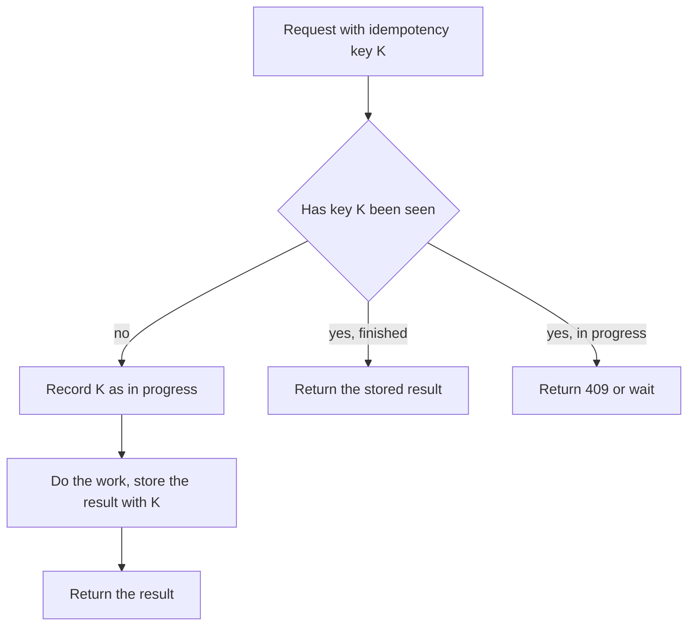

## The hook

You tap "Pay" on a train with patchy signal. The spinner turns, then an error: "Request timed out." Did the payment go through? You have no idea. So you tap again.

If the system is built well, you are charged once, and the second tap simply shows the same receipt. If not, you are charged twice, and a support ticket is born. The difference comes down to two habits every scalable system needs: keep servers stateless, and make important operations idempotent.

## The intuition

:::analogy
Think of a vending machine with an honest refund rule. Every purchase comes with a printed ticket number. If you press the button twice because nothing seemed to happen, the machine checks the ticket: "I already gave you a drink for this ticket," and gives you the same receipt instead of a second drink. And the machine itself remembers nothing about you; the ticket carries everything it needs.
:::

The ticket number is an [[idempotency key]]. A machine that remembers nothing about you between purchases, relying on what you bring, is a [[stateless service]]. Together they make it safe to retry, and safe to put many machines side by side.

## How it works

### Statelessness

A stateless server keeps no [[session state]] in its own memory between requests. Everything it needs comes from the request itself (a token, ids, parameters) or from shared storage (a database, a cache).

That one rule unlocks a lot:

- **[[Horizontal scaling]]**: a load balancer can send each request to any server.
- **Failover**: if a server dies, the next request goes elsewhere and nothing is lost.
- **Deploys**: servers can be replaced one at a time without logging anyone out.

State still exists; it just lives in a database, cache or token, not on the server.

### Idempotency

Networks fail in an annoying way: a request can succeed on the server while the response is lost on the way back. From the client's side, a timeout means "maybe". The only sensible reaction is to retry, which turns every operation into [[at-least-once delivery]]. So the server must tolerate duplicates.

Some operations are naturally [[idempotent]]: "set the address to X", "delete order 9", "read the balance". Others are not: "add 100", "create an order", "send an email". For those, the client generates a unique idempotency key and sends it with the request; the server remembers the outcome per key.

:::insight
Retries are inevitable, so duplicates are inevitable. Instead of trying to prevent duplicate requests, design the server so a duplicate does no harm: recognise it by its key and replay the first answer.
:::

### Implementation details that matter

- **Store the key and the result atomically with the effect.** If you charge the card and then crash before saving the key, a retry charges again. Save them in the same database transaction where possible.
- **Handle the in-progress case.** Two copies may arrive at once; the second should wait or get a "still processing" response, not start the work again.
- **Expire keys eventually**, for example after a day, so the table does not grow forever.
- **Scope keys to the client**, so two users cannot collide on the same key.

### Where the session goes instead

Once the server forgets, the session has to live somewhere. Two common homes:

- **A signed token held by the client**, such as a JWT in a cookie. Any server can verify the signature and read the user id without a lookup, but revoking a token early is harder.
- **A shared session store**, such as Redis, keyed by a random session id in a cookie. Every request costs a fast lookup, but logging someone out is just deleting a key.

Either way, the vending machine stays simple: it reads the ticket you hand it and remembers nothing else.

## Trade-offs

- **Stateless vs sticky sessions.** Keeping sessions in server memory (sticky sessions) is simpler at first and saves a lookup, but makes scaling, failover and deploys painful. Moving state to a shared store costs a little latency per request.
- **Idempotency storage cost.** Every non-idempotent request writes a key and result. For payments that is clearly worth it; for "like this post", a natural design such as "set liked = true" is cheaper than keys.
- **Client responsibility.** Idempotency keys only work if clients generate them once per user action and reuse them on retry, which client libraries must get right.

## What can go wrong

- **Double charges** when a payment API has no idempotency and a mobile client retries after a timeout.
- **Lost carts** when session state lives on one server and that server is replaced during a deploy.
- **Key generated per retry instead of per action**: if the client creates a new key on each retry, the server cannot tell they are duplicates.
- **Partial work**: the server performs the effect but crashes before recording the key; without a transaction or an outbox, a retry repeats the effect.

:::warning
Common misconception: "POST requests can never be retried safely." Plain POSTs are not idempotent, but a POST with an idempotency key can be retried as often as needed. Payment providers popularised exactly this pattern.
:::

:::try-this
Make these operations idempotent without a key, by changing what the request says: "add 1 to the cart quantity", "mark notification as read", "increase stock by 5". (Change "add 1" to "set quantity to 3"; "mark as read" is already idempotent; "increase stock by 5" can become "apply stock adjustment #812", recorded once by its id.)
:::

## In the real world

Payment APIs such as Stripe's accept an `Idempotency-Key` header on requests that create charges, and return the original response for repeated keys. Web applications keep sessions in signed tokens or a shared store like Redis so any server can serve any user. Message consumers in queues apply the same idea, deduplicating by message id, because queues also deliver at least once. These habits make the load balancers and retries in later articles safe to use.

## Further reading

- Stripe API documentation, "Idempotent requests": https://docs.stripe.com/api/idempotent_requests
- Brandur Leach, "Implementing Stripe-like Idempotency Keys in Postgres": https://brandur.org/idempotency-keys
- The Twelve-Factor App, "Processes" (stateless processes): https://12factor.net/processes

## Key takeaways

- Stateless servers keep no per-user memory between requests, so any server can handle any request and servers can be added or lost freely.
- State does not disappear; it moves into shared stores or tokens that every server can reach.
- Timeouts make outcomes uncertain, so clients retry, and servers must expect duplicate requests.
- Idempotent operations have the same effect when repeated; non-idempotent ones need an idempotency key with a stored result.
- Store the key, the effect and the result together, handle in-progress duplicates, and have clients reuse the same key on every retry.
